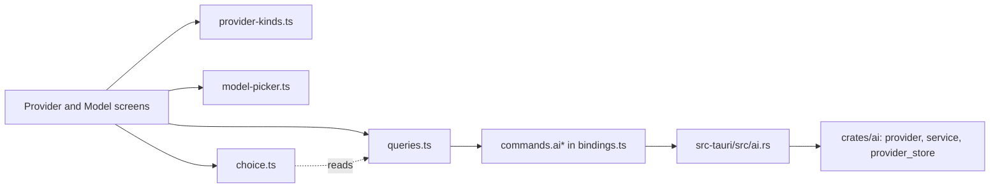
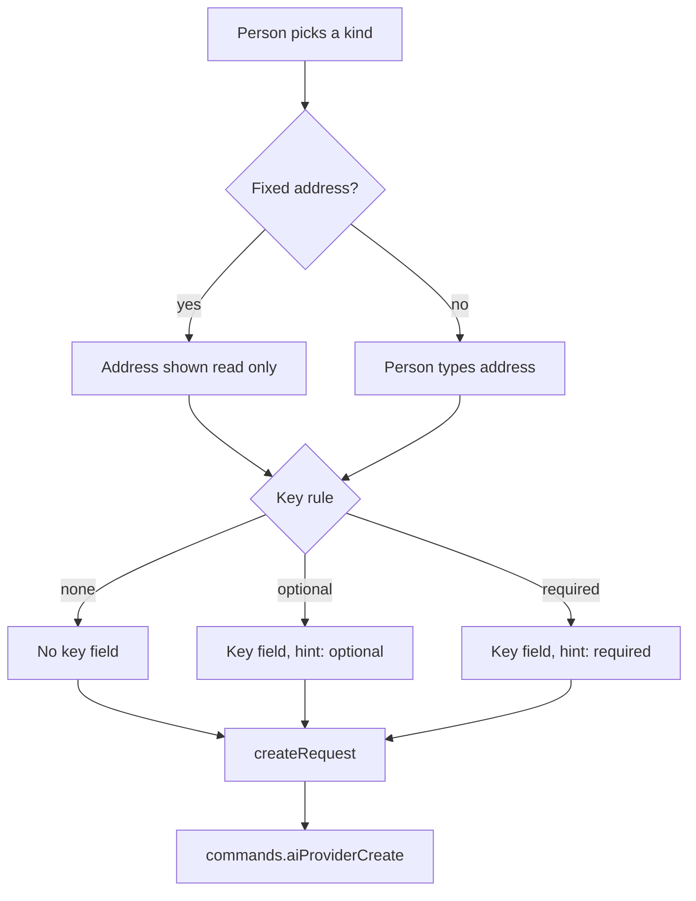
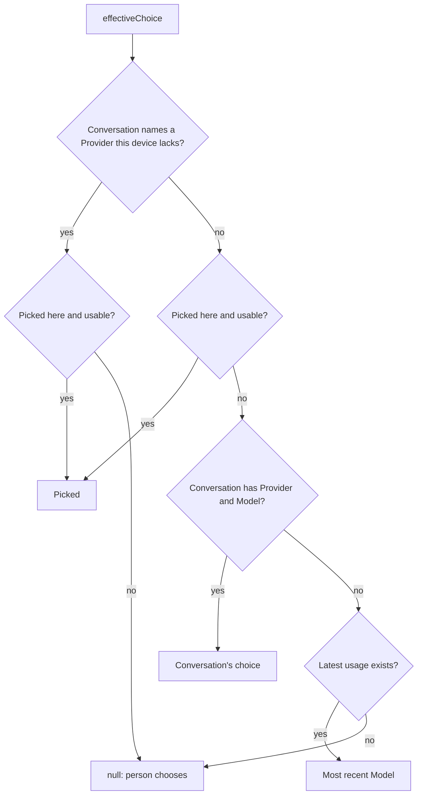
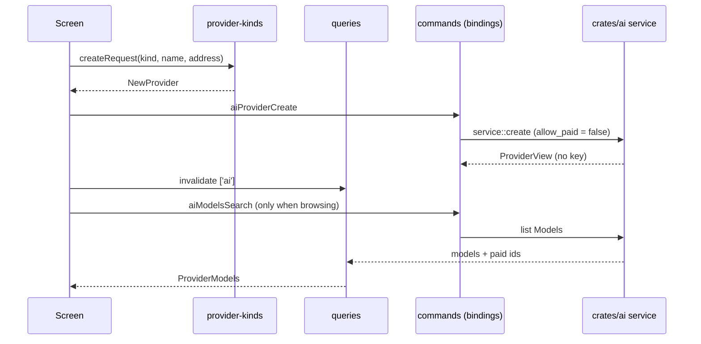

# AI Providers (client)

The AI Providers client layer is the part of the Feature Client UI that lets a person add, edit, test and remove the places a question can be asked: a Provider, and the Model chosen through it. It decides which Model a new question starts with, holds the rules for the four kinds of Provider on the screen, and caches the lists the screen reads. It does not talk to Providers itself; every change goes through the Tauri commands described in [AI Assistant Engine: AI Providers](../AI_Assistant_Engine/ai_providers.md).

Sub-pages: none. This page covers the five files below.

| File | Responsibility |
|---|---|
| `src/modules/ai/provider-kinds.ts` | Fixed facts about each kind, and the requests that add or change a Provider |
| `src/modules/ai/choice.ts` | Chooses the default Model for a new question |
| `src/modules/ai/model-picker.ts` | Search, Enter behaviour, and paid-row rules in the Model picker |
| `src/modules/ai/queries.ts` | TanStack Query options for providers, usage, Models, and conversations |
| `src/modules/ai/choice.test.ts` | Pins the default-Model order and the missing-Provider cases |

## Where it fits

The page sits between the screens and the IPC layer. Screens read and write through the query options and the pure helpers; the helpers never call the backend directly.

The Rust side owns the rules. The kind table in `provider-kinds.ts` says it "is fixed behaviour; the Rust side agrees", and the key policy, fixed addresses and paid switch were checked against `crates/ai/src/provider.rs` and `crates/ai/src/service.rs`. See [AI Assistant Engine: AI Providers](../AI_Assistant_Engine/ai_providers.md) for the backend and [AI Assistant Engine](../AI_Assistant_Engine/ai_assistant/ai_assistant_providers.md) for the command surface.

## The four kinds (`provider-kinds.ts`)

`KINDS` lists the kinds in the order the kind step shows them. Each `KindInfo` carries its name, one-line description, address, whether the address is fixed, its key rule, and whether it has paid Models.

| Kind | Address | Fixed address | Key | Paid Models |
|---|---|---|---|---|
| `wrapper` (Local AI Wrapper) | `http://127.0.0.1:8080/v1` (editable) | no | none | no |
| `openai_compatible` | empty (person types it) | no | optional | no |
| `anthropic` | `https://api.anthropic.com/v1` | yes | required | no |
| `openrouter` | `https://openrouter.ai/api/v1` | yes | required | yes |

Helpers built on the table:

- `kindOf(id)` returns the kind for a backend id. It falls back to the wrapper, but the comment says every id the backend sends is one of the four, so the fallback is never used.
- `addressFor(kind, typed)` returns the fixed address for fixed kinds, otherwise the typed address trimmed.
- `createRequest(kind, name, typedAddress)` builds a `NewProvider`. The name is trimmed. Paid Models are not part of an add.
- `updateRequest(kind, name, typedAddress, allowPaid)` builds a `ProviderUpdate`. `allow_paid` is sent as `kind.paid && allowPaid`, so it is always false for kinds without paid Models.
- `keyChip(state)` maps the key state to a row chip: `missing` gives "Needs a key" (warn), `saved` gives "Key saved" (ok), and anything else shows no chip.
- `freeOnlyNote(provider)` returns "Free Models only" for an OpenRouter Provider whose paid switch is off.
- `keyHint(rule)` gives the line under the key field. It always says the key is write-only, hidden as typed, never shown again, and stored on this device only.
- `PAID_SWITCH` holds the label and hint for the "Allow paid Models" switch.

Rust behaviour that the request builders depend on:

- `create` always stores `allow_paid = false`, so a new Provider starts with paid Models off.
- `update` drops the stored key whenever the address changes, so a key is never sent to a new address.
- `update` ignores `allow_paid` for any kind other than OpenRouter.
- `set_key` is refused for a kind with `KeyPolicy::NotNeeded` (the wrapper).

## Choosing the default Model (`choice.ts`)

`effectiveChoice(sources)` returns the Provider and Model a new question will use, or `null` when the person must pick one. The pill on the page says so in that case.

The order is:

1. The Model picked on this page since it opened.
2. The open Conversation's Provider and Model.
3. The most recently used Model on this device (`usage.recent[0]`).

A choice is used only if its Provider is on this device and its Model id is not empty. A Conversation synced from another device can name a Provider this device lacks. In that case the Conversation's choice is skipped, and so is this device's usual Model, because "this device's usual Model is not used in its place". The person picks one of this device's own Providers. A picked Model is still used even then.

The unit tests in `choice.test.ts` pin each step: picked beats conversation, conversation beats usage, nothing known gives `null`, a missing Provider gives `null` unless a picked Model is usable, and a picked choice naming a removed Provider falls through to usage.

## The Model picker (`model-picker.ts`)

- `typedModelId(query)` returns the trimmed text, or `null` when nothing is typed. Any id is accepted, not only ids the Provider lists.
- `choiceOnEnter(key, query)` returns the typed id only for Enter. This is how the "Use" row chooses a typed id from the search box.
- `matchingModels(models, query)` filters by case-insensitive substring, keeping the Provider's order. An empty query returns all Models.
- `usesOf(uses, providerId)` picks the usage rows for one Provider.
- `isFreeModel(model)` is true when the id ends with `:free`, matching the Rust rule for OpenRouter free routes.
- `modelRowState(model, { paidKind, paidIds, allowPaid })` decides a row's state. A row is paid when the kind has paid Models and either the Provider's own list marks it paid, or the id is not a free route. Recent and most-used rows are not in the Provider's list, so the id decides for them. A paid row is disabled while the switch is off, and it carries `PAID_MODEL_REASON`.

## Queries and caching (`queries.ts`)

All AI query keys start with `ai`, so one invalidation can refresh every AI query. `aiKeys` defines the keys:

| Key | Options | Notes |
|---|---|---|
| `['ai','providers']` | `providersOptions` | This device's Providers. Never carries a key. |
| `['ai','usage']` | `usageOptions` | Recent and most-used Models on this device |
| `['ai','models', id]` | `modelsOptions(id)` | Full Model list of one Provider. Fetched only when the person browses or searches. `staleTime` and `gcTime` are infinite, and retries are off. |
| `['ai','conversation', id]` | `conversationOptions(id)` | A Conversation with its entries |
| `['ai','conversations', query]` | `historyOptions(query)` | History, 30 per page (`HISTORY_PAGE`), newest first, filtered by title |
| `['ai','saved']` | `savedOptions` | Saved questions in their order |

`modelsOptions` turns a failed list into a thrown error, using the list's message. Every call goes through `unwrap` from `src/lib/ipc/unwrap`, so backend errors reach the screen as errors.

`historyOptions` computes the next page offset as the total count of items loaded so far, and stops when the last page says `more` is false.

## Data flow for adding and testing a Provider

## Related pages

- [Feature Client UI](../Feature_Client_UI.md): the parent page for this module.
- [AI Conversation (client)](ai-conversation.md): the screen that uses the default Model and the Conversation's Provider.
- [AI Assistant Engine](../AI_Assistant_Engine.md) and [AI Providers (backend)](../AI_Assistant_Engine/ai_providers.md): the Rust rules these helpers mirror.
- [AI Assistant: Providers commands](../AI_Assistant_Engine/ai_assistant/ai_assistant_providers.md): the Tauri commands behind every query and mutation here.
- [Sync Replication Engine](../Sync_Replication_Engine.md): Providers, usage and the visible branch never leave their device. That is why `choice.ts` falls back to this device's own Providers.
- [Tauri Host and IPC Bridge](../Tauri_Host_and_IPC_Bridge.md): the generated `commands` bindings and the mock backend used by tests.
- [Design System](../Design_System.md): the UI components and tokens used by the Provider screens.

## Tests

- `src/modules/ai/choice.test.ts` covers the default-Model order and the missing-Provider cases.
- `src-tauri/src/ai_provider_tests.rs` and `src-tauri/src/ai_wire_tests.rs` cover the backend rules this page depends on, such as the paid switch and key handling. Their tests are listed on the backend pages.
- The `provider-kinds.ts` and `model-picker.ts` helpers have no unit test file in this module's component list. Their behaviour is pinned through the Rust fixtures that the browser mock also uses.
