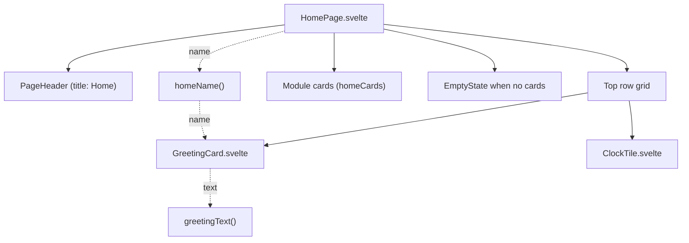
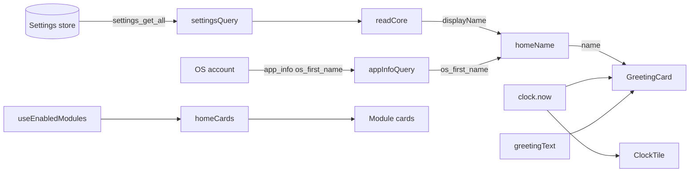
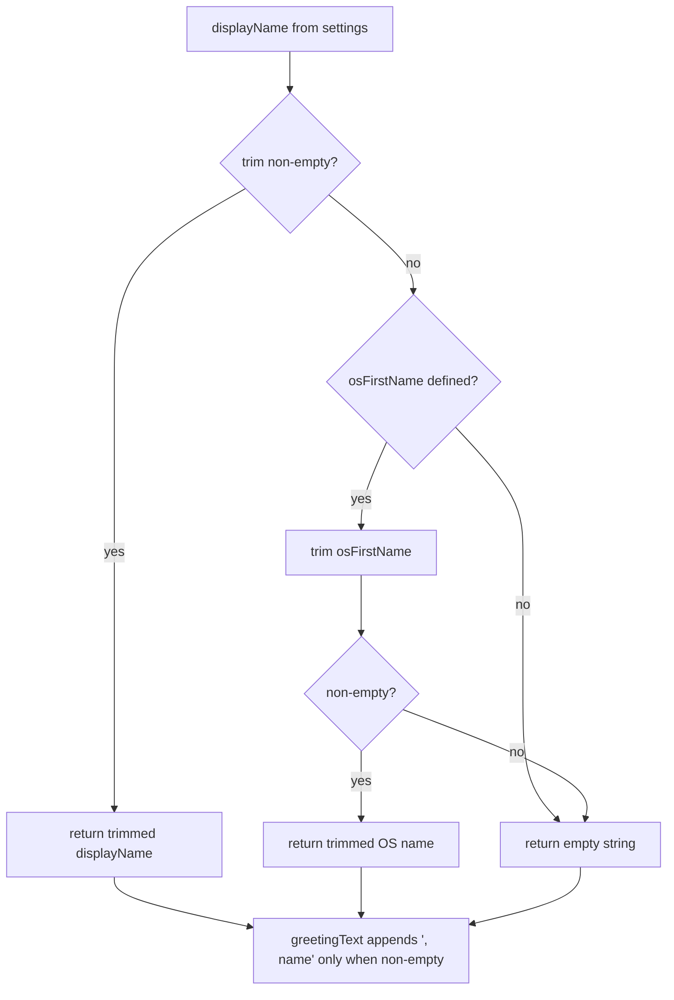

# Home Module

The Home module is the landing page of the Mnemora client UI (`src/modules/home/`). It shows a time-of-day greeting with the current date, a clock tile, and a stack of cards contributed by whichever feature Modules are enabled. The module's only unit-tested logic of its own is the choice of display name for the greeting, implemented by `homeName` in `src/modules/home/greeting-name.ts`. Everything else on the page is composition of components and helpers owned by other modules.

## Scope at a glance

| Concern | Owned here | Delegated to |
|---|---|---|
| Choosing the name shown in the greeting | `homeName` | — |
| Greeting wording and time-of-day bands | — | [time-greeting](time-greeting.md) (`greetingText`, `greetingFor`) |
| Which module cards appear and in what order | — | [Shell and Navigation](../Shell_and_Navigation.md) (`homeCards`, `useEnabledModules`) |
| Card content (Journal, To-do, etc.) | — | [Feature Client UI](../Feature_Client_UI.md) feature pages |
| Settings values (`displayName`, date/time formats) | — | [Shell and Navigation](../Shell_and_Navigation.md) settings draft and [Tauri Host and IPC Bridge](../Tauri_Host_and_IPC_Bridge.md) (`settings_get_all`, `app_info`) |
| Visual tokens (hero gradient, `--pad`, `--gap`) | — | [Design System](../Design_System.md) |

## Core component: `homeName`

```typescript
/** Display name wins; else the OS first name (already sanitised by Rust); else no name at all. */
export const homeName = (displayName: string, osFirstName: string | undefined): string =>
  displayName.trim() || (osFirstName?.trim() ?? '');
```

### Rules

1. If the user-set `displayName` is non-blank after trimming, it is used.
2. Otherwise the OS first name is used, trimmed. The comment notes that Rust has already sanitised it, so the client only trims.
3. If neither yields text (including an `undefined` OS name), the result is `''`.

The function never returns a value with surrounding whitespace in the fallback case, and never returns `undefined`. An empty result is the signal to the greeting that there is no name to show.

Test coverage lives in `src/modules/home/greeting-name.test.ts` and pins these cases: display name preferred, OS name used when the display name is blank, OS name trimmed, and empty output when both are missing or blank.

## Component structure

`HomePage.svelte` is the page; `GreetingCard.svelte` and `ClockTile.svelte` are its two top tiles, and the remaining area is filled by per-module cards.



### Page composition (`HomePage.svelte`)

- Reads `settingsQuery` and `appInfoQuery` through TanStack Svelte Query. `core = readCore(settings.data?.values)` supplies `displayName`, `dateFormat` and `timeFormat`. `info.data?.os_first_name` supplies the OS name.
- Derives `name = homeName(core.displayName, info.data?.os_first_name)`. This is the only place the module calls its own logic.
- Subscribes to the shared `clock` store (`$effect(() => clock.subscribe())`) so the greeting and clock re-render as time passes.
- Derives `cards = homeCards(enabled.list)` from `useEnabledModules()`. Each card is loaded lazily with `{#await c.load()}` and rendered with the shared `moduleContext`.
- When no module contributes a card, it renders an `EmptyState` titled "Your Modules will live here".

### Greeting (`GreetingCard.svelte`)

Receives `now`, `name` and `dateFormat` as props. It renders `greetingText(now, name)` as the `h1` and the formatted date beneath it. Its hero gradient is driven by the `--hero-from`, `--hero-via` and `--hero-to` tokens.

## Data flow



Key points:

- The display name is a user setting, so changing it in Settings is reflected on Home through the settings query cache, with no page reload.
- The OS first name is fetched once from the Rust side (`app_info`). It is only a fallback, so a user who has set a display name never sees it.
- Time is pushed by the shared clock; Home holds no timers of its own.

## Process: how the greeting name is resolved



Note the asymmetry: `homeName` returns the display name trimmed (via `trim()` in the first branch), but `greetingText` trims again defensively. Either way, a blank result yields a plain "Good morning" with no trailing comma.

## Interaction with other modules

- **Time-of-day wording.** `greetingText` and `greetingFor` in `src/lib/time/greeting.ts` map hours to morning (05–12), afternoon (12–17), evening (17–22) and night (otherwise). See [time-greeting](time-greeting.md).
- **Module cards.** Home does not know which modules exist. `homeCards` in `src/shell/enabled-modules.ts` filters the manifests to enabled modules that declare a home card, and the Journal and To-do modules contribute their cards. Disabling a module removes its card without any change here. See [Shell and Navigation](../Shell_and_Navigation.md) and the [Feature Client UI](../Feature_Client_UI.md) overview.
- **Settings and OS data.** `readCore` and the settings query come from the shared settings layer; `os_first_name` is produced by the Rust `app_info` command described in [Tauri Host and IPC Bridge](../Tauri_Host_and_IPC_Bridge.md).
- **Styling.** Hero colours and spacing come from design tokens; no raw colour values are used on this page. See [Design System](../Design_System.md).

## Where to change what

| Change | File |
|---|---|
| Fallback order for the greeting name | `src/modules/home/greeting-name.ts` |
| Greeting wording or time bands | `src/lib/time/greeting.ts` |
| Which cards appear on Home | Module manifests and `homeCards` in `src/shell/enabled-modules.ts` |
| Page layout (grid breakpoints, empty state text) | `src/modules/home/HomePage.svelte` |
| Hero look | `src/modules/home/GreetingCard.svelte` and design tokens |

## Testing

- `src/modules/home/greeting-name.test.ts` covers `homeName`.
- `src/lib/time/greeting.test.ts` covers `greetingText` at each time band and with a blank name.
- Card selection is covered by `src/shell/enabled-modules.test.ts`.
