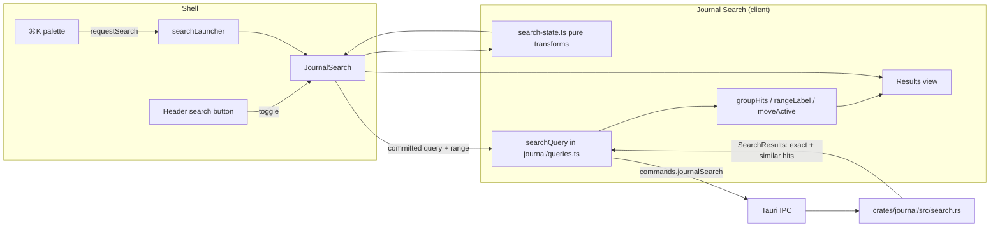
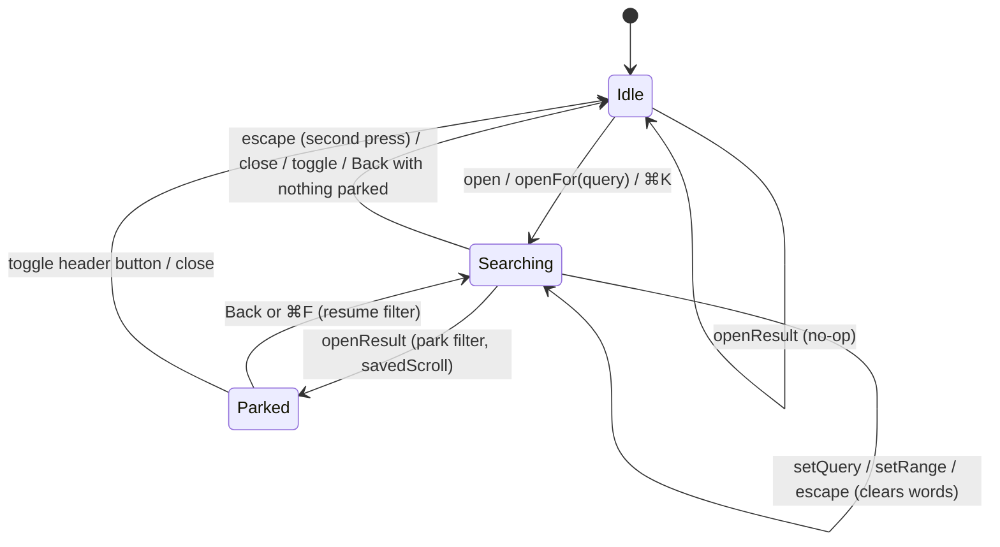
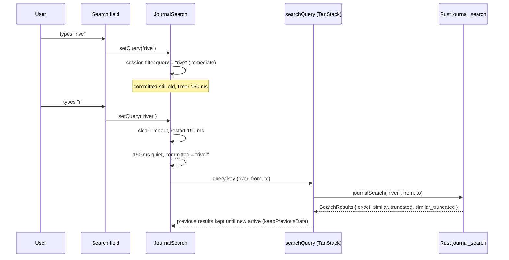

# Journal Search

The Journal Search module is the client-side search experience inside the Journal. It owns the search session (open, parked, closed), the query debounce, the Page-date range filter, and the pure helpers that turn Rust search hits into grouped, labelled results. The actual matching happens in the Rust backend (`journal_search`), which is documented in the [Journal](journal.md) module.

Search is a sub-feature of the Journal: it shares the Journal's feed, Entry model and IPC commands, and only adds its own state machine and result presentation.

## Scope

| Concern | Where it lives |
|---|---|
| Search lifecycle (open, park, Back, Esc, close) | `src/modules/journal/search-state.ts`, `search.svelte.ts` |
| Debounce and committed query | `search.svelte.ts` (`JournalSearch`) |
| Date-range presets and labels | `search-state.ts` (`presetRange`, `rangeLabel`) |
| Grouping hits by Page | `search-state.ts` (`groupHits`) |
| Cross-module entry point (⌘K) | `search.svelte.ts` (`requestSearch`, `searchLauncher`) |
| Query/cache wiring | `src/modules/journal/queries.ts` (`searchQuery`, see [journal](journal.md)) |
| Matching, ranking, snippets, typo tolerance | Rust: `crates/journal/src/search.rs`, see [journal](journal.md) and [Data_Foundation core](../Data_Foundation/core.md) |
| Rendering of the results view | Journal UI components, see [journal](journal.md) |

## Core Components

### Pure session logic: `search-state.ts`

This file has no Svelte runtime dependency; every function is a pure transform of a `SearchSession`, which makes the lifecycle testable in isolation (`search-state.test.ts`).

- **`SearchSession`** — `{ active, filter, parked }`. `filter` is the `SearchFilter` (`query` plus optional `SearchRange`). `parked` holds the filter of a search that was left by opening a result.
- **`IDLE`** — the closed state: not active, blank filter, nothing parked.
- **`openSearch` / `openSearchFor`** — open a blank search (or resume parked results), or open a search pre-filled with a palette query.
- **`openResult`** — closes search but parks its filter, so Back can return.
- **`goBack`** — resumes parked results if any, otherwise leaves search.
- **`toggleSearch`** — the header button: opens when idle; when search is active *or* parked, it leaves for good.
- **`escapeSearch`** — Esc clears the words first; a second Esc closes.
- **`withQuery` / `withRange`** — immutable filter updates.
- **`presetRange(id, today)`** — `week` (−7 days), `month` and `year` (shift back keeping the day-of-month, clamping to the shorter month's last day). Always ends on `today`.
- **`rangeLabel(range, today)`** — the date chip text: `Any date`, the preset name (`Past week`, `Past month`, `Past year`), a single day, or a span. Years are shown only when they differ from `today`'s year.
- **`canSearch(filter)`** — true when there are words (trimmed) or a range; a range alone is a valid browse.
- **`groupHits(hits, today, first)`** — groups *consecutive* hits sharing a `page_date` into `HitGroup`s, each with a human label (via `dayLabel` from `dates.ts`) and `start`, the absolute list index of its first hit (so keyboard highlight indices stay aligned across groups).
- **`moveActive(index, key, count)`** — arrow-key highlight movement; `-1` means the search field has focus. Stops at both ends and returns `-1` when there are no results.
- **Helpers**: `entriesLabel` ("1 entry" / "N entries"), `snippetText` (spans joined without marks, for screen readers), `hitDomId` (for `aria-activedescendant`).
- **Constant `SEARCH_DEBOUNCE_MS = 150`**.

### Reactive wrapper: `search.svelte.ts`

- **`JournalSearch`** — a class holding the reactive state:
  - `session` (`$state.raw`), `committed` (`$state`, the query the results follow), `savedScroll` (where the results list was when left through a result).
  - Getters `active`, `parked`, `query`, `range`.
  - Lifecycle methods mirror the pure functions: `open`, `openFor`, `toggle`, `close`, `park(scrollTop)`, `back`, `escape`.
  - `setRange(range)` — applies a date filter immediately.
  - `setQuery(query)` — the field updates at once, but `committed` follows only after 150 ms.
  - `dispose()` — clears the pending debounce timer.
  - Every state change goes through the private `#set`, which clears the timer, syncs `committed` to the filter query immediately, and resets `savedScroll` when search is fully left.
- **`searchLauncher` / `requestSearch(query)`** — a tiny reactive channel. The shell (⌘K "Search Journal for…", see [app-shell](../Shell_and_Navigation/app-shell.md)) calls `requestSearch`; the Journal, when it is showing, consumes `pending` and calls `openFor`.

## Architecture

Key points:

- The Svelte class is the only stateful piece; `search-state.ts` is pure and is the source of truth for transitions.
- Results are not stored in `JournalSearch`. They come from TanStack Query through `searchQuery`, keyed by `(committed query, from, to)`.
- The IPC boundary and `Hit`/`Span` types are generated bindings; see [IPC bridge](../Tauri_Host_and_IPC_Bridge/ipc-bridge.md).

## Search Session State Machine

Rules that the state machine enforces (each is covered by `search-state.test.ts`):

1. Closing search for good clears both the query and the date filter.
2. Opening a result never loses the query: Back returns to the exact same words and range.
3. Once parked results are resumed and then closed, nothing remains to return to.
4. The header button on parked results clears them for good; it does not resume them.
5. ⌘F (`open`) on parked results resumes them, the same as Back.

## Query Flow

Notes:

- `committed` is set immediately by `#set` for non-typing changes (range, open, escape), so those take effect with no pause. Only `setQuery` waits.
- `keepPreviousData` in `searchQuery` means the list never flashes empty while typing.
- `searchQuery` has a 30 s `staleTime`. Its query key includes the range bounds, so changing a preset refetches with the new `from`/`to`.

## Result Presentation

The backend returns two lists (see [Rust search](#backend-contract)). The client:

1. Shows `exact` hits first, then `similar` hits (typo-tolerant matches, never duplicated in `exact`).
2. Groups each list with `groupHits`, so consecutive hits from one Page share a heading (`"Thu 15 Oct"`, year added when not this year).
3. Uses `start` indices so that arrow keys (`moveActive`) walk one continuous list across groups, with `-1` as the search field.
4. Uses `hitDomId` for `aria-activedescendant` so screen readers track the highlighted row.
5. Shows `entriesLabel(count)` as the results count and `snippetText(spans)` as the spoken summary of each snippet.
6. Shows the truncation notices from `truncated` and `similar_truncated`. The backend caps exact results at 500 and similar results at 100 (newest first).

## Date Range Filter

Range is a `SearchRange { from, to, preset }` with inclusive Page dates.

- Presets (`PRESETS`): `week`, `month`, `year`. Choosing one sets `preset`, so the chip reads "Past month" even though the dates are computed.
- Custom ranges have `preset: null` and the chip shows the two dates.
- Ranges are validated in Rust: both must be valid Page dates and `from ≤ to`, or the call fails with a validation error.
- A range with no words is a valid browse: every Entry in the range is returned, newest first.

The calendar used to pick custom dates is shared with the date pickers; see [date pickers](../Design_System/date-pickers.md) (`src/lib/ui/calendar.ts`).

## Backend Contract

The client depends only on this contract, implemented by `crates/journal/src/search.rs::search` and exposed as the `journal_search` command in `src-tauri/src/journal.rs`.

| Input | Meaning |
|---|---|
| `query` | Words are all required and match by prefix; quoted text is an exact phrase |
| `from`, `to` | Optional inclusive Page dates |

| Output field | Meaning |
|---|---|
| `exact` | Entries matching every word/phrase, newest first, max 500 |
| `similar` | Entries matching only when a word may contain a typo; never also in `exact`; max 100 |
| `truncated`, `similar_truncated` | Whether each list was cut at its limit |
| `Hit.snippet` | A text window with matched spans marked |

Query parsing (`Term`, `parse`) is part of the shared search core; see [Data_Foundation core](../Data_Foundation/core.md). The backend never logs query text.

## Integration With the Rest of the Journal

- **Entry point from the shell.** ⌘K "Search Journal for…" calls `requestSearch(query)`. The Journal takes `searchLauncher.pending` and calls `openFor`. Header button calls `toggle`. Routing and palette wiring are described in [app shell](../Shell_and_Navigation/app-shell.md).
- **Opening a result.** A result click calls `park(scrollTop)` and navigates to the Entry's Page. Back restores search with the same filter and scroll position. Entry-level focus and flashing belong to the Journal navigation; see [journal](journal.md).
- **Data consistency.** Search reads live Entries only. Deleted Entries stay in the index for undo but are never returned. Search results refresh through the same invalidation as the feed, so edits made in the Journal appear in results after the query next runs. See [journal](journal.md) for write paths.
- **Sync.** Search has no sync state of its own; results reflect whatever the Journal's Entry data holds after a sync. See [Sync Replication Engine](../Sync_Replication_Engine.md).

## Testing

Unit tests live beside the pure logic and need no Svelte runtime:

- `src/modules/journal/search-state.test.ts` covers presets (including month-end clamping and year crossings), range labels, the search session lifecycle (open, park, Back, ⌘F resume, header toggle, Esc), `groupHits` indices, and arrow-key movement.
- The Rust search behaviour is tested in `crates/journal/src/search.rs` (the migration that indexes older Entries, and deleted-entry filtering).

Run them with `make test` (Vitest, via `package.json`). The build and lint entry points are described in [Build and Packaging](../Build_and_Packaging.md).

## Extending the Module

- Add a new preset: extend `PresetId` and `PRESETS`, then add a branch in `presetRange`. `rangeLabel` picks up the label automatically.
- Change the debounce: edit `SEARCH_DEBOUNCE_MS`. Tests do not depend on the value.
- Add a new way to enter search: call `session` transitions through `JournalSearch` rather than writing `session` directly, so `committed` and `savedScroll` stay consistent.
- Keep transitions in `search-state.ts` pure, and add their rules to `search-state.test.ts`.
