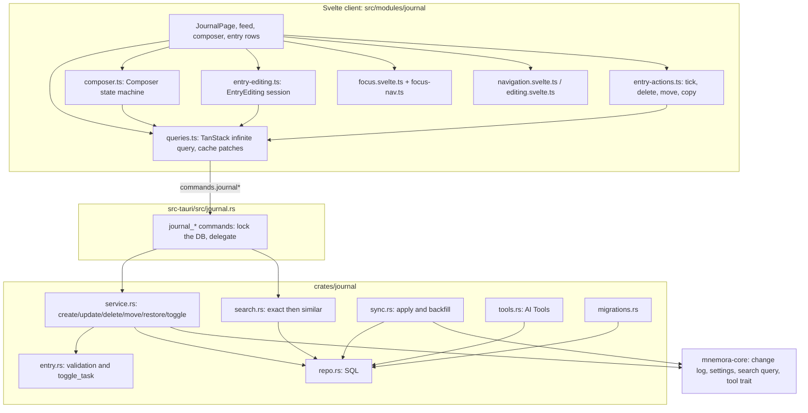
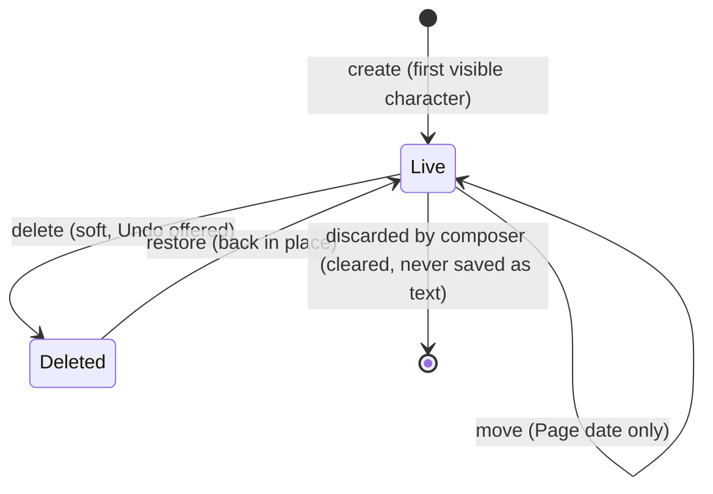
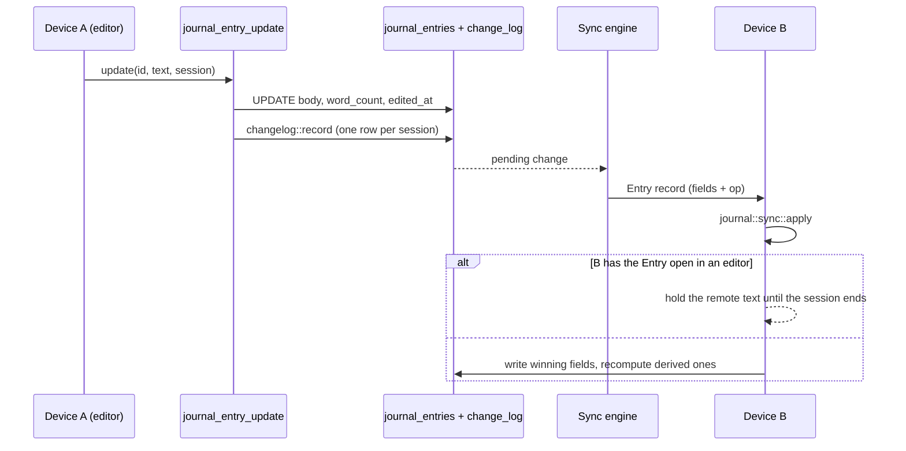
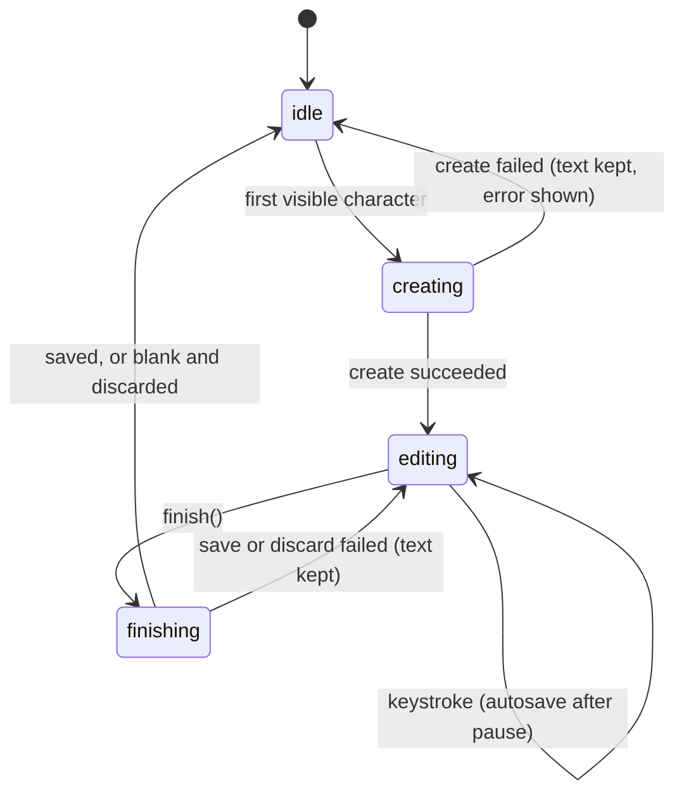
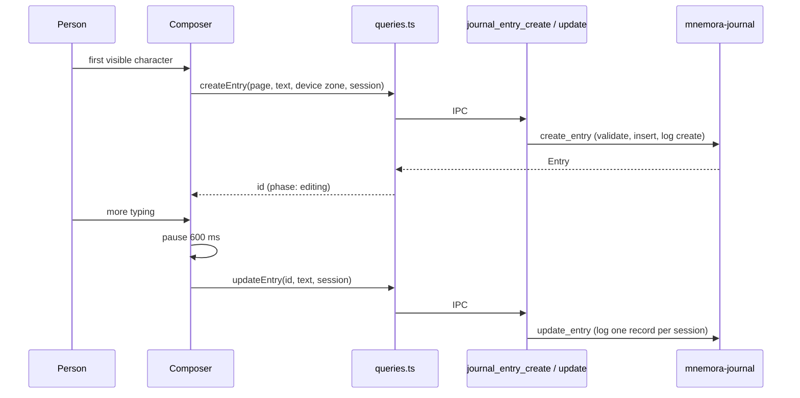
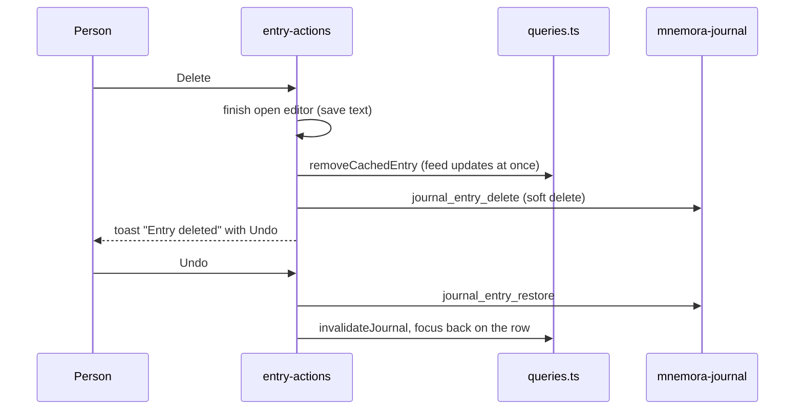

# Journal Module

The Journal is Mnemora's diary. Writing is organised by **Page** (one calendar date, `YYYY-MM-DD`), and each Page holds any number of untitled **Entries**, each a Markdown piece of writing with its own written moment, time zone and UTC offset. This page documents the whole Journal feature across its Rust crate (`crates/journal`), its Tauri command layer (`src-tauri/src/journal.rs`) and its Svelte client (`src/modules/journal`). Shared infrastructure it depends on (change log, settings registry, migrations, sync contract) is documented in [Data_Foundation](../Data_Foundation.md) and is not repeated here.

## Scope and responsibilities

| Concern | Where it lives |
|---|---|
| Entry and Page rules (blank text, real dates, zones, task toggling) | `crates/journal/src/entry.rs` |
| SQL against `journal_entries` | `crates/journal/src/repo.rs` |
| Full-text and fuzzy search | `crates/journal/src/search.rs` |
| Receiving Entries from other devices | `crates/journal/src/sync.rs` |
| Read-only AI tools | `crates/journal/src/tools.rs` |
| IPC commands (thin wrappers) | `src-tauri/src/journal.rs` |
| Feed paging, cache patching, composer, editing, focus, navigation | `src/modules/journal/*` |

Sub-pages:

- [Journal search](journal-search.md): the search UI state and result grouping.

Related module documentation:

- [Data_Foundation](../Data_Foundation.md): change log (`changelog::record`), settings registry, migrations and `backup_now`.
- [Sync_Replication_Engine](../Sync_Replication_Engine.md): how the `Entry` entity merges between devices, and the editing "hold" that defers remote edits to an open editor.
- [AI_Assistant_Engine](../AI_Assistant_Engine.md): consumes the `journal_list`, `journal_read` and `journal_search` tools.
- [Tauri_Host_and_IPC_Bridge](../Tauri_Host_and_IPC_Bridge.md): how the `journal_*` commands are registered, and the `JournalChangedEvent` / `JournalEntryDeletedEvent` broadcasts.
- [Shell_and_Navigation](../Shell_and_Navigation.md): routing (`/journal`), bare keys (`N`, `J`, `/`), palette actions and the phone tab.
- [Design_System](../Design_System.md): the markdown editor, date pickers and tokens (`--hue-journal`, `--day-today`).
- [Task_and_Journal_Domain_Services](../Task_and_Journal_Domain_Services.md): the sibling To-do module that shares the same change-log and search conventions.

## Architecture

The crate exposes its rules through `JournalModule` (`crates/journal/src/lib.rs`), which implements the core `Module` trait: `migrations`, `register_settings`, `sync_entities`, `holdings`, `backfill_log`, `tools`, `apply_remote` and `on_startup`. The Tauri layer never holds rules; each command locks the database and calls a function such as `mnemora_journal::create_entry`.

## Data model

`journal_entries` (migration 1, `crates/journal/src/migrations.rs`) is a `STRICT` table keyed by a UUIDv7 `id`:

| Column | Meaning |
|---|---|
| `page_date` | `YYYY-MM-DD` the Entry sits on. Changes only by a move. |
| `body` | Markdown text. |
| `written_at`, `written_offset_min`, `written_tz` | The written moment as one group. Never changes after creation. |
| `edited_at` | When the text was last meaningfully edited. Null until an edit beyond the grace period. |
| `word_count` | Words in the body, without Markdown symbols. Derived. |
| `created_at`, `updated_at` | Row times. `updated_at` moves on every change, including delete and restore. |
| `deleted_at` | Soft delete. Deleted rows stay in the table for Undo and for the change log. |

Index `journal_entries_page` covers `(page_date, written_at)` for live rows.

Migration 2 adds the search index: an external-content FTS5 table `journal_fts` over `body` (diacritics removed, prefix indexes 2 and 3), a `journal_fts_vocab` table for fuzzy word lookup, and triggers that keep the index in step on insert, update of `body`, and delete. Deleted Entries stay indexed so Undo works; queries filter on `deleted_at`. The index is keyed on the implicit rowid, which `VACUUM` may renumber, so the migration notes that `journal_fts` must be rebuilt after any `VACUUM`.

### Entry lifecycle

## Business rules

Rules are enforced in `crates/journal/src/entry.rs` and `service.rs`, and surfaced as `JournalError` (mapped to `validation`, `not_found` or `internal` codes at the crate boundary):

- **Blank text is refused.** `validate_text` rejects whitespace-only bodies. A blank composer never creates anything.
- **Dates are real calendar dates.** `validate_page_date` accepts only `YYYY-MM-DD` with leap-year-aware day counts. Future dates are allowed.
- **Zones are sanity-checked, not resolved.** `validate_written_zone` accepts a non-empty IANA name up to 64 characters and an offset within ±14 hours. The zone is stored as given.
- **Task toggling is exact.** `toggle_task` flips the `[ ]`/`[x]` marker on one 0-based line, but only where the line matches the Markdown task grammar (bullet `-`, `*`, `+` or number, optional quote marks and indent, then the box). Everything else in the body is left byte-for-byte.
- **Edited mark grace.** An update within ten minutes of the written moment (a typo fix) does not set `edited_at`. A checklist tick never sets it either.
- **Deleted Entries are inert.** Update, toggle and move all return `not_found` for a deleted id; restoring brings the Entry back to the same Page and position.

## Command surface

`src-tauri/src/journal.rs` exposes these commands. Each one is thin and returns `AppError` on failure:

| Command | Purpose |
|---|---|
| `journal_entry_create` | Create an Entry on a Page; takes the device zone, offset and composer session id. |
| `journal_entry_update` | Replace text; `session_id` groups autosaves in the change log. |
| `journal_entry_toggle_task` | Tick or untick a checklist line. |
| `journal_entry_delete` / `journal_entry_restore` | Soft delete and restore. |
| `journal_entry_move` | Change the Page date. |
| `journal_pages` | Cursor-paged Pages, newest first (`older`, `from`, `newer` directions). |
| `journal_month_days` | Dates with live Entries in a month, for calendar dots. |
| `journal_search` | Search with optional inclusive date range. |
| `journal_today` | Count and latest snippet for a date, for the Home card. |

Paging, by direction (`PageDirection`):

- `older`: Pages strictly before the cursor.
- `from`: the cursor's own Page and older (used to open the feed at a far date).
- `newer`: the nearest Pages above the cursor, returned newest first (needs a cursor).

Pages are returned newest first with Entries oldest first. Every write path also appends to the change log through `mnemora_core::changelog::record`, with the snapshot of the full row, so the Journal's history survives restarts (see [Data_Foundation](../Data_Foundation.md)).

## Search

`crates/journal/src/search.rs::search` runs in two stages:

1. **Exact.** Query words are parsed by the shared `mnemora_core::search::query::parse`. Every word is required and matches by prefix; quoted text is a phrase. The FTS expression matches up to 500 Entries (`MAX_EXACT`), newest Page first.
2. **Similar.** Only if the exact stage can be widened: vocabulary words within the tolerance of each query word are read from `journal_fts_vocab`, and Entries matching the expanded expression, but not already in `exact`, are returned, up to 100 (`MAX_SIMILAR`). Tolerance is one typo for words of 4 to 7 letters and two for 8 or more; shorter words are never fuzzy.

With a date range and no words, every live Entry in the range is returned. Invalid dates, or a start after the end, are validation errors. Snippets are built by the crate's `snippet` module as plain-text spans with matches marked. Search never writes to the change log, and query text never reaches a log line.

## Sync

The Journal registers one sync entity, `Entry` (`crates/journal/src/sync.rs`). The contract, defined in [Sync_Replication_Engine](../Sync_Replication_Engine.md), is declared per field:

| Field | Merge kind | Notes |
|---|---|---|
| `body` | Text | Newest wins for now; the engine decides, this file only writes what it is given. |
| `page_date` | Value | Moving on one device and editing on another both stand. |
| `written_at`, `written_offset_min`, `written_tz` | Value, one group | Written atomically so a creation always arrives whole. |
| `created_at`, `deleted_at` | Value | A delete beats nothing by itself. |
| `edited_at`, `word_count`, `updated_at` | Derived | Recomputed locally, never sent. |

`apply` checks every received unit before writing. A record for an unknown Entry that lacks its creation fields is kept for relaying only. A bad unit (blank body, impossible date, bad zone) is dropped whole while the good ones stand. When a remote delete arrives for an Entry that was live, an `EntryDeleted` event is emitted so an open editor can say so. `backfill` logs rows that predate the change log, stamped with their `updated_at`.

The Journal's `holdings` reports the live Entry count, used by the sync and settings screens.

## Settings

`register_settings` in `lib.rs` adds three Journal Preferences, validated by the core registry:

- `journal.font`: `serif` (default) or `sans`.
- `journal.width`: `narrow`, `default` (default) or `wide`.
- `journal.page_summary`: boolean, default true; shows the "N entries · N words" line in Page headers.

The client reads them through `readJournal` and `columnWidth` in `src/modules/journal/settings.ts`, which narrow values and fall back to defaults. Column widths are in rem (about 60, 72 and 90 characters of body text).

`on_startup` runs `upgrade::keep_existing_phone_tabs`, so an upgrade keeps the Journal in the phone tab bar where the person had it.

## AI tools

`crates/journal/src/tools.rs` implements three read-only tools that the AI Assistant calls (see [AI_Assistant_Engine](../AI_Assistant_Engine.md)):

- `journal_list`: Entries between two dates, newest first, 30 by default and at most 100, with `next_offset` paging. Returns a preview, never full bodies.
- `journal_read`: one Entry's full text, eight kilobytes at a time, continued with `offset`.
- `journal_search`: the app's own search, exact matches first, ten by default and at most 25.

Tools skip deleted Entries, never write, and return refusals as data (`Output::error`). Their item lists let the AI cite an Entry by id.

## Client architecture

### Feed and paging

The feed is a TanStack infinite query (`pagesQuery` in `queries.ts`) over `journal_pages`. Without an anchor it starts at the newest Pages and pages older. With an anchor (a jump to a far date) it starts `from` that date, so only the Pages around it load; older Pages arrive on scroll down and newer ones are prepended on scroll up (`paging.ts`: `firstParam`, `olderParam`, `newerParam`). The previous window stays visible while the next loads.

`feed.ts` turns loaded Pages into rows:

- `buildFeed` inserts Today as an empty Page once the window reaches it, keeps future Pages above Today, and places a month divider where the month changes, never at the top.
- `openIndex` opens on Today when future Pages exist, else at the top.
- `pageAt` reads which Page a row belongs to, for the date-jump and header.
- `upcomingCount` counts future Pages, driving the "↑ Upcoming" pill (`showUpcomingPill` in `dates.ts`). The "↑ Today" pill (`showTodayPill`) appears once a screen below Today.

Cache edits avoid refetching while the user is typing. `patchEntry` replaces one Entry in every cached window after an inline save; `removeCachedEntry` takes an Entry out at once on delete, dropping a Page that becomes empty. `invalidateJournal` is used only once the composer is finished, so the feed never jumps mid-write.

### Composer

`Composer` (`composer.ts`) is the box at the top of Today's Page. Its life is `idle → creating → editing → finishing → idle`:

- The first visible character creates the Entry; later typing autosaves after `SAVE_PAUSE_MS` (600 ms).
- Each composer session has one `session_id`, so the change log holds one record per session.
- Saves run one after another through an internal queue.
- `finish()` flushes pending text and starts a new session. A blank composer creates nothing. Clearing an Entry already created and then finishing discards it through `journal_entry_delete`, so the Journal never keeps a blank row.
- A failed create or update keeps the text, reports it, and retries on the next keystroke or Retry.
- The date chip (`setPageDate`) sets the Page for new Entries and moves an Entry already created, in order with its pending saves.

### Editing an existing Entry

`EntryEditing` (`entry-editing.ts`) is a session for one Entry: typing autosaves after the same pause, every save carries the session id, and blank text is never saved, so clearing an Entry and leaving keeps the last saved text. `abandon()` is used when the Entry is deleted elsewhere: nothing more is saved and the unsaved text is handed back. `restoreWithDraft` (`entry-remote-delete.ts`) then restores the Entry and appends what was typed on top, without overwriting the restored text.

`Editing` (`editing.svelte.ts`) is the Journal-wide state shared through context: which Entry is open (others dim), the focused editor (for the phone key bar), the Entry the composer just finished (`arrived`, so it plays its arrival once), and the writing font and spellcheck. Opening another Entry first finishes the current one, and stays put if that save fails.

### Actions

`entry-actions.ts` holds the row actions:

- `tickTask` patches the cached Entry at once and puts it back if the write fails.
- `deleteEntryWithUndo` finishes any open editor, removes the Entry from cache, deletes it, and offers Undo for a few seconds. Restore re-fetches and calls `onrestored` so focus returns.
- `moveEntryToDate` moves through the ⋯ menu and offers a "Show" action that scrolls to and flashes the Entry in its new place.
- `moveEditedEntry` moves from the editor's own date chip. The editor stays open, pending text is saved first, and nothing moves if that save fails.
- `copyEntryText` copies the Markdown.

### Keyboard focus

Desktop keyboard focus across Entries is a pure reducer in `focus-nav.ts` (`focusReducer`) that takes events such as `up`, `down`, `edit`, `stop-edit`, `from-composer` and `deleted`. `EntryFocus` (`focus.svelte.ts`) wires it to the loaded Entries and to the DOM through callbacks `JournalPage` registers. ↓ past the end sets `wantsMore` and loads older Pages; ↑ from an empty composer lands on the last Entry of Today, or of the newest earlier Page. Deleting the focused Entry moves focus to the next one, or the previous at the end.

### Navigation and scrolling

`JournalNav` (`navigation.svelte.ts`) carries cross-component pointers: the Entry or Page header currently flashing (`flashEntryFor`, `flashPageFor`, timed to fade), the composer's date chip, the week start, and the registered `scrollTo(date, entryId?)` function. `writeOn(date)` moves the chip and focuses the composer, which is how a calendar day becomes a new Entry on that Page.

The Calendar (`useMarkedDays` in `marked-days.svelte.ts`) loads `journal_month_days` for the displayed month and its two neighbours, only while the picker is open. `calendarStart` opens it on the month of the Page in view.

`launcher.svelte.ts` queues requests from outside the Journal (`compose`, `go-to-date`) until the Journal is showing. `search.svelte.ts` (documented in [journal-search](journal-search.md)) owns the search overlay and its requests.

### Routing, shell and the Home card

`manifest.ts` registers the module with the shell: the `/journal` route, the nav order, the Journal settings section, the bare keys `N` (new Entry from anywhere, via `compose`), `J` (go to the Journal) and `/` (search while the Journal is on screen), and palette actions for new entry, search, go to date, and "Search Journal for…" with the typed query. See [Shell_and_Navigation](../Shell_and_Navigation.md).

The Home card uses `todayQuery(date)`, which calls `journal_today`, and `todayCardText` (`today-card.ts`) turns the count and latest snippet into the quote and "Today · N entries" line, or "Nothing written today".

### Deletes from other devices

`followEntryDelete` checks whether a remote `journal_entry_deleted` event concerns the Entry open in the editor. If so, `remoteDeletedMessage` names it by its Page date ("‘Wed 21 Oct’ was deleted on Pixel 8"), because an Entry has no title.

## Process flows

### Create and autosave

### Delete with Undo

## Testing

- Rust unit tests live beside the code: `entry.rs` (task toggling, calendar dates), `error.rs` (wire codes), `search.rs` (migration indexes pre-existing rows), `sync.rs` (received units are checked and bad ones dropped).
- Command-level behaviour is tested in `src-tauri/src/journal.rs`: blank and invalid input, page ordering and paging, edit grace, change-log sessions, delete and restore, move, month days, search tolerance and snippets, the Today summary, preferences, and retention through restart.
- The shared rule fixture `src/lib/ipc/fixtures/journal-rules.json` is run both by the Rust suite and by the browser mock (`mock-journal.test.ts`) so the two stay in step.
- Client tests cover the state machines and pure logic: `composer.test.ts`, `entry-editing.test.ts`, `feed.test.ts`, `focus-nav.test.ts`, `paging.test.ts`, `queries.test.ts` (paging against a simulated backend), `today-card.test.ts`.

## Maintenance notes

- Never run `VACUUM` without rebuilding `journal_fts` afterwards; the FTS index is keyed on rowid.
- Keep the body out of logs. Search and entry text must not reach a `tracing` line.
- Any new Entry field that can change must be declared in `sync::ENTRY` with its merge kind, or other devices will not receive it.
- Do not change the written-moment group independently; it must arrive whole.
- Adding a command means adding a thin wrapper in `src-tauri/src/journal.rs`, the typed binding, and the matching client function in `queries.ts`.
