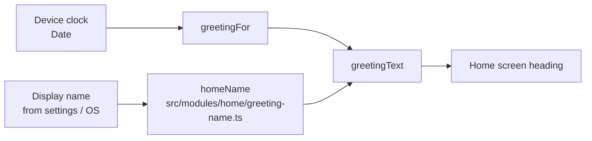
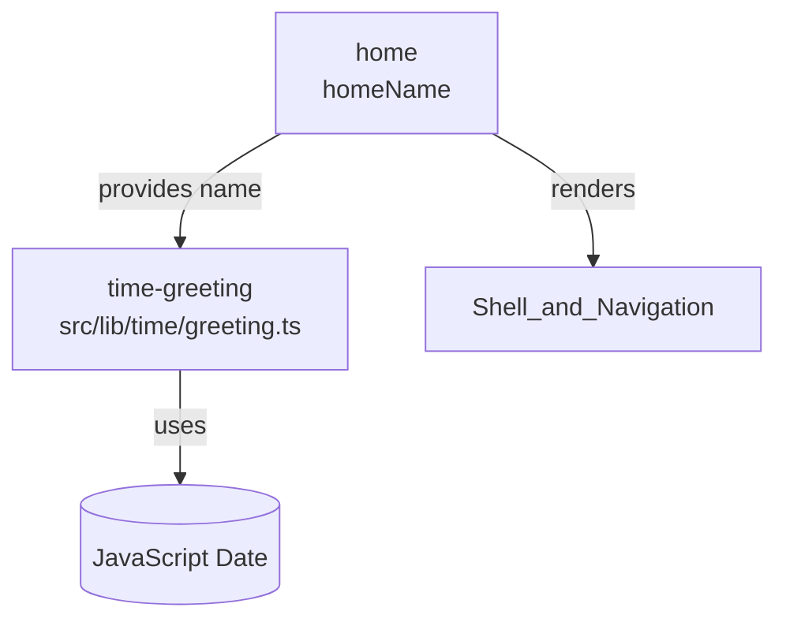
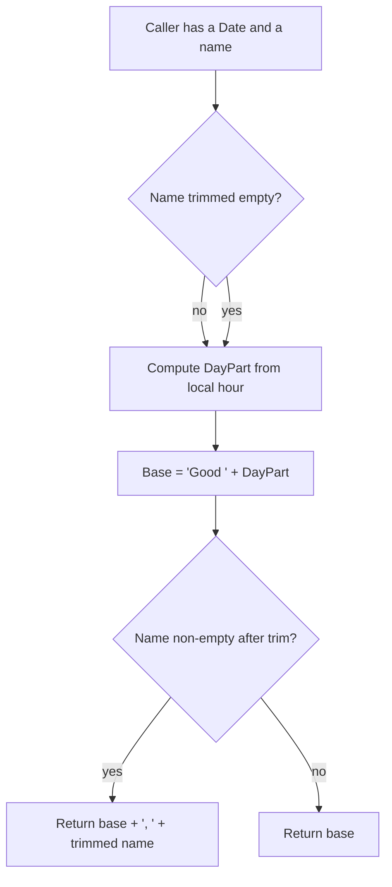

# time-greeting

The `time-greeting` module is a small, pure client-side utility that turns the current time and an optional person's name into a greeting such as `Good morning, Hemang`. It lives in the shared time library `src/lib/time/` and is consumed by the Home screen through the [home](home.md) module. It is part of the [Feature_Client_UI](../Feature_Client_UI.md) area and has no runtime dependencies beyond the browser `Date` API.

## Purpose

The Home screen opens with a personal greeting. The greeting needs two decisions:

1. **Which part of the day is it?** Derived from the device's local hour.
2. **What name, if any, follows the greeting?** Trimmed; omitted entirely when blank.

Both decisions are isolated in two exported functions so that the rules can be tested without rendering any UI.

## Module Layout

| File | Role |
|---|---|
| `src/lib/time/greeting.ts` | Implementation: `DayPart` type, `greetingFor`, `greetingText` |
| `src/lib/time/greeting.test.ts` | Unit tests for the hour boundaries and name handling |

The module is intentionally stateless. It holds no stores, performs no I/O, and never caches the result, so a caller that re-evaluates it on each render always gets the current part of the day.

## Core Components

### `DayPart`

```ts
export type DayPart = 'morning' | 'afternoon' | 'evening' | 'night';
```

The closed set of parts of the day. Callers that need to style or branch on the period should use this type rather than comparing raw strings.

### `greetingFor(date: Date): DayPart`

Maps the local hour of `date` to a `DayPart` using `date.getHours()`.

| Local hour (inclusive start, exclusive end) | Result |
|---|---|
| 05:00 – 11:59 | `morning` |
| 12:00 – 16:59 | `afternoon` |
| 17:00 – 21:59 | `evening` |
| 22:00 – 04:59 | `night` |

The hour is read in the device's local time zone, not UTC. A user travelling across time zones therefore sees the greeting that matches their wall clock.

### `greetingText(date: Date, name: string): string`

Builds the full greeting:

- Base is always `Good <dayPart>`.
- `name` is trimmed. If the result is non-empty it is appended as `, <name>`; otherwise the base is returned on its own.

```ts
greetingText(new Date(2026, 9, 20, 9, 0), 'Hemang'); // "Good morning, Hemang"
greetingText(new Date(2026, 9, 20, 23, 0), '  ');     // "Good night"
```

Only whitespace-only names are dropped. The function does not truncate or escape the name; any sanitising is the rendering layer's job.

## Behaviour Under Test

`greeting.test.ts` pins the contract with fixed local times on 20 October 2026:

- Every boundary of the table above is checked at both sides (for example `4:59 → night`, `5:00 → morning`, `21:59 → evening`, `22:00 → night`, `0:00 → night`).
- A name is included when present.
- A blank or whitespace-only name yields just `Good night` at 23:00.

Because the tests construct `Date` objects with local-time constructors, they are independent of the machine's time zone.

## How It Fits the System



- The **name** is resolved by [home](home.md) (`homeName`), which prefers the user's display name and falls back to the operating-system first name. `greetingText` itself never reads settings or the OS.
- The **time** comes from the caller, which passes a `Date` in. This keeps `greetingText` deterministic and testable.
- Rendering and styling belong to the [Design_System](../Design_System.md) and the Home page; this module returns only a plain string.

### Dependency Flow



The module has no dependency on other Mnemora modules, so it can be reused by any screen that needs a time-of-day salutation.

## Sibling Utility

`src/lib/time/` also contains `relative.ts`, which exposes `relativeTime` for "5 min ago"-style labels. It is a separate concern with its own tests (`relative.test.ts`) and is not part of this module's API. The two share only the directory and the convention that time helpers take an explicit `Date` (and, for relative labels, an explicit `now`) so they stay testable.

## Process Flow



## Maintainer Notes

- **Changing a boundary** (for example moving "evening" to start at 18:00) must update the table in this document, the doc comment on `greetingFor`, and the `it.each` cases in `greeting.test.ts`.
- **Adding a new part of the day** requires extending `DayPart` and every `switch`/branch that consumes it; the union type makes the compiler surface those places.
- **Localisation** is not supported. The English strings are inline in `greetingText`; translating them would mean moving the phrases into the i18n layer rather than editing this function piecemeal.
- Keep the function free of side effects. The `now` value is intentionally a parameter, so do not add a default `new Date()` here as `relativeTime` does unless the test strategy changes.
