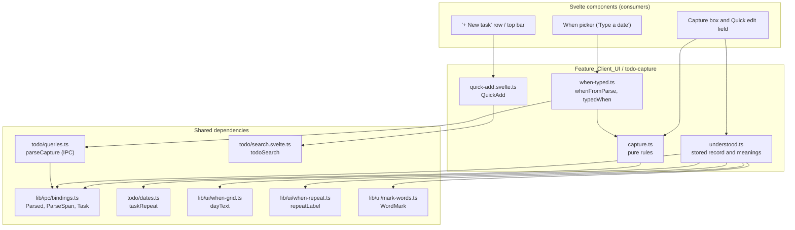
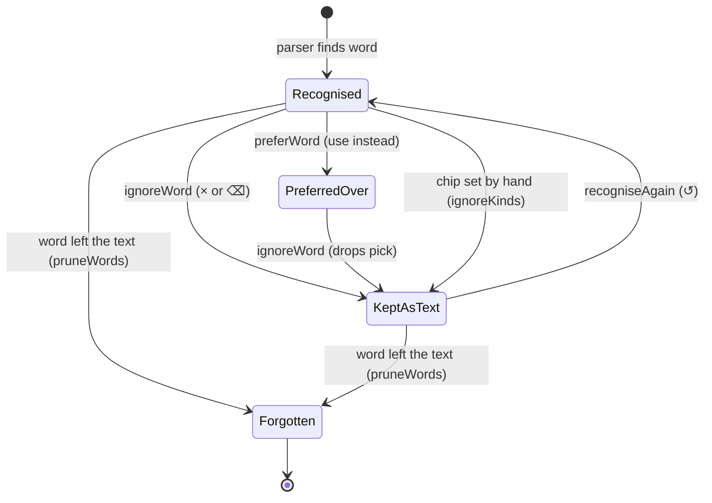
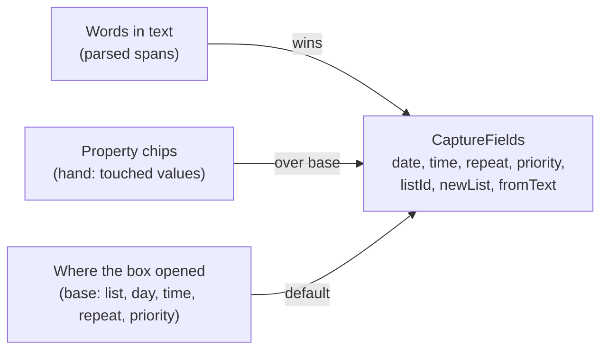
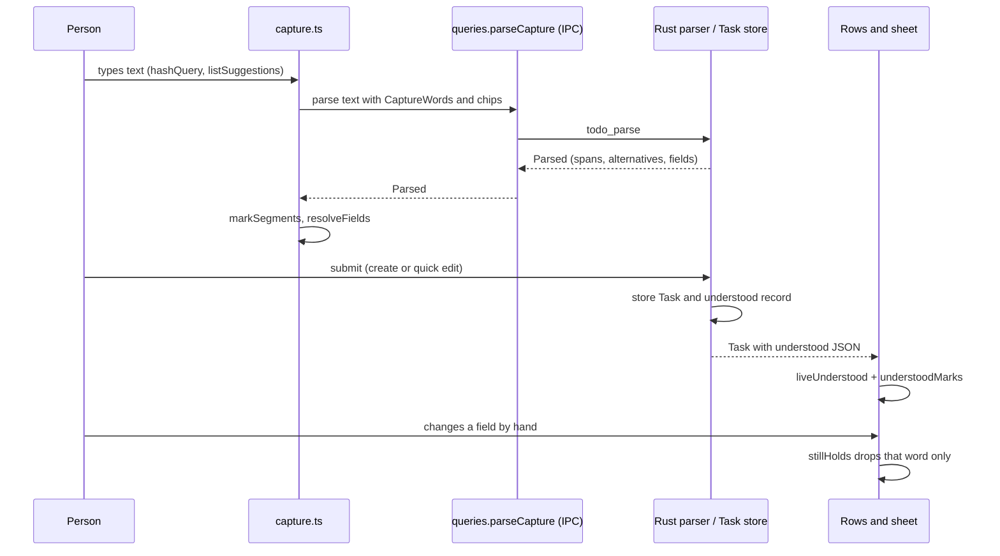
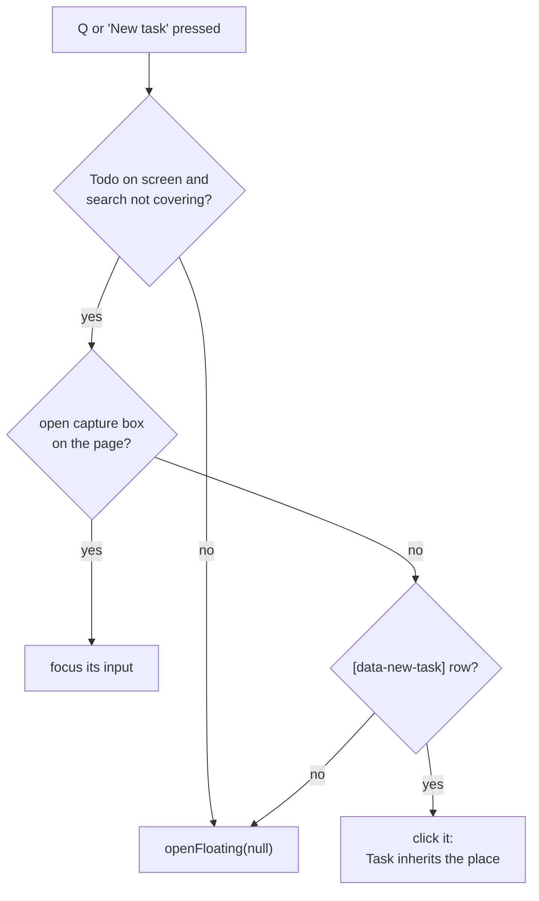

# Todo Capture (client)

The Todo capture module is the client-side logic behind the Task capture box: the single-line field where a person types a Task such as `Pay rent tomorrow 9am p1 #Home`, and the Quick edit field that changes an existing Task's title. It decides which typed words the parser recognised and how the person can override them, how `#List` tags are completed, how multi-line pastes are split, how typed words and property chips combine into the final fields of a Task, and what the parser's understanding of a title is stored and shown as.

The module is made of pure TypeScript helpers (no Svelte component state, no IPC calls) plus two small state holders. The parsing itself happens in Rust; this module only consumes the parser's result.

Related pages:

- [Feature_Client_UI](../Feature_Client_UI.md): parent client feature overview.
- [Todo tasks](todo-tasks.md) and [Todo task editing](todo-task-editing.md): the Task rows and sheet that the capture box feeds and that Quick edit belongs to.
- [Todo search](todo-search.md): the other Todo input surface.
- [Task and Journal Domain Services / Todo](../Task_and_Journal_Domain_Services/todo.md): the Rust parser (`parse`, `rule`), Task creation and `todo_parse` / `todo_task_quick_edit` commands.
- [Android Integration / Widget](../Android_Integration/widget.md): the Android Quick add widget repeats these rules natively (see [Cross-platform parity](#cross-platform-parity)).
- [Design System / Date pickers](../Design_System/date-pickers.md) and [UI kit](../Design_System/ui-kit.md): the When picker and the components that render the capture box.

## Purpose

A person can type a Task in natural language. The Rust parser recognises words that mean a date, a time, a Repeat, a Priority or a List. This module answers the questions that surround that recognition:

| Question | Answered by |
| --- | --- |
| Which recognised words should be kept as plain text instead of acted on? | `ignoreWord`, `recogniseAgain`, `ignoreKinds`, `pruneWords` |
| What does ⌫ right after a recognised word do? | `backspaceTarget` |
| How is a `#List` tag typed and completed? | `hashQuery`, `listSuggestions`, `suggestionKey`, `applySuggestion`, `foldTag`, `tagOf` |
| Which parts of an old title must not be parsed again on Quick edit? | `unchangedRanges` |
| What happens to a multi-line paste? | `pasteParts` (capture), `pasteIntoTitle` (Quick edit) |
| Which words are highlighted behind the field? | `markSegments` |
| What fields does the new Task actually get? | `resolveFields` |
| What is stored as the record of understood words, and when does it stop applying? | `understood.ts` |
| What does a "Type a date" entry mean? | `whenFromParse`, `typedWhen` |
| Where does the floating or in-place capture box open? | `QuickAdd` |

## Module structure

The four files have no dependency on each other except `when-typed.ts`, which uses `parseCapture` from `queries.ts` and `whenFromParse`'s logic in the same file, and `understood.ts`, which only reads types and display helpers. `capture.ts` is deliberately free of imports other than the generated bindings, so it can be tested with plain fixtures.

## Core concepts

### Recognised words and decisions about them

The parser returns `Parsed` with `spans` (the words that won), `alternatives` (words that lost a conflict), and the resolved `date`, `time`, `repeat`, `priority`, `list_id` and `new_list`. Each span has a stable `key` (for example `date:tomorrow:1`), a `kind` (`date`, `time`, `repeat`, `prio`, `list`), character offsets and the word text.

The person can change how a word is treated. That decision is held as a `CaptureWords` value:

- `ignored`: keys of words **kept as text**. A word in this list is not acted on.
- `prefer`: per kind, the key of the word chosen over the winner ("use instead").

Rules encoded in `capture.ts`:

- `ignoreWord` keeps a word as text (the × on its chip, or ⌫ right after it) and forgets any "use instead" pick for that same word.
- `recogniseAgain` reads a kept word again.
- `preferWord` replaces the earlier pick of the same kind.
- `ignoreKinds` is used when a property chip is set by hand: every word of those kinds in the text becomes text, and any "use instead" for those kinds is dropped, so the chip is not overruled by the words.
- `pruneWords` forgets decisions about keys that are no longer in the text. A key that disappears and reappears is treated as new, so the decision is not carried over.

### ⌫ right after a recognised word

`backspaceTarget` implements a two-step backspace. With a caret (no selection) right after a recognised word, or after that word plus one space, the first ⌫ returns the word's key so the caller can keep it as text. The caller passes `justUnrecognised`; when it is true, the next ⌫ deletes as usual. Mid-word carets, selections and carets far from a word fall through to normal editing.

### `#List` tags

- `hashQuery(text, caret)` finds the `#tag` being typed at the caret. The `#` must start the text or follow whitespace, the caret must be at the end of the word, and the next character must be whitespace or the end. Digits-only tags are still tags here, but see below.
- `listSuggestions(query, lists)` matches List names by folded prefix (accents and case removed, see `foldTag`). Exact matches come first. If no List matches, it offers a new List named after the query, except when the query is empty or only digits (so an issue number such as `#123` never offers a new List).
- `tagOf(name)` spells a List name as a tag by dropping characters that are not letters, digits, `_` or `-` (`Side projects` becomes `Sideprojects`, `R&D` becomes `RD`).
- `suggestionKey` maps keys while suggestions show: ↑/↓ move with wrap-around, Enter and Tab accept (Shift+Enter is left alone, so Enter never adds the Task while suggestions are open), Escape dismisses.
- `applySuggestion` replaces the typed `#query` with `#tag` and a trailing space, and returns the new caret. Because the text is replaced rather than appended, accepting by Tab, Enter or click always yields exactly one tag.

### Quick edit: which words to read again

When an existing Task's title is edited, the parser must not read words the person did not change. A week-old `tomorrow` should not suddenly move the date again. `unchangedRanges(oldText, newText)` returns the stretches of the new text that are untouched old words: the common prefix and the common suffix, trimmed to whole-word boundaries in both texts. Only the rest is parsed. Changed words are never frozen, and an empty old title freezes nothing.

### Pasting

- **Capture** (`pasteParts`): a multi-line paste becomes one Task. The first non-blank line is the title (trimmed, capped at 500 characters); the remaining lines, joined with `\n`, are the notes. Any part of the first line over the title limit spills into the notes. A paste without a line break, or of blank lines only, is left to the field (`null`).
- **Quick edit** (`pasteIntoTitle`): the lines are trimmed, blank ones dropped, joined with single spaces and inserted at the selection. The insertion is cut to the room left under the 500-character limit. A paste without a line break, or of blank lines only, returns `null`.

The difference is intentional: in capture, the rest of a paste is notes; in Quick edit, the title is the only text field, so everything stays in it.

### Highlight behind the field

`markSegments(text, spans)` cuts the text into plain and recognised stretches so the field can paint a highlight behind recognised words. Spans are sorted; overlapping spans or spans outside the text are ignored.

### What the Task gets: `resolveFields`

`resolveFields(parsed, hand, base)` produces the fields a Task is created with, applying precedence:

1. **Words in the text win** over a property chip.
2. **A chip wins** over where the box opened (`base`).
3. **Where the box opened** is the default: the List, the day, the time, the Repeat and the Priority of the view it was opened in.

Specific rules:

- A `date` set by words replaces the inherited date. If there is no date span, the inherited date is kept; if the box opened with no day at all, the parser's own date suggestion is used.
- A `time` with no date keeps the day the box opened on, so a time typed inside an Upcoming day stays on that day. Only a box that opened with no day takes the parser's today-or-tomorrow.
- A `list_id` from the words wins. A `new_list` (a `#Name` that matches no List) sets `newList` and clears `listId`, so the List is created when the Task is added.
- `hand` distinguishes "not touched" (`undefined`) from "cleared" (`null`); a chip set to `null` clears the inherited value.
- `fromText` lists the kinds the typed words set, which the UI uses to show "Understood as" marks.

## Understood words: the stored record

When a Task is captured or Quick-edited, the words the parser understood are stored with it as JSON in `Task.understood`. The record is an array of `{ word, kind, value }`:

| kind | value |
| --- | --- |
| `date` | `YYYY-MM-DD` |
| `time` | `HH:MM` |
| `repeat` | the Repeat as JSON (`freq`, `every`, `days`, `mode`) |
| `prio` | the Priority number as text |
| `list` | the List's id (not its name) |

`parseUnderstood` reads it back and treats anything unreadable as no record, and `serializeUnderstood` writes `null` for an empty record.

### The drift rule

A word is **still understood** only while the field it set still has the value it set. `stillHolds` compares each kind to the Task's current fields. If the person changes the date, time, Repeat, Priority or List by hand, that word stops being underlined, and the others remain. A month Repeat is compared without its days, because for non-weekly Repeats the day is the Due date's own and moves with the date. A weekly Repeat keeps its days in the comparison. A Task with no record has no live words.

`liveUnderstood` applies this rule to the stored record. `understoodMarks` turns the live words into `WordMark`s for the title, with a tooltip of the form `Understood as Wed 21 Oct · 20:00`; words that share their text (such as `tonight`, which is both a date and a time) share one mark.

### Meanings

`meaningText(kind, value, cx)` says each value in the user's terms: dates through `dayText`, times through `formatHm` with the 12h or 24h setting, Priority as `P1`–`P4`, Repeat through `repeatLabel`, and a List by its current name, or `a List that is gone` when the id no longer resolves. `spanMeaning` does the same for a freshly parsed span, showing a new List as an offer (`New list “Garage”`).

### Creating the record

`understoodFromSpans(spans, listId)` stores the winning spans. A List is stored by id, supplied by the `listId` callback (which can resolve a List created in the same action). A span whose value resolves to `null` is skipped.

### After a Quick edit

`mergeUnderstood(old, fresh, title, fields)` keeps an old word only if all three hold: its kind is not set again by new words, its text is still in the title (case-insensitive), and it still holds on the edited Task. New words are appended. A new word of a kind replaces the old words of that kind, because the field it described has changed.

## When picker: "Type a date"

`whenFromParse(text, parsed)` decides whether typed text means a date, a time or both, and nothing else. It returns `null` (the picker says it cannot read the text, rather than guessing) when:

- the parser found nothing, or found alternatives (two dates to choose from);
- any span is not a date or time (a Repeat, a Priority, a List);
- any non-space, non-punctuation character of the text is not covered by a span.

Otherwise the result takes the date (if a date span exists) and the time (if a time span exists). A time alone returns no date even though the parser guesses one, so the day of the box is kept. `tonight` is one word that is both a date and a time, and is accepted as both.

`typedWhen(text, ctx)` calls `parseCapture` with empty words and no chips, then applies `whenFromParse`.

## Opening the capture box: `QuickAdd`

`quickAdd` is a singleton `QuickAdd` with three reactive fields: `floating` (the floating box is open), `date` (the day a Task added there is due) and `listId` (the List it goes to).

`request(inTodo)` is called for the Q shortcut and the top bar's "New task":

1. If Todo is on screen and search does not cover the page, it looks for an already-open capture box (`[data-capture-box] input`) and focuses it.
2. Otherwise it clicks the first `[data-new-task]` row on the page, so the Task inherits that place (Today, a List, an Upcoming day).
3. If neither exists, or Todo is not on screen, it opens the floating box with no day and no List (the Inbox).

`openFloating(date, listId)` opens the floating box with a day and/or List, used by Home's Add button (today) and the phone's + button (the view it was pressed in). `close()` resets all three fields.

## Interaction summary

| Gesture | Effect | Rule |
| --- | --- | --- |
| Type a word the parser recognises | Highlighted behind the field | `markSegments` |
| ⌫ right after a recognised word | Word is kept as text | `backspaceTarget`, `ignoreWord` |
| ⌫ again | Ordinary deletion | `justUnrecognised` |
| × on a chip, or ↺ | Keep as text / read again | `ignoreWord`, `recogniseAgain` |
| "Use instead" on a word | Chosen over the winner of its kind | `preferWord` |
| Set a property chip by hand | Words of that kind become text | `ignoreKinds` |
| `#` then letters | List suggestions | `hashQuery`, `listSuggestions` |
| Enter / Tab on a suggestion | Tag completed once | `suggestionKey`, `applySuggestion` |
| Paste several lines into capture | First line is title, rest notes | `pasteParts` |
| Paste several lines into Quick edit | Joined with spaces into the title | `pasteIntoTitle` |
| Quick edit of a title | Old words not parsed again | `unchangedRanges` |

## Cross-platform parity

The test files state that the Android Quick add widget repeats these helpers natively (`CaptureRules.kt`, with a JUnit test running the same fixture), and that the Rust port (`crates/todo/src/quick_add.rs`) runs the shared cases. The shared fixtures are `src/lib/ipc/fixtures/capture-ui.json` and `capture-resolve.json`. Any change to a rule here must change the fixture, the Kotlin port and the Rust port together; see [Android Integration / Widget](../Android_Integration/widget.md).

## Testing

Tests are colocated and use the shared fixtures:

- `capture.test.ts`: word decisions, ⌫ behaviour, `#List` suggestions and completion, Quick edit freezing, paste rules, `resolveFields` precedence, and the `capture-resolve` fixture.
- `capture-ui.test.ts`: runs `capture-ui.json` against every helper in `capture.ts`, so the Kotlin port can run the same cases.
- `understood.test.ts`: record round-trip, the drift rule per kind, meanings and tooltips, record creation, and merging after Quick edit.
- `when-typed.test.ts`: which typed texts count as a date, a time or both.

Run them with `make test` (Vitest, see [Build and Packaging](../Build_and_Packaging.md)).

## Known boundaries

- The module does not call the parser for capture suggestions; `parseCapture` is called by the Svelte components and by `typedWhen`. The helpers here take the parser's output as input.
- `pasteParts` and `pasteIntoTitle` deliberately differ; a change to one is not a change to the other.
- Titles are capped at 500 characters on the client; Rust enforces the same limit.
- Understood records are only a display and a drift guard. They never change the Task's fields.
