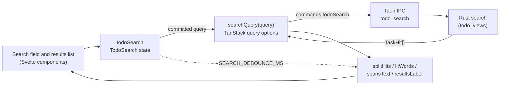
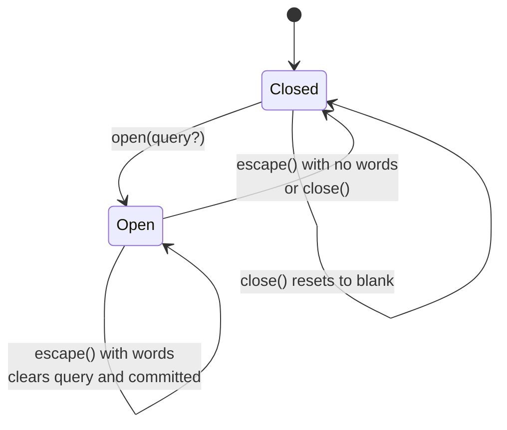
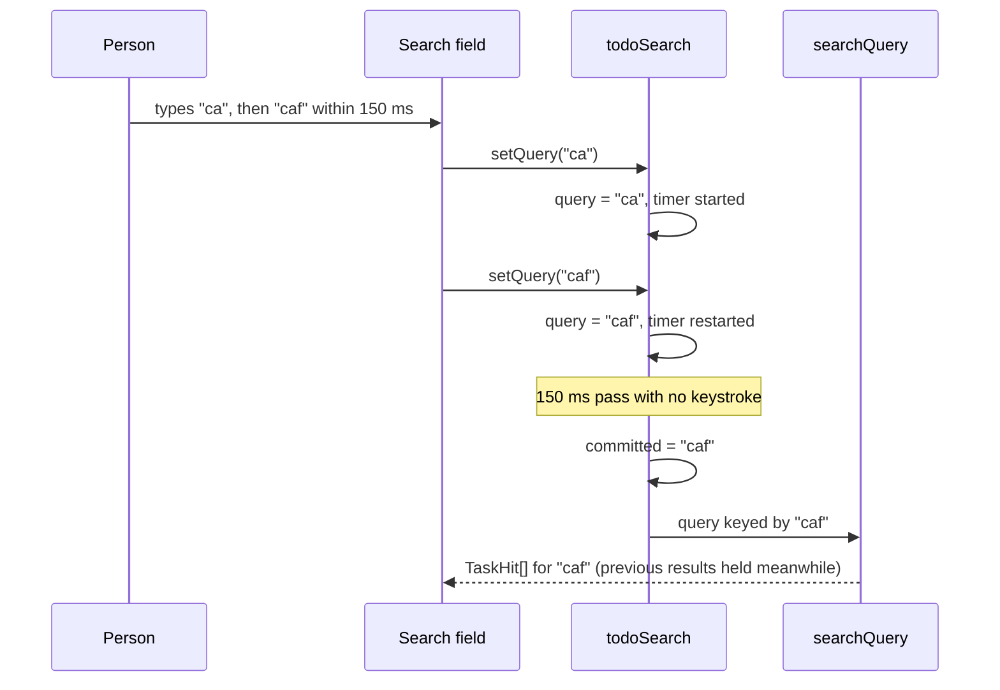
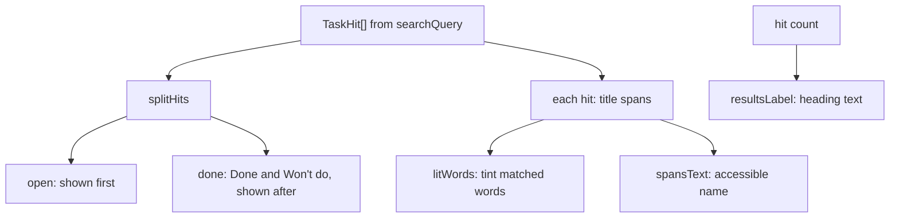

# todo-search

Client-side search for Todo: the search field, the debounced query state, the query cache entry, and the helpers that split, tint and label the results. The search itself runs in Rust; this module only decides what to ask for, when to ask, and how to show the answer. See [Feature_Client_UI](../Feature_Client_UI.md) for the parent feature and [todo-tasks](todo-tasks.md) and [todo-capture](todo-capture.md) for the sibling Todo modules.

## Purpose

Todo search lets a person type words and see every matching Task, in any state, grouped so that open Tasks come first. This module owns four things:

| Concern | Component | File |
|---|---|---|
| Search session state (field text, committed query, debounce) | `TodoSearch` / `todoSearch` | `src/modules/todo/search.svelte.ts` |
| Result shaping (open vs done split, tinting, labels, readiness check) | `splitHits`, `litWords`, `spansText`, `resultsLabel`, `canSearch`, `SEARCH_DEBOUNCE_MS` | `src/modules/todo/search-results.ts` |
| Cached IPC query for results | `searchQuery` | `src/modules/todo/queries.ts` |
| Tests for the pure helpers | `hit` fixture and `splitHits`/`litWords`/`canSearch`/`resultsLabel` tests | `src/modules/todo/search-results.test.ts` |

The Rust side (the `todo_search` command, the search and its index, and the Rust tests) is documented in [Task_and_Journal_Domain_Services/todo_views.md](../Task_and_Journal_Domain_Services/todo_views.md) and [Task_and_Journal_Domain_Services/todo/todo_todo_views.md](../Task_and_Journal_Domain_Services/todo/todo_todo_views.md). The IPC bindings (`commands.todoSearch`, `TaskHit`, `Span`, `Task`) are generated; see [Tauri_Host_and_IPC_Bridge](../Tauri_Host_and_IPC_Bridge.md).

## Component Relationships

The search field writes to `todoSearch` on every keystroke. `todoSearch` decides which string the results follow. The results are a TanStack query keyed by that committed string. The pure helpers in `search-results.ts` turn the returned `TaskHit[]` into what the page draws.

## Search Session State

`TodoSearch` (exported as the singleton `todoSearch`) holds three pieces of state, all Svelte runes:

- `active`: whether search is open.
- `query`: the text the field shows. It follows typing at once.
- `committed`: the text the results follow. It trails `query` by `SEARCH_DEBOUNCE_MS` (150 ms) while typing, and is set immediately by every other change.

Behaviour of each method:

- `open(query?)` sets `active` to true. When a query is given, it is applied at once to both `query` and `committed`, with any pending timer cancelled.
- `setQuery(query)` sets `query` immediately and restarts the 150 ms timer. The timer then sets `committed`. Only the last keystroke in a burst reaches the results.
- `escape()` is the Esc key in the field. If the field has words, it clears them (both `query` and `committed`) and returns `false`, so the search stays open. If the field is blank, it calls `close()` and returns `true`.
- `close()` sets `active` to false and clears the query, so the next search starts blank.
- A private `#set` helper cancels the pending timer and writes both fields together. Every immediate change goes through it, so a stale debounced write can never overwrite a newer state.

A Task opened from the results shows its sheet over them. The sheet's URL is owned by the task sheet (see [todo-task-editing](todo-task-editing.md)). `todoSearch` is not touched by that, so Esc on the sheet returns to the same results with the same query.

### Typing sequence

## Result Query

`searchQuery(query)` returns TanStack `queryOptions`:

- Key: `todoKeys.search(query)`, which is `['todo', 'search', query]`. Because the key starts with `'todo'`, `invalidateTodo()` (which invalidates `todoKeys.all`) refreshes search results along with every other Todo view. This is how a Task edit made elsewhere shows up in open results.
- Fetch: `unwrap(commands.todoSearch(query))`. The Rust command returns a list of `TaskHit`, each with the Task, its title spans, its snippet spans, and where the snippet came from.
- `placeholderData: keepPreviousData`: while a new query loads, the previous results stay on screen, so typing never flashes empty.

The caller decides whether the query runs (`enabled`). The module does not call Rust for blank or non-searchable input; that check is `canSearch` (below) and is applied by the caller before enabling the query.

Keys for the other Todo queries are documented in [todo-tasks](todo-tasks.md).

## Result Helpers

All helpers are pure functions in `search-results.ts`.

| Helper | Input | Output | Use |
|---|---|---|---|
| `canSearch(query)` | string | boolean | True only when the text holds a Unicode letter or digit (`\p{L}\p{N}`). Blank, spaces and punctuation such as `"*-` do not search. |
| `splitHits(hits)` | `TaskHit[]` | `{ open, done }` | Open Tasks first. Done and Won't do Tasks go in `done`. Each group keeps the order Rust returned. |
| `litWords(spans)` | `Span[]` | `Set<string>` | The folded text of every matched span. Used to tint the same words wherever a title is drawn. |
| `spansText(spans)` | `Span[]` | string | Plain text of the spans, for an accessible name on a row. |
| `resultsLabel(n)` | number | string | `"1 result"`, `"0 results"`, `"12 results"`. |

`litWords` folds each matched span with `foldWord` from `src/lib/ui/mark-words.ts` (see [Design_System/ui-kit.md](../Design_System/ui-kit.md)), so an accent-insensitive match such as `cafe` finds `Café`.

`SEARCH_DEBOUNCE_MS` (150) is exported beside the helpers so that the store and any test can share one number.

### Result shaping flow

## Data Contract

The module reads these generated types from `src/lib/ipc/bindings.ts`:

- `TaskHit`: `{ task, title, snippet, snippet_source }`. `task` is the full `Task`. `title` and `snippet` are `Span[]`. `snippet_source` says which field the snippet came from (title, notes or a comment).
- `Span`: `{ text, matched }`. Spans of a title or snippet concatenate back to the original text, and `matched` marks the stretches the query hit.
- `Task.state`: `'open' | 'done' | 'wont'`. Only `'open'` counts as open for `splitHits`.

The search fixtures used by the Rust tests (`src-tauri/src/todo_search_tests.rs`, including `the_shared_search_fixtures_hold`) are the same rules the client helpers follow, so a case that passes in Rust is expected to show the same grouping and tinting here.

## Who Uses This Module

- The Todo search field and results list, which read `todoSearch` and call `searchQuery`, `splitHits`, `litWords`, `spansText` and `resultsLabel`.
- The Task sheet opened from a result. The sheet reads the Task through `taskQuery` in [todo-task-editing](todo-task-editing.md), not through this module.
- Cross-module refresh: `invalidateTodo()` in `queries.ts` covers search results, so Task changes from [todo-tasks](todo-tasks.md) and from sync (see [Sync_Replication_Engine/todo_sync.md](../Sync_Replication_Engine/todo_sync.md)) refresh the open results.

## Rules Worth Knowing

- Results follow the committed query, not the field. Code that wants the result for what is typed must read `committed`, not `query`.
- Esc is two-step by design: first Esc clears words, second Esc closes. `escape()` returns `true` only when it closed, so callers can decide whether to move focus away.
- Search never writes. It reads the index in Rust. Nothing here is logged or recorded in the change log; the Rust tests check this for the search command.
- A blank or punctuation-only query should not be sent. Check `canSearch` before enabling `searchQuery`.
- Open Tasks come before Done and Won't do Tasks. Within each group the order is Rust's order; this module does not re-sort.

## Testing

- `src/modules/todo/search-results.test.ts` covers `splitHits` ordering, `litWords` folding and `spansText`, `canSearch` (letters, digits, blanks, punctuation), and `resultsLabel` singular and plural.
- Rust-side behaviour (exact matches, windowed snippets, open-before-done ordering, index updates after edits, no logging) is covered by `src-tauri/src/todo_search_tests.rs`. See [Task_and_Journal_Domain_Services/todo/todo_todo_views.md](../Task_and_Journal_Domain_Services/todo/todo_todo_views.md).
- Debounce behaviour of `TodoSearch` has no dedicated test in the provided components; any change to `setQuery`, `escape` or `#set` should add one.
