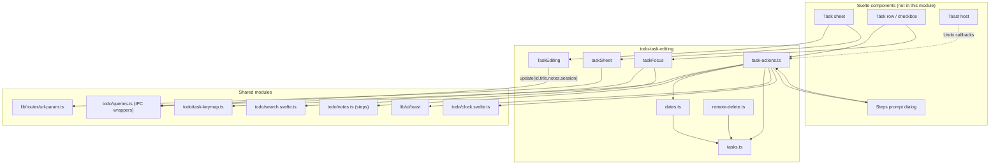
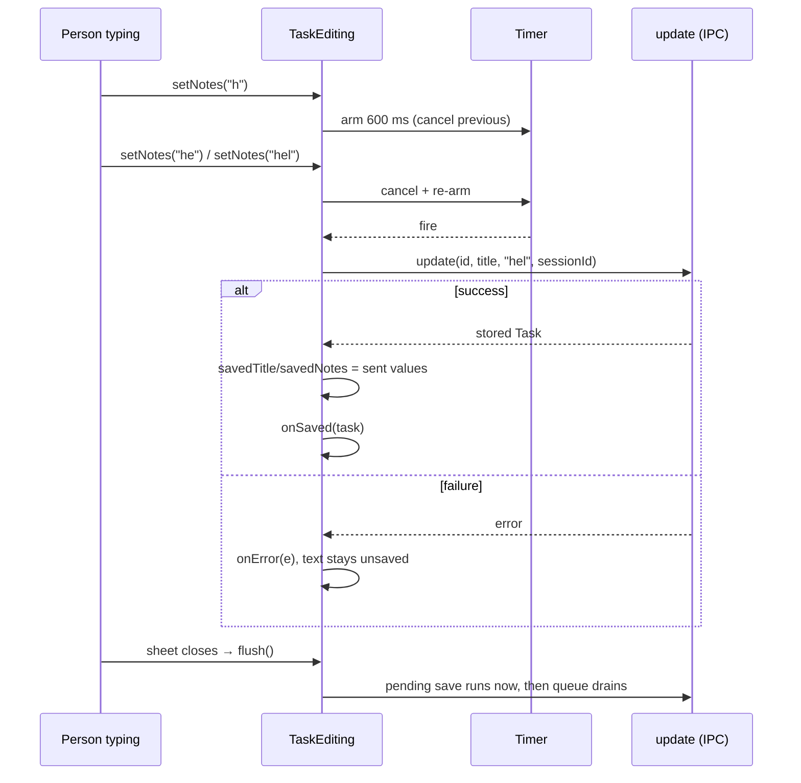
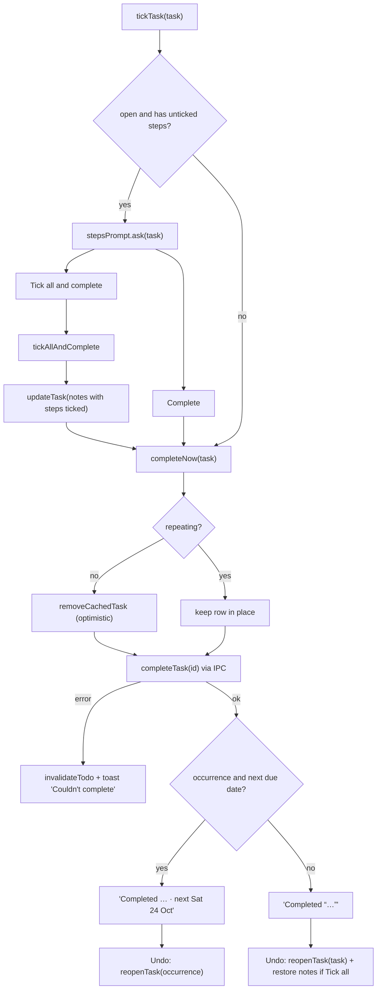
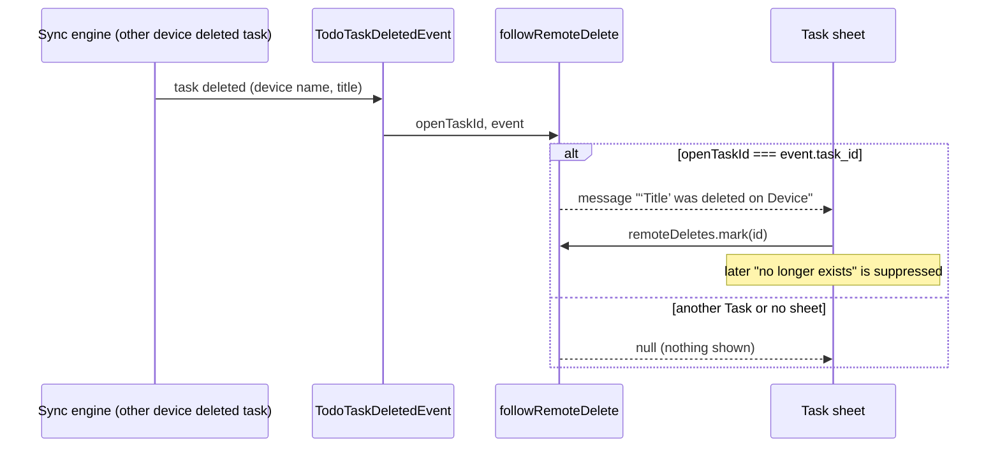

# todo-task-editing

The `todo-task-editing` module is the client-side logic behind changing a single Task in the Todo feature: editing its title and notes, completing or reopening it, changing its date, Priority, List and order, skipping it, marking it Won't do, deleting it, and keeping the Task sheet, keyboard focus and "remote deleted" messages in step with what the app is doing. It is pure TypeScript and Svelte rune classes; every write goes to Rust through the IPC layer and the authoritative rules (date validation, repeat rewinds, change-log records) live in the Rust domain, not here.

Companion modules: [Feature_Client_UI](../Feature_Client_UI.md) (parent), [todo-tasks](todo-tasks.md) (lists, views, sidebar and queries), [todo-capture](todo-capture.md) (Quick add and typed-word recognition), [todo-search](todo-search.md), and the Rust side in [Task_and_Journal_Domain_Services / todo](../Task_and_Journal_Domain_Services/todo.md). The IPC bridge is described in [Tauri_Host_and_IPC_Bridge](../Tauri_Host_and_IPC_Bridge.md).

---

## 1. Purpose and scope

| Concern | Where it lives |
|---|---|
| Autosaving the title and notes of an open Task | `task-editing.ts` (`TaskEditing`) |
| Which Task is open in the sheet (URL state, Back behaviour) | `task-sheet.svelte.ts` (`taskSheet`) |
| Keyboard focus ring across Task rows | `task-focus.svelte.ts` (`taskFocus`) |
| User actions with Undo toasts (tick, untick, date, Priority, skip, Won't do, delete, drag placement) | `task-actions.ts` |
| Date, time, repeat and "Overdue / time passed" rules shown in the UI | `dates.ts` |
| Toast wording and optimistic list trimming | `tasks.ts` |
| Reaction to a Task deleted on another device | `remote-delete.ts` |

Out of scope here: the grouped views and their queries (see [todo-tasks](todo-tasks.md)), typed-word capture ([todo-capture](todo-capture.md)), and the sync engine that produces remote deletes ([Sync_Replication_Engine](../Sync_Replication_Engine.md)).

---

## 2. Architecture and component relationships

`TaskEditing` is deliberately unaware of IPC or timers: its dependencies (`update`, `setTimer`, `onSaved`, `onError`) are injected, which is what makes it testable without a DOM (see `task-editing.test.ts`).

---

## 3. Components

### 3.1 `TaskEditing<T>` — autosaving one editing session

One instance represents one opening of the Task sheet. It holds the typed `title` and `notes`, the last stored values, and a queue of saves.

Behaviour, drawn from the class and its tests:

- **Debounced autosave.** Every keystroke calls `setTitle` or `setNotes`, which reschedules a single timer of `SAVE_PAUSE_MS` (600 ms, the Journal's pause). Many keystrokes produce one save.
- **No-op detection.** If the text equals what is stored, no timer is armed and no save is sent (`unsaved` is false).
- **Session id on every save.** Each `update(id, title, notes, sessionId)` carries the session id, so the change log writes one record per opening of the sheet; that is what makes History show one line per session.
- **Blank titles are never saved.** While the title field is empty, `#titleToSave` falls back to the stored title, so notes still save under the old title. `leaveTitle()` restores the stored title when focus leaves.
- **Line breaks fold.** `setTitle` replaces runs of line breaks with a single space, so a title stays one line.
- **Serial saves.** Saves are chained on `#queue`; each one sends the latest text at the time it runs, and a save with nothing new is skipped.
- **Failure keeps text.** A failed `update` calls `onError` and leaves the text unsaved; the next edit (or `flush()`) tries again.
- **External changes win.** `adopt(task)` cancels the pending timer and takes the stored title and notes as the new baseline. It is used when another change (for example a repeating Task's Checklist reset on completion) rewrites the Task.

### 3.2 `taskSheet` — which Task is open

The open Task's id is the URL parameter `task` (`/todo?task=‹id›`), read through `urlParam`. Opening a Task from nothing pushes a history entry; moving to another Task swaps the entry (`switchTo`) so Back does not pile up. `close()` steps back over the pushed entry or deletes the parameter, and a 400 ms debounce makes Esc and the editor's own close count as one close. The sheet component publishes the loaded Task in `task` so keyboard actions can act on it.

### 3.3 `taskFocus` — keyboard ring across rows

On desktop, the ring is a single Task id. `ids()` reads the DOM (`[data-task-scope]` → `[data-task-row]`), so it follows whatever is on screen: the view or the search results, in reading order and only for visible rows. `focus(id)` moves real DOM focus to the row's title, so Tab and screen readers agree with the ring. `keepAfter(id, fallback)` waits two animation frames after a change that may remove or move the Task, then keeps the ring on that Task, falls back to its neighbour, or drops it. `neighbour(id)` is the Task the ring would go to if `id` disappeared.

### 3.4 `task-actions.ts` — user actions and their Undo

Each exported action performs one IPC write, then refreshes the Todo queries (`invalidateTodo`) and, where the action can be reversed, raises a toast with an Undo callback.

| Action | Write | Undo |
|---|---|---|
| `tickTask` | If the Task is open and has unticked Checklist items, opens the steps prompt; else `completeNow` | — |
| `tickAllAndComplete` | `updateTask` with every step ticked, then `completeNow` | Reopens, and restores the original notes if the rewind did not |
| `completeNow` | `completeTask`; a repeating Task keeps its place and reports the next date | `reopenTask` on the occurrence (or the Task) |
| `untickTask` | `reopenTask` | — |
| `moveTaskTo` | `moveTask` to a List or the Inbox | `moveTask` back |
| `setTaskWhen` | `setWhen` (date, time, Repeat) | — (see gap in §6) |
| `dateTaskToday` | `setTaskWhen` to today, keeping time and Repeat | as above |
| `skipRepeating` | `skipTask`, or `wontDo` for a repeating Task | `restoreWhen` with the old date and Repeat |
| `moveAllOverdue` | `moveOverdue(date)` | `restoreWhen` for every moved Task |
| `setTaskPriority` | `setPriority` | — |
| `wontDoTask` | `wontDo`; for a repeating Task delegates to `skipRepeating` | `reopenTask` |
| `deleteTaskWithUndo` | `deleteTask` (cache removed first) | `restoreTask` |
| `placeTask` | `reorderTask(id, before, after, adopt)` | — |
| `dropTaskOnSidebar` | Today → `dateTaskToday`; Inbox or a List → `moveTaskTo` | as above |

Two rules are worth knowing:

- **Optimistic removal.** `completeNow` and `deleteTaskWithUndo` remove a non-repeating Task from the local cache before the write, so it leaves the page at once. On failure, `invalidateTodo()` reloads the truth from Rust.
- **Rust decides repeats.** The client never computes the next occurrence. `wontDoTask` on a repeating Task calls the same command as Skip and only chooses the wording of the toast from `repeat_freq`.

`completeNow` also fires a light haptic tick on phones (`viewport.isPhone`), on every completion whatever started it.

### 3.5 `dates.ts` — date rules and labels

Pure functions shared by rows, the sheet and toasts:

- `isOverdue(task, today)`: open and due before today. A Task due today is never overdue, even if its time has passed.
- `timePassed(task, today, now)`: due today with a time already behind `now`; it stays in Today with the time in red.
- `rowDateLabel(date, today)`: Today, Tomorrow, Yesterday, a weekday within the next week, then `28 Oct` (with the year when it is not this year).
- `whenMessage`, `whenChipLabel`: the When toast and chip (`Tomorrow · 09:00 · Every month`, or `When`).
- `landedIn(task, listName, today)`: where a new Task went when the page it was typed into does not show it.
- `stampLabel(at, today, format)`: History and sheet footer times (`Today 09:12`, `Mon 08:00`, `14 Oct 08:00`).
- `localNow(now)`: the device's `today`, `now` and `offset_min`, which every date-dependent command receives so Rust works in the device's calendar.
- `taskRepeat(task)`: builds a `RepeatRule` from the four `repeat_*` fields, or `null`.

### 3.6 `tasks.ts` — toast wording and grouped-view trimming

- `quoted` / `quotedTitle`: a name in curly quotes, cut at 34 characters with `…`; `quotedTitle` strips Markdown first (via `notes.ts`).
- `completedMessage`, `wontMessage`, `deletedMessage`, `editedMessage`, `priorityMessage`, `quickAddedMessage`: the toast texts.
- `withoutTaskInGroups(view, id)`: removes one Task from a grouped view immediately and drops groups it empties, except the plain group that holds "+ New task".
- `priorityTone(priority)`: ring colour for P1 (red), P2 (amber), P3 (violet), none for P4.

### 3.7 `remote-delete.ts` — a Task deleted on another device

`followRemoteDelete(openTaskId, event)` returns a message only when the Task open in the sheet is the one deleted elsewhere: "‘Plan weekend hike’ was deleted on Pixel 8". The `remoteDeletes` set records which ids were already announced (`mark`, `has`, `clear`) so the sheet does not also report that the Task "no longer exists". The events come from the sync engine's journal path (see [Sync_Replication_Engine](../Sync_Replication_Engine.md)).

---

## 4. Process flows

### 4.1 Tick a Task

### 4.2 Change a date with a Repeat

`setTaskWhen` sends the new date, time and Repeat to `setWhen`, then refreshes the queries. The Rust side refuses a past date for a non-overdue Task; that error text is shown as the toast. The repeat argument is passed explicitly: callers that keep the Repeat pass `taskRepeat(task)`.

### 4.3 Remote delete while the sheet is open

### 4.4 Keyboard movement

`taskFocus.move('down')` reads the visible rows in the active scope, computes the next id with `moveRing` (from `task-keymap.ts`), and focuses it. After a completion or move, the caller invokes `keepAfter(id, neighbour(id))` so the ring lands sensibly once the page redraws.

---

## 5. Data contracts used

| Type / command | Source | Used for |
|---|---|---|
| `Task` (`state`, `due_date`, `due_time`, `repeat_*`, `priority`, `notes`, `title`, `list_id`) | `lib/ipc/bindings.ts` | everything above |
| `Completion` (`task`, `occurrence`) | bindings | tick and Undo |
| `DueChange` (`id`, `due_date`, `due_time`, `repeat`) | bindings | Undo for dates and Skip |
| `GroupKey`, `TaskGroup` | bindings | drag placement and trimming |
| `TodoTaskDeletedEvent` (`task_id`, `title`, `device`) | bindings | remote delete |
| `LocalNow` | bindings | `localNow(now)` |

Rust commands behind the wrappers in `queries.ts`: complete, reopen, update, delete, restore, move, reorder, set priority, set when, restore when, skip, won't do, move overdue. Their rules are documented in [Task_and_Journal_Domain_Services / todo](../Task_and_Journal_Domain_Services/todo.md) and the sheet behaviour tests (`todo_sheet_tests.rs`, `todo_order_tests.rs`) that the Rust crate runs.

---

## 6. Known gaps and notes for maintainers

- **`setTaskWhen` has no Undo.** Its doc comment promises an Undo toast that restores the old date and Repeat, but the body only computes `before`/`after` and returns without calling `notifyUndo`. Only `skipRepeating` and `moveAllOverdue` currently offer `restoreWhen` Undo. Either add the toast (using `whenMessage`) or correct the comment.
- **`TaskEditing` saves are not retried automatically.** After a failure the text waits for the next edit or `flush()`; the sheet's Retry is the only other trigger.
- **`remoteDeletes` is never cleared by this module.** Entries stay until a caller invokes `clear(id)`; the set is process-wide.
- **Reference to the Checklist reset.** `adopt()` is the seam that keeps an open sheet consistent when completion rewrites the notes; any new writer that changes a Task while the sheet is open should go through it.

---

## 7. Testing

| Test file | Covers |
|---|---|
| `task-editing.test.ts` | debounce, single timer, blank-title rule, line folding, failure retry, `adopt`, serial saves |
| `task-actions.test.ts` | Undo after "Tick all and complete" reopens and restores notes, using mocked queries and toasts |
| `tasks.test.ts` | toast wording, 34-character cut by code points, `withoutTaskInGroups`, Priority tones |

Rust-side behaviour these actions depend on is tested in `src-tauri/src/todo_sheet_tests.rs`, `todo_order_tests.rs` and `todo_capture_tests.rs`, summarised in [Task_and_Journal_Domain_Services / todo](../Task_and_Journal_Domain_Services/todo.md).

Build and test entry points (`make test`, `pnpm test`) are described in [Build_and_Packaging](../Build_and_Packaging.md).
