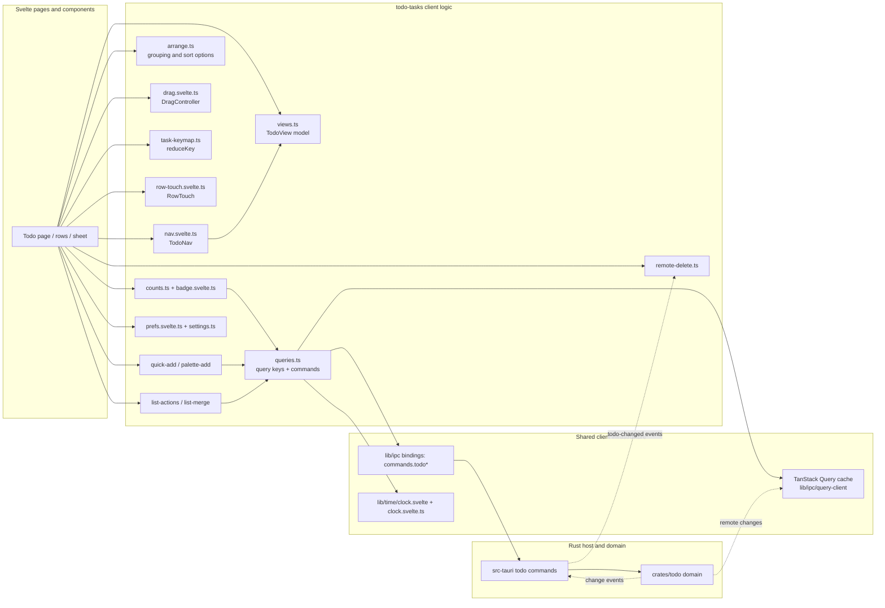
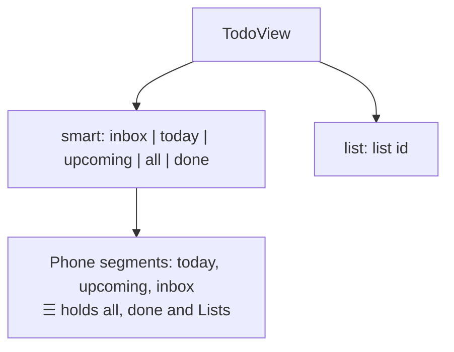
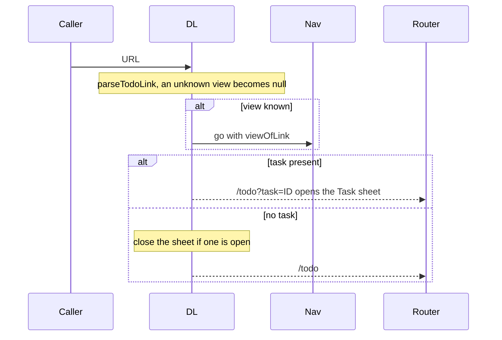
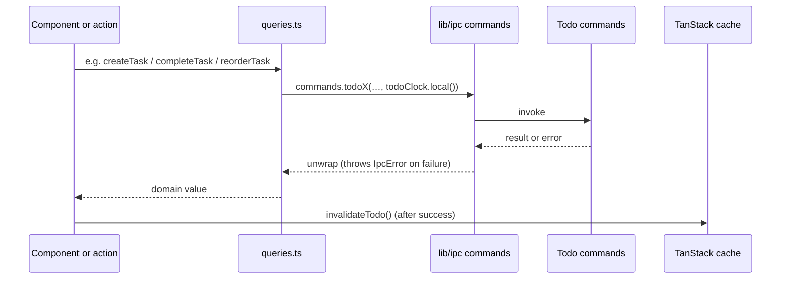
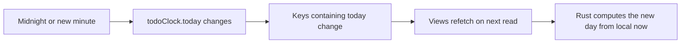
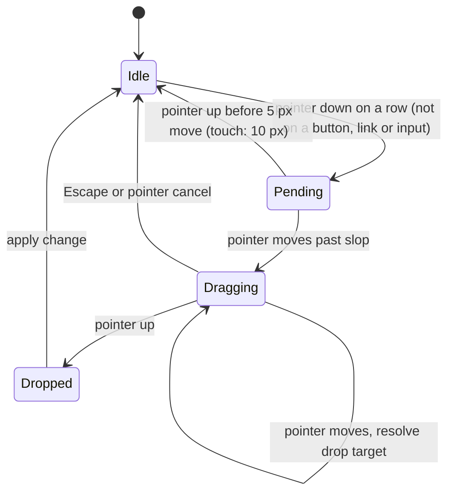
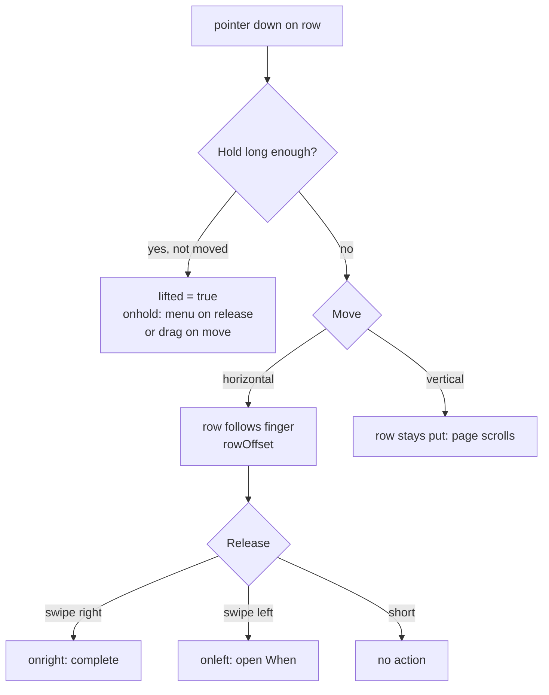
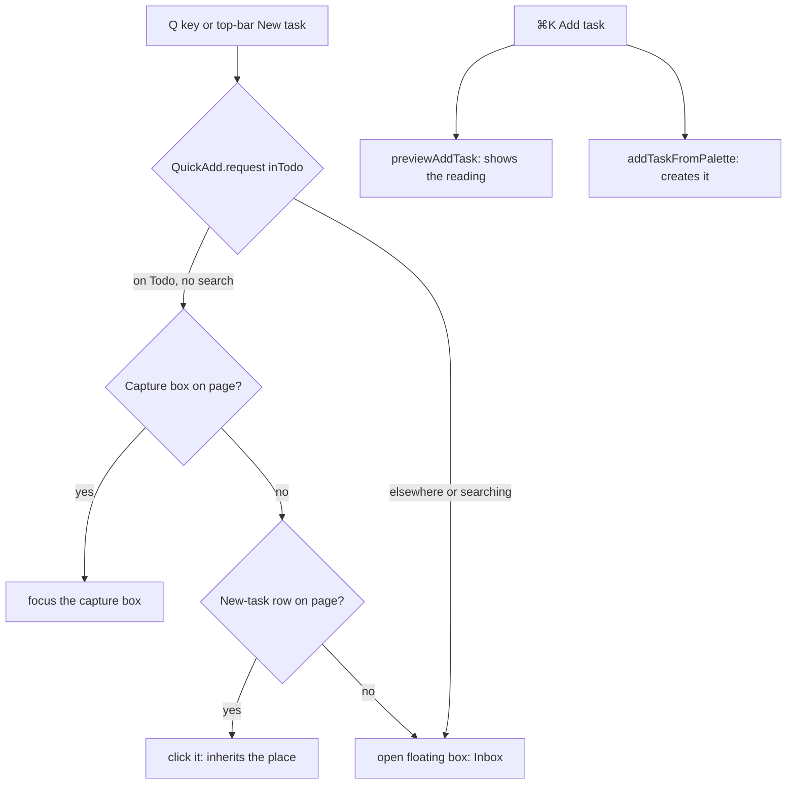
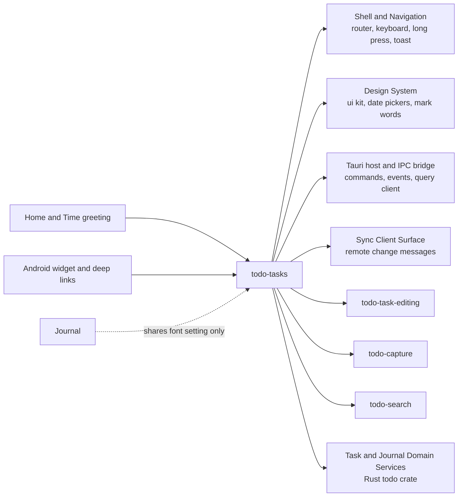

# Todo Tasks (Client UI)

The Todo Tasks module is the client-side half of Mnemora's task manager. It is the Svelte and TypeScript code that shows Tasks and Lists, lets the person arrange, edit, complete, search and capture them, and reacts when another device changes them. It owns no data: every read and write goes through Tauri commands into the Rust `todo` domain crate, and the results are cached with TanStack Query.

This page explains how the module's pieces fit together. Detailed sub-areas have their own pages: [task editing](todo-task-editing.md), [capture](todo-capture.md) and [search](todo-search.md). The Rust side is described in [Task and Journal Domain Services](../Task_and_Journal_Domain_Services/todo.md), and the sync that delivers changes from other devices is in [Sync Client Surface](../Sync_Client_Surface.md) and [Sync Replication Engine](../Sync_Replication_Engine.md).

---

## 1. Purpose and scope

The module answers six questions for the rest of the client:

| Question | Where it is answered |
|---|---|
| Which view is showing, and how do I move between views? | `views.ts`, `nav.svelte.ts`, `deep-link.ts` |
| What data does a view show, and when is it refreshed? | `queries.ts`, `clock.svelte.ts` |
| How are Tasks grouped, sorted and labelled? | `arrange.ts`, `prefs.svelte.ts`, `settings.ts` |
| How do drag, keyboard and touch gestures act on Tasks? | `drag.svelte.ts`, `task-keymap.ts`, `task-keys.svelte.ts`, `row-touch.svelte.ts` |
| What do the badge, Home card and palette show? | `counts.ts`, `badge.svelte.ts`, `palette-add.ts`, `quick-add.svelte.ts` |
| What happens when a Task or List changes on another device? | `remote-delete.ts`, `list-merge.ts`, `queries.ts` (invalidation) |

Out of scope: the Task sheet, editing and conflict-free text saves ([todo-task-editing](todo-task-editing.md)); parsing typed words ([todo-capture](todo-capture.md)); the search screen ([todo-search](todo-search.md)); the rendering components and Design System tokens ([Design System](../Design_System.md)); app-wide shortcuts and routing ([Shell and Navigation](../Shell_and_Navigation.md)).

---

## 2. Architecture

Three rules shape the whole module:

1. **Views are state, not routes.** Todo is one route (`/todo`). The current view is `TodoNav.view`, held for the session. A fresh launch opens Today; coming back from the Journal keeps the place (`nav.svelte.ts`).
2. **The server is the source of truth.** Components call pure helpers or commands and then invalidate the cache. Only a few things are applied optimistically, such as removing a Task from cached pages before Rust answers (`removeCachedTask` in `queries.ts`).
3. **Date-dependent keys roll over.** Query keys contain the local day, so a page refreshes after midnight without polling (see [section 5](#5-data-access-and-caching)).

---

## 3. Views and navigation

### 3.1 The view model

`views.ts` defines the only description of "where the person is" in Todo:

| Helper | Behaviour |
|---|---|
| `smartView(id)`, `listView(id)` | Build a `TodoView`. |
| `sameView(a, b)` | Structural equality, used when a List event asks "is the person looking at this List?". |
| `viewAfterListGone(view, listId)` | If the open List was deleted, the view falls back to the Inbox. |
| `activeSegment(view)` | Lights one of the three phone segments, or `more` for everything else. |
| `swipedView(view, step)` | Next or previous phone segment; `null` at the ends or outside the segments. |
| `addPlaceFor(view, today, tomorrow)` | Where the phone's `+` adds: due today in Today, tomorrow in Upcoming, in the List inside a List, the Inbox elsewhere. |
| `visibleOn(view, task, today)` | Whether a new open Task belongs on the view as it stands. Used to decide whether a fresh Task should appear immediately. |
| `viewCount(sidebar, id)` | Sidebar counts: Inbox and Today; Today turns red when anything is Overdue. |

`DEFAULT_VIEW` is Today.

### 3.2 Navigation state

`TodoNav` holds three things: `view`, `slide` (which way the last swipe went, so the new view slides in from that side) and `topRequests` (a counter the page watches to scroll to the top).

- `go(view)` changes the view and clears the slide.
- `swipeTo(view, step)` changes the view and records the slide direction.
- `home()` returns to Today and bumps `topRequests`. This is the phone's Todo tab tapped while already in Todo.

### 3.3 Deep links

`deep-link.ts` turns `mnemora://todo?view=…&task=…` into navigation:

`view` accepts `today`, `upcoming`, `inbox`, `all` or `list:<id>`. The Todo widget uses the same spellings (see [Android Integration](../Android_Integration.md)).

---

## 4. Data flow for the views

Each view is one query from `queries.ts`. The query key always carries the device's local day (or the view's own parameters), and the query function passes `todoClock.local()` so Rust computes "today" from the device.

| Query | Command | Key includes |
|---|---|---|
| `inboxQuery` | `todoInbox` | day |
| `listsQuery` | `todoLists` (sidebar counts and Lists) | day |
| `countsQuery` | `todoCounts` (badge and Home card) | day |
| `allQuery` | `todoAll` | day |
| `listQuery` | `todoList` | list id, day |
| `todayQuery` | `todoToday` | day |
| `upcomingQuery` | `todoUpcoming` | day |
| `doneQuery` | `todoDone` (infinite, 14 days per page) | day |
| `dayCountsQuery` | `todoDayCounts` (date picker dots) | from, to, excluded id |
| `taskQuery`, `commentsQuery`, `historyQuery` | `todoTask`, `todoComments`, `todoTaskHistory` | task id |
| `searchQuery` | `todoSearch` | query text (keeps previous results while loading) |

All queries are built on `todoKeys`, a single key namespace rooted at `['todo']`. That is why one call to `invalidateTodo()` refreshes every Todo view at once.

### 4.1 Writes

Every write follows the same shape:

Helper functions in `queries.ts` pass arguments through unchanged. Rust validates them, so the client does not duplicate rules such as "a repeat without a date lands on its first day" or "a past date cannot be set".

Two details matter for maintainers:

- `createTask` only sends a `when` object when a date, time or repeat is present. Priority 4 is sent as `null` (no priority).
- `savePreference(key, value)` saves a setting, then invalidates the `settings` queries and all Todo queries, because the views come back grouped and sorted by the new value.

### 4.2 Remote changes

Changes made on another device arrive as Tauri events and are followed by the client:

- A deleted Task that is open in the sheet is reported by `followRemoteDelete`. `remoteDeletes` remembers which Tasks have already been reported so the sheet does not also say "no longer exists".
- A List that merged into another with the same name is followed by `followMerge`: if the person was on the removed List, Todo moves to the surviving one and a message explains it.
- Everything else refreshes through invalidation of the cached queries.

Sync itself (how the change arrives and is merged) is described in [Sync Replication Engine](../Sync_Replication_Engine.md) and [Todo sync](../Sync_Replication_Engine/todo_sync.md).

---

## 5. Data access and caching

### 5.1 The clock

`clock.svelte.ts` (`todoClock`) exposes `today` and `hm` as derived strings from the shared clock in `lib/time`. Because they are strings, anything that reads them updates only when the day or the minute changes. `local()` returns a fresh `LocalNow` at the moment of the call, which is what commands expect.

`useTodoBadge()` (in `badge.svelte.ts`) also subscribes to the shared clock. This keeps the count rolling over at midnight even when no Todo page is open.

### 5.2 Cache keys and day rollover

Only keys that depend on the day change. The Inbox, Today, Upcoming, Done, the lists and the counts all include the day, so a page left open across midnight shows the new day's tasks.

---

## 6. Arranging Tasks: grouping and sorting

`arrange.ts` is the single place that knows how each view groups its Tasks and what those groups look like.

### 6.1 Options and defaults

| Table | Contents |
|---|---|
| `GROUP_OPTIONS` | For each view (`today`, `upcoming`, `inbox`, `all`, `list`), the group choices in the menu. Rust accepts exactly these values. |
| `GROUP_DEFAULTS` | Group by until the person chooses: Today → Priority, Upcoming → Day, Inbox → None, All → List, a List → None. |
| `GROUP_PREF_KEYS` | The preference that stores each smart view's grouping (`todo.group_today`, `todo.group_upcoming`, `todo.group_inbox`, `todo.group_all`). A List keeps its grouping on its own row. |
| `TASK_SORT_OPTIONS` | Manual, Due date, Priority, Title, Recently added. Only Manual is a drag order (`canDrag`). |
| `LIST_SORT_OPTIONS` | Manual, Name A–Z, Name Z–A, Most open, Oldest first. Saved in `todo.lists_sort`. |
| `DONE_IN_LISTS_OPTIONS` | How done Tasks show on a List page, saved in `todo.done_in_lists`. |

`groupButtonLabel(view, value)` builds the `Group: Priority` text. `sortMenuLabel` names Manual as "Manual (drag)".

### 6.2 Headings

`groupHeading(key, ctx)` turns a group key from Rust into what the page draws:

| Group key kind | Heading |
|---|---|
| `plain` | none |
| `overdue` | "Overdue" in the danger tone |
| `priority` | "P1"–"P3" (with the flag), or "No priority" for 4 |
| `list` | the List, or none when it is the Inbox |
| `day` | today gets "Today" only under an Overdue group; other days get a relative day heading |
| `due` | Overdue, Today, Tomorrow, Next 7 days, Later, No date |
| `no_date_in_list` | "No date, in a List" with a calendar-off icon |

### 6.3 What a group adopts

A group can give its Tasks properties. Dropping or adding into a group uses the group's `adopt` keys:

- `addDefaults(adopt)` decides what a new Task inside the group starts with: its day and its List. **Priority is never inherited**, so a Task added under P1 is P4 unless it says otherwise.
- `groupTakesTasks(group)` says whether a group shows "+ New task". Overdue and "No date, in a List" do not take new Tasks.
- `adoptSummary(adopt, task, ctx)` names what a drop would change ("Today", "P1", "🏠 Home"). It returns `null` when the Task already matches, which is how a drop that changes nothing is recognised.

---

## 7. Drag and drop

`DragController` (exported as `drag`) implements pointer dragging for Tasks and for Lists in the sidebar. Rows and groups are found by data attributes, so the controller does not know how each page is laid out.

### 7.1 Markers the pages must provide

| Attribute | Where | Meaning |
|---|---|---|
| `data-task-group`, `data-adopt` (JSON `GroupKey[]`) | group container | A place a Task can be dropped; `adopt` says what the drop sets. |
| `data-drag="off"` | group container | The group is sorted, so it does not accept reorder drops. |
| `data-task-row="<id>"` | each Task row | Row identity and position. |
| `data-group-end` | "+ New task" row | Where a drop goes after the last row. |
| `data-drop-nav` (`inbox`, `today`, `list:<id>`) | sidebar row | Accepts a Task dropped on the sidebar. |
| `data-list-tree`, `data-list-row="<id>"` | sidebar | Lists that can be reordered by drag. |

### 7.2 Drag lifecycle

While dragging:

- A `#resolve()` step runs on every move. It checks the sidebar first (a List, Inbox or Today lights up), then the groups nearest the pointer (within 28 px vertically and 24 px sideways), and finds the insertion index among the rows.
- `lineAt` and `summary` tell the person where the Task will land and what it will adopt.
- Near the top or bottom of the scroll container, `autoScrollSpeed` scrolls the page each frame.
- Dropping outcomes:
  - **Between two rows** → `placeTask` with the neighbours and the group's adopt keys. Dropping in the same place (`same`) does nothing.
  - **On a sidebar target** → `dropTaskOnSidebar` with Inbox, Today or the List.
  - **A List between Lists** → `placeList` (reorders the sidebar).
- After a drag, a one-shot click guard swallows the click that would otherwise open the Task.

### 7.3 Keyboard reorder

`keyboardMove(task, dir)` implements ⌥↑ and ⌥↓. It works only inside a group that is not sorted (`data-drag` is not `off`). After the move the focus returns to the moved row.

---

## 8. Keyboard

The desktop key map is one pure function, `reduceKey(state, event, scene, now)` in `task-keymap.ts`. The page supplies a `KeyScene` that says what is on screen, and gets back the action to run. Nothing in the reducer touches the DOM, so each row of the map is a Vitest case in `task-keymap.test.ts`.

### 8.1 The scene

| Field | Meaning |
|---|---|
| `typing` | Focus is in a text field, an editor or the capture box. |
| `overlay` | A menu, picker or dialog is open. |
| `sheet` | The Task sheet is open and owns the key. |
| `target` | `ring` when a Task row has the focus ring, `none` otherwise (a hovered row is never a target). |
| `taskOpen` | The target is open (not done, not Won't do). |
| `onControl` | The key went to a button or link, which presses itself on Space and Enter. |

### 8.2 Rules of the map

- **Bare keys** (no modifier, not repeating) act only when the scene is not typing, has no overlay, and has a target. This follows ADR 0011.
- **Task keys** on the focused row:

  | Key | Action | Open tasks only |
  |---|---|---|
  | Space | complete (ticks an open Task, reopens a done one) | no |
  | ⇧Space | Won't do (or skip a repeating Task) | yes |
  | Enter | open the sheet | yes |
  | `e` | quick edit | yes |
  | `d` | when (date picker) | yes |
  | `t` | set due today | yes |
  | `m` | move to a List | no |
  | `1`–`4` | Priority | yes |
  | Backspace, Delete | delete | no |
  | ⌥↑ ⌥↓ | reorder within the group | yes |
  | Escape | drop the focus ring | n/a |

- **Ring movement**: ↑ and ↓ move the focus ring (`moveRing`, which holds at the ends). When the focused Task goes away, `ringAfterRemoval` puts the ring on the next Task, else the previous.
- **G chords**: `G` followed within 1.5 s (`CHORD_MS`) by `T`, `U`, `I`, `A` or `D` goes to Today, Upcoming, Inbox, All or Done. Chords work with no Task focused, and they never start inside a field or while the sheet is open.
- **Search**: ⌘F or Ctrl+F opens search, even from a field, unless an overlay is open.
- **Sheet keys**: ⌘↑ and ⌘↓ step through the Tasks, ⌘↵ closes the sheet, Priority and Won't do still work on the sheet's Task, and every other key is ignored.
- **Bare T** yields to the row key: `bareTodayFires(onTodo, ringed)` is false when a row on Todo holds the ring, so T sets a Task due today instead of going to Today.

### 8.3 Who receives keys

`task-keys.svelte.ts` keeps a registry (`taskRows`) of mounted rows. Each row registers its Task and two openers (`when` and `moveToList`). A key that acts on a Task looks up the focused row here, so the reducer never holds Task data.

`inSheetScope(target)` decides whether a key belongs to the Task sheet. Focus in the sheet, or on the page behind it, counts. A menu, picker or dialog opened over the sheet does not.

---

## 9. Touch gestures

`RowTouch` (in `row-touch.svelte.ts`) handles a finger on a Task row. It is attached to touch and pen only; mouse input is ignored.

- Swiping right completes the Task, and swiping left opens the When picker. `sides()` is read at the start of each touch, so only sides with something to do can be swiped.
- A finished gesture (a swipe or a lifted hold) sets a short click guard (350 ms), so the click the browser sends afterwards does not open the Task.
- `RowTouch` hands a held finger to `DragController.armTouch`, so the same hold-then-move logic serves both dragging and the row menu.

---

## 10. Counts, badge and Home card

`counts.ts` is pure: it turns the `todoCounts` result into what is drawn.

| Function | Result |
|---|---|
| `badgeOf(counts)` | Due today plus Overdue, red only while anything is Overdue. `null` (no badge) when zero or not loaded. |
| `homeCardModel(counts, today)` | Up to five due-today Tasks, the Overdue count, how many more are due, and the line to show when nothing is due. |
| `nothingDueText(next, today)` | "Nothing due today · next: Water the plants, Tomorrow" (the title is stripped of Markdown). |
| `footerParts(model)` | "2 overdue" and "+3 more" as separate parts so the overdue part can be red. |
| `captureSummary(fields, list, today, format)` | The palette's reading of typed text, e.g. "Tomorrow · 18:00 · P2 · Home". Nothing read gives "Inbox". |

`badge.svelte.ts` (`useTodoBadge`) feeds the sidebar and phone tab bar. The count query is keyed by day, so the badge rolls over at midnight.

---

## 11. Notes, checklists and completion

Notes are Markdown. `notes.ts` reads them without rendering:

- `checklistProgress(notes)` counts Checklist items and how many are ticked (nested items included). It returns `null` when there are none.
- `openSteps(notes)` returns the number of unticked items.
- `tickAllSteps(notes)` ticks every unticked item and leaves other text alone. This is "Tick all and complete".
- `notePreview(notes)` returns the first line of prose, with marks removed. Checklist items are skipped because the "1/3" progress covers them.
- `plainTitle(title)` removes Markdown marks from a title for use in a sentence.

Completing a Task that still has open steps asks first. `steps-prompt.svelte.ts` holds the Task being completed (`ask`) and is cleared by `close`. The dialog in the page answers the question: complete as is, tick all and complete, or cancel. The reply is separate from the completion command, so declining leaves the notes unchanged.

---

## 12. Quick add and the palette

Three entry points create Tasks, and each sets the place differently.

- **`QuickAdd`** decides where the box opens. Inside Todo the first "+ New task" row is clicked, so the Task inherits that place (Today, a List, an Upcoming day). When search covers the page, or Todo is not on screen, the floating box opens for the Inbox. `openFloating(date, listId)` lets Home's Add and the phone's `+` pass a day or List.
- **`addTaskFromPalette`** reads the text through the same rules as the capture box (`parseCapture`, when the "Recognise dates in titles" setting is on). It creates the List first if the text names a new one, creates the Task with the understood words recorded, then shows a toast that names the place.
- **`previewAddTask`** gives the palette's second line. It never throws, so a failed reading simply shows no line.

Capture details (how words become fields and what the person can ignore or prefer) are covered in [todo-capture](todo-capture.md).

---

## 13. Lists

| Function | What it does |
|---|---|
| `createListAndOpen(name)` | Creates a List, refreshes Todo, opens it. Rust's refusal (taken or invalid name) is thrown for the field to show. |
| `deleteListWithUndo(entry, choice, targetName)` | Deletes a List with its Tasks deleted or moved (`choice`). If it was open, Todo goes to the Inbox. The toast offers Undo, which restores the List and reopens it if it was open. The List's cached page is removed so its "gone" error cannot appear when Undo reopens it. |
| `placeList(id, before, after)` | Drops a List between two neighbours in the sidebar. |
| `listSortItems(sortedBy, canDrag)` | The "Sort Lists by" menu entries; picking one saves `todo.lists_sort`. |
| `followMerge(view, event)` | When two Lists with the same name merge, a person on the removed List moves to the kept one and is told which. Others stay put. |
| `mergedMessage(event)` | "Groceries merged with Groceries from Pixel 8". |

---

## 14. Preferences and settings

Settings that affect Todo are read in one place and exposed as reactive state.

| Preference | Read by | Default |
|---|---|---|
| General: week start, time format (via `readCore`) | `followCoreSettings` → `todoPrefs.weekStart`, `todoPrefs.timeFormat` | from core settings |
| `journal.font` | `followCoreSettings` → `todoPrefs.notesFont` (Todo shares the Journal's writing font) | serif |
| `todo.parse_dates` (`PARSE_DATES_PREF`) | `followCoreSettings` → `todoPrefs.parseDates`, and `readTodo` | on |
| `todo.done_in_lists` | `readTodo` → `doneInLists` | `today_shown` |
| `todo.group_*`, `todo.inbox_sort`, `todo.lists_sort` | `arrange.ts` constants, saved through `savePreference` | per table in section 6 |

`followCoreSettings()` is called once from Todo's page. It keeps `todoPrefs` in step with the settings query while Todo is open. Todo never imports the Journal: it reads the Journal's font as plain setting data.

`readTodo` accepts only the four known "done in lists" values. Anything else is replaced by the default, so an invalid stored value reads as the default rather than breaking the page. Rust validates values on save.

---

## 15. Module file map

| File | Role |
|---|---|
| `views.ts` | View model, phone segments, add placement, visibility rule |
| `nav.svelte.ts` | Current view state, swipe direction, return-to-top |
| `deep-link.ts` | `mnemora://todo` links to views and Tasks |
| `queries.ts` | Query keys, read queries, write helpers, cache invalidation |
| `clock.svelte.ts` | Device today and minute for keys and labels |
| `badge.svelte.ts`, `counts.ts` | Badge, Home card, footer text, palette summary |
| `arrange.ts` | Group and sort options, headings, adopt rules |
| `prefs.svelte.ts`, `settings.ts` | Reactive preferences and typed settings |
| `sidebar.svelte.ts` | Lists by id for chips and headings |
| `drag.svelte.ts`, `drag-math` | Pointer drag of Tasks and Lists |
| `row-touch.svelte.ts` | Touch swipe and hold on rows |
| `task-keymap.ts` | Pure key reducer and focus ring rules |
| `task-keys.svelte.ts` | Registry of mounted rows, sheet key scope |
| `notes.ts` | Checklist counts, Tick all, note preview |
| `steps-prompt.svelte.ts` | "Steps still open" question on completion |
| `quick-add.svelte.ts`, `palette-add.ts` | Quick add box and ⌘K Add task |
| `list-actions.ts`, `list-merge.ts` | Create, delete with Undo, reorder, merge follow |
| `remote-delete.ts` | Deleted-elsewhere messages for the open Task |

---

## 16. Dependencies

Inside the Feature Client UI, Todo depends on the shared pieces and is depended on by the shell:

Todo and Journal are independent. The only shared item is the writing font setting. The Android widget reads and writes the same data through its own bridge, and its view spellings match `deep-link.ts`.

---

## 17. Testing

Each pure module has a Vitest file beside it. The useful groups are:

| Test file | Covers |
|---|---|
| `task-keymap.test.ts` | Every bare key, G chords, sheet keys, focus ring rules, ⌘F, typing and overlay guards |
| `counts.test.ts` | Badge rules, Home card, footer, capture summary |
| `arrange.test.ts` | Group headings, adopt defaults and summaries, which groups take new Tasks |
| `drag` (tested through `drag-math`) | Insert index and neighbours for drops |
| `task-actions.test.ts`, `tasks.test.ts` | Task action messages and priority tone |
| `list-*` and `list-merge` behaviour | Covered with the List actions' tests |

Behaviour that depends on Rust (what a write stores, what a repeat does, what counts as overdue) is tested in the domain crate and the Tauri test files (see [Task and Journal Domain Services](../Task_and_Journal_Domain_Services/todo.md)). The client tests check only that the right command is called with the right values and that the pure rules read correctly.

---

## 18. Maintenance notes

- **Adding a view:** add it to `SmartViewId` in `views.ts`, to `GROUP_OPTIONS`/`GROUP_DEFAULTS` in `arrange.ts` if it groups, and to the query keys in `queries.ts`. Then update `visibleOn` and `addPlaceFor`, and the Rust side.
- **Adding a group kind:** update `GroupHeading` in `arrange.ts` (the `switch` is exhaustive, so the compiler flags it), then the Rust group keys.
- **Changing a keyboard shortcut:** change `reduceKey` and its Vitest cases together. Keep bare keys out of fields and overlays (ADR 0011). Keep the row-key versus global-key rule in `bareTodayFires`.
- **Any new drag target:** add the data attributes in section 7.1 rather than new code in `DragController`.
- **Any new cached query:** key it under `todoKeys` so `invalidateTodo()` covers it, and include the day if the result depends on it.
- **Date and time:** pass `todoClock.local()` to commands rather than reading the time in components, so Rust and the client agree on "today".
