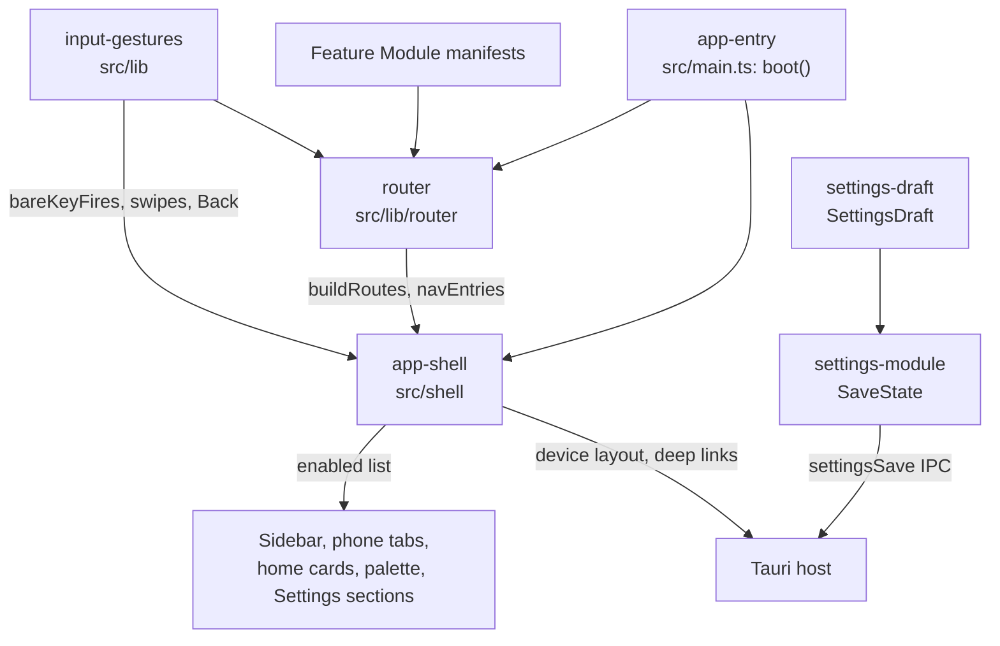
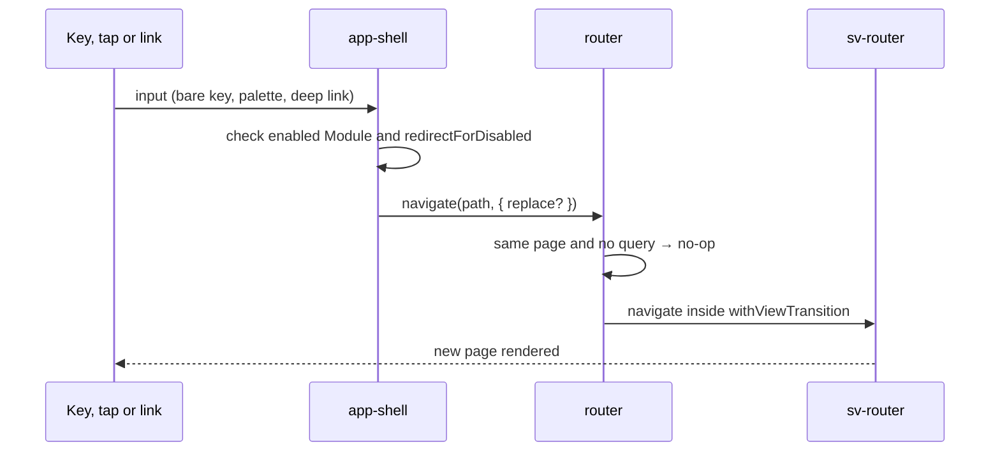

# Shell and Navigation

## Purpose

`Shell_and_Navigation` is the frontend layer that starts the Mnemora webview, decides which Modules are switched on, and builds the navigation around them: the sidebar, phone bottom tabs, home cards, Settings sections and the ⌘K palette. It also owns URL routing, single-key and gesture input, Android Back handling, and the holder for unsaved Settings edits. It contains no feature screens. Feature Modules plug in through their manifests and the shell reads those manifests.

## Architecture

Responsibilities by child:

| Child | Role |
|---|---|
| [app-entry](Shell_and_Navigation/app-entry.md) | `src/main.ts`. Installs the dev-only mock backend, installs global error handlers, then mounts `App.svelte`. |
| [app-shell](Shell_and_Navigation/app-shell.md) | Pure rules for enabled Modules, redirects, bare-key ownership, phone tabs, palette and shortcuts, sidebar layout and persistence, the Todo tree fold, and `mnemora://` deep links. |
| [router](Shell_and_Navigation/router.md) | Builds the route table from manifests, wraps `sv-router` in a navigation facade, provides `urlParam` query state, the Back interceptor stack and dynamic palette actions. |
| [input-gestures](Shell_and_Navigation/input-gestures.md) | Decides how input is read: bare keys, long press, swipes, on-screen keyboard, phone or desktop layout, OS checks, the editing hold lease, the leave-without-saving prompt and external links. |
| [settings-draft](Shell_and_Navigation/settings-draft.md) | `SettingsDraft` keeps unsaved edits apart from the saved snapshot. Setting a value back to its saved value removes the edit. |
| [settings-module](Shell_and_Navigation/settings-module.md) | `SaveState` sends the draft's changes to the core in one batch and commits on success. It also builds the copyable diagnostics report. |

Two design principles run through the module. Decisions are pure functions that are unit-tested. Only a few Svelte rune holders keep state. The module registry is the single source of truth: a Module contributes its routes, nav entry, home card, Settings section, overlay, bare keys and deep link through its manifest, so the shell needs no edits to add one.

## Key flows

**Startup.** `boot()` runs, then the mock backend is installed in dev browsers only, then global error handlers are installed, and then `App.svelte` mounts into `#app`. Module enablement is read from saved core settings and device switches, and redirects are held until those reads finish, so a cold start on a Sync URL does not bounce to Home.

**Navigation.** A key or click reaches the shell. The shell asks the router to navigate, and the router no-ops on the current page, replaces the history entry when staying on the page, and wraps the change in a View Transition. Android Back closes the newest open overlay before it navigates or leaves.

**Settings save.** Edits go into `settingsDraft`. `save.run` sends `changes()` as one `settingsSave` call. On success it calls `commit()`, and on failure it keeps the edits so the user can retry.

## Extending the module

- To add a Module to navigation, declare its manifest fields (`nav.order`, `routes`, and optionally `homeCard`, `settingsSection`, `overlay`, `bareKeys`, `openLink`). Nothing in the shell needs editing.
- Navigation is bare-key by design (ADR 0011). Adding a global modifier shortcut requires updating `resolveShortcut`, `runShortcut` and the hand-maintained `SHORTCUT_LIST`.
- Routes are registered only in manifests. A duplicate path makes `buildRoutes` throw at startup.

## Core component references

- [app-entry](Shell_and_Navigation/app-entry.md)
- [app-shell](Shell_and_Navigation/app-shell.md)
- [router](Shell_and_Navigation/router.md)
- [input-gestures](Shell_and_Navigation/input-gestures.md)
- [settings-draft](Shell_and_Navigation/settings-draft.md)
- [settings-module](Shell_and_Navigation/settings-module.md)