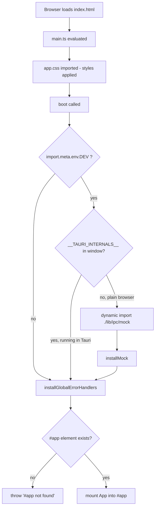
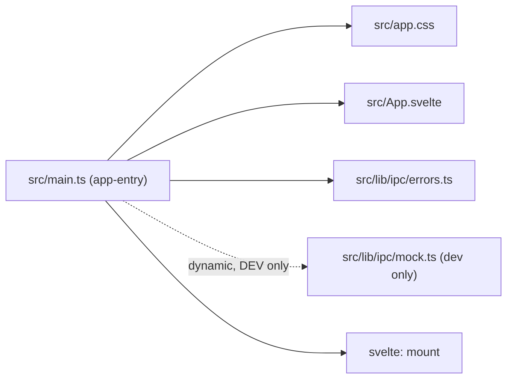
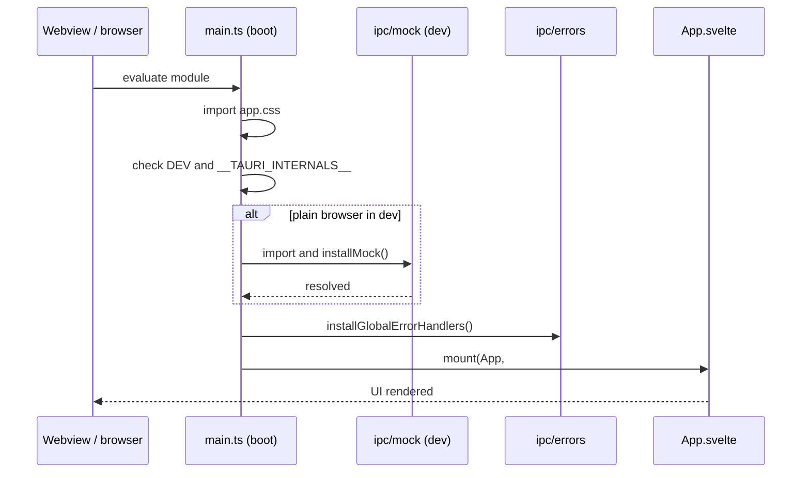

# app-entry

The `app-entry` module is the browser-side bootstrap of the Mnemora frontend. It is the first JavaScript that runs in the Svelte/Tauri webview. Its only source file, `src/main.ts`, exposes a single function, `boot`, which decides whether a mock backend is needed, installs global error handling, and mounts the root `App.svelte` component into the `#app` element.

For the shell that `App.svelte` renders after mounting, see [app-shell](app-shell.md). For the parent module overview, see [Shell_and_Navigation](../Shell_and_Navigation.md).

## Purpose and scope

| Concern | Handled here | Delegated to |
|---|---|---|
| Load global styles | Yes, `import './app.css'` | [Design_System/theme](../Design_System/theme.md) |
| Dev-only mock of the Rust side | Yes, conditional install | [ipc-mock-backend](../Tauri_Host_and_IPC_Bridge/ipc-mock-backend.md) |
| Global `error` / `unhandledrejection` capture | Yes, call only | [ipc-bridge](../Tauri_Host_and_IPC_Bridge/ipc-bridge.md) |
| Mount the root component | Yes | [app-shell](app-shell.md) |
| Routing, navigation, shortcuts | No | [router](router.md), [input-gestures](input-gestures.md) |

The module contains no state, no reactive stores and no IPC calls of its own. It is intentionally small so that every other module can assume the environment is ready by the time they run.

## Source file

`src/main.ts` (the only file in this module):

```typescript
import { mount } from 'svelte';
import './app.css';
import App from './App.svelte';
import { installGlobalErrorHandlers } from './lib/ipc/errors';

async function boot() {
  // Dev-only: in a plain browser there is no Rust side, so a mock stands in for it.
  if (import.meta.env.DEV && !('__TAURI_INTERNALS__' in window)) {
    await (await import('./lib/ipc/mock')).installMock();
  }
  installGlobalErrorHandlers();

  const target = document.getElementById('app');
  if (!target) throw new Error('#app not found');
  mount(App, { target });
}

void boot();
```

## Boot sequence



Key points about the order:

1. **Styles first.** `app.css` is a static import, so it is bundled into the entry chunk and is present before `boot` runs. The first-paint theme logic is covered in [Design_System/theme](../Design_System/theme.md).
2. **Mock before anything else touches IPC.** The mock is awaited before error handlers are installed and before mounting, so that no component can invoke a Tauri command before the mock is in place.
3. **Error handlers before mount.** Errors thrown while `App.svelte` initialises are already captured.
4. **Mount last.** `mount` from Svelte 5 creates the component tree synchronously under `#app`.

## Environment detection

The mock branch runs only when both conditions hold:

- `import.meta.env.DEV` is true. This is a Vite-defined flag that is `true` under the dev server and `false` in production builds. Because it is a compile-time constant, the dynamic `import('./lib/ipc/mock')` is eliminated from release bundles. See [Build_and_Packaging/vite_build_config](../Build_and_Packaging/vite_build_config.md).
- `'__TAURI_INTERNALS__' in window` is false. Tauri injects this global into the webview, so inside the desktop or Android app the real Rust backend is used and the mock is skipped.

In practice this means:

| Environment | DEV | `__TAURI_INTERNALS__` | Mock installed |
|---|---|---|---|
| `pnpm dev` opened in a plain browser | true | absent | yes |
| Tauri dev window | true | present | no |
| Production Tauri build (desktop or Android) | false | present | no |

The mock is only a development convenience; it never ships to users.

## Error handling and mounting

- `installGlobalErrorHandlers()` (from `src/lib/ipc/errors.ts`) registers the page-level handlers that report uncaught errors. Recent errors are kept for display and support diagnostics; see [ipc-bridge](../Tauri_Host_and_IPC_Bridge/ipc-bridge.md).
- The `#app` element is the single mount point defined in the HTML shell. If it is missing, `boot` throws a plain `Error`. Because `boot` is invoked with `void`, that rejection is not awaited by anything; it surfaces as an unhandled promise rejection in the console.
- `mount(App, { target })` returns the component instance, which this module does not keep.

## Dependencies



Downstream, `App.svelte` and the modules it composes (see [app-shell](app-shell.md)) depend on everything `boot` has prepared. Nothing in the frontend imports `main.ts`, so it is a leaf of the module graph and the only true entry point.

## Interaction with the rest of the system



## Maintenance notes

- **Do not add IPC calls here.** Anything that needs the backend belongs in a module that runs after mount, so that the mock and error handlers are already in place.
- **Keep the mock branch behind `import.meta.env.DEV`.** Removing the guard or the dynamic import would ship mock code in production.
- **If the root element changes**, update both `index.html` and the lookup here together.
- **Startup failures are silent to the user.** A failing `installMock` or missing `#app` produces only a console error, so check the console first when the window is blank.

## Related pages

- [Shell_and_Navigation](../Shell_and_Navigation.md): parent module overview.
- [app-shell](app-shell.md): the component tree mounted by this module.
- [router](router.md): routing set up inside `App.svelte`.
- [Tauri_Host_and_IPC_Bridge](../Tauri_Host_and_IPC_Bridge.md): the Rust side that the mock replaces in development.
- [Design_System/theme](../Design_System/theme.md): styles loaded through `app.css`.
- [Build_and_Packaging/vite_build_config](../Build_and_Packaging/vite_build_config.md): where `import.meta.env.DEV` comes from.
