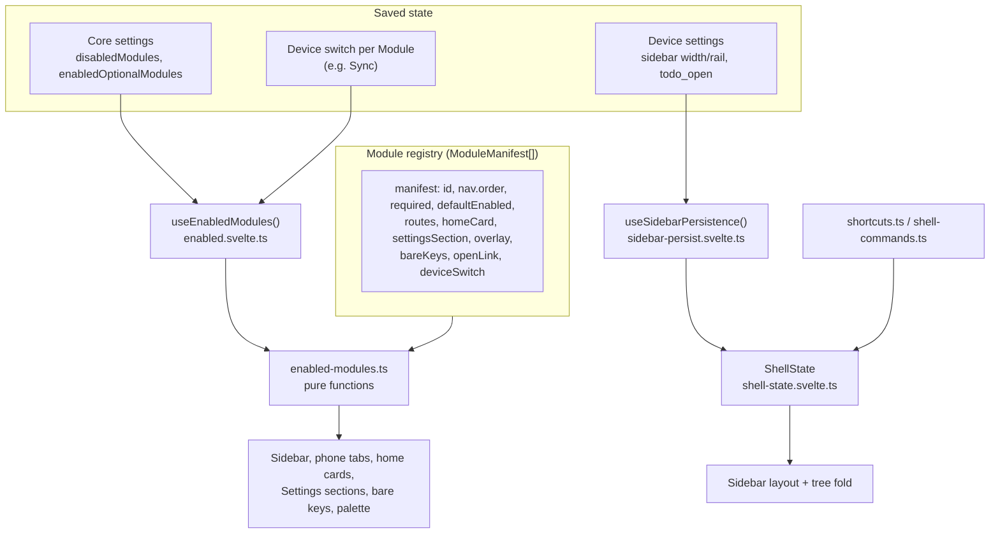
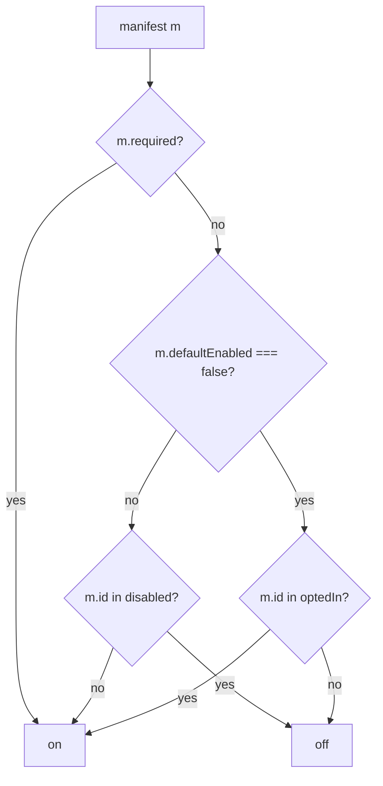
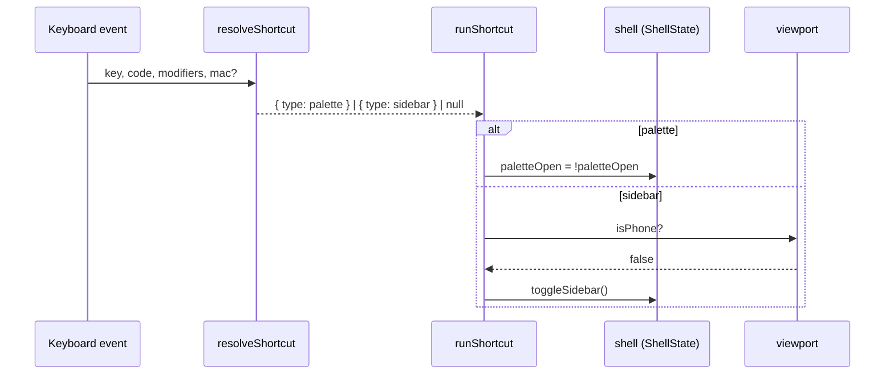
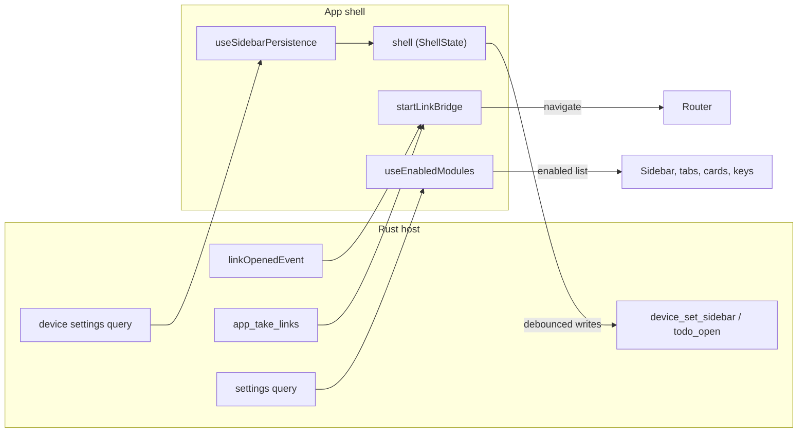

# App Shell

The app shell is the layer that decides **which Modules are on**, **which of them appear in navigation**, **which keys and gestures reach them**, and **how the sidebar looks and remembers its state**. It is pure logic plus a few Svelte 5 rune holders. Routing itself, the boot sequence and the Rust host are documented elsewhere (see [Related modules](#related-modules)).

## Purpose at a glance

| Concern | Where it lives | Main file |
|---|---|---|
| Which Modules are switched on | `enabledModules`, `useEnabledModules` | `src/shell/enabled-modules.ts`, `src/shell/enabled.svelte.ts` |
| Home cards, Settings sections, always-on overlays | `homeCards`, `moduleSettingsSections`, `overlayModules` | `src/shell/enabled-modules.ts` |
| Keeping a disabled Module's URL out of reach | `redirectForDisabled` | `src/shell/enabled-modules.ts` |
| Global bare keys owned by Modules | `bareKeyFor` | `src/shell/enabled-modules.ts` |
| Phone bottom tabs | `visibleTabs`, `toggleTab`, `moveTab`, `isMoreActive` | `src/shell/phone-tabs.ts` |
| ⌘K palette and Cmd/Ctrl shortcuts | `paletteItemsFor`, `runShortcut`, `resolveShortcut` | `src/shell/shell-commands.ts`, `src/shell/shortcuts.ts` |
| Sidebar width, rail, drag | `settleDrag`, `shownWidth`, `ShellState` | `src/shell/sidebar-layout.ts`, `src/shell/shell-state.svelte.ts` |
| Remembering sidebar layout and tree fold | `useSidebarPersistence` | `src/shell/sidebar-persist.svelte.ts` |
| Nested Todo tree fold rule | `onNavigate`, `toggle`, `rowClick`, `initialOpen` | `src/shell/tree-fold.ts` |
| `mnemora://` deep links | `routeForLink`, `startLinkBridge`, `startAppLinkBridge` | `src/shell/deep-links.ts` |

## Architecture

Two principles run through the module:

- **Pure core, thin Svelte wrapper.** Every decision (`enabledModules`, `redirectForDisabled`, `bareKeyFor`, `settleDrag`, `onNavigate`, `resolveShortcut`, …) is a plain function with unit tests beside it. Only `useEnabledModules`, `useSidebarPersistence` and `ShellState` touch reactive state, queries or IPC.
- **The registry is the single source of truth.** A Module contributes everything through its `ModuleManifest` (declared in `src/lib/router`). The shell never names a specific Module except for the Sync device switch and the `home` / `settings` required Modules.

## Module enablement

### The rule

`enabledModules(manifests, disabled, optedIn = [])` in `src/shell/enabled-modules.ts` keeps a manifest when one of these holds:

1. `required` is set (Home and Settings always stay on, and ignore both lists);
2. the Module is **default-on** (`defaultEnabled` is not `false`) and its id is **not** in `disabled`;
3. the Module is **default-off** (`defaultEnabled === false`, Sync today) and its id **is** in `optedIn`.

Unknown ids in either list are ignored, because the filter runs over the live registry. A default-off Module ignores `disabled` entirely; only an opt-in turns it on. Opting a default-on Module into `optedIn` changes nothing.

### Where the lists come from

`useEnabledModules()` (`src/shell/enabled.svelte.ts`) is called during component setup. It:

- reads saved core settings through `settingsQuery` and `readCore`, using `disabledModules` and `enabledOptionalModules`. A pending draft in the Settings screen does **not** count until saved (see [Settings draft](settings-draft.md));
- collects **device switches**: a Module with a `deviceSwitch(moduleContext)` hook contributes its on/off state from this device rather than from synced settings. Sync is the case in point, so a Module can be on for one device and off for another;
- exposes `list` (the enabled manifests) and `ready`. `ready` is false until every device switch has read its device file. A default-off Module reads as off until then, so `redirectForDisabled` is held back, otherwise the URL of a Sync page would be sent Home on a cold start.

The helpers `setModuleEnabled(disabled, id, on)` and `setOptedIn(optedIn, id, on)` return the new list. They are plain set operations with no duplicates, and they are what the Settings screen writes (see [Settings module](settings-module.md)).

### Derived views of the enabled set

| Function | Returns | Used by |
|---|---|---|
| `homeCards(enabled)` | `{ id, load }[]` for Modules with a `homeCard`, in `nav.order` | Home screen |
| `moduleSettingsSections(enabled)` | `{ id, label, icon, component }[]` after the core Settings sections | Settings |
| `overlayModules(enabled)` | Modules with an always-on `overlay`, in nav order | Root layout (mounted overlays such as quick add and search) |
| `redirectForDisabled(path, all, enabled)` | `'/'` when the path belongs to a disabled Module, otherwise `null` | Router guard |
| `bareKeyFor(enabled, key, ctx)` | the first matching `BareKey` | Global key handler |

`byOrder` sorts by `nav.order`, so the order of home cards, settings sections, overlays and bare-key precedence is the nav order, not the registry order.

### Routes of switched-off Modules

`redirectForDisabled` finds the owner of a pathname with `activeModuleId` (in `src/shell/phone-tabs.ts`). It matches an exact route path, or the **longest** route path that prefixes the pathname at a `/` boundary. Sub-paths such as `/journal/2026-01-01` therefore belong to the Journal. The owner is checked against the **whole** registry for ownership and against the enabled list for permission. Unknown paths return `null` and are left to the router's own not-found handling.

## Bare keys across Modules

Modules may claim single keys (`bareKeys: [{ key, when?, run }]`). The key lookup is case-insensitive. `bareKeyFor` walks the enabled Modules in nav order and returns the first claim whose `when(ctx)` holds. So:

- a key can be claimed by several Modules, one per page (for example `/` is a search key on both Journal and Todo, and each claim has a `when` that matches its own page);
- a claim whose `when` fails is skipped, so the next Module gets the key;
- a switched-off Module's claims disappear with it, because `bareKeyFor` only sees the enabled list.

Modifier shortcuts are a different, much smaller set (next section). The rule in `src/shell/shortcuts.ts` is that navigation is bare keys (ADR 0011), and the modifier layer only holds the palette and the sidebar.

## Phone tabs

`src/shell/phone-tabs.ts` manages the bottom tab bar on phones:

- `MAX_TABS = 4`.
- `toggleTab(tabs, id)` adds or removes a tab. Adding past the maximum returns the **same array**, so a caller can detect "nothing changed" by identity.
- `moveTab(tabs, id, -1 | 1)` swaps a tab with its neighbour. It returns the same array at either end.
- `visibleTabs(stored, known)` drops ids that name Modules that no longer exist, and caps the list at four. Stored state is never trusted blindly.
- `isMoreActive(activeId, tabIds)` lights the "More" control when the current Module (Settings included) is not pinned to a tab.

## Command palette and shortcuts

- `resolveShortcut(e, mac)` (`src/shell/shortcuts.ts`) uses **Cmd** on macOS and **Ctrl** elsewhere. It matches the physical `code` as well as the produced `key`, so `⌘K` still works on a layout that types another character. `\` opens the sidebar and accepts Alt or Shift, because some layouts only reach it that way. Every other modifier combination is refused.
- `runShortcut(action)` (`src/shell/shell-commands.ts`) toggles the palette, or toggles the sidebar on non-phone viewports only.
- `paletteItemsFor(enabled)` builds the ⌘K items with `buildPaletteItems`. Its theme commands call `setTheme`, which saves `core.theme` at once. A palette command is explicit, so it does not go through the Settings draft.
- `SHORTCUT_LIST` is a static, human-readable table for the keyboard help in Settings. It lists the shell's own keys together with the Modules' bare keys (Todo, Journal, navigation letters, and so on). It is documentation data and is not used for dispatch, so **when a Module's bare keys change, this list must be updated by hand**.

## Shell state and the sidebar

`ShellState` (`src/shell/shell-state.svelte.ts`) is a single shared rune object, exported as `shell`. It holds:

| Field | Meaning |
|---|---|
| `paletteOpen` | ⌘K palette is visible |
| `layout` | `{ width, rail }` of the sidebar |
| `treeOpen` | the nested Todo tree is unfolded |
| `treeUnset` | no fold choice has been saved yet; nothing is persisted until one changes |
| `layoutReady` | the device layout has been loaded; writes are blocked until then |

Methods: `toggleSidebar()` flips the rail, `resetSidebar()` restores the default width and expanded state.

### Layout rules

`src/shell/sidebar-layout.ts` holds the numbers and the pure rules:

| Constant | Value |
|---|---|
| `MIN_WIDTH` | 200 px |
| `MAX_WIDTH` | 360 px |
| `DEFAULT_WIDTH` | 248 px |
| `RAIL_WIDTH` | 60 px |
| `SNAP_BELOW` | 150 px |

- `settleDrag(px, current)`: a drag narrower than 150 px collapses to the rail and keeps the last expanded width, so the user does not lose it. Anything else is clamped to 200–360 px and expanded. The rule is the same from the rail or from the expanded state.
- `shownWidth(layout)`: 60 px in rail mode, the stored width otherwise.
- `toggleRail` and `resetLayout` are the two other transitions.

### Persistence

`useSidebarPersistence()` (`src/shell/sidebar-persist.svelte.ts`) is called once from the root. It works in three effects:

1. **Restore, once.** When the device settings query has succeeded or errored, it copies `width`, `rail`, `todo_open` into `shell` and sets `layoutReady`. A failed read still sets `layoutReady`, so the app runs with defaults rather than blocking. `treeUnset` becomes true when `todo_open` was never saved.
2. **Persist the tree fold**, debounced by `PERSIST_DEBOUNCE_MS`, through `commands.deviceSetTodoOpen`. It does nothing until `layoutReady`, and nothing while `treeUnset`, so a first visit does not write a default.
3. **Persist the layout**, debounced the same way, through `commands.deviceSetSidebar(width, rail)`.

The layout and the fold are stored **per device** (Device settings), not in the synced Settings. A phone and a laptop keep different sidebars. The Rust side of these commands is in [Tauri host and IPC bridge](../Tauri_Host_and_IPC_Bridge.md).

## Todo tree fold

Todo's sidebar nests Views and Lists under the Module row. `src/shell/tree-fold.ts` decides whether the tree is open. Its rule is a small state machine over `{ open, inside }`:

```mermaid
stateDiagram-v2
  [*] --> Outside_Folded
  Outside_Folded --> Inside_Unfolded: enter Todo (auto unfold)
  Inside_Unfolded --> Outside_Folded: leave Todo (auto fold)
  Inside_Unfolded --> Inside_Folded: chevron or row click
  Inside_Folded --> Inside_Unfolded: chevron or row click
  Outside_Folded --> Outside_Unfolded: chevron click (peek)
  Outside_Unfolded --> Outside_Folded: chevron click
  Outside_Unfolded --> Inside_Unfolded: enter Todo (auto unfold)
```

- `onNavigate(fold, inside)` applies the automatic rule **only when the Module membership changes**. Moving around inside or outside keeps the user's choice.
- `toggle(fold)` flips `open` and nothing else. It is the chevron.
- `rowClick(fold)` gives `'toggle'` inside the Module and `'enter'` outside it. Clicking the row from outside goes there rather than peeking.
- `initialOpen(saved, inside)` lets a saved choice win. Without one, the tree is open exactly when the app starts inside Todo.

The manual flip lasts only until the next enter or leave. The `open` flag is the only part persisted (via `treeOpen`).

## Deep links

`mnemora://‹module›?…` links open the app at a specific place. The module has three parts:

- `routeForLink(raw, manifests)` parses the URL. A malformed URL, a non-`mnemora:` scheme, an unknown host, or a Module without an `openLink` hook all go to `/`. The hook receives the parsed `URL` and returns the route.
- `startLinkBridge(deps)` takes the links queued before the page loaded (a cold start from the Todo widget), and then listens for `linkOpenedEvent` while the app runs. Only the **newest** link of a batch matters.
- The **first drain replaces** the current history entry, so a cold open has no Home entry behind it. The app waits for this drain before it draws anything. The listener is attached **before** the first drain, so a link that arrives during it is not lost.

`startAppLinkBridge()` wires the real dependencies: `commands.appTakeLinks`, `events.linkOpenedEvent`, `router.navigate` and the registry `modules`.

## Data flow summary

## Testing

Each pure rule has a Vitest file next to it:

- `enabled-modules.test.ts` covers enablement, required Modules, default-off Modules, cards, settings sections, redirects and bare-key precedence.
- `shortcuts.test.ts` covers Cmd vs Ctrl, physical-key matching, and the layouts that need Alt or Shift for `\`.
- `tree-fold.test.ts` covers every transition of the fold rule.
- The sidebar and phone tab helpers are exercised through the components that use them.

Run them with the usual test target (`make test`, see [Build and packaging](../Build_and_Packaging.md)).

## Extending the shell

- **Add a Module that appears in navigation**: give its manifest `nav.order`, `routes`, and optionally `homeCard`, `settingsSection`, `overlay`, `bareKeys` and `openLink`. Nothing in the shell needs editing.
- **Add a Module that is off by default**: set `defaultEnabled: false`. Its switch must be stored somewhere; a synced switch goes into `enabledOptionalModules`, and a per-device switch uses `deviceSwitch`, which the shell reads through `useEnabledModules`.
- **Add a global shortcut**: this is a decision point, because navigation is bare-key by design. Add the key in `resolveShortcut` and a `ShortcutAction` variant, then handle it in `runShortcut`, and document it in `SHORTCUT_LIST`.
- **Change the sidebar bounds**: edit the constants in `sidebar-layout.ts`. The persisted width is clamped on read by `settleDrag` on the next drag, so an out-of-range stored value is corrected the next time the user drags.

## Related modules

- [App entry](app-entry.md): `boot()` in `src/main.ts`, which starts the shell and the link bridge.
- [Router](router.md): `createAppRouter`, `ModuleManifest`, `RoutePath`, and the back button. The shell builds on those types.
- [Input gestures](input-gestures.md): `Keyboard`, `bareKeyFires`, long press and swipe, which feed `bareKeyFor` and `viewSwipeStep`.
- [Settings draft](settings-draft.md) and [Settings module](settings-module.md): the saved and pending values that `useEnabledModules` reads and the Settings screen writes.
- [Sync client surface](../Sync_Client_Surface.md): the default-off Module and its device switch.
- [Feature client UI](../Feature_Client_UI.md): Todo's views and lists, the content of the tree fold, and the Journal and Todo bare keys.
- [Design system](../Design_System.md): `PageHeaderState`, the palette filter and the tooltip gate that the shell's UI relies on.
- [Tauri host and IPC bridge](../Tauri_Host_and_IPC_Bridge.md): the Rust commands and events used above (`deviceSetSidebar`, `deviceSetTodoOpen`, `appTakeLinks`, `linkOpenedEvent`).
