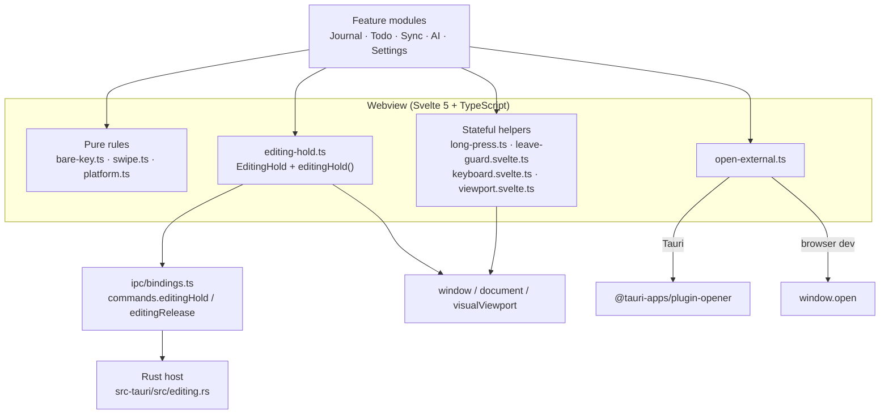
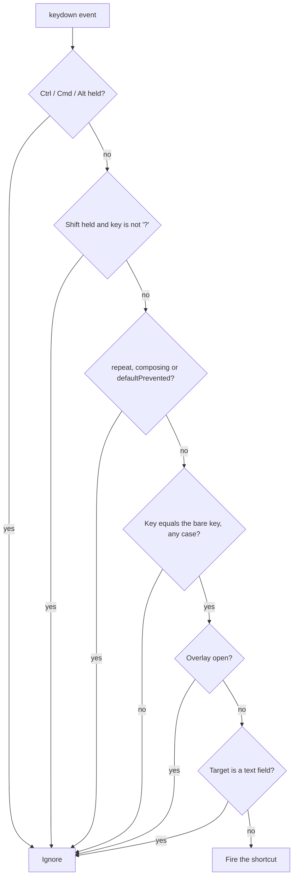
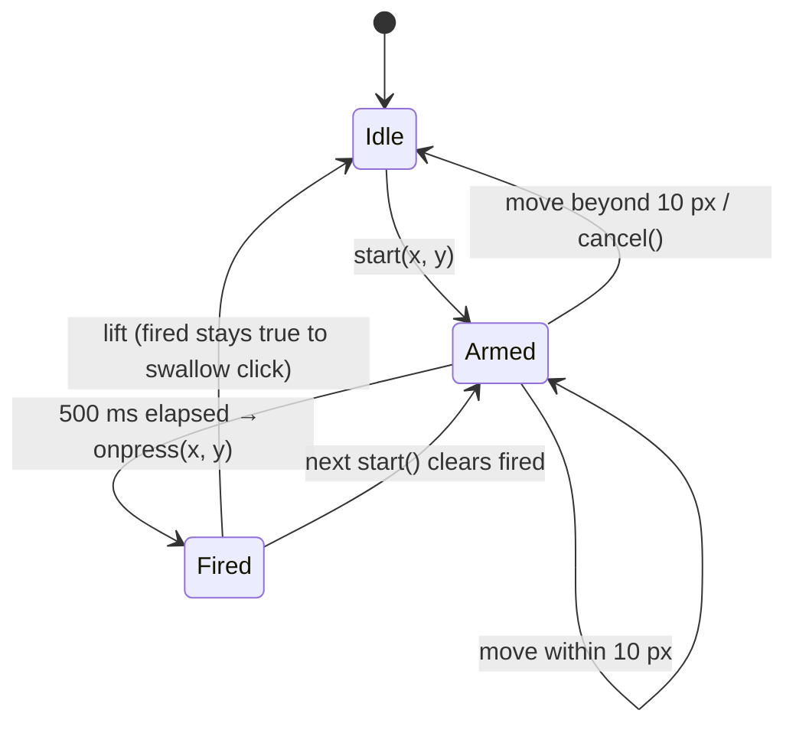
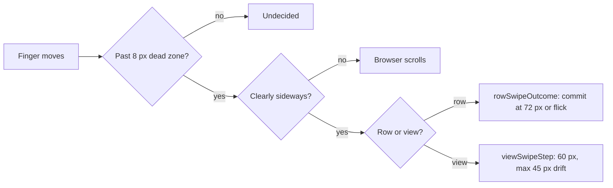
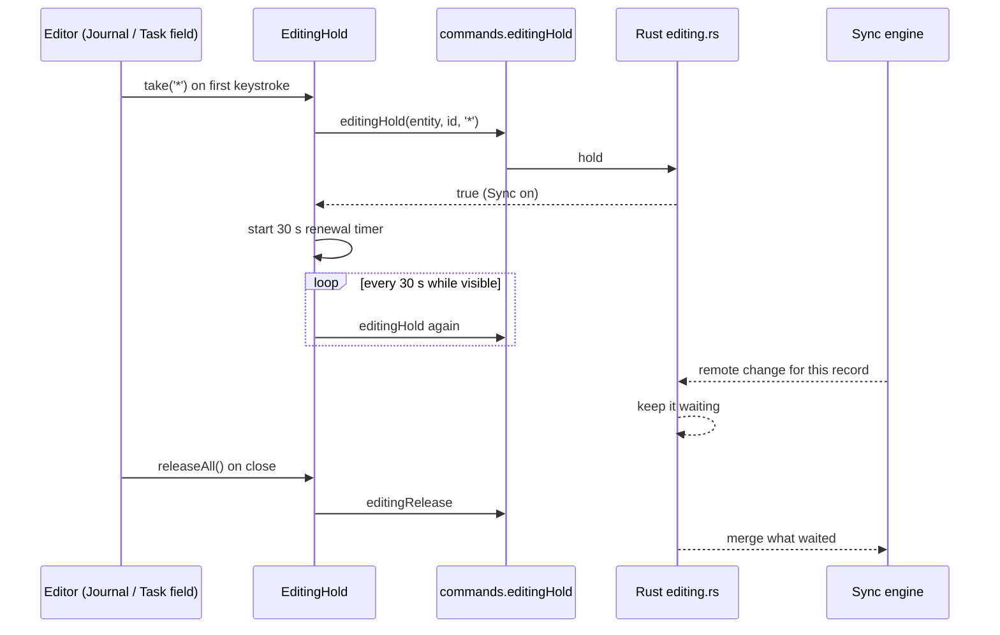
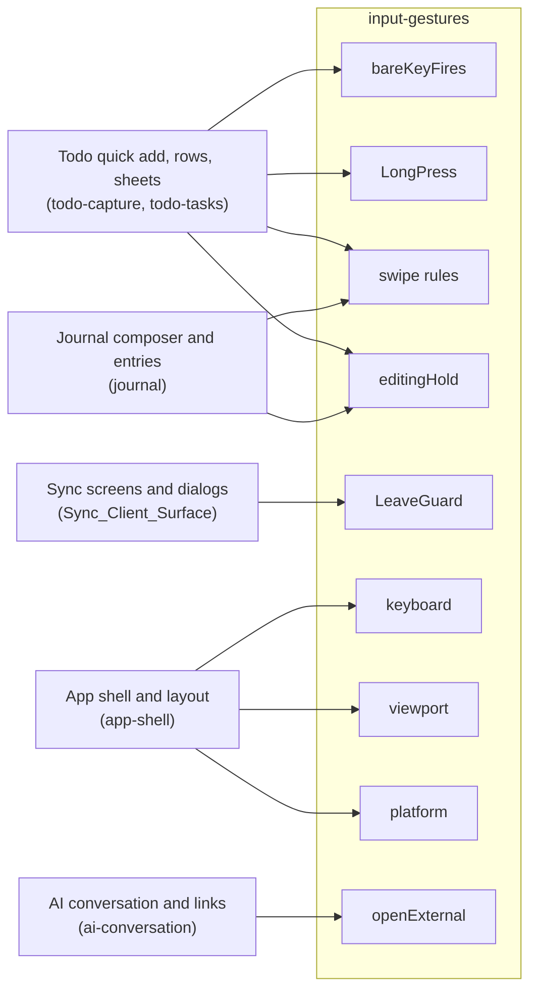

# Input Gestures

## Introduction

The `input-gestures` module is the client-side layer that decides *how a person's input is read* across the Mnemora UI: bare single-key shortcuts, press-and-hold gestures, swipes, the on-screen keyboard, the phone/desktop layout switch, the platform (OS) checks, a "hold the record while I type" lease, and the one place that opens external links. It contains no screens of its own. Other modules (Journal, Todo, Sync, AI) ask it questions such as "should this key fire here?" or "has this touch been held long enough?" and act on the answer.

All files live under `src/lib/` (the framework-free and Svelte-rune helpers shared by the whole app). For the shell that consumes these helpers see [app-shell](app-shell.md) and [router](router.md). For the design-system primitives that sit on top of gestures (sheets, pinned rows, tooltips gated by pointer type) see [ui-kit](../Design_System/ui-kit.md).

---

## Responsibilities at a glance

| Concern | Source file | What it answers |
|---|---|---|
| Bare single keys (e.g. `Q`, later `N`) | `src/lib/bare-key.ts` | Should a letter shortcut fire right now? |
| Press-and-hold | `src/lib/long-press.ts` | Has a touch rested long enough, without drifting? |
| Swipes on rows, views and sheets | `src/lib/swipe.ts` | Which way did the finger go, and does it commit? |
| On-screen keyboard | `src/lib/keyboard.svelte.ts` | How tall is the keyboard right now? |
| Phone vs desktop layout | `src/lib/viewport.svelte.ts` | Is this a phone-sized window or a mobile OS? |
| OS detection and labels | `src/lib/platform.ts` | Which OS, and what does ⌘ / Ctrl look like? |
| Editing hold (sync lease) | `src/lib/editing-hold.ts` | Keep other devices' changes waiting while I type |
| Leave-with-unsaved-work prompt | `src/lib/leave-guard.svelte.ts` | Ask "leave without saving?" and await the answer |
| External links | `src/lib/open-external.ts` | Open a URL in the system browser (or a new tab in dev) |

---

## Architecture

Two kinds of code live here:

- **Pure rules** take plain data (a key event, a `dx`/`dy` distance) and return a decision. They have no DOM dependency beyond a small structural type, so they are unit-tested directly (`bare-key.test.ts`).
- **Stateful helpers** own a little state (a timer, a pending promise, a reactive flag) and receive their timers or events through constructor options so tests can drive time.

For how the Rust side stores and merges what a hold protects, see [Sync_Replication_Engine/sync_data_merge/sync_data_merge_journal_holds.md](../Sync_Replication_Engine/sync_data_merge/sync_data_merge_journal_holds.md). For the Tauri command surface that carries `editing_hold` / `editing_release`, see [Tauri_Host_and_IPC_Bridge/app_shell.md](../Tauri_Host_and_IPC_Bridge/app_shell.md).

---

## Components

### 1. Bare single-key shortcuts (`bare-key.ts`)

A "bare key" is a letter pressed with no modifier, which must never steal a letter the person is typing. The module exports a pure decision function and a helper that detects an open overlay.

- `bareKeyFires(e, key, scene)` returns `true` only when all of these hold:
  - no `⌘`/Ctrl/Alt/Shift (Shift is allowed only for `?`, the key typed with it);
  - not a held-down auto-repeat, not an IME composition, and not already `defaultPrevented`;
  - the key matches, case-insensitively (`q` fires on `Q`);
  - no dialog, alert dialog, menu or listbox is open (`scene.overlayOpen`);
  - the event target is not a text field (`input`, `textarea`, `select`, a `contenteditable` element, or `role="textbox"`).
- `isTypingTarget(target)` performs the text-field check using `closest()`, and treats a non-element target as "not typing".
- `overlayOpenIn(doc)` checks the document for `[role="dialog"]`, `[role="alertdialog"]`, `[role="menu"]` or `[role="listbox"]`.

Per the file header, bare keys are the app-wide single-key shortcuts (Q for Todo quick add; N for the Journal is planned), recorded in ADR 0011 under `docs/adr/`.

### 2. Press-and-hold (`long-press.ts`)

`LongPress` turns pointer positions into a single "long press" event.

- `start(x, y)` arms a timer (`LONG_PRESS_MS` = 500 ms). Any previous timer is cancelled and the `fired` flag is cleared.
- `move(x, y)` cancels the press if the pointer has moved more than `LONG_PRESS_SLOP_PX` (10 px) from the start point. Small jitter is forgiven.
- `cancel()` is called on lift, interruption or scroll.
- When the timer fires, `onpress(x, y)` runs once, at the **start** coordinates, and `fired` becomes `true`. The caller uses `fired` to swallow the click that the browser will emit after the lift.

The timer function is injectable (`setTimer`, defaulting to `./timing`), which is how `long-press.test.ts` verifies the 500 ms delay, the slop, and the swallow flag without real time.

### 3. Swipes (`swipe.ts`)

All gesture thresholds are constants in one place:

| Constant | Value | Used for |
|---|---|---|
| `AXIS_LOCK_PX` | 8 | Dead zone before the direction is decided |
| `ROW_COMMIT_PX` | 72 | Sideways row swipe that commits |
| `FLICK_MIN_PX` / `FLICK_PX_PER_MS` | 40 / 0.6 | Quick flick that commits short of the full distance |
| `VIEW_SWIPE_PX` / `VIEW_SWIPE_MAX_DY_PX` | 60 / 45 | Swipe on the title or segment bar to change view |
| `SHEET_CLOSE_PX` | 110 | Pull-down that closes a sheet |

Exports:

- `viewSwipeStep(dx, dy)` (the listed component) returns `-1` (previous view, swiped right), `1` (next view, swiped left), or `0`. It requires the horizontal travel to be at least 60 px and the vertical drift to be at most 45 px.
- Same file, not in the listed component set: `lockAxis` decides whether a gesture is sideways (`x`) or vertical (`y`, left to the browser to scroll); `rowOffset` gives the visual position of a dragged row (free up to 72 px, then resisted at 35 %, and locked towards a side that has no action); `rowSwipeOutcome` returns `'right'`, `'left'` or `null` on release; `sheetShouldClose` closes a sheet at 110 px or on a fast flick of at least 40 px.

### 4. On-screen keyboard (`keyboard.svelte.ts`)

`keyboard` is a singleton with two reactive values:

- `inset` (`$state`): the height the keyboard covers, computed by `keyboardInset(window.innerHeight, vv.height, vv.offsetTop)` from `visualViewport`.
- `open` (`$derived`): `isKeyboardOpen(inset)`.

The app shell pads its bottom by `inset` so that content above the keyboard stays visible. Listeners on `resize` and `scroll` are attached **only on mobile OSes**; on desktop and in the browser the inset stays `0` and `open` stays `false`.

### 5. Phone versus desktop layout (`viewport.svelte.ts`)

`viewport` exposes:

- `narrow`: `true` while `(max-width: 719.98px)` matches, updated by a `matchMedia` change listener.
- `isPhone` (derived): `narrow || isMobileOs`. A mobile OS is always phone layout, regardless of width.

On construction and on every change it sets the `data-phone` attribute on `<html>`. The comment in the source explains why this is synchronous at module load: the first paint must already agree with the layout switch, and the `phone:` CSS variant keys off that attribute.

### 6. Platform helpers (`platform.ts`)

- `detectOs(ua)` maps a user-agent string to `'android' | 'ios' | 'macos' | 'windows' | 'linux' | 'web'`. Android is checked first, then iPhone/iPad, then Mac, then Windows, then Linux/X11. Anything else is `'web'`.
- Module constants built from it: `os`, `isMac`, `isMobileOs` (Android or iOS).
- `inTauriWindow()` is `isTauri()` from `@tauri-apps/api/core`. It is `false` in a browser and in the dev mock.
- `modLabel` and `shortcutLabel(key)` produce the display form (`⌘K` on macOS, `Ctrl+K` elsewhere).
- `hasMod(e)` is the "primary modifier" test: `metaKey` on macOS, `ctrlKey` elsewhere, and never with Alt.

Note the asymmetry: `hasMod` is a *modifier* check for shortcuts, while `bareKeyFires` is the *no-modifier* check for bare keys. Both live in this module so the two rules cannot disagree about what "Cmd/Ctrl" means.

### 7. Editing hold: a sync lease (`editing-hold.ts`)

This is the most behaviourally important part. While a person types into an Entry, or into a field of a Task, changes that other devices make to the same record must wait, otherwise text jumps under the cursor. The Rust side keeps those incoming changes apart and merges them when the hold ends. This file is the client half of that contract.

`EditingHold` manages a set of **scopes** on one record (`WHOLE = '*'` means the whole record; a field name such as `title` or `notes` means one field).

- `take(scope)`: takes the hold, and if it succeeds and Sync is on, starts a renewal timer every `HOLD_RENEW_MS` (30 s). Calling it again for a held scope does nothing, so it is safe to call on every keystroke.
- `renewNow()`: renews all held scopes immediately (used when the window is shown again).
- `release(scope)`: stops the timer, forgets the scope, and tells Rust to release it. The Rust side merges what waited.
- `releaseAll()`: releases everything, for example when the editor closes.
- `has(scope)`: whether the scope is currently held.

Design points stated in the source:

- The hold is a **lease**. Rust lets a hold lapse after two minutes, so it is renewed every 30 s while the editor is open and the window is visible. If the editor vanishes (app to background, webview death), the lease expires by itself and cannot block sync for good.
- Renewal is skipped while the window is hidden (`visible()` is false). It resumes at once when the window is shown again (`onShown`).
- With Sync off, Rust answers `false` to `hold`, and no timer is started. Only one call is made.
- Failures are swallowed. The worst case is that a change lands without waiting.

`editingHold(entity, entityId)` builds an `EditingHold` wired to the real world:

- `hold` calls `commands.editingHold(entity, entityId, scope)` and treats `status === 'ok' && data === true` as "Sync is on".
- `release` calls `commands.editingRelease`.
- `repeat` uses `setInterval`/`clearInterval`.
- `visible` reads `document.visibilityState`.
- `onShown` listens for `visibilitychange`.

Known gaps, found while reading the code (not covered by the tests):

1. **Hidden at first take.** `take()` only starts the renewal timer if the first `hold` call returns `true`. `#renew` returns `false` without calling Rust when the window is hidden, so a hold taken while hidden never gets a timer. `renewNow()` renews once when the window is shown, but does not start a timer, so the lease can lapse after two minutes of an open editor. Consider starting the timer on `take` regardless of the first answer, and letting the timer skip hidden ticks.
2. **Sync off and hidden look identical.** Both return `false` from `#renew`, so a "hidden" result is read as "nothing to renew". That is correct for Sync off, but it makes gap 1 easier to hit.
3. **Ordering of concurrent calls.** `release()` can be called before the first `hold` IPC has returned. Nothing in this module serialises the two calls, so the order in which Rust receives them is assumed, not enforced. The test "starts no timer when released before Rust answered" checks only the timer.

### 8. Leave-with-unsaved-work prompt (`leave-guard.svelte.ts`)

`LeaveGuard` is a tiny promise bridge between a screen and its confirmation dialog:

- `ask()` sets `open = true` and returns a promise that resolves when the user answers.
- `answer(leave)` sets `open = false`, resolves the pending promise with `leave`, and clears it.

The dialog binds to `open`; the screen awaits `ask()` before discarding unsaved work. Calling `answer` with nothing pending is harmless.

### 9. External links (`open-external.ts`)

`openExternal(url)` opens a URL in the system browser.

- In a Tauri window it lazily imports `@tauri-apps/plugin-opener` and calls `openUrl`.
- In a plain browser (including the dev mock) it calls `window.open(url, '_blank', 'noopener,noreferrer')`.

Using a dynamic import keeps the opener plugin out of the browser path.

---

## How consumers use the module

For the screens behind these arrows see [todo-tasks](../Feature_Client_UI/todo-tasks.md), [todo-capture](../Feature_Client_UI/todo-capture.md), [journal](../Feature_Client_UI/journal.md), [ai-conversation](../Feature_Client_UI/ai-conversation.md) and [Sync_Client_Surface](../Sync_Client_Surface.md). Sync's conflict and hold behaviour is described in [Sync_Replication_Engine](../Sync_Replication_Engine.md).

---

## Testing

| Test file | What it locks down |
|---|---|
| `src/lib/bare-key.test.ts` | Bare key fires only unmodified, case-insensitive, outside text fields and overlays; `?` takes Shift; repeats, IME and handled keys are ignored; `overlayOpenIn` recognises all four roles |
| `src/lib/long-press.test.ts` | Fires once at start coordinates after 500 ms; cancelled by lift or by drift past 10 px; a new press clears the swallow flag |
| `src/lib/editing-hold.test.ts` | Holds at once; renews every 30 s; takes a scope once; `releaseAll` releases only held scopes; a failing Rust call is ignored; Sync off means one call and no timer; no renewal while hidden, immediate renewal when shown |

`swipe.ts`, `keyboard.svelte.ts`, `viewport.svelte.ts`, `platform.ts`, `leave-guard.svelte.ts` and `open-external.ts` have no dedicated test file in the module listing. Their behaviour is covered only indirectly by the consumers' tests.

Tests run through the repo's `make test` target (see [Build_and_Packaging](../Build_and_Packaging.md)). No browser or emulator is required: the tests inject timers, documents and IPC functions.

---

## Extending the module

- **New bare key:** call `bareKeyFires(event, 'n', scene)` from a window-level `keydown` listener, with `scene.target = event.target` and `scene.overlayOpen = overlayOpenIn(document)`. Do not re-implement the modifier or text-field checks.
- **New press gesture:** create a `LongPress` with an `onpress` callback, and check `fired` in the click handler to swallow the click that follows a long press.
- **New held record:** create one `editingHold(entity, entityId)` per open editor, call `take(scope)` on edits, and `releaseAll()` on close. Use `WHOLE` for a whole-record editor.
- **New threshold:** change the named constant in its file. Each constant is exported, so the tests and consumers see the same value.
