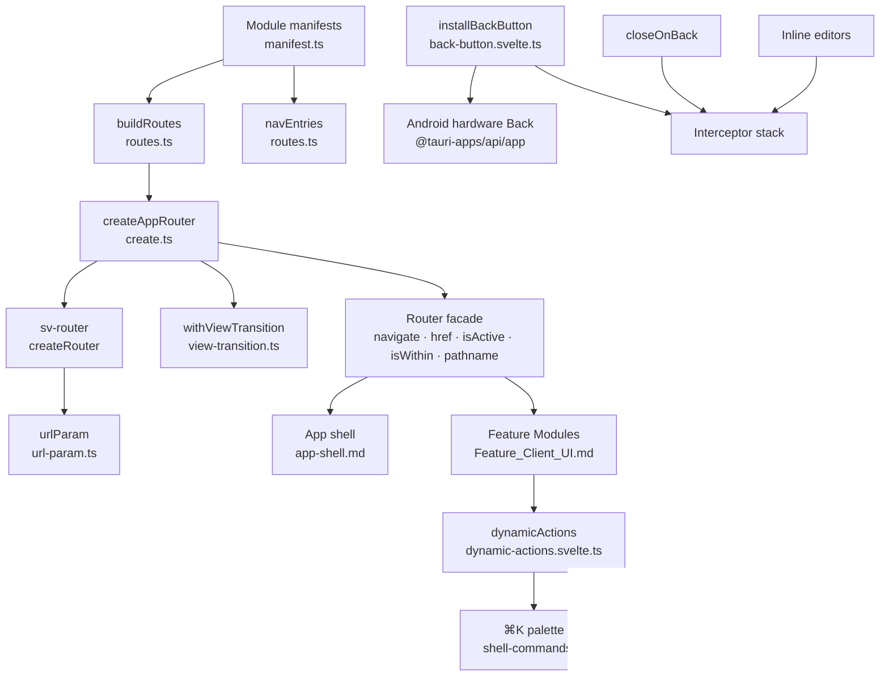
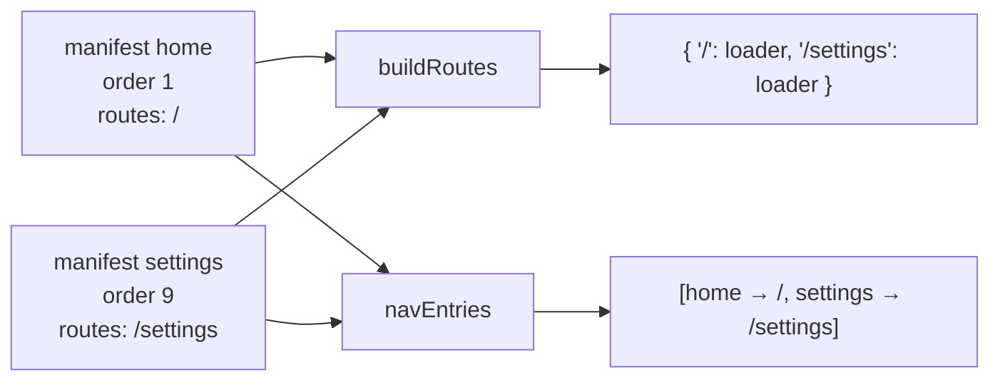
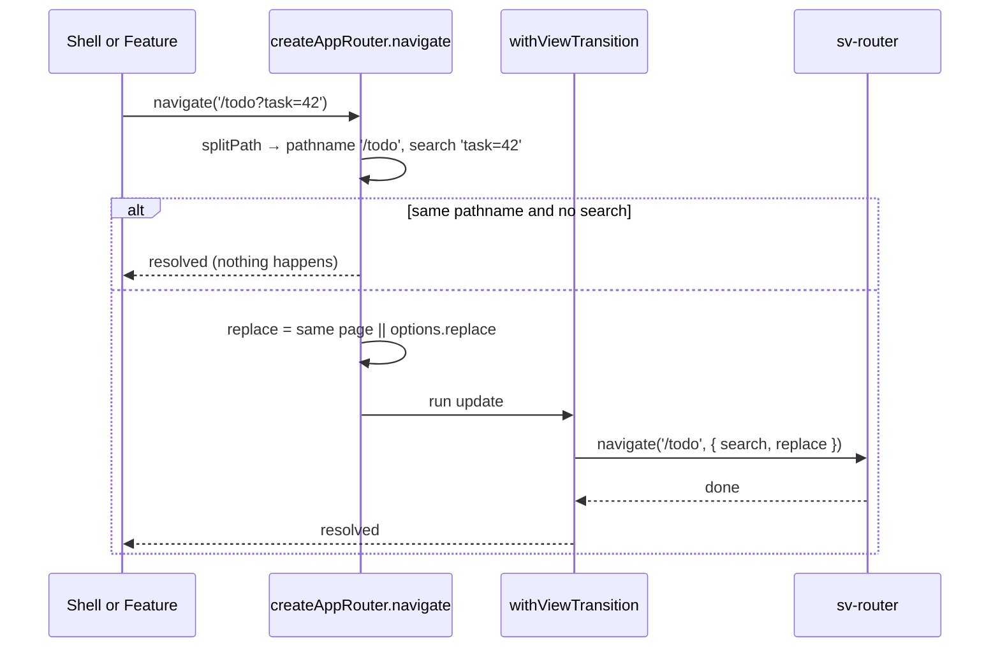
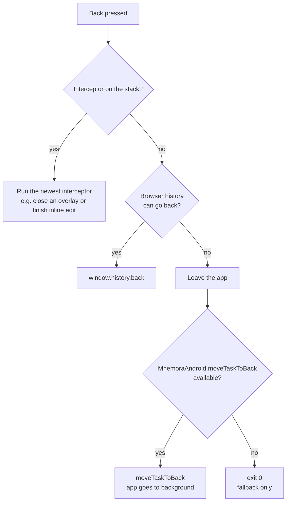
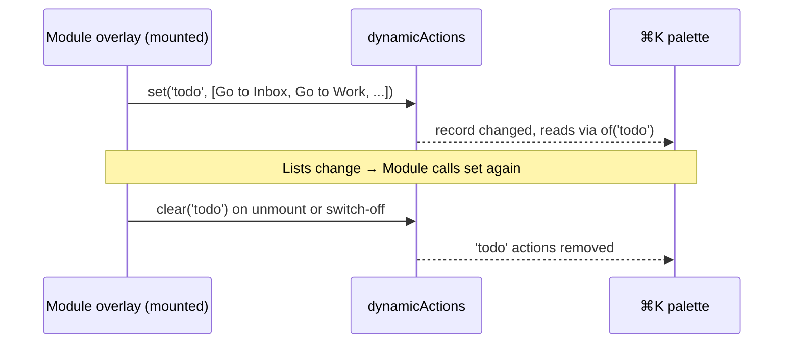

# Router

The router module is the navigation layer of the client shell. It wraps `sv-router` (history mode), builds the route table from Module manifests, and provides the small helpers that the rest of the UI uses for navigation: URL query state, Android Back handling, and per-Module command-palette actions. It lives in `src/lib/router/` and is consumed by the app shell described in [app-shell.md](app-shell.md) and by every feature Module in [Feature_Client_UI.md](../Feature_Client_UI.md).

The module has no persistent state of its own. Its state is the browser URL, the in-memory stack of Back interceptors, and the reactive map of dynamic palette actions.

## Contents

| Area | File | Purpose |
|---|---|---|
| Route table | `routes.ts` (tested in `routes.test.ts`) | Flattens Module routes into one path→component map; orders nav entries |
| Router facade | `create.ts` | `createAppRouter`: navigation, hrefs, active checks, same-page handling |
| Query state | `url-param.ts` | `urlParam`: one reactive query parameter, optionally pushed to history |
| Back button | `back-button.svelte.ts` | Interceptor stack, overlay helper `closeOnBack`, Android hardware Back |
| Palette actions | `dynamic-actions.svelte.ts` | `dynamicActions`: data-driven ⌘K actions keyed by Module |
| Transitions | `view-transition.ts` (tested in `view-transition.test.ts`) | Wraps route changes in a View Transition |

## Architecture

The manifest-driven route table is the only place where paths are registered. `createAppRouter` is the only object that talks to `sv-router` directly; everything else uses its facade or `urlParam`, which reads the same `searchParams` store.

## Route table

`buildRoutes(manifests)` flattens every Module's `routes` list into a single `Record<path, component>`. The component values are the lazy loaders declared in each manifest. Two Modules that claim the same path make `buildRoutes` throw an error that names the path, so a collision fails at startup rather than silently shadowing a page.

`navEntries(manifests)` returns the sidebar and phone-tab entries sorted by `nav.order`. Each entry links to the Module's first route. The shell uses these entries to build navigation; the sidebar and tab behaviour are documented in [app-shell.md](app-shell.md).

## Navigation facade

`createAppRouter(manifests)` returns the object that the shell and Modules use. It is a thin layer over sv-router with three additions.

- **Query-aware navigation.** A path may carry a query string such as `/todo?task=‹id›`. `splitPath` separates the pathname from the search.
- **No-op on the current page.** If the target pathname equals the current one and there is no query, `navigate` resolves immediately without creating a history entry.
- **Replace when staying put.** If the target is the current page with a query, or the caller passes `replace: true`, the current history entry is replaced. This stops Back from walking through a no-op query change.

Every real navigation runs inside `withViewTransition`, so route changes can animate where the browser supports View Transitions.

| Member | Behaviour |
|---|---|
| `navigate(path, { replace? })` | Navigates, honouring the rules above. Returns a promise. |
| `href(path)` | Resolves a path to its URL via `router.p`. |
| `isActive(path)` | Exact-match active check. |
| `isWithin(path)` | True for the path or a sub-page (`/sync` while `/sync/activity` is open). |
| `pathname` | Getter for the current pathname. |

### Navigation sequence

### Path-level behaviour to rely on

- Navigating to the current page with no query does nothing, so a Module can call `navigate` defensively without adding history.
- Setting a query on the current page replaces the entry; Back returns to the page before it, not to the same page without the query.
- Navigating to a different page always pushes unless the caller asks for `replace`.

## Query state (`urlParam`)

`urlParam` exposes one query parameter of the current URL. It is used for state that should survive a reload and be reachable by Android Back, most notably the Todo task sheet, which is opened as `/todo?task=‹id›`.

| Method | Behaviour |
|---|---|
| `get(name)` | Reactive read; `null` when absent. |
| `set(name, value, replace = false)` | Writes the parameter. Pushes a history entry unless `replace` is true. |
| `delete(name, replace = false)` | Removes the parameter, with the same history rule. |

Because a `set` pushes history by default, opening a sheet and pressing Back closes it. Callers that adjust the parameter as a correction, rather than as a user action, should pass `replace = true`.

## Android Back handling

Android hardware Back is handled by one function, `handleBack`, which resolves each press in a fixed order.

Key rules:

- **Interceptors are a LIFO stack.** `interceptBack(handler)` pushes a handler and returns a function that removes it. Only the newest handler runs, so nested overlays close one at a time.
- **Overlays use `closeOnBack`.** Called during component init, it registers an effect. While `isOpen()` is true the effect holds an interceptor that calls `close`; when the overlay closes, the effect's cleanup removes the interceptor. Back therefore closes a Sheet, Popover, Menu or Dialog before it navigates.
- **Editors use `interceptBack` directly.** For transient modes such as inline editing, where Back means "finish". See [input-gestures.md](input-gestures.md) for the editing hold that goes with these modes.
- **Leaving is not `exit(0)`.** At the root, the app is sent to the background with `moveTaskToBack` through the Android bridge (`window.MnemoraAndroid`). The code comment records that `exit(0)` runs libc destructors while the render thread still draws, which aborts the app (#51). `exit(0)` remains only as a fallback when the bridge lacks `moveTaskToBack`. The bridge itself is implemented on the Android side; see [Android_Integration.md](../Android_Integration.md).

`installBackButton()` wires this up. It does nothing unless the platform is Android and the page runs inside Tauri (`__TAURI_INTERNALS__` is present). Otherwise the browser or desktop already handles Back. On Android it dynamically imports `onBackButtonPress` and `exit` from `@tauri-apps/api/app` and passes each press to `handleBack` with the real history and leave functions. The Tauri host side is described in [Tauri_Host_and_IPC_Bridge.md](../Tauri_Host_and_IPC_Bridge.md).

## Dynamic palette actions

Some ⌘K actions depend on data a Module loads at runtime. Todo's "Go to ‹List›" action exists once per List, so it cannot be listed in the static manifest. `dynamicActions` holds these actions per Module.

| Method | Behaviour |
|---|---|
| `of(moduleId)` | Returns the Module's actions, or `[]`. |
| `set(moduleId, actions)` | Replaces the Module's actions. |
| `clear(moduleId)` | Removes the Module's entry. |

The state is a `$state.raw` record. Each `set` and `clear` builds a new object instead of mutating, so the palette, which reads through `of`, re-renders when a Module's list changes. `set` and `clear` read the current record with `untrack`, so a Module's effect that calls `set` does not subscribe to the very value it writes.

Lifecycle, as documented in the source: a Module's always-on overlay calls `set` while it is mounted and `clear` when it goes. A Module that is switched off is not mounted, so its actions disappear with it. The palette merges these with the manifest's own actions; the merge is handled by the shell (see [app-shell.md](app-shell.md)).

## Dependencies

| Dependency | Used by | Role |
|---|---|---|
| `sv-router` | `create.ts`, `url-param.ts` | Route table, navigation, `searchParams` store |
| `svelte` (`$state`, `$effect`, `untrack`) | `back-button.svelte.ts`, `dynamic-actions.svelte.ts` | Reactivity and effect lifecycle |
| `../platform` (`os`) | `back-button.svelte.ts` | Restricts Back handling to Android |
| `@tauri-apps/api/app` | `back-button.svelte.ts` | `onBackButtonPress`, `exit` |
| `window.MnemoraAndroid` | `back-button.svelte.ts` | `moveTaskToBack` bridge |
| `./manifest` types | `routes.ts`, `create.ts`, `dynamic-actions.svelte.ts` | `ModuleManifest`, `RoutePath`, `ModuleAction` |
| `./path` | `create.ts` | `splitPath`, `isWithin` |

Nothing in the router imports from feature Modules. The dependency runs one way: Modules declare manifests, and the router consumes them.

## Consumers

- **App entry and shell** (`src/main.ts`, `src/shell/`): build the router from the enabled manifests, call `installBackButton`, and render sidebar and phone tabs from `navEntries`. See [app-shell.md](app-shell.md) and [app-entry.md](app-entry.md).
- **Feature Modules**: call `navigate` and `href`, use `urlParam` for sheet state, use `closeOnBack` in overlays, and set `dynamicActions` from their overlays. See [Feature_Client_UI.md](../Feature_Client_UI.md).
- **Design system**: overlay and sheet components rely on `closeOnBack`; see [Design_System.md](../Design_System.md).

## Testing

| Test file | What it pins down |
|---|---|
| `routes.test.ts` | Flattening into one map; duplicate paths throw and name the path; nav entries sorted by order and linked to the first route |
| `back-button.test.ts` | An open interceptor takes Back; otherwise history goes back; at the root the app leaves |
| `view-transition.test.ts` | A superseded transition (`AbortError`) still resolves the route change without logging an error; real errors reach the caller; the fade-off marker `root.dataset.viewTransition` stays on while a newer transition runs and is removed when the newest finishes |

Run the suite with `pnpm test` (see the `test` script in `package.json`), or `make test` for the full project. The `view-transition` tests stub `window.matchMedia`, which indicates the implementation checks it before animating.

## Adding a route or overlay

1. Declare the route in the Module's manifest; do not register paths anywhere else. Duplicate paths will fail `buildRoutes`.
2. Navigate with `createAppRouter.navigate` (or the facade the shell exposes), passing a query for sheet state rather than a new path.
3. For a new overlay, call `closeOnBack(isOpen, close)` during component init so Android Back closes it first.
4. For data-driven palette actions, call `dynamicActions.set` from a mounted overlay and `clear` on teardown.

## Known limits

- `closeOnBack` must run during component init, because it relies on `$effect`.
- The interceptor removal matches the last occurrence of a handler. Registering the same function twice and removing one leaves the other on the stack.
- `urlParam.get` returns `String(value)`; values are not parsed into numbers or other types.
- The `exit(0)` fallback in `installBackButton` is kept for bridges without `moveTaskToBack`; it should not be relied on.
