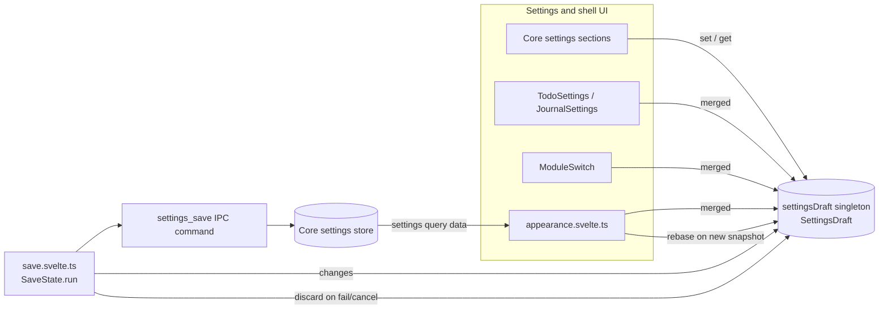
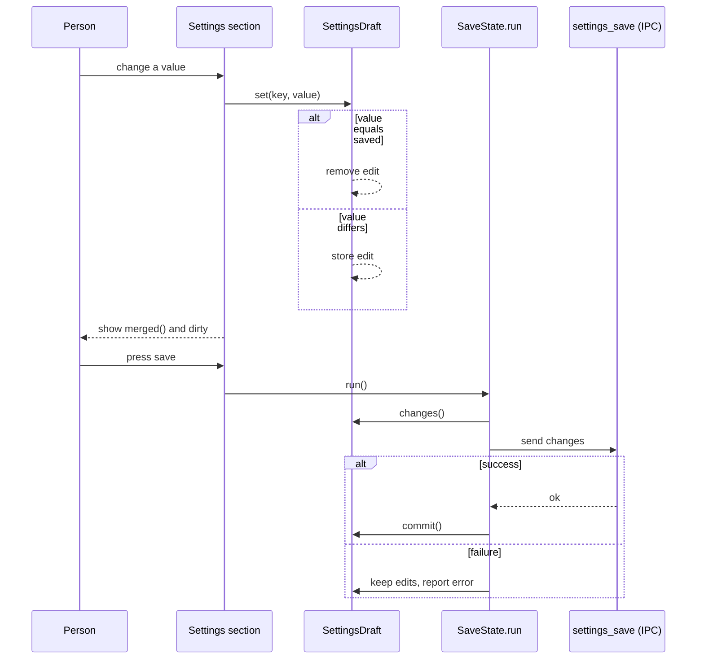
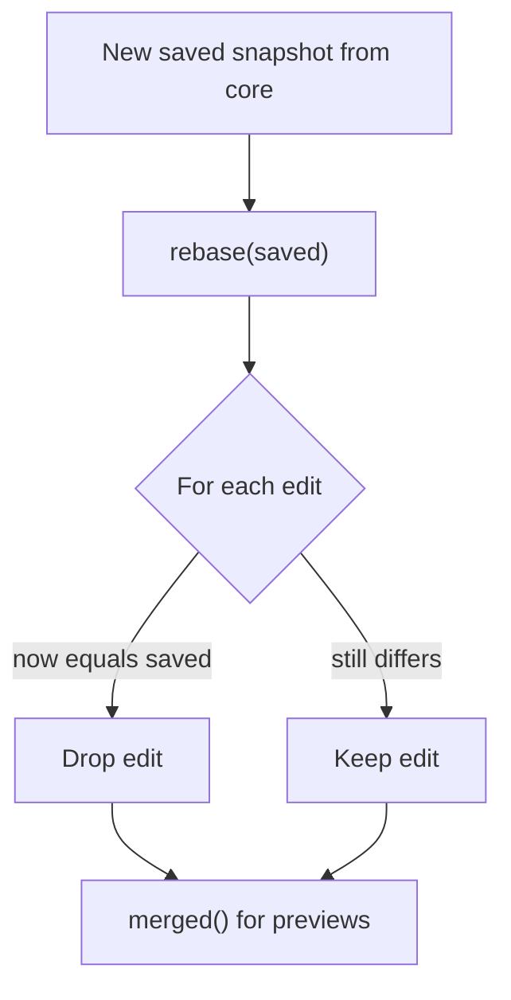

# settings-draft

## Introduction

`settings-draft` is the client-side holder of **unsaved Settings edits**. The Settings screens let the person change many values before pressing save. `SettingsDraft` keeps those pending values separate from the last saved snapshot, so the UI can show what the person is typing while the saved values stay the source of truth until a save succeeds.

The module is one class in `src/lib/settings/draft.svelte.ts`, plus a singleton created in `src/lib/settings/store.svelte.ts`. It has no IPC calls of its own; saving is handled by the Settings save flow in [settings-module](settings-module.md), and the persisted values come from the core settings described in [Data_Foundation](../Data_Foundation.md).

## Where it sits



- The settings module's save flow reads `changes()` and calls `commit()` or `discard()` (see [settings-module](settings-module.md)).
- Preview consumers (`TodoSettings`, `JournalSettings`, `ModuleSwitch`) read `merged()` so they reflect edits before they are saved.
- `appearance.svelte.ts` (see [Design_System](../Design_System.md) for the theme side) reads `merged()` to preview the theme immediately, and calls `rebase()` whenever a fresh saved snapshot arrives.

## Core concepts

| Concept | Meaning |
| --- | --- |
| Saved snapshot (`#saved`) | The last values known to be stored. Set by the constructor, `commit()` and `rebase()`. |
| Edits (`#edits`) | Only the keys whose value differs from the saved snapshot. |
| Equality | Values are compared with `JSON.stringify`, so arrays and objects compare by content. |
| Value type | `SettingsChange['value']` from the generated IPC bindings. |

The key invariant: **`#edits` never holds a key whose value equals the saved value.** Setting a key back to its saved value removes the edit, so `dirty` becomes `false` again.

## Component reference

### `SettingsDraft` (class)

Constructed with the saved snapshot, `new SettingsDraft(saved = {})`. Both internal fields are Svelte `$state`, so reads in components re-run when edits change.

### `get(key)`

Returns the edit for `key` if one exists, otherwise the saved value. Returns `undefined` for unknown keys.

### `set(key, value)`

- If `value` equals the saved value, the edit is removed.
- Otherwise the value is stored as an edit.

### `changes()`

Returns every edit as `{ key, value }[]`. This is the payload the save flow sends to the backend. It is empty when nothing differs from the saved values.

### `dirty` (getter)

`true` when at least one edit exists. Used to enable the save button and to guard leaving the screen (see [input-gestures](input-gestures.md) for the leave guard).

### `discard()`

Clears all edits. The saved snapshot is untouched, so `get()` returns saved values again.

### `merged()`

Returns saved values with edits applied. Consumers that render previews use this rather than `get()` so they see a complete record.

### `commit()`

Called after a successful save. The saved snapshot becomes `merged()` and the edits are cleared.

### `rebase(saved)`

Called when a new saved snapshot arrives from the core (for example after a sync or another save). The snapshot is replaced, and any edit that now equals the new saved value is dropped. Edits that still differ are kept, so the person's unsaved typing survives a background refresh.

> Note: `merged()` and `rebase()` are not in the provided component list for this module, but they are part of `draft.svelte.ts` and are used by `appearance.svelte.ts` and the module-settings components.

## Process flows

### Editing and saving



### Background refresh



### Discard

When the person abandons their changes, the save flow calls `discard()` (`SaveState.discard` in `src/modules/settings/save.svelte.ts`), which empties the edit map. The saved snapshot is not changed.

## Usage example

```typescript
import { settingsDraft } from '$lib/settings/store.svelte';

// A control changes a value
settingsDraft.set('core.theme', 'dark');

// A preview reads the merged view
const theme = readCore(settingsDraft.merged()).theme;

// Setting it back to the saved value removes the edit
settingsDraft.set('core.theme', savedTheme);
settingsDraft.dirty; // false

// Save success
settingsDraft.commit();
```

## Relationships to other modules

- **[settings-module](settings-module.md)**: owns the save and discard flow (`SaveState`) and the diagnostics view. It is the main caller of `changes()`, `commit()` and `discard()`.
- **[Shell_and_Navigation](../Shell_and_Navigation.md)**: the app shell applies theme and appearance from the merged values.
- **[Feature_Client_UI](../Feature_Client_UI.md)**: the Todo and Journal settings panels read preferences through `merged()`.
- **[Design_System](../Design_System.md)**: theme resolution consumes the merged theme preview.
- **[Data_Foundation](../Data_Foundation.md)**: the core settings store is the authoritative saved source; its values arrive here as the saved snapshot.

## Testing

Behaviour is covered by `src/lib/settings/draft.test.ts`, which checks that:

- only differing keys become changes,
- setting a value back to its saved value clears the edit,
- `commit()` moves edits into the saved snapshot,
- `rebase()` keeps edits that still differ and drops those that now match,
- `merged()` overlays edits on saved values.

## Maintenance notes

- Keep the equality check consistent with what the backend stores. `JSON.stringify` is key-order sensitive for objects; keep values built the same way on both sides.
- Any new consumer that needs the full picture should use `merged()`, not `get()` per key.
- A single shared instance (`settingsDraft`) is used app-wide. Tests should construct their own `SettingsDraft` rather than mutate the singleton.
