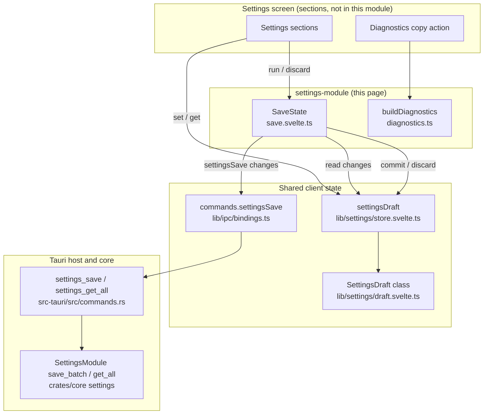
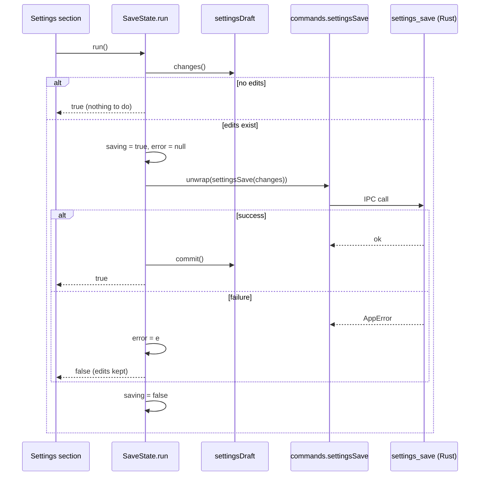
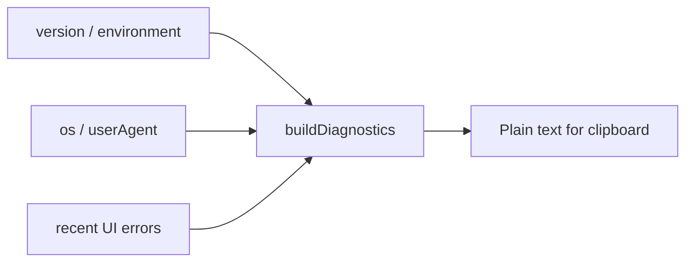
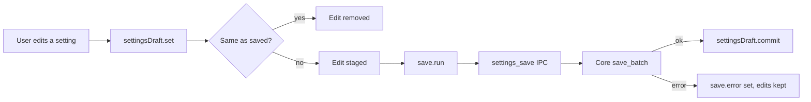

# Settings Module (Client)

## Introduction

The **settings-module** is the client-side part of the Settings screen. It has two jobs:

1. **Save edits** made in the Settings sections. Edits are staged in the shared `SettingsDraft`, and `SaveState` sends the staged changes to the Rust core in one batch.
2. **Build a diagnostics report** the user can paste into a bug report, without exposing any Settings values or file paths.

The module is small. Most of the behaviour it depends on, such as the draft model, the persistence rules and the Tauri command layer, lives in other modules. This page covers only the settings-module's own components and how they connect to those modules.

## Where it sits



Related pages:

- [Settings draft](settings-draft.md) explains the `SettingsDraft` model, which is the state `SaveState` works on.
- [Shell app shell](app-shell.md) and [Shell app entry](app-entry.md) explain how the Settings screen is mounted.
- [Core settings](../Data_Foundation/core_settings.md) explains the persistence side: validation, `save_if_unset` and the settings sync rules.
- [IPC bridge](../Tauri_Host_and_IPC_Bridge/ipc-bridge.md) explains the generated `commands` object and the `unwrap` helper.
- [Tauri host app shell](../Tauri_Host_and_IPC_Bridge/app_shell.md) explains the `settings_get_all` and `settings_save` command registration.

## Components

| Component | File | Role |
|---|---|---|
| `SaveState` | `src/modules/settings/save.svelte.ts` | Saving state, last error, and the save and discard actions. Exported as the singleton `save`. |
| `SaveState.run` | same file | Sends the draft's changes to the core and commits them on success. |
| `SaveState.discard` | same file | Throws away unsaved edits and clears the error. |
| `buildDiagnostics` | `src/modules/settings/diagnostics.ts` | Pure function that turns version, environment, OS, user agent and recent UI errors into plain text. |
| `DiagnosticsInput` | `src/modules/settings/diagnostics.ts` | Input shape for `buildDiagnostics`. |

Nothing in this module is persisted by itself. All durable state is held by the core.

## SaveState

`SaveState` is a Svelte 5 class with two reactive fields:

- `saving` (boolean): true while a save is in flight.
- `error` (unknown): the last failure, or `null`.

### run()



Behaviour that callers can rely on:

- **No edits, no call.** If `changes()` is empty, `run()` returns `true` without touching the IPC layer or the `saving` flag.
- **Batch.** All staged edits go in one `settingsSave` call as an array of `{ key, value }` records. The core applies them together.
- **Commit only on success.** `settingsDraft.commit()` runs only after the core accepts the batch. The draft then treats the merged values as the new saved snapshot and clears its edits.
- **Failure keeps the edits.** A failed call stores the error, returns `false`, and leaves the draft untouched so the user can retry.
- **Always clears `saving`.** The `finally` block resets `saving` whether the call succeeded or failed.

The return value is a boolean, so a caller can decide whether to close the screen or stay open. The module does not show the error itself. The caller reads `save.error`.

### discard()

`discard()` calls `settingsDraft.discard()`, which drops every staged edit, and clears `error`. It does not call the core. Saved values are unchanged.

## Diagnostics

`buildDiagnostics` produces the text the user copies into a bug report. The output has this shape:

```text
Mnemora <version> (<environment>)
OS: <os>
User agent: <userAgent>
Recent UI errors:
  <at> <message>
  ...
```

If there are no recent errors, the last section reads `  none`.

Design rules, stated in the source:

- It is **pure**. It takes an input object and returns a string, with no I/O and no reactive state.
- It **contains no Settings values or paths**. The input type has no field for them, so a caller cannot leak them by accident.
- The `errors` list is the caller's responsibility. The UI error log is provided by the client error store, documented under [Tauri host and IPC bridge](../Tauri_Host_and_IPC_Bridge/ipc-bridge.md) (the `recentUiErrors` helper).



## Data flow end to end



The comparison in `SettingsDraft.set` (step C) means that setting a value back to its saved value removes the staged edit. `save.run` therefore sends only real changes.

## Interaction with other modules

- **Settings draft.** `SaveState` depends on `settingsDraft` from `lib/settings/store.svelte.ts`. That module exports one app-wide `SettingsDraft`. The Settings sections write to it and the shell reads its merged values for preview. See [Settings draft](settings-draft.md).
- **Persistence and rules.** The core validates each key, stores it, and decides whether it syncs. See [Core settings](../Data_Foundation/core_settings.md). The client does not validate keys or values. Any rejection arrives as an error in `save.error`.
- **Reads.** The Rust `settings_get_all` command returns a snapshot of all settings for the client to seed the draft. It is not called from this module.
- **Shell and themes.** Some settings, such as theme and sidebar, are applied by other shell and design modules after they are saved. See [Design System theme](../Design_System/theme.md).

## Testing

This module has no test files in the module tree. The Rust settings behaviour is covered by the core and Tauri test suites, and the draft model by the settings-draft tests. The save path is best checked by tracing the sequence above and confirming:

1. A failed `settingsSave` leaves `changes()` unchanged.
2. A successful save leaves `changes()` empty and `dirty` false.
3. `discard()` makes `get(key)` return the saved value again.

## Notes for maintainers

- `save.run` is not guarded against concurrent calls. A second call while `saving` is true would send the same changes again. The Settings UI should disable its save button while `saving` is true.
- `SettingsDraft.rebase` (not called from this module) is the path for a new saved snapshot arriving from sync. If a remote change reaches the client while edits are pending, the draft keeps only edits that still differ from the new snapshot.
- `unwrap` (imported from `lib/ipc/unwrap`) converts the typed IPC result into a thrown error. Its file is not in the provided component set, so its exact behaviour should be read from source before changing error handling here.
