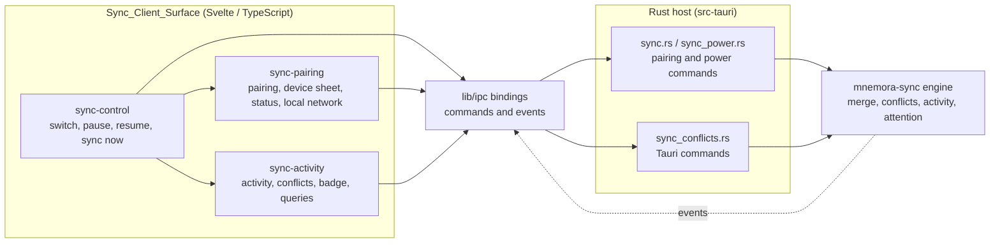

# Sync_Client_Surface

## Purpose

`Sync_Client_Surface` is the user-facing half of Mnemora's Sync feature. It covers the Devices, Conflicts and Activity screens, the on/off switch and pause banners, and the pairing sheet. The Rust side decides everything that matters: pairing phases, peer state, merge outcomes, conflicts and the activity log. This module only holds what the screens remember, turns Rust's answers into text for people, and calls the `sync_*` commands. It also decides when those calls happen, such as when to refresh, resume, or show progress.

## Architecture

The three client children share one pattern. Reads go through query layers that refresh when Sync events arrive. Commands go through the generated IPC bindings. Text and grouping logic is pure, so it can be tested without a live backend.

## Core components

- **[sync-control](Sync_Client_Surface/sync-control.md)**: the Sync on/off switch and its "Turn off Sync?" confirmation. It also covers pause and clock-skew banner wording, resuming on app foreground or network return, the "Sync now" palette action, and the 600 ms rule that delays the progress bar.
- **[sync-pairing](Sync_Client_Surface/sync-pairing.md)**: the pairing sheet (show a code, enter a code, or pair by address), the device sheet kept in the URL, device rename, peer status lines, the This device line, local network permission banners, and live refresh of addresses while the page is visible.
- **[sync-activity](Sync_Client_Surface/sync-activity.md)**: the Activity page (filter chips, day-grouped paged log), shared Conflicts helpers, the sidebar badge, Home card line and palette hint, the Compare flow state, the Devices/Conflicts/Activity tabs, and the TanStack query and event listener layer.
- **[sync_conflicts_and_activity](Sync_Client_Surface/sync_conflicts_and_activity.md)**: the Rust Tauri command layer behind Conflicts, Resolved automatically, and Activity. It exposes list, resolve, "use other", draft and attention commands. It writes chosen values back through the owning Module's service, so each resolution is an ordinary edit that syncs like any other change.

## Key design rules

- **Rust owns decisions.** The client never invents a pairing phase, merge result or conflict state. It words and displays what Rust returns.
- **Reads are centralised.** Components read Sync data through query keys that events invalidate, not through direct command calls.
- **Shell routing waits for fresh state.** Turning Sync on refreshes Sync state before navigating to `/sync`.
- **Turning off goes through one path.** Sync is switched off only via the confirmation dialog, which keeps the guarantee that a triple click cannot open that dialog.
- **Wording is a contract.** Failure copy and banner sentences are pinned by tests and must match the Rust side's messages.