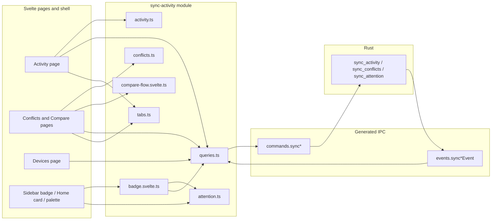
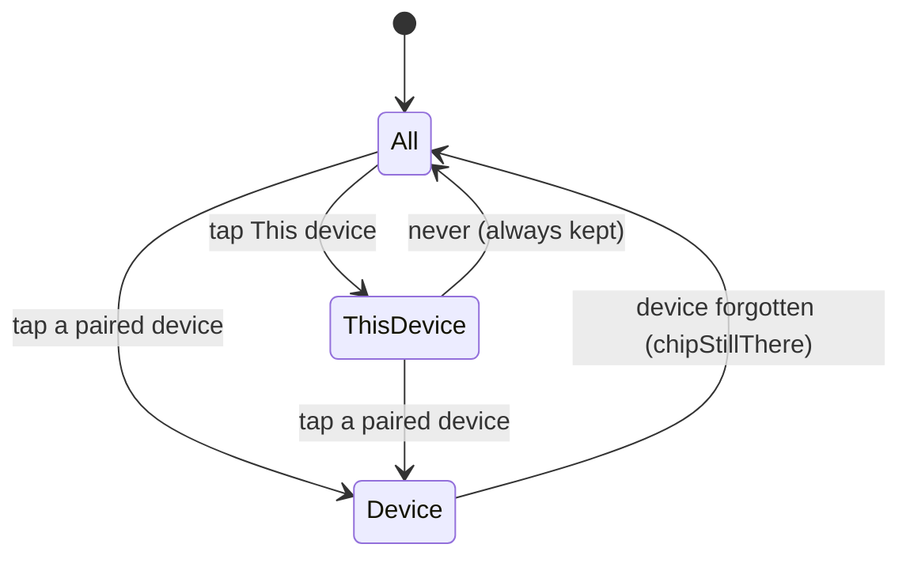
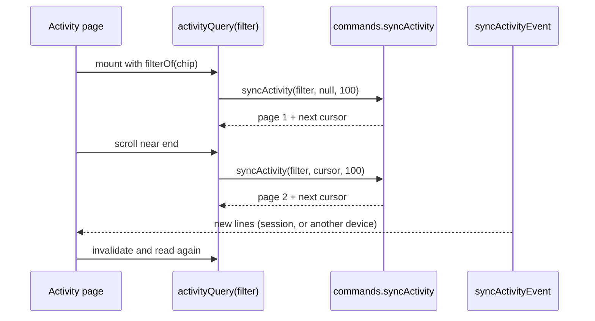
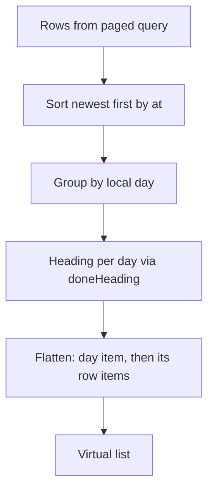
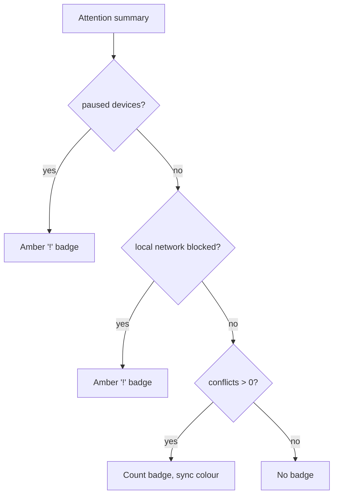
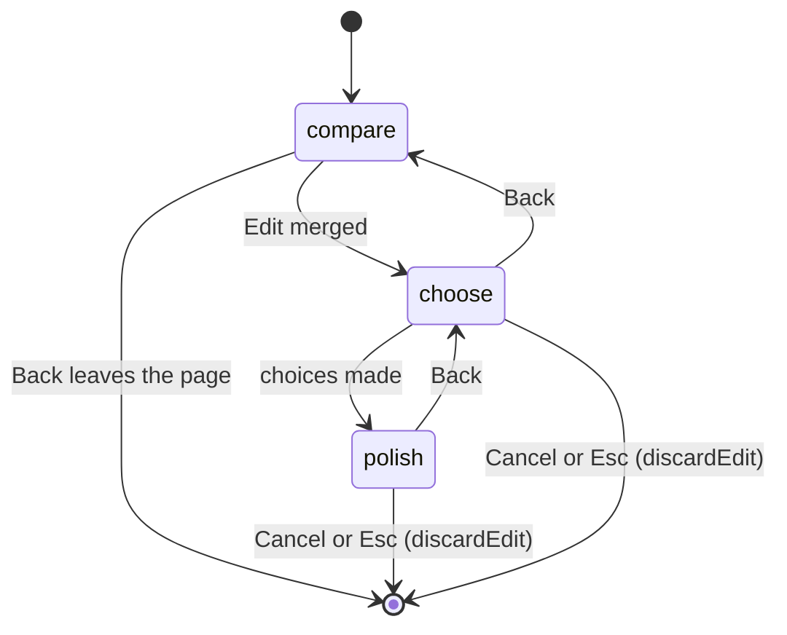
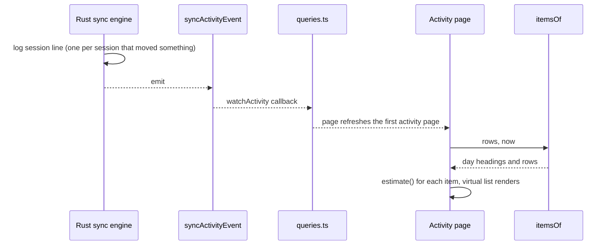

# sync-activity

The `sync-activity` module is the client side of Sync's **Activity** page (`/sync/activity`) and of the small set of helpers that the other Sync screens share: the **Conflicts** page and its Compare flow (`/sync/conflicts/‹id›`), the sidebar badge, the Home card line, the palette hint, and the tab strip that switches between Devices, Conflicts and Activity. It turns the log and state that the Rust side produces into plain sentences, day headings, counts, and paged lists that Svelte components can render directly.

It does not decide what gets logged or how conflicts are resolved. Those rules live in the Rust sync engine (see [Sync_Replication_Engine/sync_activity.md](../Sync_Replication_Engine/sync_activity.md) and [Sync_Replication_Engine/sync_conflicts.md](../Sync_Replication_Engine/sync_conflicts.md)). This page covers only what the client does with the rows it receives.

## Scope of the files

| File | Role |
|---|---|
| `src/modules/sync/activity.ts` | Activity chips, day grouping, row sentence, expandability, height estimate |
| `src/modules/sync/activity.test.ts` | Tests for the functions above |
| `src/modules/sync/queries.ts` | TanStack Query options and event listeners for every Sync read (Activity, Conflicts, Attention, Devices) |
| `src/modules/sync/conflicts.ts` | Conflict row titles, "where it is shown" labels, two-device time line, day groups, route id parsing |
| `src/modules/sync/conflicts.test.ts` | Tests for the conflict helpers |
| `src/modules/sync/attention.ts` | Sidebar badge, Home card line, Review destination, palette hint, toast wording |
| `src/modules/sync/attention.test.ts` | Tests for attention and the manifest |
| `src/modules/sync/badge.svelte.ts` | `useSyncBadge()`, the reactive wrapper that feeds the sidebar badge |
| `src/modules/sync/compare-flow.svelte.ts` | Per-conflict state for the Compare → Choose → Polish flow, kept outside the page |
| `src/modules/sync/tabs.ts` | The three Sync pages, their addresses, and the Conflicts count pill |

The Rust side of the Activity log is tested in `src-tauri/src/sync_activity_tests.rs`. The Conflicts tests (`sync_conflicts_tests.rs`, `sync_resolutions_tests.rs`) cover the data this module displays. Those tests are described on the Sync pages above, not repeated here.

## Architecture



Two rules hold across the module:

- **Reads go through `queries.ts`.** Components never call `commands.*` directly for Sync reads. The query keys are hierarchical (`['sync', 'activity', filter]`, `['sync', 'conflicts']`, `['sync', 'attention']`, `['sync', 'device', id]`), so one event can refresh exactly the lists that depend on it.
- **Formatting is pure.** Every function that turns data into text or groups takes its clock (`now`) and time format as arguments, which keeps them testable without mocks of the real time.

## Activity page

### Filter chips

The Activity page has one chip per filter. `chipsOf` builds the chip list in a fixed order: **All**, **This device**, then one chip per paired device in the same order the Devices tab shows them.

```ts
chipsOf(peers) // [{value:'all',label:'All'}, {value:'this',label:'This device'}, ...peers]
```

`filterOf(chip)` turns a chip value into the `ActivityFilter` that Rust understands:

| Chip value | `ActivityFilter` sent to Rust |
|---|---|
| `'all'` | `{ kind: 'all' }` |
| `'this'` | `{ kind: 'this_device' }` |
| any device id | `{ kind: 'device', id }` |

If a device is forgotten while its chip is selected, `chipStillThere` returns `'all'`, so the page never asks for a filter that no longer has a device behind it. `'all'` and `'this'` always survive.



### Loading the log

`activityQuery(filter)` is an infinite query. Each page is `ACTIVITY_PAGE` (100) lines, newest first. The next page is taken from `last.next`, which the Rust side returns as an opaque cursor. `staleTime` is `0`, so switching chips or coming back to the page reads again.



`watchActivity(onchange)` listens for `syncActivityEvent` and calls back when Activity gained lines. The page decides how to refresh; the query layer does not refetch on its own.

### Day headings and rows

`itemsOf(rows, now)` flattens the paged rows into one list for the virtual scroller:

1. Rows are sorted newest first by `at`.
2. They are grouped by local calendar day.
3. Each group starts with a `day` item, followed by its `row` items.
4. The heading text comes from `doneHeading(day, today)`, the same function Done uses. So "Today", "Yesterday" or a weekday name appears with the same small date beside it on every screen.
5. The first heading is flagged `first: true`. That only changes its height estimate.



Each item has a unique `key`: `day:YYYY-MM-DD` for headings and the row `id` for rows. Keys must stay unique because the virtual list uses them to keep measured heights.

`estimate(item, open)` gives the first guess of an item's height in pixels, used before the row is measured:

- day heading: 36 px when it is the first heading, 58 px otherwise
- row with a breakdown that is open: 78 px
- any other row: 52 px

### Row sentence and breakdown

`lineText(row)` joins the row's text runs into one sentence. If the row has a device (`on`), it appends ` · on ‹device›`.

`expandable(row)` is true when the row has a `breakdown`. Only those rows open to show a detail. Plain rows have no affordance.

## Shared Conflicts helpers (`conflicts.ts`)

These functions are used by the Conflicts list and the Compare page, and the test file lives beside them.

- **`rowTitle(subject, format)`** names what clashed and where: `Wed 21 Oct · 09:12 Entry`, `‘Plan weekend hike’ · notes`, `‘Trip’ · comment`, `‘Plan the hike’ · conversation title`, `‘Coffee shops’ · saved question`.
- **Entry time** is shown in the zone the entry was written in, not the viewer's. `entryTime` shifts the stored UTC instant by `written_offset_min` and reads the UTC hours and minutes, so a late-night entry keeps the hour the person wrote it at.
- **`shownIn(subject)`** says which screen holds the showing text: Journal, Task, Conversation or Saved question. Comments count as Task.
- **`sidesText(row, format)`** produces the two-device line, showing version first: `Mac 21:40 · Pixel 8 21:39`.
- **`groupByDay(rows, now, when)`** groups rows by day, newest day first. By default it groups conflicts by `raised_at`. Resolved rows pass their own time function, so they group by when they were decided.
- **`conflictIdOf(pathname)`** reads the id from `/sync/conflicts/‹id›`, or returns `null` for any other address.
- **`timeText(ms, format)`** formats a clock time as `15:07` or `3:07 PM`, following the Time format preference.
- **`pageLabel(pageDate)`** turns `YYYY-MM-DD` into `Wed 21 Oct`, and returns the input unchanged if it does not parse.
- **`usePossessive(device)`** returns `Use Mac’s`, for the Use-other button.

## Attention: badge, Home card, palette and toast (`attention.ts`)

`Attention` is the summary the Rust side returns through `syncAttention`. It has counts and lists: conflicts waiting, paused devices, unseen devices, whether the Local Network setting blocks Sync, and the last sync. `attention.ts` maps that summary onto each surface.



Rules that the tests pin down:

- **Badge (`badgeOf`)**: a pause or a Local Network block outranks the conflict count, because nothing arrives until it is fixed. Zero conflicts with nothing else shows no badge. Labels read "1 sync conflict needs you" and "3 sync conflicts need you". The phone tab bar never shows this badge; the manifest sets `phoneBadge: false`.
- **Home card (`homeCardLine`)**: one clause per issue, joined with ` · `. Clauses are, in order: conflicts to review, paused devices, Local Network blocked, unseen devices, and then the last sync. The last-sync clause is skipped if an earlier clause already names that device, so the line never repeats a name.
- **Review destination (`reviewPath`)**: `/sync/conflicts` when any conflict waits, otherwise `/sync`.
- **Palette hint (`paletteHint`)**: "2 waiting" beside "Open Sync conflicts", or `null` at zero.
- **Toast (`newConflictsText`)**: "1 sync conflict from Pixel 8", or the same without the device when the source is unknown.

`badge.svelte.ts` wraps the badge for components. `useSyncBadge()` creates the `attentionQuery`, derives the badge with `badgeOf`, and returns a getter. It must be called during component setup. The query is kept fresh by `watchAttention()` in `queries.ts`, which listens to both `syncConflictsEvent` and `syncPeersEvent`.

## Compare flow state (`compare-flow.svelte.ts`)

Resolving a conflict through **Edit merged** has three steps: `compare`, `choose`, `polish`. The state for each conflict lives in a `CompareFlow` object, looked up by conflict id with `compareFlow(id)`.

The state is kept outside the page on purpose. The shell mounts a different layout across the phone breakpoint, which remounts the page. If the state lived in the page, resizing the window would send the person back to Compare and lose their text.



- `stepBack(step)` returns the step Back goes to, or `null` at Compare, where Back leaves the page. Choices and typed text are kept on the way back, so nothing is lost.
- `draftIsCurrent(flow)` says whether the polished text was made from the choices now on the screen. The draft is only regenerated when `choices` change, tracked through `draftFor`.
- `escapeCancels(flow, event, overlayOpen, editorPopupOpen)` handles Esc. It does nothing at Compare. In Choose or Polish it cancels, unless the key was already handled by something else. A dialog or sheet open over the page takes the key first. Esc inside the CodeMirror editor counts as a page Esc, unless the editor's slash menu was open when the key went down. In that case Esc closes the menu instead.
- `forgetCompareFlow(id)` drops the state once a conflict is settled, so a later visit starts at Compare.

## Tabs (`tabs.ts`)

Sync has three pages, each with its own address so that a link lands on the right tab and Back returns to the last one:

| Tab | Path |
|---|---|
| Devices | `/sync` |
| Conflicts | `/sync/conflicts` |
| Activity | `/sync/activity` |

- `tabForPath(pathname)` maps an address to a tab. Any address under `/sync/conflicts/‹id›` (Compare) belongs to Conflicts. Unknown paths under `/sync` fall back to Devices.
- `pathForTab(tab)` is the reverse.
- `tabsWithCounts(conflicts)` returns the tabs with the Conflicts count as a pill: "Conflicts 2".

## Query and event reference

| Export | Kind | Purpose |
|---|---|---|
| `syncQuery` | query | Sync on/off, name, options, paired count |
| `devicesQuery`, `deviceDetailQuery(id)` | query | Devices tab and one device sheet |
| `conflictsQuery`, `conflictQuery(id)` | query | Conflicts list and one Compare view |
| `attentionQuery` | query | Badge, Home card, palette hint |
| `activityQuery(filter)` | infinite query | Activity log, 100 lines per page |
| `watchDevices()` | listener | `syncPeersEvent` refreshes devices, device sheets, and sync state |
| `watchConflicts()` | listener | `syncConflictsEvent` refreshes conflict lists and Compare |
| `watchAttention()` | listener | Both events refresh attention |
| `watchActivity(cb)` | listener | `syncActivityEvent` calls back so the page can refresh |
| `whileMounted(listen)` | helper | Starts a listener and a cleanup that works even if the cleanup runs before the listener is ready |

All queries use `staleTime: Infinity` except the Activity query, which uses `0`. Infinite staleness is safe here because the listeners invalidate the keys whenever the Rust side changes them.

## Process flow: a sync session reaches the Activity page



The session is logged once per session that moved something. Passing activity on, or a sync that moved nothing, is not logged. Those rules are on the Rust side ([Sync_Replication_Engine/sync_activity.md](../Sync_Replication_Engine/sync_activity.md)).

## Testing

- `activity.test.ts` covers the filter mapping, the chip order and fallback, day grouping and the shared heading, unique keys, the row sentence with and without a device, and the height estimate for open and closed breakdowns.
- `attention.test.ts` covers the badge priority (pause and Local Network over the count), the Home card clauses and their de-duplication, Review destination, palette hint, toast wording, and the manifest (palette actions, no phone badge, Home card on offer).
- `conflicts.test.ts` covers row titles in 24-hour and 12-hour formats, the late-night offset case, the two-device line, the day groups (including groups by a different time), and route id parsing.

Behaviour that depends on the Rust side (what appears in the log, what counts as a conflict) is tested in `src-tauri/src/sync_activity_tests.rs`, `sync_conflicts_tests.rs` and `sync_resolutions_tests.rs`.

## Related modules

- [Sync_Replication_Engine/sync_activity.md](../Sync_Replication_Engine/sync_activity.md): writes the Activity log and provides `syncActivity` pages.
- [Sync_Replication_Engine/sync_conflicts.md](../Sync_Replication_Engine/sync_conflicts.md): raises, lists and resolves conflicts.
- [Sync_Connectivity_and_Pairing/sync_devices.md](../Sync_Connectivity_and_Pairing/sync_devices.md): the Devices tab and device sheet that the chips and the Conflicts tab sit beside.
- [Sync_Client_Surface/sync_conflicts_and_activity.md](sync_conflicts_and_activity.md): the Rust commands and tests behind these screens.
- [Sync_Client_Surface/sync-pairing.md](sync-pairing.md): the Devices page, pairing and device rename.
- [Sync_Client_Surface/sync-control.md](sync-control.md): the on/off switch, pause and resume, and Sync now.
- [Shell_and_Navigation.md](../Shell_and_Navigation.md): the router, the sidebar badge slot and the phone tab bar.
- [Design_System.md](../Design_System.md): the tokens and components used by the Sync pages.
