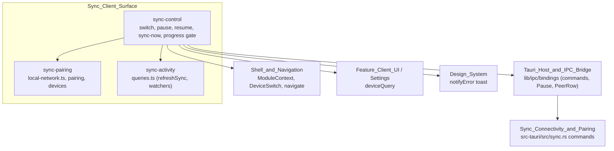
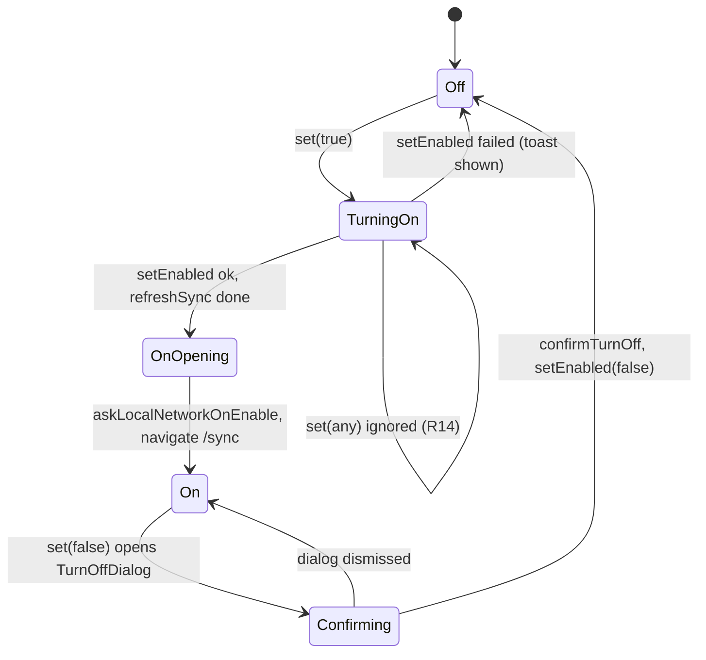
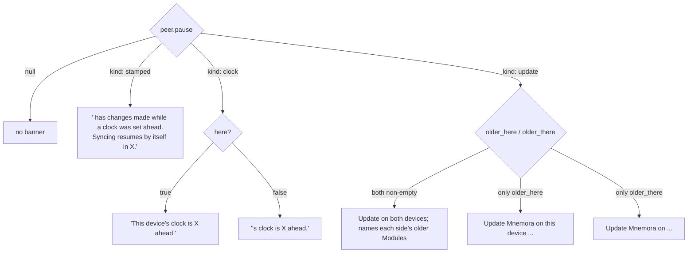
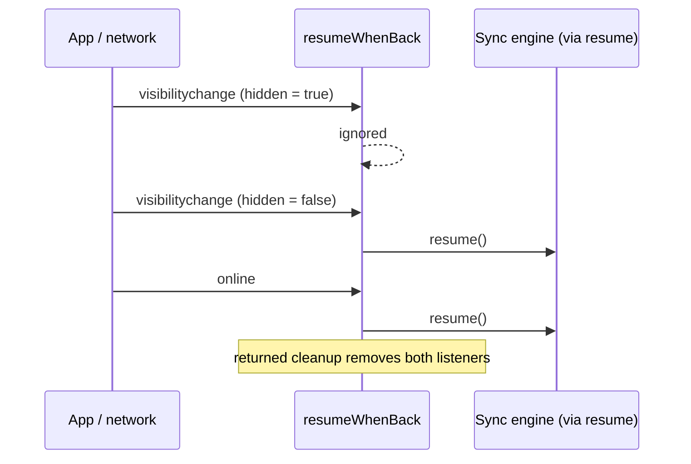
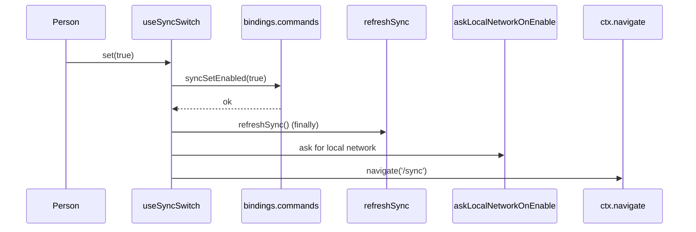

# sync-control

## Introduction

`sync-control` is the small client-side layer that decides *when* Sync is on, *when* it shows progress, *when* it wakes up again, and *what* the person is told about a paused device. It lives in `src/modules/sync/` and sits beside the larger Sync client pages: [sync-pairing](sync-pairing.md) (pairing and the Devices sheet), [sync-activity](sync-activity.md) (the activity log, conflicts and queries), and the parent [Sync_Client_Surface](../Sync_Client_Surface.md) page.

The module does not move any data. The protocol, merge and storage work happen in the Rust engine ([Sync_Replication_Engine](../Sync_Replication_Engine.md)) and the Tauri command layer ([Sync_Connectivity_and_Pairing](../Sync_Connectivity_and_Pairing.md), [Tauri_Host_and_IPC_Bridge](../Tauri_Host_and_IPC_Bridge.md)). `sync-control` only decides, in the UI, when to call those commands and how to word their state.

Its responsibilities, one file each:

| Concern | File | Exported core API |
|---|---|---|
| Sync on/off switch in the Modules list, plus the "Turn off Sync?" dialog | `switch.svelte.ts` | `useSyncSwitch`, `confirmTurnOff`, `turnOffDialog` (`TurnOffDialog`) |
| Wording for a paused device (update, clock, stamped records) | `pause.ts` | `pauseBanner`, `moduleName`, `nameList`, `durationWords` |
| Resuming when the app or network comes back | `resume.ts` | `resumeWhenBack` |
| "Sync now" from the command palette | `sync-now.ts` | `runSyncNow`, `NO_DEVICES` |
| Progress bar appears only for slow syncs (600 ms rule) | `bar-gate.ts` (source not in this page's inputs; behaviour documented from its test) | `BarGate`, `PROGRESS_BAR_DELAY_MS` |

Each concern has a unit test next to it (`*.test.ts`).

## Where the module sits

What `sync-control` imports from the rest of the system:

- **`lib/ipc/bindings`**: `commands.syncSetEnabled`, plus the `Pause` and `PeerRow` types used by `pause.ts`. See [Tauri_Host_and_IPC_Bridge](../Tauri_Host_and_IPC_Bridge.md).
- **`lib/ipc/unwrap`**: turns a Rust `Result` into a thrown error for `setEnabled`.
- **`lib/router`**: the `ModuleContext` (`navigate`) and `DeviceSwitch` interface that the Modules list uses. See [Shell_and_Navigation](../Shell_and_Navigation.md).
- **`lib/settings/queries`**: `deviceQuery`, the device-file read that says whether Sync is enabled. Device settings are read from the device file and never synced.
- **`./local-network`**: `askLocalNetworkOnEnable`, owned by [sync-pairing](sync-pairing.md).
- **`./queries`**: `refreshSync`, owned by [sync-activity](sync-activity.md). It refetches the shell-visible sync values.
- **`lib/ui/toast`**: `notifyError`.

## Turning Sync on and off

`useSyncSwitch(ctx)` returns a `DeviceSwitch` for the Modules list. Its `on` and `ready` getters read `deviceQuery` (not the Sync query), so the switch reflects the device file.

Turning **on** is immediate, but it has to be guarded:

1. A click sets a local `turningOn` flag and calls `setEnabled(true)`.
2. `setEnabled` calls `commands.syncSetEnabled` through `unwrap`, and always awaits `refreshSync()` in a `finally`. The shell routes by these fresh values, so `/sync` has to be enabled before navigation happens.
3. On success the module asks for local-network access (Android 17 asks now, not later), then navigates to `/sync`, which shows the welcome page until the first pairing.
4. While `turningOn` is true, further `set(...)` calls are ignored. This is requirement **R14**: a triple click is one click, and it must never open the "Turn off Sync?" dialog over the page that is opening.

Turning **off** never happens directly. `set(false)` only opens `turnOffDialog.open`. `confirmTurnOff()` closes the dialog and calls `setEnabled(false)`. This turns sync off for this device only: its data and paired devices are kept.

The `turnOffDialog` singleton (`TurnOffDialog`, with one `open` rune) is mounted by the Module's overlay while Sync is on. Only `sync-control` writes to it.

`src/modules/sync/switch.test.ts` covers both halves: a triple click calls `syncSetEnabled` once, opens the page once and never asks to turn off; and turning off still asks once the switch has settled.

## Pause wording

`pauseBanner({ name, pause })` builds the title and text of the banner shown on Devices for a paused peer, or returns `null` when the peer is not paused. `pause` is a `Pause` from the bindings with one of three kinds:

Supporting helpers:

- `durationWords(ms)` renders a clock offset: minutes under an hour (`6 min`), hours with minutes under ten hours (`3 h 20 min`), whole hours up to 47 h, then days (`2 d`). It rounds to whole minutes with a floor of 1 minute.
- `moduleName(id)` maps internal ids to names people know: `todo` → Todo, `journal` → Journal, `core` → Settings, `sync` → Sync. Unknown ids are capitalised.
- `nameList(ids)` joins names as `A`, `A and B`, or `A, B and C`.

The pause kinds map to the backend states described in [Sync_Connectivity_and_Pairing](../Sync_Connectivity_and_Pairing.md) (version mismatch, clock skew, and records stamped from a wrong clock). The test file `pause.test.ts` pins the exact sentences, including the curly apostrophe in `’s clock`.

## Resuming when the app or network returns

`resumeWhenBack(resume, sources?)` registers two listeners:

- `visibilitychange` on `document`, calling `resume` only when `document.hidden` is false (the app came to the front).
- `online` on `window`, calling `resume` directly.

It returns a function that removes both listeners. The sources are injectable so that tests can use plain `EventTarget`s.

The purpose is retry timing. The engine backs off for unreachable devices (5 s, 15 s, 60 s, and so on). Resuming on foreground or network change tries them again from the start of that schedule instead of waiting out a long pause.

Power handling (pausing on mobile data, flushing on leaving the app) is a separate concern in `src-tauri/src/sync_power.rs`. It is documented in [Sync_Connectivity_and_Pairing](../Sync_Connectivity_and_Pairing.md), not here.

## Sync now

`runSyncNow(pairedCount, syncNow, say)` is the palette's "Sync now" action:

1. Await `pairedCount()`. If it is `0`, call `say(NO_DEVICES)` (`"No paired devices to sync with"`) and stop.
2. Otherwise start `syncNow()` without awaiting it, and say `"Syncing with your devices"`.

The top-bar sync button is disabled when there are no paired devices, so the palette is the only place this message can appear. The function takes its dependencies as arguments, which keeps it independent of the IPC layer.

## Progress bar gate (600 ms rule)

`BarGate` decides when the sync progress bar becomes visible. From `bar-gate.test.ts` the contract is:

- Progress starts a timer for `PROGRESS_BAR_DELAY_MS` = **600 ms**. Syncs that end sooner never show the bar, and the change callback is never called for them.
- Once the timer fires, `visible` becomes true and the callback receives `true`.
- Further `update(true)` calls (progress) do not restart the wait.
- `update(false)` hides the bar and calls back with `false`.
- A second sync waits its own 600 ms.
- `stop()` cancels a pending reveal.

The timer function is injected (`setTimer(fn, ms)` returns a cancel function), which is how the tests advance time by hand.

## Integration with the rest of the Sync client

Once Sync is on, the Sync pages in [sync-pairing](sync-pairing.md) and [sync-activity](sync-activity.md) take over. The Tauri commands that do the work (`sync_set_enabled`, `sync_get`, `sync_pair_*`) are documented in [Sync_Connectivity_and_Pairing](../Sync_Connectivity_and_Pairing.md) under the command layer.

## Testing

| Test file | What it pins |
|---|---|
| `switch.test.ts` | R14 triple-click behaviour; turn-off confirmation |
| `pause.test.ts` | `durationWords`, `moduleName`, `nameList`, every banner sentence |
| `resume.test.ts` | Foreground and online resume; cleanup stops listening |
| `bar-gate.test.ts` | 600 ms rule, restart rules, `stop()` |

`runSyncNow` has no test file in the inputs of this page. Its behaviour is simple and is covered by the palette tests in [Shell_and_Navigation](../Shell_and_Navigation.md).

Run with the project's test target (`make test`, which runs Vitest); see [Build_and_Packaging](../Build_and_Packaging.md) for the scripts in `package.json`.

## Maintenance notes

- **Do not add a direct "off" path.** Turning off must go through `set(false)` → dialog → `confirmTurnOff`, otherwise the R14 guarantee and the confirmation are lost.
- **Keep the `refreshSync()` wait.** The shell routes by fresh values; navigating before the refresh sends the person to a disabled `/sync`.
- **Banner wording is a contract.** `pause.test.ts` pins exact sentences. Change the tests in the same change.
- **`durationWords` is shared with the paused banner only.** If another surface needs clock offsets, reuse it rather than writing new rounding.
