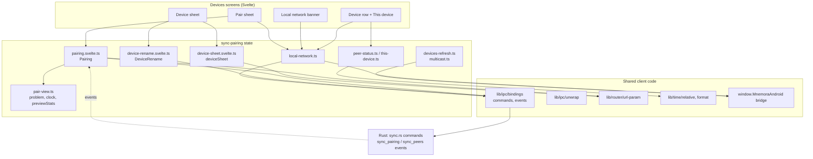
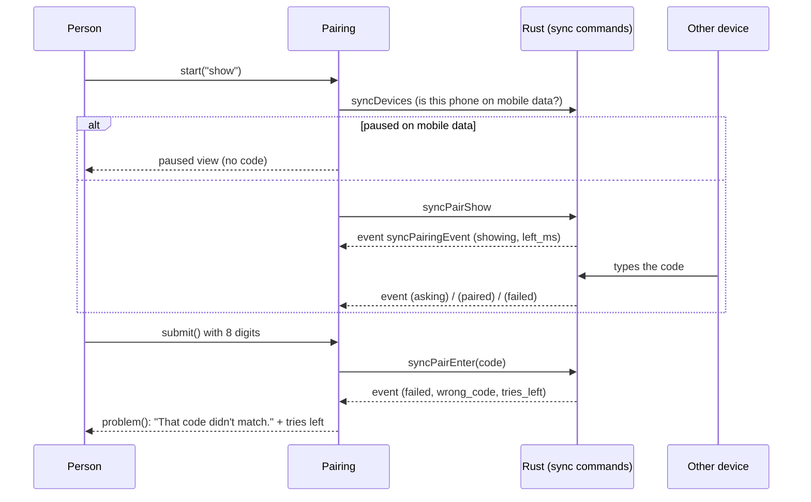
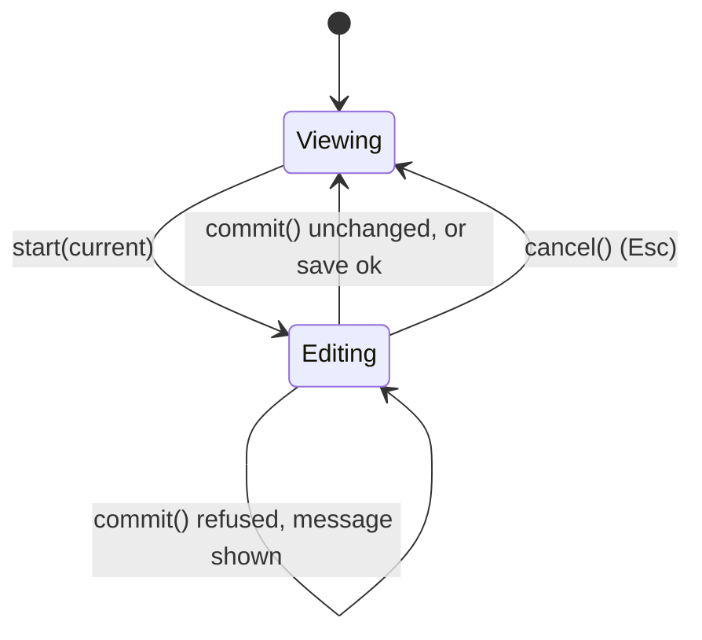

# sync-pairing

The `sync-pairing` module is the client-side (TypeScript/Svelte) half of the Devices experience: the pairing sheet, the device sheet, the device rename field, the peer status line, the local network permission banners, and the glue that keeps those screens fresh while they are visible. Rust owns every decision (pairing phases, peer state, network reachability). This module only holds what the screens remember, words Rust's answers for people, and calls the `sync_*` commands.

For the protocol, the TLS transport, and the Rust commands behind these screens, see [Sync_Connectivity_and_Pairing](../Sync_Connectivity_and_Pairing.md) and its [sync_devices](../Sync_Connectivity_and_Pairing/sync_devices.md) page. For the sibling client modules see [sync-activity](sync-activity.md) and [sync-control](sync-control.md); the parent is [Sync_Client_Surface](../Sync_Client_Surface.md).

## Responsibilities

| Concern | File(s) | What it does |
|---|---|---|
| Pairing sheet state | `pairing.svelte.ts`, `pair-view.ts` | Opens the sheet in one of three modes, types the code, submits it, mirrors Rust's `PairingView`, and words failures. |
| Device sheet | `device-sheet.svelte.ts`, `device-detail.ts` | Keeps the open device in the URL (`?device=`), and formats its versions, addresses and pairing date. |
| Rename field | `device-rename.svelte.ts` | Turns the name into a field, saves once, and keeps the reason for a refusal. |
| Peer status line | `peer-status.ts` | Builds the "Up to date · synced 2 min ago · 12 in · 3 out · Wi‑Fi" line. |
| This device line | `this-device.ts` | Says whether this device is listening, and on which networks. |
| Local network | `local-network.ts` | Banners and buttons for a blocked local network permission (macOS and Android). |
| Live refresh | `devices-refresh.ts`, `multicast.ts` | Re-reads addresses while visible; holds Android's multicast lock while visible. |
| Empty state | `welcome.ts` | Decides whether the Devices tab shows the welcome card. |
| Address rules | `address.test.ts` (tests `address.ts`) | Shares the address fixture with Rust. |

## Architecture

The pairing sheet and the device sheet are the only two parts with state that outlives a render. Everything else is a pure function of the data the Sync queries (see [sync-activity](sync-activity.md) for `watchDevices`) deliver.

## Pairing sheet

### Modes

`Pairing` (`pairing.svelte.ts`) is a singleton with three modes (`PairMode`):

- `show` — "Pair a device": calls `syncPairShow` and displays the 8-digit code Rust generates.
- `enter` — "Enter a code": the person types the code shown on the other device; `submit` calls `syncPairEnter`.
- `address` — "Pair by address…": the person types the other device's address plus the code; `submitAddress` checks the address locally first, then calls `syncPairEnterAt`.

`switchTo(mode)` cancels the current pairing on Rust (`syncPairCancel`) and starts the other mode.

### State flow

`view` is whatever Rust last said (`PairingView`). The client never invents a phase; it only:

1. stamps `arrivedAt` so the countdown can run from the moment the view arrived (`remaining`, `clock`, `fractionLeft` in `pair-view.ts`);
2. clears the typed code when the view is a failure whose code can no longer work (`problem(...).deadCode`);
3. calls `refreshSync()` after a `paired` view so the device list catches up.

### Failure wording

`problem(error, typing, address)` in `pair-view.ts` turns each `PairingError.kind` into a `PairProblem` with a `title`, a `fix` and `deadCode`:

| Kind | Who sees it | Dead code? |
|---|---|---|
| `wrong_code` | either | only when `tries_left` is 0 |
| `code_expired` | typing / showing device differ in wording | yes |
| `tries_used` | either | yes |
| `declined` | either | yes |
| `cancelled` | either | yes |
| `different_environment` | either | no (Mnemora and Sandbox never pair) |
| `version_mismatch` | either | no (names which Modules are older) |
| `different_groups` | either | no |
| `nothing_nearby`, `connection_lost`, `address_not_found`, `address_unreachable` | either | no |
| `backup_failed`, `busy`, `not_ready` | either | no |

`address_unreachable` only blames Tailscale when the typed address is a Tailscale address (`usesTailscale` from `address.ts`). The wording is the contract: the copy here must match the messages the Rust side uses in its fixtures, so changes start in the Rust pairing tests (see [sync_devices](../Sync_Connectivity_and_Pairing/sync_devices.md)).

### Mobile data pause

On a phone with "Allow over mobile data" off, `start` and `refreshPause` check `paused_on_mobile_data` first and show `PAIRING_PAUSED` instead of a code. When the phone changes network with the sheet open (a `syncPeersEvent`), `refreshPause` either explains the pause, or starts a fresh code once the network allows it.

### History and Back

Opening the sheet pushes `?pair=<mode>` onto the history stack (so Back closes it). The `#pushed` flag remembers whether this sheet added the entry:

- `shut()` steps back over the entry it pushed; otherwise it drops the parameter in place.
- `backed()` is called when Back removed the entry while the sheet was open; it cancels the pairing without stepping back again.
- `dropStale()` removes a `?pair=` left behind by a reload or a Forward navigation when no sheet is open.

Cancel and deny both end the pairing on the other device, so the sheet closes at once rather than showing an empty step (`decide(false)` shuts before the command is sent).

## Device sheet

`deviceSheet` (`device-sheet.svelte.ts`) keeps the open device id in the URL as `?device=<id>`. It is derived from `urlParam`, so reload, a shared link and Back all work.

- `open(id)` pushes a history entry when no device is open, otherwise replaces the parameter.
- `close()` steps back over the pushed entry, or drops the parameter if the page was opened on a link. Closes within 400 ms of each other are one close.
- `dismiss()` drops the parameter without stepping back; used when the device has gone (forgotten or never there). `deviceGone(error)` detects `not_found`.

`device-detail.ts` supplies the text for the sheet:

- `versionsText` — "Mnemora 0.9.2 · Journal 3 · Todo 9 · Core 4", ordered content Modules first.
- `addressLines` — each address with "worked 2 min ago" or "not tried yet".
- `pairedText` — "Wed 14 Oct, by Hemang's MacBook Pro".

### Rename

`DeviceRename` is a small state machine:

- `commit` does nothing for an unchanged name (after trimming). Enter and blur may both call it; `#saving` ensures one save runs.
- A refusal leaves the field open with the reason from `Error.message`, and the next `type` or `start` clears it.

## Peer status line

`peer-status.ts` produces the line under each paired device. `rowParts(peer, now)` returns parts joined by "·":

1. Status word (`STATUS_WORDS`, plain English, D3).
2. How long ago it synced (`syncedText`): "synced 2 min ago", "last synced …" for paused or blocked devices, a date after a week, "not synced yet" when never.
3. Last session counts (`countsText`), only while `up_to_date`.
4. Route (`routeWord`: "Wi‑Fi" or "Tailscale", using a non-breaking hyphen).

A `syncing` device reads "Syncing… 120 of 340 changes" instead (`progressText` never counts past the total). `absoluteTime` gives the hover text using the app's date style and the Time format preference (see [Shell_and_Navigation](../Shell_and_Navigation.md) and [Design_System](../Design_System.md) for the shared formatters in `lib/time`).

`listeningSummary` (`this-device.ts`) gives the This device line: "Listening on Wi‑Fi and Tailscale" with the addresses and port as detail (IPv6 in brackets), "Not listening yet" before the port is known, and "Paused on mobile data" when paused.

## Local network permission

Two system permissions can silently stop discovery: macOS 15+ Local Network privacy and Android 17's local network permission. Rust decides `local_network_blocked`; this module words it.

- `localNetworkBanner(device)` returns the title, body and button text for the Devices page and the Pair sheet, or `null` while nothing is blocked. The phone version asks the app settings; the Mac version points to System Settings.
- `welcomeLine(mac, device)` shows the one-time Mac line that the system will ask, unless it is already blocked.
- `pairByAddressHint(device)` offers "Or on your phone: Pair by address… <address>" on a Mac whose first address is known.
- `openLocalNetworkSettings(platform)` calls the Android bridge on a phone (`requestLocalNetwork` or `openAppSettings`), or the Rust command `syncOpenLocalNetworkSettings` on desktop.
- `reportLocalNetworkPermission(bridge, report)` runs while Sync is on. It asks once if never requested, reports `denied` now, on return to the front and when the system dialog is answered (`mnemora-local-network` event), and reports `false` on cleanup. It does nothing without the bridge.

`askLocalNetworkOnEnable` is called when Sync is switched on, so the Android 17 prompt appears only then. The Android side of these calls is documented in [Android_Integration](../Android_Integration.md).

## Live refresh

Two helpers keep the screens current without a Sync event:

- `refreshWhileVisible(refresh)` (`devices-refresh.ts`) calls `refresh` every 10 seconds (`DEVICES_REFRESH_MS`), and on window focus or when the document becomes visible again. A Wi‑Fi or Tailscale change emits no Sync event, so the poll is the only signal for addresses.
- `holdMulticastWhileVisible(bridge)` (`multicast.ts`) holds Android's Wi‑Fi multicast lock only while the page is visible and while Sync is mounted, and releases it on hide or stop. Without this, discovery stops on Android when the screen is off.

Both return a stop function that the Svelte component calls on unmount.

## Welcome state

`showWelcome(paired, listed)` returns true when either the Sync state's paired count or the Devices list count is zero. Two lists are checked because either may notice first (after Leave or Forget).

## Testing

The tests in this module pin the words and the state transitions, not the Rust protocol:

- `address.test.ts` runs every case of the shared `sync-rules.json` fixture through `parseAddress`, and checks that the four messages match Rust's words and that the route of an address (Tailscale range `100.64.0.0/10`, `fd7a:115c:a1e0::/48`, `.ts.net` names; otherwise Wi‑Fi) matches.
- `device-rename.test.ts` covers save, refusal, Esc, message replacement and the single save for Enter plus blur.
- `multicast.test.ts` covers the no-bridge case, hold on visible, release on hidden, and release on stop, using a fake document.
- `peer-status.test.ts` covers the status words, the progress line, count text, relative times, the mobile-data and local-network states, and absolute time formats.

Rust-side behaviour (pairing outcomes, the code rules, the local network state) is tested in `src-tauri/src/sync_pairing_tests.rs` and `sync_network_and_pairing` pages; see [Sync_Connectivity_and_Pairing](../Sync_Connectivity_and_Pairing.md).

## Known constraints

- `Pairing` and `deviceSheet` are module-level singletons. Only one pairing and one device sheet can be open at a time, which matches the one-sheet-per-screen design.
- `problem()` text is product copy; changing a kind's meaning on the Rust side needs a matching change here.
- `version_mismatch` names Modules by their display names via `nameList` from `pause.ts`; the sync-control page covers that helper.
