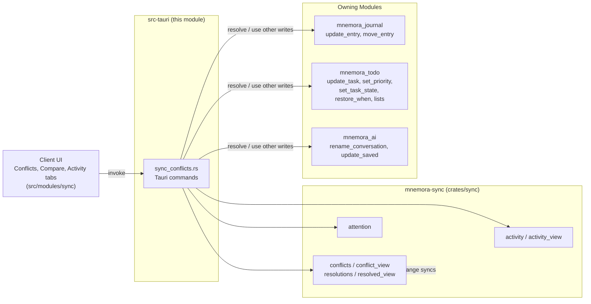
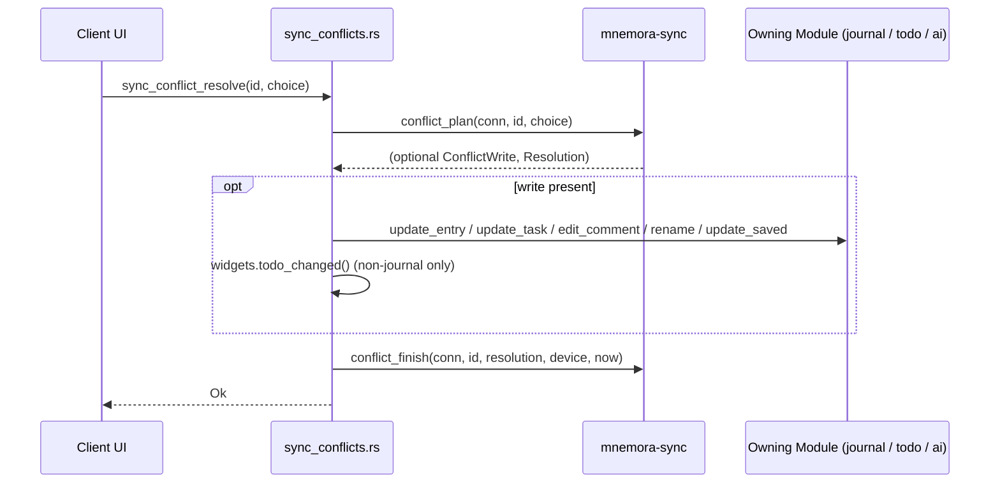
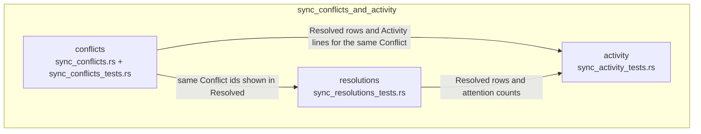

# sync_conflicts_and_activity

## Introduction

`sync_conflicts_and_activity` is the Tauri command layer that exposes three sync-facing surfaces to the client UI:

- **Conflicts ("Needs you")**: concurrent edits that could not be merged silently and wait for a person to choose.
- **Resolved automatically**: value clashes that were decided newest-wins on every device and logged once, with an optional "Use ‹other› instead" action.
- **Activity**: the cross-device log of sync sessions, pauses, renames, merges, conflicts and other sync events.

The module is intentionally thin. The rules (merge decisions, conflict identity, activity wording and paging) live in `mnemora-sync`, and the write-back of a chosen value goes through the owning Module's own service (`mnemora_journal`, `mnemora_todo`, `mnemora_ai`). A resolution is therefore an ordinary edit: it validates, records an ordinary change, and syncs like any other change.

Source files covered:

| File | Role |
|---|---|
| `src-tauri/src/sync_conflicts.rs` | Tauri commands (IPC surface) |
| `src-tauri/src/sync_conflicts_tests.rs` | Scenario tests: text merging and Conflicts |
| `src-tauri/src/sync_resolutions_tests.rs` | Scenario tests: "Resolved automatically", "Use other instead", attention |
| `src-tauri/src/sync_activity_tests.rs` | Scenario tests: Activity log |

## Architecture overview

## Command surface

All commands are defined in `sync_conflicts.rs` and registered through `specta` for typed bindings.

| Command | Purpose |
|---|---|
| `sync_conflicts` | "Needs you" list plus "Resolved automatically" rows |
| `sync_conflict` | One Conflict for Compare, or nothing |
| `sync_conflict_draft` | Builds the Edit-merged starting text from per-clash choices |
| `sync_conflict_resolve` | Settles a Conflict: keep this, keep other, or write an edited merge |
| `sync_activity` | A page of the Activity log, newest first |
| `sync_attention` | Counts that drive the Home card, sidebar badge and palette hint |
| `sync_resolution_use_other` | Writes the value that gave way as a new ordinary edit |
| `sync_resolutions_visited` | Marks "Resolved automatically" as seen |

### Write-back path

Both `sync_conflict_resolve` and `sync_resolution_use_other` write user-visible values through one pattern: the owning Module's service is called, the widget is signalled for Todo changes, then the sync-side record is finalised.

`sync_resolution_use_other` follows the same shape with `resolution_plan_use` and `resolution_finish_use`. Its `write_value` helper maps each `(entity, unit)` pair (for example `todo_task`/`priority`, `todo_task`/`when`, `todo_list`/`group_by`, `journal_entry`/`page_date`) to the corresponding Module call. Unknown pairs are refused with a validation error.

## How the sub-modules relate

The scenario tests exercise cluster-level behaviour from three angles. They share the `Cluster` and `TestApp` harness from `test_support` and only call real commands.

## Sub-modules

- **[Conflicts](sync_conflicts_and_activity/sync_conflicts_and_activity_conflicts.md)**: the Tauri command file and the text-merge and Conflict scenarios (silent merges, overlapping edits, Compare, Keep this / Keep other / Edit merged, held editors, deletes after a clash, Tasks and Comments).
- **[Resolutions](sync_conflicts_and_activity/sync_conflicts_and_activity_resolutions.md)**: value clashes decided newest-wins and logged once (Priority, Status, When, Use other instead), delete-versus-edit rows, Inbox moves, Order and Preference folding, "since your last visit", attention, and the toast.
- **[Activity](sync_conflicts_and_activity/sync_conflicts_and_activity_activity.md)**: the session line and its breakdown, pauses, resumes, renames, forgets, failures, the Local Network block line, and paging and device filters.

## Related modules

- Merge engine, conflict and activity storage, and paging rules: [Sync_Replication_Engine](../Sync_Replication_Engine.md).
- Pairing, devices and transport that produce session and pause events: [Sync_Connectivity_and_Pairing](../Sync_Connectivity_and_Pairing.md).
- Client screens that consume these commands: [Sync_Client_Surface](../Sync_Client_Surface.md).
- Owning Modules whose edits are used for write-back: [Feature_Client_UI](../Feature_Client_UI.md) (journal and todo) and [AI_Assistant_Engine](../AI_Assistant_Engine.md).
- IPC registration and event bridge: [Tauri_Host_and_IPC_Bridge](../Tauri_Host_and_IPC_Bridge.md).

## Key design rules

1. **Thin commands.** No merge rule is decided in this layer; it calls `mnemora_sync` and the owning Module.
2. **Resolution is an edit.** Any text or value written back is an ordinary change that validates and syncs; there is no side channel.
3. **Same answer everywhere.** A Conflict or resolved row carries a stable id, so every device shows the same row, and a row decided on one device clears on all.
4. **Quiet by default.** Activity logs a session only when something moved. Toasts for new conflicts appear only on devices that opt in.
