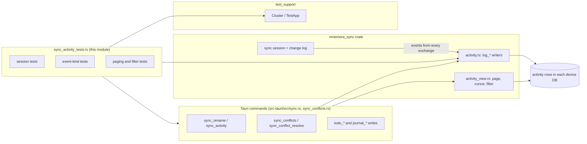
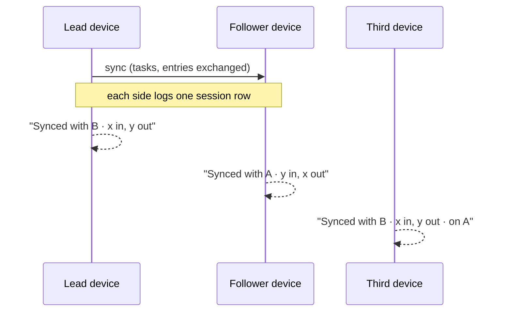
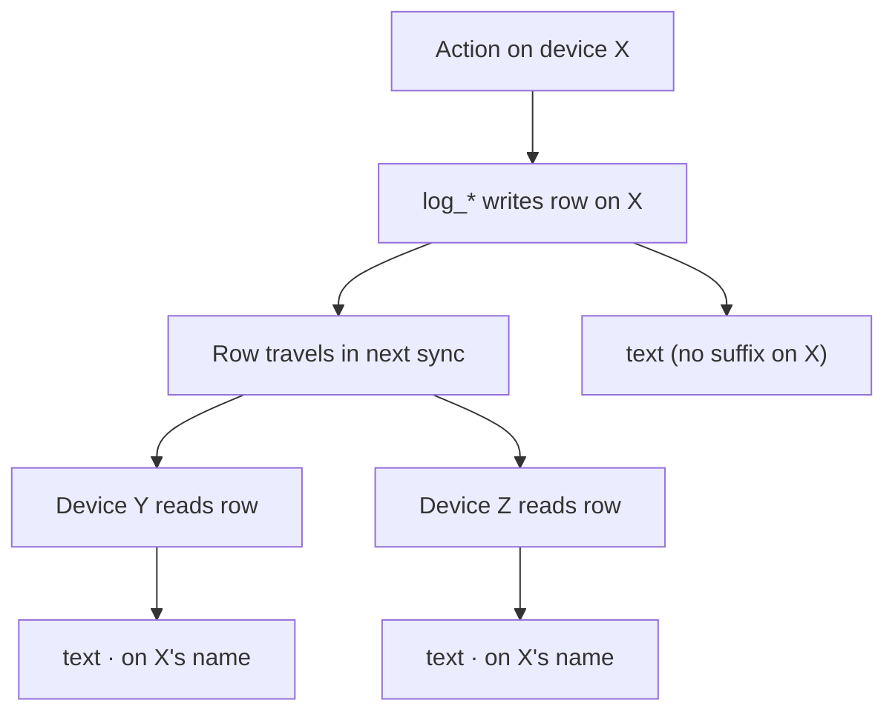
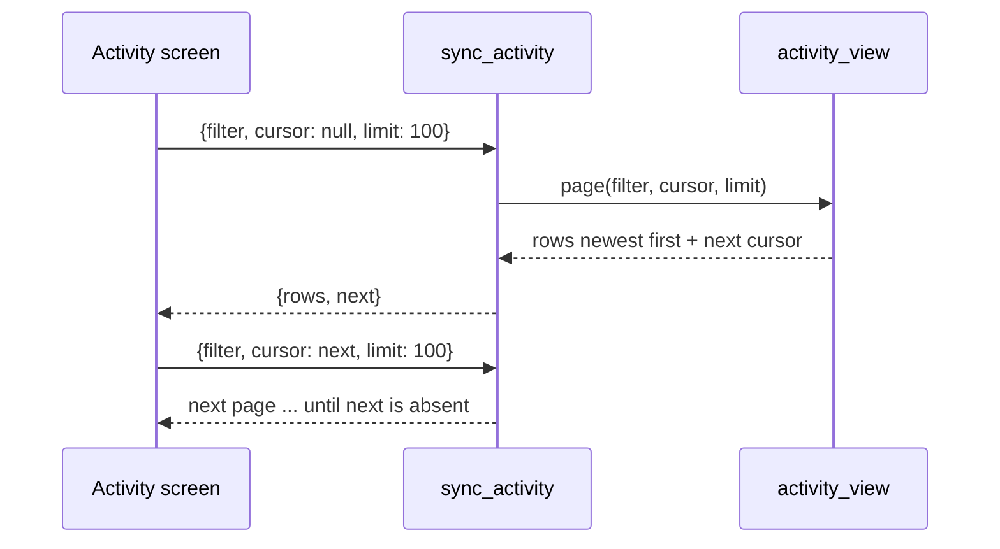

# Sync Activity Log (sync_conflicts_and_activity_activity)

## Introduction

This module is the executable specification for the **Activity log**: the per-device history of sync events that the user sees on the Sync screen. It is made of Rust integration tests in `src-tauri/src/sync_activity_tests.rs` that run on a simulated multi-device `Cluster` and read everything back through real commands (`sync_activity`, `sync_conflicts`, `sync_conflict_resolve`, `todo_*`, `journal_*`, `sync_rename`). No test reads the database directly for assertions, in line with ADR 0009.

The tests pin five behaviours:

1. A sync session is logged **once**, with counts that match what actually moved, read correctly from each end.
2. Every kind of event (conflicts, list merges, renames, pauses, resumes, failures, forgetting, leaving, local-network blocks) appears **once on every device**, attributed to the device that caused it.
3. A quiet sync (nothing moved) and passing data along are **not** logged.
4. A long log **pages newest first** with no gaps or repeats, and can be **filtered by device**.
5. A page asks for at least one and at most the limit of rows.

The implementation lives in the `sync_activity` and `activity_view` code of the Sync engine (see [Sync_Replication_Engine/sync_activity.md](../../Sync_Replication_Engine/sync_activity.md)). The screen that renders the rows is described in [sync-activity](../sync-activity.md). Conflict lines reference the conflict workflow documented in [sync_conflicts_and_activity_conflicts](sync_conflicts_and_activity_conflicts.md) and [sync_conflicts_and_activity_resolutions](sync_conflicts_and_activity_resolutions.md). The underlying change log that makes events visible on other devices is covered in [Data_Foundation/core.md](../../Data_Foundation/core.md).

## Where this module sits

The tests drive two entry paths:

- **Commands**: user-level actions such as creating a task or entry, editing an entry, resolving a conflict, renaming a device, and reading `sync_activity`.
- **Direct `mnemora_sync::log_*` calls**: used where the production trigger is not reachable from a command (pause, resume, failure, forgetting, leaving, local-network block). The file comment states these are the calls made by the features tracked in issues #69 and #72.

## Test cluster and helpers

| Helper | Purpose |
|---|---|
| `group(n)` | Builds `n` devices named `Mac`, `Pixel 8`, `Tablet`, sets a shared `sync_group` row and mutual `sync_peers` rows. |
| `by_id(c, n)` | Orders devices by device id. The lowest id is the "lead" of a shared event. |
| `page(app, filter, cursor, limit)` | Calls `sync_activity` once. |
| `all(app)` | Walks every page until `next` is absent and returns all rows. |
| `of_kind(app, kind)` | Filters `all` by `kind`. |
| `line(row)` | Joins the row's text parts and appends `· on <name>` when the row came from another device. |
| `numbers(text)` | Sums the digit runs of a string; used to check a breakdown adds up. |

The screen text for a row is therefore `text parts` plus an optional `· on <device>` suffix. Tests compare against these exact strings.

## Session lines

A sync session that moved data produces one `session` row on each device.

Rules the tests enforce:

- **Counts are read from the perspective of the reader.** The lead writes `in` as what it received and `out` as what it sent. The follower reads the same session with `in` and `out` swapped.
- **The breakdown** (for example `Tasks ... Journal: 1 Entry`) names the modules and kinds moved, sums to `received + sent`, and contains no content text.
- **Same row id everywhere.** The session row has one id shared by all devices, so the set of session ids is identical on every device and no id appears twice.
- **Pass-through is attributed.** A third device that did not take part in the session shows `· on <lead device>`.
- **Quiet syncs leave no row.** Repeating `sync_all()` when nothing changed adds no lines, and a first sync of two empty devices adds none either.
- **One line per session that moved something.** Over several rounds of sync with growing task counts, the log holds exactly one row per round, and the `(in, out)` numbers match each session in order.

## Event kinds

The tests check the following kinds, each produced as one row per event and replicated to every device.

| Kind | Example line | Produced by |
|---|---|---|
| `session` | `Synced with Pixel 8 · 3 in, 1 out` | Each sync that moved data |
| `conflict_raised` | `Conflict in an Entry’s text needs you` | Overlapping edits to the same entry; link to `conflicts` |
| `conflict_resolved` | `Conflict in an Entry’s text resolved` | `sync_conflict_resolve` with `keep_this`; link is cleared on old raised rows |
| `lists_merged` | `groceries (…) merged into Groceries` | Two lists with the same name created on different devices |
| `renamed` | `Mac renamed to Studio Mac` | `sync_rename` |
| `paused` | `Paused with Pixel 8: one of you needs an update` | `log_paused` with `Why::Update` |
| `resumed` | Resume after a pause | `log_resumed` |
| `failed` | `Connection to Pixel 8 lost; retrying` | `log_failed` with `Why::Lost` |
| `forgot` | Forgetting a paired device | `log_forgot` |
| `left` | Leaving the sync group | `log_left` |
| `blocked` | `Can’t reach devices on the network: blocked by the Local Network setting` | `log_local_network_blocked` |

### De-duplication rules

- **Conflict raised and resolved**: each produces one line per device. After resolution the earlier `conflict_raised` row no longer has a link (`link` is `null`) because there is nothing left to review.
- **Pause and resume**: a pause noticed again (after a restart) does not add a second row; a resume with nothing paused logs nothing. Pause and resume alternate, so the test sees `paused` twice and `resumed` once across a pause, re-check, resume, re-check, pause cycle.
- **Failure**: a flaky link that fails repeatedly is one `failed` line while the failure persists.
- **Local-network block**: a permission that flickers is one `blocked` line.
- **Lower-id logs shared events**: for a shared event between two devices, only the device with the lower device id writes the row, so the pair does not double-log. The higher-id device's `log_paused`, `log_resumed` and `log_failed` return `false`.

### Attribution

The device that did the action reads the line plainly. Every other device reads it with `· on <device name>`. Renames propagate: after `Mac` is renamed to `Studio Mac`, other devices use the new name in later lines.

Note the test for `lists_merged` accepts a second form for devices that heard about the merge from elsewhere: the name of the device that made the merged list is shown in brackets, for example `groceries (<device>) merged into …`.

## Paging and filtering

`sync_activity` takes `{ filter, cursor, limit }` and returns `{ rows, next }`.

- **Order**: newest first (`at` is non-increasing across pages).
- **Cursor**: opaque; `next` is absent on the last page.
- **Page size**: the limit is clamped to at least 1 and at most the requested maximum (a limit of `0` returns one row; `100000` returns all available up to the cap in the test fixture).
- **No gaps or repeats**: 450 renames plus 150 forgotten-peer lines (600 total) are read in pages of 100; the test asserts 6 pages, each full except the last, with every id unique.
- **Filters**:
  - `{ "kind": "all" }`: every line on the device.
  - `{ "kind": "this_device" }`: every line the device took part in (all 600 in the test).
  - `{ "kind": "device", "id": <device id> }`: lines involving that device only. A forgotten peer appears on its own lines (150 in the test); a device with no involvement gets 0.

## Test coverage map

| Test | Concern |
|---|---|
| `a_session_is_logged_once_with_counts_that_match_and_read_the_right_way_round` | Session counts, breakdown, perspective, ids |
| `every_session_that_moved_something_is_one_line_and_each_line_matches_its_session` | One row per moving session, numbers in order |
| `a_sync_that_moved_nothing_is_not_logged_and_neither_is_passing_activity_on` | Quiet syncs add nothing |
| `a_conflict_raised_and_resolved_is_one_line_each_on_every_device` | Conflict lifecycle across three devices |
| `a_list_merge_is_one_line_on_every_device` | Same-name lists merge into one attributed line |
| `renaming_forgetting_leaving_pauses_resumes_and_failures_are_each_one_attributed_line` | All event kinds, lead/follow logging |
| `a_pause_and_a_resume_are_logged_once_however_often_they_are_noticed` | Idempotent pause/resume |
| `the_system_keeping_a_device_off_the_local_network_is_one_line_that_every_device_reads` | Blocked line, flicker-safe |
| `a_long_log_pages_newest_first_without_gaps_or_repeats_and_filters_by_device` | Paging and device filters at scale |
| `a_page_asks_for_at_least_one_row_and_at_most_the_limit` | Limit bounds |

The conflict workflow these tests exercise is covered in the conflict pages linked above; the contents of the conflict and resolution rows are not re-described here.

## Dependencies and boundaries

- **Test harness**: `Cluster` and `TestApp` from `src-tauri/src/test_support.rs` create isolated devices with their own databases and a controllable clock (`clock().advance(ms)`).
- **Engine**: `mnemora_sync` provides the `log_*` writers, the `Local` device descriptor, the `Why` reason enum, and the paging view. See [Sync_Replication_Engine/sync_activity.md](../../Sync_Replication_Engine/sync_activity.md).
- **Replication**: events reach other devices through the same exchange that moves data, so the activity log is replicated the way any sync record is. The change log that supports this is in [Data_Foundation/core.md](../../Data_Foundation/core.md).
- **Client**: the Svelte side reads these rows through the queries and presentation helpers in [sync-activity](../sync-activity.md) and renders the screen described in [Sync_Client_Surface.md](../../Sync_Client_Surface.md).

## Maintenance notes

- When adding an event kind, add a `log_*` writer with the same lead/follow rule if it concerns two devices, and add one test that checks the line on every device.
- Keep the text exactly as the tests spell it. The strings include typographic apostrophes (`’`) and the middle dot separator (`·`); changing them breaks several assertions.
- Counts in session lines must come from what was actually moved. Do not compute them from a separate estimate.
- Paging assertions use 100 as the page size. If the server clamps the limit differently, update the `a_page_asks_for_at_least_one_row_and_at_most_the_limit` test and the paging loop together.
