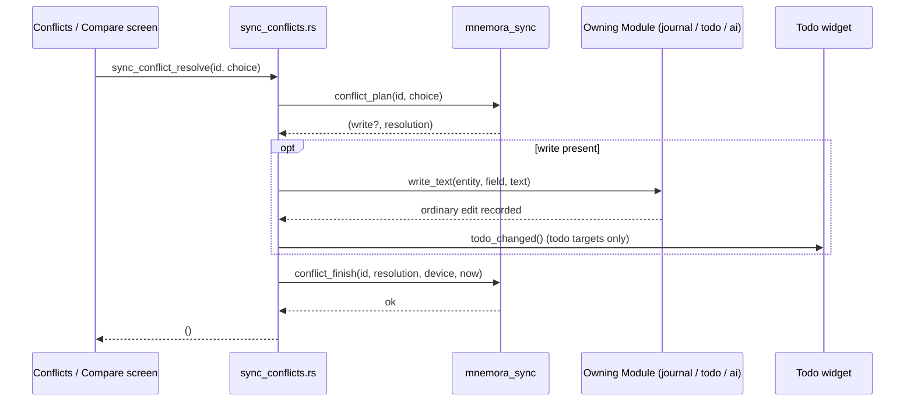
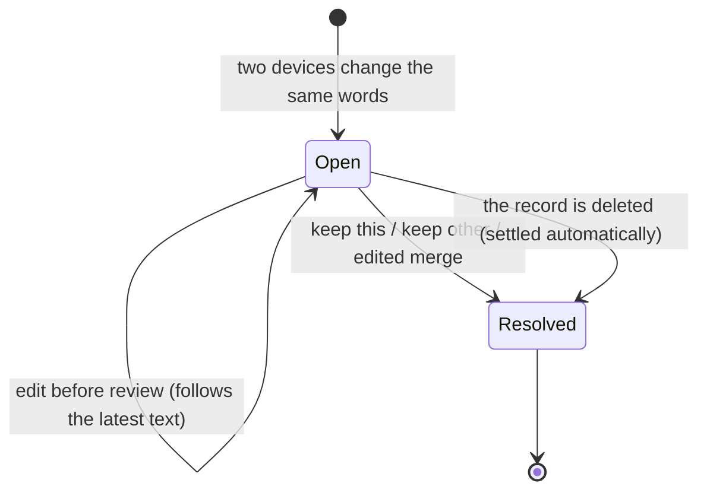
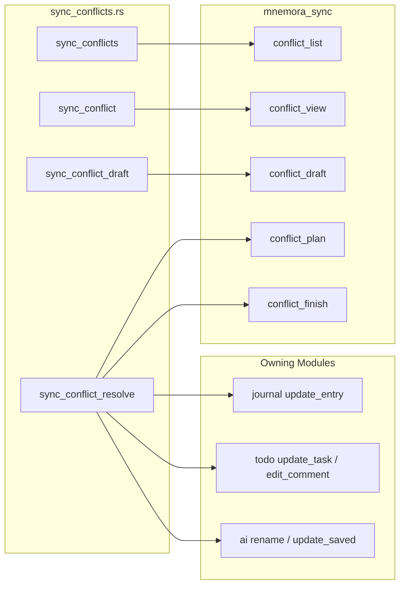

# sync_conflicts_and_activity_conflicts

This module is the Tauri command layer behind the **Conflicts** tab and the **Compare** view of the sync client. When two devices change the same text while apart, sync cannot pick a winner silently, so it records a Conflict. This module lets the person list those Conflicts ("Needs you"), read both versions side by side, draft a merged text, and settle the Conflict. It is deliberately thin: the rules (what clashes, what is agreed, what counts as resolved) live in `mnemora-sync`, and the text that is finally written goes through the owning Module's own edit path.

The module's Rust source is `src-tauri/src/sync_conflicts.rs`; its scenario tests are in `src-tauri/src/sync_conflicts_tests.rs`.

## Where it sits

- The sync rules, the `conflicts` table and the merge engine are described in [Sync_Replication_Engine/sync_conflicts.md](../../Sync_Replication_Engine/sync_conflicts.md) and [Sync_Replication_Engine/sync_engine.md](../../Sync_Replication_Engine/sync_engine.md).
- The sibling module for auto-resolved rows and the Activity feed is documented in [sync_conflicts_and_activity_resolutions](sync_conflicts_and_activity_resolutions.md) and [sync_conflicts_and_activity_activity](sync_conflicts_and_activity_activity.md).
- The written text is owned by other Modules: Journal ([Feature_Client_UI/journal.md](../../Feature_Client_UI/journal.md)), Todo ([Task_and_Journal_Domain_Services/todo.md](../../Task_and_Journal_Domain_Services/todo.md)) and AI ([AI_Assistant_Engine/ai_assistant.md](../../AI_Assistant_Engine/ai_assistant.md)). This module never writes rows directly.
- The client screens that call these commands are in [Sync_Client_Surface/sync_conflicts_and_activity.md](../sync_conflicts_and_activity.md) and [Sync_Client_Surface/sync-activity.md](../sync-activity.md).
- Command registration and the typed IPC bridge are in [Tauri_Host_and_IPC_Bridge/ipc-bridge.md](../../Tauri_Host_and_IPC_Bridge/ipc-bridge.md).

## Commands

| Command | Purpose | Inputs | Returns |
|---|---|---|---|
| `sync_conflicts` | Lists the Conflicts that wait, newest first ("Needs you"). | none | `ConflictList` |
| `sync_conflict` | Reads one Conflict for Compare. | `id` | `Option<ConflictView>`; `None` when no such id |
| `sync_conflict_draft` | Builds the text Edit merged starts from. | `id`, `choices` | merged text `String` |
| `sync_conflict_resolve` | Settles a Conflict: keep what shows, keep the other, or write an edited merge. | `id`, `choice` | `()` |

Every command reads the current device id and its display name (`my_name`, which falls back to `default_device_name` when no name is set) before calling into `mnemora_sync`.

## Core flows

### Listing and comparing

`sync_conflicts` returns `needs_you`, a list of rows. Each row carries the module, a `subject` (kind, page date, written time as a timestamp plus zone, task title, field, and so on) and `raised_at`. The row's time is sent as a timestamp and offset, never as a pre-formatted string, so the screen can follow the person's Time format.

`sync_conflict` returns a `ConflictView` with:

- `open`: whether the Conflict still waits.
- `showing`: the text the device currently shows, as stretches with `changed` flags.
- `other`: the version that gave way.
- `original`: the text both edits started from.
- `pieces`: the agreed parts and the `clash` parts, each clash carrying its `showing` and `other` words.
- `resolution`: set once the Conflict is settled.

### Drafting a merge

`sync_conflict_draft` takes `choices`, one per clash, in order. The clash choices are `showing`, `other` or `both`. A clash without a choice takes the showing version. Agreed parts are always kept. The result is the text the Edit screen opens with; nothing is written.

### Settling a Conflict

`sync_conflict_resolve` takes a `ConflictChoice`. The sync engine plans the change, and this module applies it:

1. `mnemora_sync::conflict_plan` returns `(write, resolution)`. `write` is `None` for a plain "keep what shows" choice, which only ends the Conflict.
2. If there is a write, `write_text` sends it to the owning Module as an ordinary edit (a new editing session), and the Todo widget is signalled unless the target is a Journal entry.
3. `mnemora_sync::conflict_finish` records the resolution with this device's id and the current time.

Because the text is an ordinary edit, it validates, appears as a normal change and syncs like any other. The Conflict then reads resolved on every device.

### Writing text back to its owner

`write_text` dispatches on the `entity` string of the plan:

| `entity` | Owning call | Notes |
|---|---|---|
| `journal_entry` | `mnemora_journal::update_entry` | Fresh session id per write. |
| `todo_task` | `mnemora_todo::update_task` | `field == "notes"` keeps the title and replaces notes; any other field replaces the title and keeps the notes. |
| `todo_comment` | `mnemora_todo::edit_comment` | |
| `ai_conversation` | `mnemora_ai::rename_conversation` | |
| `ai_saved_question` | `mnemora_ai::update_saved` | Stamped with `physical_now`. |
| anything else | rejected with `ErrorCode::Internal` | "That kind of text cannot be written back". |

The "Use other instead" path (`sync_resolution_use_other`) is a separate dispatcher, `write_value`. It is covered in [sync_conflicts_and_activity_resolutions](sync_conflicts_and_activity_resolutions.md).

## Conflict lifecycle

The behaviour the tests pin down:

- An overlapping edit raises one Conflict on every device, and the newest text shows. Further sync rounds add nothing.
- Editing the entry again before review keeps the same Conflict. Showing becomes the latest text; the other version stays as it was.
- Edits to different parts of an entry merge silently and raise no Conflict. Task notes and titles merge apart and clash apart.
- Resolving on one device clears the Conflict on all devices once sync carries the decision.
- A Conflict on a record that is then deleted, on any device, is resolved automatically with the reason `deleted` and logged once, with the same id on each device.
- A clash made while a text is held in an open editor is decided only after the editor is released (see [Feature_Client_UI/journal.md](../../Feature_Client_UI/journal.md) for the editor side).

## Data model in brief

## Tests

`sync_conflicts_tests.rs` runs real commands on a `Cluster` of two or three simulated devices (see [Tauri_Host_and_IPC_Bridge](../../Tauri_Host_and_IPC_Bridge/ipc-bridge.md) for the test harness conventions). Its scenarios cover:

- `overlapping_edits_raise_one_conflict_on_both_devices_and_the_newest_shows`: one row per device, identical ids, timestamp and offset present, no new row on further sync.
- `edited_merge_writes_the_chosen_text_and_resolves_everywhere`: draft with `both` and `other`, then an edited merge that clears the Conflict on both devices.
- `three_devices_agree_on_the_text_and_the_conflict_whatever_order_they_sync_in`: six sync orders must converge on the same text and exactly one Conflict.
- Task notes/title, comment bodies, held editors, a session saved twice, and a Conflict raised before its entry is deleted (both deleting sides).

## Notes for maintainers

- `sync_conflict_resolve` writes the text before recording the resolution. If `conflict_finish` fails after the write, the text stays changed while the Conflict stays open; the next attempt then produces a fresh write. Keep this order in mind when changing either side.
- The widget signal is sent for every non-Journal write, including AI targets. This matches the existing code; the AI surfaces do not read the widget.
- `write_text` and `write_value` are the only places this module knows about other Modules' entity names. Adding a new text-bearing kind means adding a match arm in `write_text` and a matching planner in `mnemora_sync`.
- Unknown kinds fail with a validation or internal error rather than writing anything.
