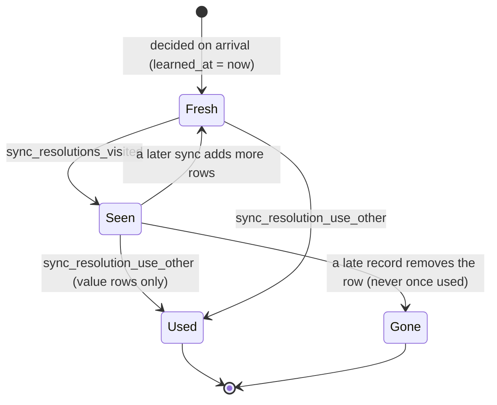
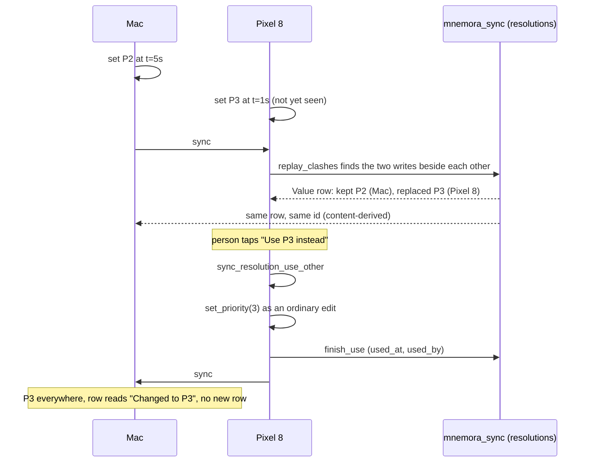
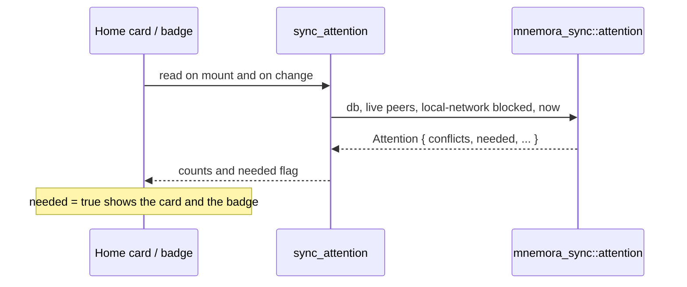
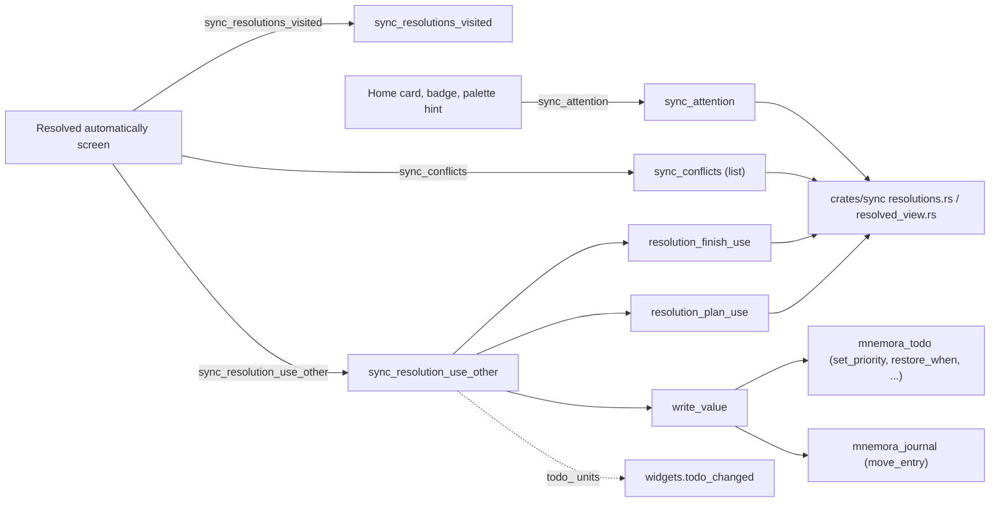

# sync_conflicts_and_activity_resolutions

This module is the client-facing side of **"Resolved automatically"**: the list of decisions Sync made without asking, the "since your last visit" newness that marks them, the "Use ‹other› instead" action that undoes a value decision, and the attention signal (Home card, sidebar badge, palette hint) that tells the person something needs them. The rules that decide these rows live in the sync engine ([sync_conflicts](../../Sync_Replication_Engine/sync_conflicts.md)); this module covers the Tauri commands that expose them, the words the person reads, and the tests that pin the behaviour end to end on a simulated cluster of devices.

The Rust side is a thin command layer in `src-tauri/src/sync_conflicts.rs`. Each command either reads a view from `mnemora_sync`, or writes a value through the owning Module (Todo, Journal) and then marks the sync-side row. Nothing here decides a merge; that is the engine's job.

## Where it sits

| Concern | Source | Documented in |
| --- | --- | --- |
| Commands: `sync_resolution_use_other`, `sync_resolutions_visited`, `sync_attention` | `src-tauri/src/sync_conflicts.rs` | this page |
| Automatic decisions (`Value`, `DeleteEdit`, `TaskInbox`, `ConflictDeleted`, `OrderPrefs`) | `crates/sync/src/resolutions.rs` | [sync_conflicts](../../Sync_Replication_Engine/sync_conflicts.md) |
| "Resolved automatically" rows, words, icons, button rule | `crates/sync/src/resolved_view.rs` | [sync_conflicts](../../Sync_Replication_Engine/sync_conflicts.md) |
| Activity lines for person decisions and raised clashes | `crates/sync/src/activity.rs` | [sync_activity](../../Sync_Replication_Engine/sync_activity.md) |
| Conflicts list, Compare, Keep / Edit merged | see sibling page | [sync_conflicts_and_activity_conflicts](sync_conflicts_and_activity_conflicts.md) |
| Behaviour tests | `src-tauri/src/sync_resolutions_tests.rs` | this page, Tests section |

The sibling page [sync_conflicts_and_activity_conflicts](sync_conflicts_and_activity_conflicts.md) covers the "Needs you" side. Both appear in the same Conflicts tab, and both feed the same attention signal.

## Core concepts for the person

Two lists sit under the Conflicts tab:

- **Needs you** holds open text Conflicts. Those are handled by the sibling module.
- **Resolved automatically** holds `Resolution` rows that Sync decided itself. These are the subject of this module.

A row in "Resolved automatically" is one of five kinds. The kind is stored; the words are produced on read.

| Kind (`kind` in the list) | Example title | Action offered |
| --- | --- | --- |
| `value` | ‘Water plants’ · Priority | "Use P3 instead" (when offered) |
| `delete_edit` | ‘Water plants’ · Deleted | none |
| `task_inbox` | ‘Pack’ moved to Inbox | none |
| `conflict_deleted` | a text clash on a deleted entry | none |
| `order_prefs` | Order & preferences · 3 changes | none |

Only `value` rows can be used. The engine's `can_write_back` rule decides which value units offer the button: Task priority, when, list; List name, emoji, sort and grouping; Journal page date; and a Task's status unless the Task repeats.

## Commands

### `sync_resolution_use_other(id)`

"Use ‹other› instead". The command runs this sequence:

1. `mnemora_sync::resolution_plan_use(conn, id)` returns a `UsePlan` (entity, entity id, `unit`, and the `values` that were replaced). The plan refuses rows that are gone, already used, or not `value`.
2. `write_value` writes the replaced values back through the owning Module's own service, so validation and the ordinary change log apply. The unit decides the call:

| Entity | Unit | Owning call |
| --- | --- | --- |
| `todo_task` | `priority` | `set_priority` |
| `todo_task` | `state` | `set_task_state` |
| `todo_task` | `list_id` | `move_task` |
| `todo_task` | `when` | `restore_when` (date, time and Repeat together) |
| `todo_list` | `name` / `emoji` | `rename_list` / `set_list_emoji` |
| `todo_list` | `task_sort` / `group_by` | `set_list_sort` / `set_list_group` |
| `journal_entry` | `page_date` | `move_entry` |

3. If the entity starts with `todo_`, the widget is told the Todo data changed.
4. `resolution_finish_use(conn, id, me)` sets `used_at` and `used_by` and records an `Update` change.

Because the write is an ordinary edit, the value syncs like any other change, reads as a normal History line, and is not a new Conflict. Using the same row twice is refused.

### `sync_resolutions_visited()`

Called when the person opens "Resolved automatically". It calls `resolutions_visited`, which stamps the log as seen, so every row reads as no longer new. A later sync that brings more rows makes them new again.

### `sync_attention()`

Returns the `Attention` value that three surfaces read: the Home card, the sidebar badge and the palette hint. It is computed from:

- the open Conflicts that wait (`conflicts` count) and whether any are open (`needed`),
- the live peers (`state.sync.peers_live()`),
- whether the local network is blocked (`state.sync.local_network_blocked()`),
- the current time (`now_ms()`).

Its test asserts the rule: `needed` is true while a Conflict is open on either device, and falls back to false once the Conflict is resolved on the other device and the change has synced.

## Words and the "fresh" flag

`sync_conflicts` returns a `ConflictList` with `needs_you` and `resolved`. Each resolved row has:

- `id`, `kind`, `title`, `detail`, `at`, `module`,
- `action` (the button label, or `null` when the button is not offered),
- `used` (the outcome text once used, e.g. "Changed to P3"),
- `fresh` (true until the log is visited),
- `changes` (for `order_prefs`, the folded changes of one sync session).

The strings are produced on read, so a change to `core.date_format`, `core.time_format` or a device's name applies to every row at once. The tests show the same value rendered three ways: `Fri 30 Oct 19:00`, `2026-10-30 7:00 PM` (iso plus 12h), and `Oct 30, 2026 7:00 PM` (short).

## Lifecycle of a Resolved automatically row

A used row is never removed by a later sync; the engine keeps it because the person has acted on it.

## Sequence: a Priority clash and the undo

The main flow the tests exercise, with two devices (Mac and Pixel 8):

## Sequence: attention on the Home card

## Component interaction

Key rules:

- The commands never decide a merge and never write a Resolution row directly. Rows change only inside `mnemora_sync`.
- The chosen value is always written through the owning Module, so validation and change logging are the Module's.
- Activity lines are not written by these commands. Automatic outcomes stay out of the Activity tab; a person's "use other" appears in History as an ordinary edit line.

## Tests

`src-tauri/src/sync_resolutions_tests.rs` runs real commands on a `Cluster` of simulated devices and reads results back through commands (see [ADR 0009](../../adr/0009-rule-tests-at-the-command-layer.md)). The file pins:

| Behaviour | Test |
| --- | --- |
| A Priority clash is one row, the same on both devices, with the expected title, detail and action | `a_priority_clash_is_logged_once_the_same_on_both_devices` |
| Syncing again, or a third device meeting the records, adds no row and keeps the same id | `syncing_again_adds_nothing_and_whoever_decided_the_row_is_the_same` |
| A later change is not a clash | `a_change_made_after_another_is_not_a_clash` |
| Both deleting or both completing is not a clash | `both_deleting_or_both_completing_a_task_is_not_a_clash_though_the_moments_differ` |
| A status clash can be used instead | `a_task_status_that_gave_way_can_be_used_instead_unless_the_task_repeats` |
| A group clash on When converges as a whole | `a_change_to_one_member_of_a_group_beside_another_member_is_a_logged_clash` |
| Dates and times follow the format Preferences | `the_values_are_written_the_way_the_format_preferences_say` |
| "Use other" is an ordinary change, syncs, and can be used once | `use_other_is_an_ordinary_new_change_that_syncs_and_reads_as_a_history_line` |
| Delete versus edit is one row whichever clock is later, and through a third device | `a_delete_and_an_edit_are_logged_whichever_clock_is_later`, `a_delete_and_an_earlier_edit_met_through_a_third_device_are_logged_once_in_any_order`, `a_delete_met_by_two_edits_is_one_row_the_same_on_three_devices_in_any_order` |
| An edit the deleter had already received is not logged | `an_edit_the_deleting_device_had_already_received_is_not_logged` |
| A Task moved into a deleted List lands in the Inbox and is logged | `a_task_moved_into_a_list_deleted_elsewhere_lands_in_the_inbox_and_is_logged` |
| A text clash on a deleted entry is logged without asking | `a_text_clash_on_a_deleted_entry_is_logged_without_asking` |
| Order and Preference changes fold into one line per sync session | `order_and_preference_changes_fold_into_one_line_per_sync_session` |
| "Fresh" flag clears on visit and returns with new rows | `rows_are_new_until_the_log_is_visited_and_new_again_when_more_arrive` |
| Attention follows open Conflicts | `attention_follows_the_conflicts_that_wait` |
| A new Conflict is announced only on a device set to toast | `a_new_conflict_is_announced_only_on_a_device_set_to_a_toast` |

## Edge cases to know

- **Write before mark.** `sync_resolution_use_other` writes the value first and marks the row used second. If the second step fails after a successful write, the value is already changed but the row is still unused, so a retry writes the same value again. The write is idempotent for the same value, but the row stays shown as unused until a retry succeeds.
- **Repeat rule is checked upstream.** The Task status case refuses a repeating Task only in the view (`can_write_back`). `write_value` for `todo_task` / `state` does not re-check repetition, so the guard depends on `plan_use` never returning such a row.
- **Empty fallbacks.** For `todo_list` / `name` and `journal_entry` / `page_date`, `write_value` falls back to an empty string when the stored value is missing (`unwrap_or_default`). The owning Module's validation is expected to refuse an empty name or date; this module does not add its own check.
- **Deleted rows are never offered.** Deletions and clashes on deleted records have no button, so there is no way to bring a deleted record back from this screen.
