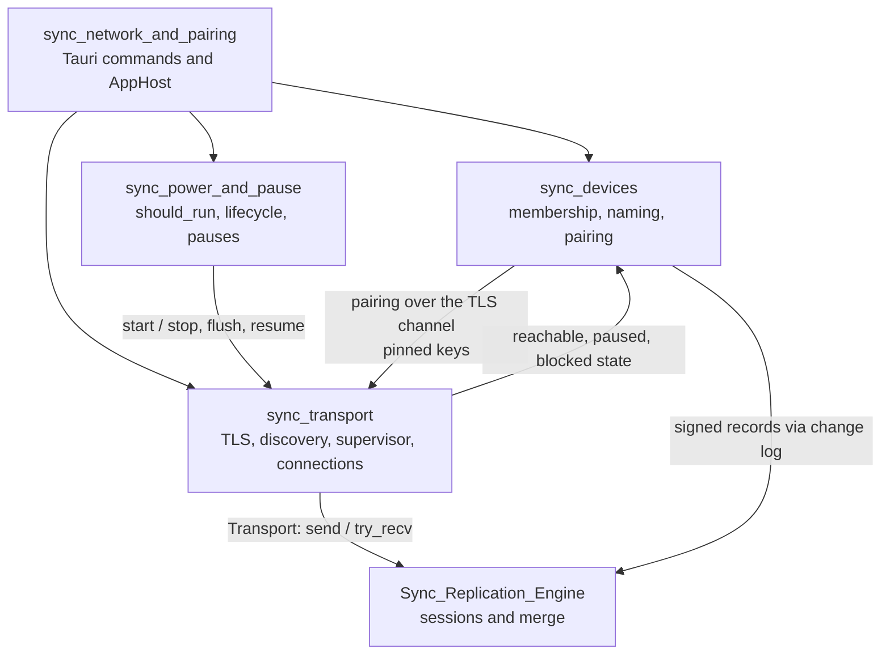

# Sync Connectivity and Pairing

## Purpose

`Sync_Connectivity_and_Pairing` is the connectivity layer under Mnemora's sync. It answers four questions:

- **Which devices belong to the group?** Pairing with a code, Forget/Leave, and introductions that bring in a device through another member.
- **How do devices find and reach each other?** Discovery, typed addresses, pinned-key TLS 1.3, and a supervisor that keeps connections alive.
- **When is the network allowed to run?** Sync's on/off switch, mobile-data permission, and whether the app is in front on Android.
- **What is shown when a device cannot sync?** The Devices tab states such as "paused on mobile data", "not nearby", and paused for a data-version or clock mismatch.

The module moves no sync data and applies no merge rules. Those belong to [Sync_Replication_Engine](Sync_Replication_Engine.md).

## Architecture

The layers are separate. `sync_transport` opens sockets but has no knowledge of membership. `sync_devices` decides membership and naming but never opens a socket itself. `sync_power_and_pause` decides when the network exists and passes start and stop decisions to the transport. The Tauri host in `sync_network_and_pairing` wires them together.

## Components

| Component | Responsibility | Documentation |
|---|---|---|
| `sync_devices` | The Devices tab data, paired-device list, naming, and signed Forget, Leave, and introduction records. Also the pairing state machine that uses a SPAKE2 code exchange. | [sync_devices](Sync_Connectivity_and_Pairing/sync_devices.md) |
| `sync_transport` | Ed25519 device identity, pinned-key TLS 1.3, handshake checks, typed addresses, the supervisor that dials and retries, duplicate-connection rules, and macOS and Android local-network detection. | [sync_transport](Sync_Connectivity_and_Pairing/sync_transport.md) |
| `sync_power_and_pause` | The `should_run` rule, the Android foreground and link lifecycle, the flush-then-stop timer, and data-version and clock pauses. | [sync_power_and_pause](Sync_Connectivity_and_Pairing/sync_power_and_pause.md) |
| `sync_network_and_pairing` | The Tauri command layer (`sync_set_enabled`, `sync_pair_*`, `sync_device_*`), `AppHost` as the implementation of the library's `PairingHost` and `Host` traits, and the network start and stop path. Its test suites run over real loopback sockets. | [sync_network_and_pairing](Sync_Connectivity_and_Pairing/sync_network_and_pairing.md) |

## Key behaviours

- **Identity and trust.** A device is identified by its Ed25519 public key, not by its name or address. Each side pins the other's key after pairing. Revocations and introductions are signed, and a receiver accepts one only when the signature checks out against a key it already trusts.
- **Power gate.** The network runs only when Sync is enabled, the app is not away, and either the link is not mobile data or mobile data is allowed. Leaving the app flushes pending changes for up to 5 seconds before the network stops.
- **Pauses are not refusals.** A data-version mismatch or a clock more than five minutes ahead pauses sync on both devices until the cause is fixed. Both devices remain paired.
- **Local-network blocking.** On macOS and Android, a blocked local network is reported only after repeated failures over a grace period. A single failure is not treated as a block.

## Maintenance notes

- Changing a field of the handshake, or the rules in `check`, is a protocol change. Bump `PROTOCOL_VERSION`.
- Changing a signed message format breaks verification of records already in the change log. Bump the version tag deliberately.
- The naming rules and the address rules must match the shared fixture `src/lib/ipc/fixtures/sync-rules.json` on both the Rust and TypeScript sides.
- Only the supervisor (`live/manager.rs`) changes a peer's connection state. Power-related network changes go through `settle`.