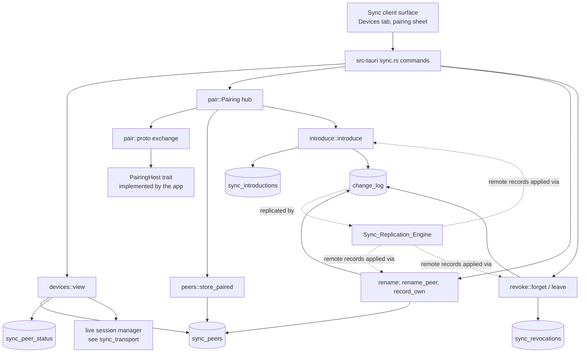
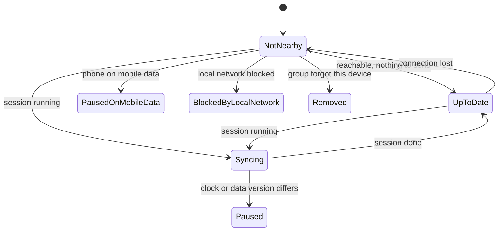
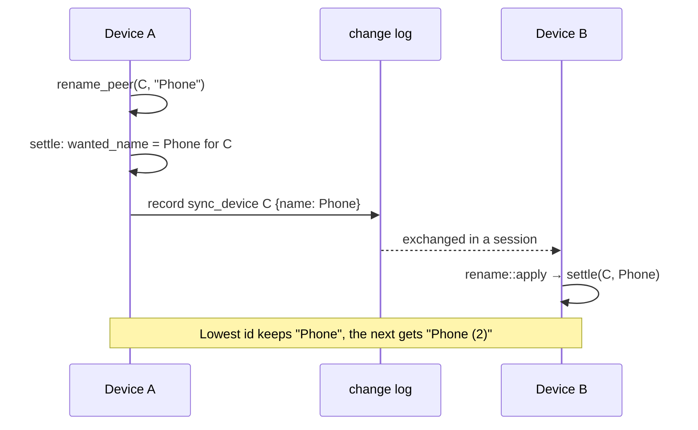
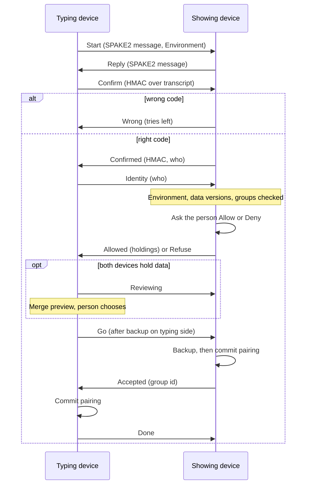

# sync_devices

`sync_devices` is the part of the sync crate that decides **which devices belong to the group** and **what each device is called and reached at**. It covers the Devices tab's data (`devices.rs`), the paired-device list (`peers.rs`), device naming (`name.rs`, `rename.rs`), and the three membership decisions that travel between devices as signed or ordinary change-log records: pairing with a code (`pair/`), Forget/Leave (`revoke.rs`), and introductions that bring a device in through another member (`introduce.rs`).

It does not move data or open sockets. Connections, the TLS listener, discovery and the live session manager belong to [sync_transport](sync_transport.md); power and pause rules belong to [sync_power_and_pause](sync_power_and_pause.md); the merge of synced records belongs to [Sync_Replication_Engine](../Sync_Replication_Engine.md). The screens that show these devices are in [Sync_Client_Surface](../Sync_Client_Surface.md), and the Tauri commands that expose them are in [Tauri_Host_and_IPC_Bridge](../Tauri_Host_and_IPC_Bridge.md).

## Where it sits

Remote records reach this module through the Module contract: `rename::apply`, `revoke::apply` and `introduce::apply` are called by the sync engine for their entity names (`sync_device`, `sync_revocation`, `sync_introduction`). Local actions call the same storage paths and append to the change log so the other devices learn the same thing.

## Core concepts

| Concept | Meaning | Where |
|---|---|---|
| Group | One id shared by every device that has paired. Created at the first pairing. | `peers::store_paired`, `peers::group` |
| Paired device | A row in `sync_peers` with a name, platform, public key and pairing time. | `peers.rs` |
| Pinned key | A paired device's public key, trusted by the TLS layer. Pinning is done by `Pairing` after a store. | `pair/hub.rs` (`commit`) |
| Wanted name | What a device asked to be called. The shown name is derived from all wishes, so it does not depend on arrival order. | `rename::settle` |
| Typed address | An address a person typed for a device, shared through the change log so other devices can dial it. | `rename::set_address` |
| Revocation | A signed "this device is forgotten" (or "lifted") decision. | `revoke.rs` |
| Introduction | A signed statement by one member that a newcomer belongs to the group. | `introduce.rs` |

## Devices tab data (`devices.rs`)

`view` builds the `DevicesView` the Devices tab renders:

- **`ThisDevice`**: this device's name (from the device settings, or the default name), platform, the listening port (`None` when not listening), its addresses and their networks (Wi-Fi first, Tailscale after), and two flags: `paused_on_mobile_data` and `local_network_blocked`.
- **`peers`**: `rows_of` loads paired devices, overlays the remembered per-device status (`peer_state::all`), and applies live state from the session manager.

Each `PeerRow` state comes from `state_of(live)`:

| Live condition | `PeerState` |
|---|---|
| Live entry paused | `Paused` |
| Live entry syncing | `Syncing` |
| Live entry reachable | `UpToDate` |
| Otherwise | `NotNearby` |

Two overlays then change `NotNearby` only:

1. `with_mobile_pause`: while the phone waits on mobile data, unreachable devices read `PausedOnMobileData`.
2. `with_local_network_block`: while the system keeps the device off the local network, unreachable devices read `BlockedByLocalNetwork`. A connected device is never marked blocked. Mobile data is the stronger reason and is applied first.

If this device has been forgotten by the group (`revoke::removed_here`), every row reads `Removed`.

Rows are sorted reachable-first, then by last seen (newest first), then by pairing time, then by name.

## Paired devices (`peers.rs`)

| Function | Role |
|---|---|
| `list` | Paired devices, most recently paired first. |
| `is_paired`, `name_of` | Membership and name lookup. |
| `pinned` | `(key, device id)` pairs to pin at startup. Devices without a stored key are skipped. |
| `members` | The other devices, as they are introduced to a newcomer. |
| `unique_name` | `wanted`, or `wanted (2)`, `(3)`… when another device has that name. Comparison ignores case, accents and extra spaces. |
| `store_paired` | Records a pairing in one transaction (see below). |
| `forget_all` | Leaves the group: deletes peers and group, clears revocations and introductions, and logs "left" unless the notice was already written. Synced data is kept. |

### Recording a pairing

`store_paired` runs in one SQLite transaction:

1. If this device has no group, it creates one with the group id from the other device. A different existing group aborts with `SyncError::Protocol`.
2. The other device is inserted or updated. Its name is made unique against this device's name and all other peers.
3. Its typed address (if any) is refreshed from the change log.
4. A "paired" activity line is logged.
5. Each member the other device brought is inserted, unless it is already known, is this device, is the other device, or stands revoked here. Names are made unique the same way and each member gets a "joined" line.
6. The result lists the names, whether the name changed, and every key to pin.

The pinning itself happens in `Pairing::commit` after the store succeeds, followed by `PairingHost::paired`.

## Naming (`name.rs`, `rename.rs`)

- **`validate_name`** trims the name and requires 1 to 40 characters (`MAX_NAME_CHARS`).
- **`default_device_name`** prefills the name: the computer name on desktops, `getprop ro.product.model` on Android (falling back to the system device name). `tidy` squeezes whitespace and cuts to 40 characters, falling back to "This device".

Renames are records of the change-log entity `sync_device` with two Value fields, `name` and `address`. The snapshot keeps the other field when only one changes.

`settle` stores each device's wish in `sync_peers.wanted_name` and recomputes shown names for every device whose wish matches. The lowest id keeps the plain name. Because the result depends only on the set of wishes, devices that hear two renames in different orders end with the same names. The test suite checks this for two and three devices.

`rename_peer` refuses a name that clashes with this device or another peer (`"Another of your devices already has that name"`), and `record_own` tells the group when this device is renamed.

### Typed addresses

`set_address` stores an address typed for a paired device (or clears it), and records it only when it changes and a group exists. `apply` accepts an `address` field as a parsed, normalised value; a device ignores the address typed for itself. `refresh_address` pulls the newest recorded address into a newly paired device. `adopt_local_addresses` runs at startup and logs addresses that were typed before sync was on, once.

## Membership decisions

Three record types make membership changes travel through the normal change log. Each one is signed with the key of the device that made it, and a receiver only trusts a signature that checks out against the key it holds for the signer. Records that fail are kept for relay and change nothing.

### Forget and Leave (`revoke.rs`)

- **`forget`** (a member removes another device): in one transaction it signs a `revoked` decision for the device's key, stores it in `sync_revocations`, records it in the change log, logs "forgot", and removes the device from `sync_peers`, its status and its addresses.
- **`leave`** (this device leaves): it signs a revocation of itself and records it so the next exchange carries it, then logs "left". Nothing is kept as revoked locally, because that would stop this device before the notice left. The caller pushes the notice, then calls `forget_all`.
- **`lift`** (pairing takes a forgotten device back): if the device stands revoked, a newer `lifted` decision is signed by this device and recorded.

Signed content covers every field, so none can be swapped. Decisions are ordered by `at`, which is forced to be later than the one it replaces. A decision dated more than 24 hours ahead of the local clock is refused, so one dated far in the future cannot block pairing again.

`apply` takes a remote decision only when all of these hold:

1. All fields are present, and the state is `revoked` or `lifted`.
2. It was not made by this device.
3. The signer is a paired device, the signature verifies, and the signer does not stand revoked.
4. It is not dated too far ahead.
5. It is newer than the stored decision.
6. For a `revoked` decision, the device was not paired again after it (`paired_since`).

When a `revoked` decision is taken for another device, that device is removed and its key unpinned, but only if the key matches the revoked key. A device that was told it was forgotten is marked `Removed` in its own Devices tab until it is paired again.

### Introductions (`introduce.rs`)

When a member pairs a newcomer, the other members do not share a direct pairing with it yet. `introduce` signs an introduction for each device the new pairing brought. It does nothing when the newcomer is the only other device, since the first session would only get longer. Each introduction records a `direct` flag: `true` only for the device this member paired itself.

`apply` takes an introduction only if:

- it is not made by this device, and not about this device,
- the signer is a paired device that does not stand revoked, and the signature checks out,
- it is not too far ahead of the clock, and is newer than any stored introduction,
- the key is not held by another paired device,
- and, when the introduced device stands forgotten here, the introduction is newer than the Forget **and** `direct` is set. Only a direct pairing can undo a Forget, so a member behind on news cannot revive a device by passing it on.

A new device is inserted with `paired_at` set to the introduction time. A key change for an already-paired device is accepted only from a `direct` introduction that is newer than the device's pairing.

## Pairing with a code (`pair/`)

Pairing connects two devices that do not yet trust each other. One device shows an 8-digit code, the other types it (or is given an address). A SPAKE2 exchange over the TLS connection proves both sides know the code, and HMAC proofs bind the proof to both TLS keys, so a man in the middle fails.

| File | Role |
|---|---|
| `pair/hub.rs` | `Pairing`: the sheet's state machine, the code timer, tries, the question to the person, and tasks. |
| `pair/proto.rs` | The message exchange, written against two port traits (`TyperPort`, `ShowerPort`) so it knows nothing about sockets or windows. |
| `pair/msg.rs` | The wire messages (`Msg`), including `Who` (identity, Environment, data versions, group, members). |
| `pair/host.rs` | `PairingHost`: the trait the app implements over its database and window, and `Paired` / `Stored` results. |

### Exchange

Rules enforced along the way:

- **Environment**: Production and Sandbox refuse each other (`Reason::Environment`).
- **Data versions**: every module's version must match; the older side is named so the person can update it.
- **Groups**: two devices in different groups do not pair (`Reason::Groups`).
- **Tries**: each proof counts against the code's tries, under the same lock that checks it. After three wrong tries the code is dead (`TriesUsed`).
- **Backups**: both devices back up their database before anything is stored, so a failed backup refuses the pairing with nothing changed.
- **Preview**: the merge preview appears only when both devices hold data (`needs_preview`). Cancelling it leaves both databases untouched.

### The hub's state machine

`Pairing` publishes a `PairingView` to the host after every change. The view comes from one of:

| Stage | View |
|---|---|
| Idle | `Idle` (or the base view after pairing) |
| Showing a code | `Showing` (code, time left, tries left, notice) |
| Question on the showing device | `Asking`, then `Finishing` after Allow |
| Typing a code | `Searching` (discovery), `Waiting` (code accepted, waiting for Allow) |
| Merge preview | `Preview` on the typing device, `Confirming` on the showing device |
| Done | `Paired` (name, whether renamed, members that also joined) |
| Failure | `Failed` with a `PairingError` such as `WrongCode`, `CodeExpired`, `Declined`, `DifferentGroups`, `NothingNearby` |

While a code is shown, TLS admits unpinned keys (`trust.set_pairing_open`). The flag is also announced in discovery, only while a code is shown. Stopping or expiring pairing closes it again.

### Pairing by address

`enter_at` dials a typed address instead of searching. It resolves the address, tries each resolved socket, and on success calls `PairingHost::remember_address`, so the typed address becomes that device's address. Code expiry is reported even when the other side still pins this device, so the person sees "the code expired" rather than a generic connection error.

### Typing a code by discovery

`search_and_pair` browses for devices that announce `pairing_open`, skips itself and duplicates, and tries each. A "final" error (declined, different versions, different groups, cancelled, backup failed) stops the search at once. Otherwise the most informative error is kept, ranked wrong code, expired, different environment, busy, connection lost.

## Interaction with the rest of sync

| Concern | Handled by |
|---|---|
| Opening connections, pinned TLS, discovery | [sync_transport](sync_transport.md) |
| Pausing on mobile data, clock and data-version pauses | [sync_power_and_pause](sync_power_and_pause.md) |
| Applying merged records and conflicts | [Sync_Replication_Engine](../Sync_Replication_Engine.md) |
| Commands, events and the Devices screen | [Sync_Client_Surface](../Sync_Client_Surface.md), [Tauri_Host_and_IPC_Bridge](../Tauri_Host_and_IPC_Bridge.md) |
| The database and change log under all of this | [Data_Foundation](../Data_Foundation.md) |

The host talks to this module through `PairingHost`, so the sync crate never opens the database or a window itself. Every record written here goes through `changelog::record`, which is what lets the other devices learn about renames, forgets, introductions and address changes.

## Testing

- Unit tests in each file cover the rules above (naming clashes, revocation ordering, introduction trust, the Devices overlays).
- `crates/sync/src/pair/tests.rs` runs the real exchange over loopback sockets: right and wrong codes, tries used up, expiry, deny and cancel, Environment and version mismatches, name clashes, joining a group, pairing by address, and closing the port with Sync.
- `unique_names_match_the_shared_fixture` checks the naming rule against `src/lib/ipc/fixtures/sync-rules.json`, the same fixture the browser mock uses.
- Device-level tests live in `src-tauri/src/sync_pairing_tests.rs`, `sync_forget_tests.rs`, `sync_groups_tests.rs`, `sync_address_tests.rs` and `sync_merge_preview_tests.rs` (see [sync_network_and_pairing](sync_network_and_pairing.md)).

## Maintenance notes

- Changing a signed message format (`message()` in `revoke.rs` or `introduce.rs`) breaks verification of records already in the change log. Both functions carry a version tag (`mnemora-revocation-v1`, `mnemora-introduction-v2`); bump it deliberately.
- Changing `PeerState` or `PairingView` variants affects the TypeScript bindings generated with `make bindings`, and the UI mapping in `src/modules/sync/`.
- Naming rules (`unique_name`, `settle`) must stay identical to the shared fixture, or devices will disagree about names.
