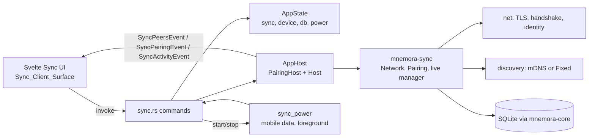
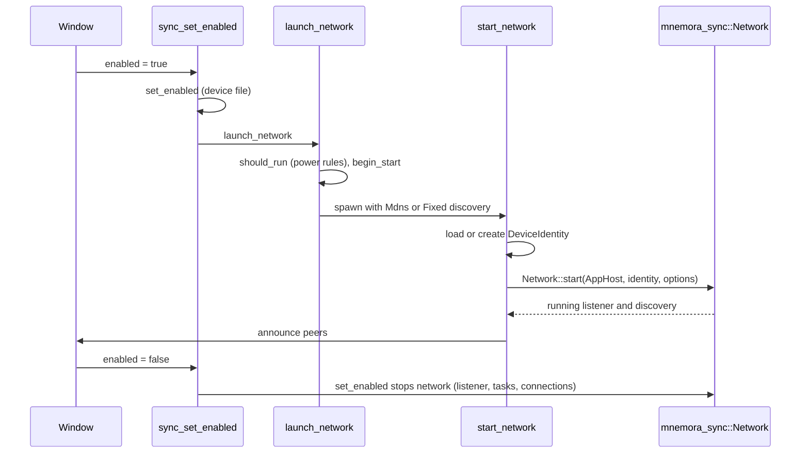
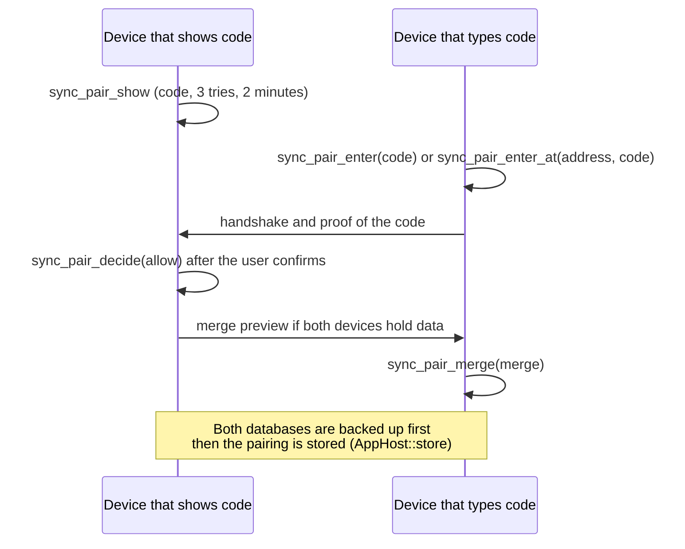

# Sync Network and Pairing

This module is the Tauri host side of Sync's connectivity: the command layer the window calls to turn Sync on and off, pair and forget devices, rename them, type an address for them, and leave a group, plus the test suites that prove those commands behave across real loopback sockets. The protocol, discovery, TLS, merge and pairing rules live in the `mnemora-sync` crate (see [Sync Replication Engine](../Sync_Replication_Engine.md) and [Sync Connectivity and Pairing](../Sync_Connectivity_and_Pairing.md)). This page explains how the host wires those rules to the app and where each piece is documented.

## Purpose

- Expose Sync to the UI as a small set of Tauri commands (`sync_get`, `sync_set_enabled`, `sync_pair_show`, `sync_device_forget`, ...). The commands are thin; the rules are in `mnemora-sync`.
- Own the lifecycle of the network: start it when Sync is on, stop it when Sync is off, on mobile data without permission, or when the app leaves the foreground.
- Bridge the library to the app. `AppHost` implements the library's `PairingHost` and `Host` traits so the library can read and write the app's database, emit window events, make backups before a first merge, and read the device file.
- Hold the end-to-end behaviour in tests (`sync_*_tests.rs`) that drive two or three `TestApp` instances through the same commands the UI uses.

## Architecture

Key points:

- **Commands are the only entry point.** Every `#[tauri::command]` in `src-tauri/src/sync.rs` is a one-to-three-line adapter. Business rules (name validation, pairing codes, revocation, address parsing) are called from the library.
- **`AppHost` is the seam.** It reads `AppState` for the device file, database, module registry and event bus. When a pairing session runs in the background it uses its own database connection (`own_db`) so a long sync never holds a command up.
- **Network lifecycle is centralised** in `launch_network` and `start_network`. Both check that Sync is enabled and that the power rules allow running before binding the port. Turning Sync off drops the `Network`, which closes the listener, discovery and connections.

The host-side command surface, grouped by job:

| Job | Commands |
|---|---|
| On/off and options | `sync_get`, `sync_set_enabled`, `sync_set_option`, `sync_rename`, `sync_leave` |
| Pairing | `sync_pair_state`, `sync_pair_show`, `sync_pair_new_code`, `sync_pair_enter`, `sync_pair_enter_at`, `sync_pair_decide`, `sync_pair_merge`, `sync_pair_cancel` |
| Devices | `sync_devices`, `sync_device`, `sync_device_rename`, `sync_device_address`, `sync_device_check`, `sync_device_sync_now`, `sync_device_forget` |
| Connectivity | `sync_resume`, `sync_local_network_os`, `sync_open_local_network_settings` |

## Sub-modules

The module splits into a command adapter and three test groups. Each has its own page under [sync_network_and_pairing/](sync_network_and_pairing/).

| Sub-module | Responsibility | Page |
|---|---|---|
| Commands | `sync.rs`: the Tauri commands, `AppHost` (the `PairingHost` and `Host` implementation), `launch_network` and `start_network`. | [sync_network_and_pairing_commands.md](sync_network_and_pairing/sync_network_and_pairing_commands.md) |
| Pairing tests | Pairing codes, wrong tries, pairing by address, IPv6, the first-merge preview and its backups. | [sync_network_and_pairing_pairing_tests.md](sync_network_and_pairing/sync_network_and_pairing_pairing_tests.md) |
| Live tests | Connections that come and go, quiet-period timing, widget refreshes, blocked local network, rename propagation. | [sync_network_and_pairing_live_tests.md](sync_network_and_pairing/sync_network_and_pairing_live_tests.md) |
| Membership tests | Device sheet, Forget, Leave, rename uniqueness, typed addresses, multi-device groups and introductions. | [sync_network_and_pairing_membership_tests.md](sync_network_and_pairing/sync_network_and_pairing_membership_tests.md) |

## Lifecycle of the network

If Sync is switched off while the network is still starting, `start_network` checks again and drops the network, so no port is left open.

## Pairing flow

`AppHost::store` records the pairing, lifts any earlier revocation of either device, and introduces the members the new device brings, all signed by this device's identity. `AppHost::backup` runs before a first merge so each side can recover.

## How it fits the rest of the system

- **Sync Replication Engine** ([../Sync_Replication_Engine.md](../Sync_Replication_Engine.md)) decides what moves once two devices are connected: the change log, merge rules, and the `sync_data_merge` tests. This module only decides when and how the connection starts.
- **Sync Connectivity and Pairing** ([../Sync_Connectivity_and_Pairing.md](../Sync_Connectivity_and_Pairing.md)) is the parent that holds the library side: `devices`, `peers`, `pair/*`, `live/*`, `net/*` and `transport`. The sub-modules here call into it and do not repeat it.
- **Sync Client Surface** ([../Sync_Client_Surface.md](../Sync_Client_Surface.md)) is the Svelte UI that calls these commands and listens for `SyncPeersEvent`, `SyncPairingEvent` and `SyncActivityEvent`.
- **Tauri Host and IPC Bridge** ([../Tauri_Host_and_IPC_Bridge.md](../Tauri_Host_and_IPC_Bridge.md)) registers the commands and event types and owns `AppState`.
- **Data Foundation** ([../Data_Foundation.md](../Data_Foundation.md)) supplies the database, the device file, `migrate::versions`, and `backup::backup_for_pairing`.
- **Android Integration** ([../Android_Integration.md](../Android_Integration.md)) is where the phone's Local Network permission and the foreground signal come from; `sync_power` consumes them.

## Power, mobile data and foreground rules

`src-tauri/src/sync_power.rs` decides whether the network should run. It reads the device's Sync options, the connection type (mobile data or not), and whether the app is in front. The rules are tested in `sync_power_tests.rs` (leaving the app flushes changes then stops everything; mobile data stops Sync unless allowed; rapid leave and return never duplicates the network). The Android side reaches Rust through `sync_power/android.rs` JNI entry points. Its details belong to the sub-module pages.

## Testing approach

The tests in this module run two or more `TestApp` instances over real loopback sockets with a fast `Pace`. Discovery is simulated by `Fixed`, which the test tells where the other device announced itself. Assertions read back through the same commands the UI calls (`sync_devices`, `sync_device`, `sync_activity`, `sync_attention`) and through database counts. A few tests use a `Cluster` with an in-memory transport for relay scenarios.

Run the suite with `make test`, which calls `cargo test --workspace` (see [Build and Packaging](../Build_and_Packaging.md)). Clippy runs with `-D warnings` in `make lint`. Build commands run with `CARGO_BUILD_JOBS=2` per the project's resource rules.

## Where to start

- Changing a command's behaviour: read the adapter in `src-tauri/src/sync.rs`, then the library function it calls in `crates/sync`.
- Changing pairing UX or errors: see the pairing tests sub-module first; they name the exact messages.
- Changing when the network runs: see `sync_power.rs` and the live tests.
