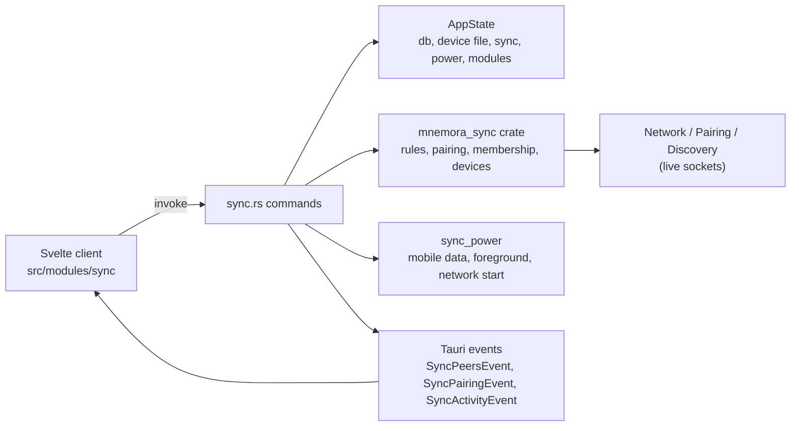
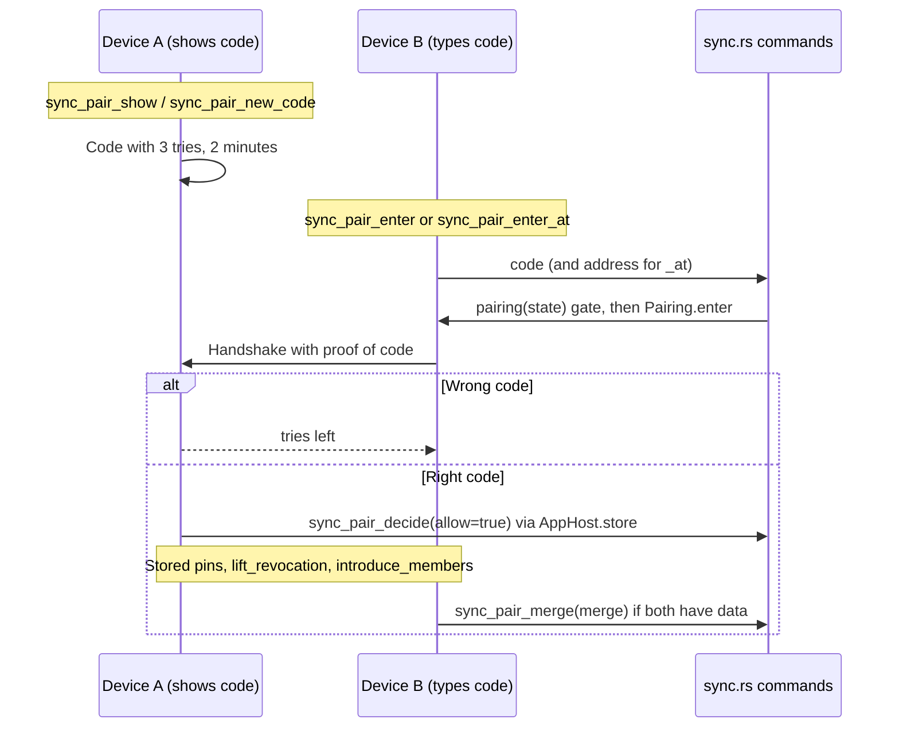
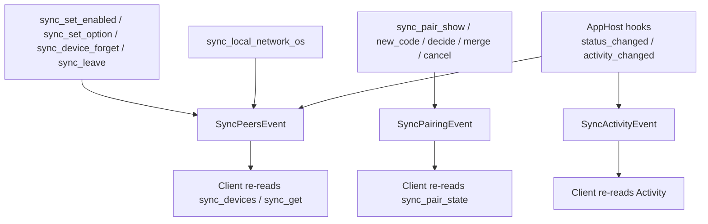
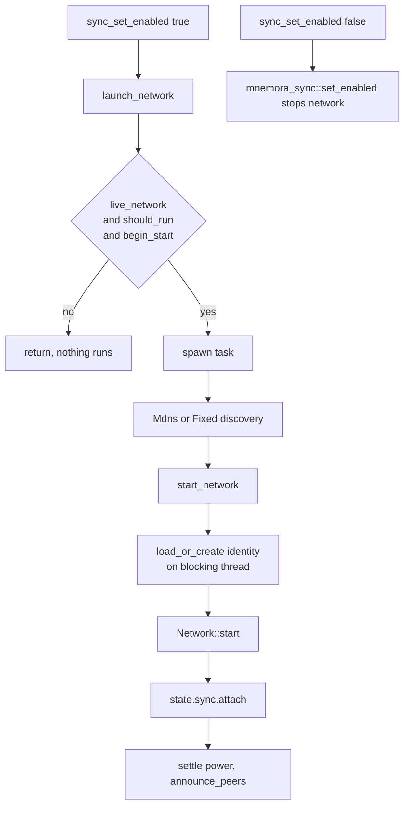

# sync_network_and_pairing_commands

## Introduction

This module is the Tauri command layer for Sync's network and pairing features. It lives in `src-tauri/src/sync.rs` and exposes the IPC commands the Svelte client calls to turn Sync on or off, name the device, pair with another device, manage paired devices, and read status for the Devices tab.

The file is deliberately thin. Its own header says so: *"Sync commands. Thin: the rules live in `mnemora-sync`."* Each command validates its input at the boundary, locks the app database or the device file, delegates to a `mnemora_sync` function, and then tells the window what changed. The protocol, pairing rules, merge rules and networking all live in the `crates/sync` crate, documented in [Sync_Replication_Engine](../../Sync_Replication_Engine.md) and [sync_transport](../sync_transport.md).

Read this page if you need to know *which command does what, what it touches, and what events it emits*. Read the linked pages for the rules behind them.

---

## Where it sits



- **Client side**: [Sync_Client_Surface](../../Sync_Client_Surface.md) and its [sync-pairing](../../Sync_Client_Surface/sync-pairing.md) page call these commands and react to the events.
- **Host shell**: the commands are registered in the Tauri host described in [Tauri_Host_and_IPC_Bridge](../../Tauri_Host_and_IPC_Bridge.md).
- **Sync engine**: the `mnemora_sync` functions these commands call are described in [Sync_Replication_Engine](../../Sync_Replication_Engine.md).
- **Network and transport**: the live listener, discovery and dialling are covered in [sync_transport](../sync_transport.md). Mobile-data and foreground pausing are covered in [sync_power_and_pause](../sync_power_and_pause.md).
- **Devices tab rules**: the device-list and membership rules behind `sync_devices` are in [sync_devices](../sync_devices.md).

---

## Core concepts

### Two stores, one command surface

Every command touches one or more of:

| Store | What it holds | Accessed through |
|---|---|---|
| App database | Paired devices, group membership, typed addresses, change log | `lock(&state.db)` |
| Device file (`device.toml`) | This device's Sync on/off, name, and options (`automatic`, `mobile_data`, `visible`, `toast_conflicts`) | `state.device.get()` / `mnemora_sync::set_enabled`, `set_option`, `rename` |

On/off, name and options are **device settings, never synced**. The tests in `sync_network_and_pairing_membership_tests` and the `on_off_is_a_device_setting_never_a_synced_preference` test confirm this: turning Sync on writes no `settings` row and no `change_log` row.

### Running state

`state.sync` owns the running network (`Network`), the pairing controller (`Pairing`), the local-network state and the set of pinned keys. Commands that need live behaviour call into it (`refresh_advert`, `resume`, `unpin`, `peers_changed`, `sync_now_with`, and so on). Commands that only read or write data do not need the network to be up.

### Power gating

`sync_power` decides whether the network may run at all (`should_run`, `paused_on_mobile_data`). Pairing is refused while mobile data is the reason nothing runs, via the `pairing()` helper below.

---

## Command reference

Commands are grouped by job. All are `#[tauri::command]` with `#[specta::specta]`, so their TypeScript bindings are generated.

### Switch and identity

| Command | Signature (simplified) | Behaviour |
|---|---|---|
| `sync_get` | `() -> SyncState` | Current on/off, name, options, paired count. Read-only. |
| `sync_set_enabled` | `(enabled) ` | Sets the device switch. When turned on, calls `launch_network`. Off stops everything but keeps data and paired devices. |
| `sync_rename` | `(name) ` | Validates via `check_own_name`, saves locally, refreshes the advert. If the device is in a group, logs a rename and records the new name for the other devices. |
| `sync_set_option` | `(option, enabled)` | Saves `Visible`, `Automatic`, `MobileData` or `ToastConflicts`. Each option triggers its own follow-up (see below). |
| `sync_local_network_os` | `(denied)` | Reports the OS Local Network permission. A denial is ignored while Sync is off. |
| `sync_open_local_network_settings` | `()` | macOS only. Opens System Settings at the Local Network pane, falling back to Privacy & Security. No-op elsewhere. |

`sync_set_option` follow-ups:

- `Visible` → `state.sync.refresh_advert()`
- `Automatic` → `state.sync.options_changed()`
- `MobileData` → `sync_power::settle(&app)` then `announce_peers`. This starts or stops the whole network.
- `ToastConflicts` → nothing extra.

### Leaving the group

`sync_leave` is the one async command in the pairing area.

1. If any member is connected, `announce_leaving` writes a signed revocation of this device and a "left" line, and `farewell(3s)` waits briefly for the network to push it. This wait is capped at `FAREWELL = 3 seconds`.
2. With nobody reachable it is local only and does not block.
3. Either way, `forget_all` removes every paired device here, then `unpin_all`, `peers_changed` and `refresh_advert` run.

Data is kept. Leaving stops syncing for good on this device.

### Devices tab

| Command | Behaviour |
|---|---|
| `sync_devices` | Returns `DevicesView`: this device (name, addresses, port) and paired devices. Inputs include listening state, mobile-data pause, local-network block, and live peer state. |
| `sync_device` | Returns `DeviceDetail` for one paired device. Returns `NotFound` if the id is not paired. If the peer is `NotNearby`, it is re-labelled `PausedOnMobileData` or `BlockedByLocalNetwork` when either applies. |
| `sync_device_rename` | Renames a paired device for the whole group. Returns the saved name. |
| `sync_device_address` | Saves a typed address (`host`, `host:port`, IPv4, `[IPv6]`, or MagicDNS name). Empty clears it. Calls `resume()` so the address is tried at once. |
| `sync_device_check` | Dials the typed address with the expected device id and name. On success, `remember_worked` stores the working address. Returns a `CheckResult`. |
| `sync_device_sync_now` | Syncs with one device now, even with Sync automatically off. |
| `sync_device_forget` | Writes a signed revocation for the group, unpins the key, closes any open connection, and refreshes the advert. Data on the forgotten device is kept. Pairing again undoes it. |
| `sync_now` | Syncs with every reachable paired device now. Returns immediately. Not in the core list, but defined in the same file. |
| `sync_resume` | Releases editing holds left behind by a backgrounded editor (`crate::editing::release_lapsed`), then `resume()`s unreachable devices from the start of their retry schedule. |

### Pairing

Pairing is a small state machine owned by `state.sync.pairing()`. The commands below drive it. `sync_pair_state` reads it, and the `AppHost` implementation pushes changes to the window through `SyncPairingEvent`.

| Command | Who runs it | Behaviour |
|---|---|---|
| `sync_pair_state` | Either | Returns `PairingView`. Returns `Idle` while Sync is off or still starting. Does not fail. |
| `sync_pair_show` | Showing device | Shows a code and waits for the other device to type it. |
| `sync_pair_new_code` | Showing device | Makes a fresh code with 3 tries and 2 minutes. |
| `sync_pair_enter` | Typing device | Looks for a device showing a code on the network and tries the typed code. |
| `sync_pair_enter_at` | Typing device | "Pair by address". Dials the typed address with the code, so the other device need not be discoverable. On success the address is kept as that device's typed address. |
| `sync_pair_decide` | Showing device | Allow or deny the device that typed the right code. |
| `sync_pair_merge` | Typing device | Merge or cancel on the first-merge preview. Cancel tells the other device and leaves both databases unchanged. |
| `sync_pair_cancel` | Either | Cancels the pairing. Whoever was asked is told. Silently ignored when pairing is not available. |

The `pairing()` helper gates every mutating pairing command:

```rust
fn pairing(state: &AppState) -> Result<Arc<Pairing>, AppError> {
    if paused_on_mobile_data(state) {
        return Err(SyncError::PausedOnMobileData.into());
    }
    Ok(state.sync.pairing()?)
}
```

So on mobile data with the setting off, pairing fails with a clear reason. The commands `sync_pair_cancel` and `sync_pair_state` skip this gate.

---

## Pairing flow



What each host hook does during a successful pairing (from `AppHost`):

- `me` and `handshake` give this device's identity, group, data versions and member list.
- `pinned` returns the keys this device already trusts.
- `holdings` backs up and counts what will merge. It first runs `registry.backfill(&conn)` so the preview matches what the merge will send.
- `backup` writes a backup before the first merge.
- `store` saves the new pin, lifts any revocation for the device or its introduced members, and calls `introduce_members` so existing members accept the new keys.
- `remember_address` keeps the address typed in "pair by address".
- `show` emits `SyncPairingEvent`. `paired` calls `peers_changed`.

The detailed pairing protocol, code rules and tests are in [sync_network_and_pairing_pairing_tests](sync_network_and_pairing_pairing_tests.md) and the `pair` modules described in [sync_devices](../sync_devices.md).

---

## Event and state flow

Commands never return live network state directly for long. They emit events, and the client re-reads.



- `announce_peers(app)` emits `SyncPeersEvent`. It is used by `sync_set_option`, `sync_local_network_os`, and `start_network` after a successful bind, so an open pairing sheet waiting for the network can start.
- `sync_rename` and `sync_device_rename` call `peers_changed()`, which reaches the same event path.

Activity lines and conflict events are produced elsewhere; see [Sync_Client_Surface](../../Sync_Client_Surface.md) and [Tauri_Host_and_IPC_Bridge](../../Tauri_Host_and_IPC_Bridge.md).

---

## Starting and stopping the network



- `launch_network` is a no-op where the app does not run a live network (`!state.live_network`), when power conditions say not to run, or when a start is already in progress.
- If discovery (mDNS) fails, a `Fixed` discovery is used. Pairing by address and paired devices still work; only finding nearby devices is lost.
- `start_network` refuses with `SyncError::Off` if Sync was turned off while starting. If it was turned off after the port was bound, the returned `Network` is dropped and closes its port.
- The device key is read or created with blocking I/O on a blocking thread, never on a runtime worker.

---

## Error handling

Commands return `Result<_, AppError>`. The error codes that come from this file are:

| Situation | Code | Source |
|---|---|---|
| Device id not paired | `NotFound` ("That device is not paired") | `sync_device`, `sync_device_check` |
| Invalid device name | `validation` | `check_own_name`, `rename_peer` |
| Mobile data pauses pairing | `SyncError::PausedOnMobileData` | `pairing()` |
| Network not up yet | `SyncError::NotReady` | `sync_device_check` |
| Sync off during start | `SyncError::Off` | `start_network` |
| Could not open System Settings | `Io` ("Could not open System Settings") | `sync_open_local_network_settings` |

Failures in background helpers (emitting events, remembering an address, backing up) are logged with `tracing::warn!` on target `sync`. They are not returned to the caller, so a failed emit does not fail a command that already changed data.

---

## Testing

The behaviour of these commands is covered by Rust integration tests in `src-tauri/src/`, with the test-only fixture `TestApp` from `test_support`:

| Test file | Covers | Page |
|---|---|---|
| `sync.rs` (`mod tests`) | Off by default, switch, name rules, option defaults, leave, device-setting-not-synced, the Local Network fallback, and the shared name-rule fixture | this page |
| `sync_pairing_tests.rs` | Pairing commands, pairing by address, IPv6, network existence only while on | [pairing tests](sync_network_and_pairing_pairing_tests.md) |
| `sync_merge_preview_tests.rs` | Backup before merge, cancel leaves databases alone | [pairing tests](sync_network_and_pairing_pairing_tests.md) |
| `sync_live_tests.rs` | Live connections, rename reaching devices, sync-off teardown, Local Network warning | [live tests](sync_network_and_pairing_live_tests.md) |
| `sync_forget_tests.rs` | Forget, leave, check, typed addresses, rename uniqueness | [membership tests](sync_network_and_pairing_membership_tests.md) |
| `sync_groups_tests.rs`, `sync_address_tests.rs` | Introductions, multi-device groups, typed-address sync | [membership tests](sync_network_and_pairing_membership_tests.md) |

The Rust test `name_rules_match_the_shared_fixture` reads `src/lib/ipc/fixtures/sync-rules.json`, the same fixture the browser mock runs. This keeps the Rust and TypeScript name rules in step.

---

## Operational notes

- **Off stops everything but keeps data.** `sync_set_enabled(false)` stops the network and the port. Paired devices and their data remain.
- **Option changes take effect immediately.** `Visible` refreshes the mDNS advert. `MobileData` may start or stop the network. `Automatic` only affects background syncing.
- **Leave is not instant when a member is connected.** Up to 3 seconds are spent waiting for the farewell line to go out.
- **Pairing is refused on mobile data unless allowed.** The message tells the user why.
- **Mobile-data and background behaviour belongs to `sync_power`.** This page calls it; read [sync_power_and_pause](../sync_power_and_pause.md) for the rules.

---

## Related modules

- Parent: [sync_network_and_pairing](../sync_network_and_pairing.md)
- Siblings: [sync_network_and_pairing_pairing_tests](sync_network_and_pairing_pairing_tests.md), [sync_network_and_pairing_live_tests](sync_network_and_pairing_live_tests.md), [sync_network_and_pairing_membership_tests](sync_network_and_pairing_membership_tests.md)
- Device list and membership rules: [sync_devices](../sync_devices.md)
- Transport and discovery: [sync_transport](../sync_transport.md)
- Power and pause: [sync_power_and_pause](../sync_power_and_pause.md)
- Sync engine: [Sync_Replication_Engine](../../Sync_Replication_Engine.md)
- Client UI: [Sync_Client_Surface](../../Sync_Client_Surface.md)
- Host and IPC: [Tauri_Host_and_IPC_Bridge](../../Tauri_Host_and_IPC_Bridge.md)
- Core data: [Data_Foundation](../../Data_Foundation.md)
