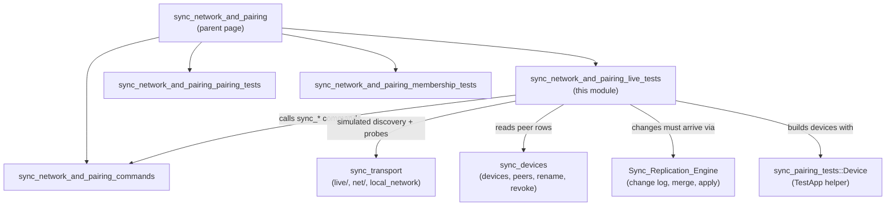
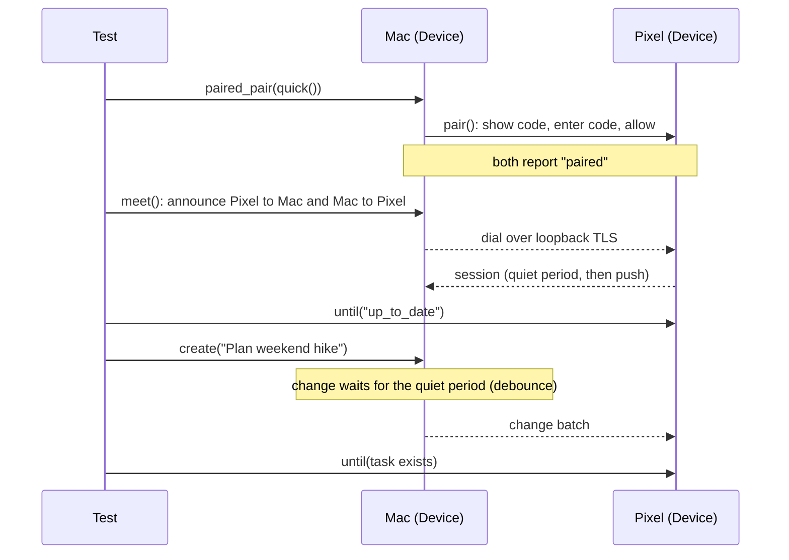
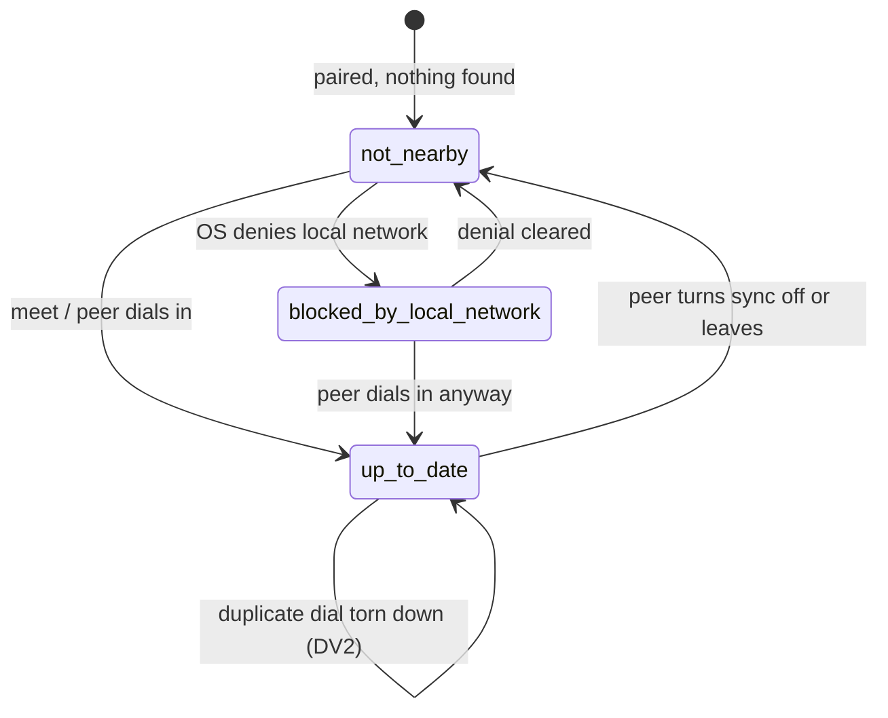

# sync_network_and_pairing_live_tests

This module is a set of Rust integration tests in `src-tauri/src/sync_live_tests.rs`. They run two or three simulated devices (`TestApp`-backed `Device` values) against real loopback sockets and check what the Sync feature does once devices are paired and online: discovery, connecting, the quiet period before a change is pushed, reconnecting, leaving the group, the local-network permission state, and the Activity lines each device writes. Discovery is simulated: the test tells each device where the other announced itself, instead of relying on mDNS.

The module contains no production code. It exercises the commands in [`sync_network_and_pairing_commands`](sync_network_and_pairing_commands.md) (the `sync_*` Tauri commands in `src-tauri/src/sync.rs`) and the live networking layer described in [sync_transport](../sync_transport.md) and [sync_devices](../sync_devices.md). The data merge rules that decide *what* arrives are covered in [Sync_Replication_Engine](../../Sync_Replication_Engine.md), not here.

## Where it sits

Sibling pages cover the other test groups: [pairing tests](sync_network_and_pairing_pairing_tests.md) (codes and pairing flows), and [membership tests](sync_network_and_pairing_membership_tests.md) (leaving, forgetting, renaming, introductions and addresses). Power and pause rules have their own tests in `sync_power_tests.rs` and `sync_pause_tests.rs`, documented under [sync_power_and_pause](../sync_power_and_pause.md).

## Test harness helpers

Every test is built from a small set of helpers at the top of `sync_live_tests.rs`. They are the vocabulary of the module.

| Helper | What it does |
|---|---|
| `quick()` | Returns a `Pace` with a 400 ms quiet period (`debounce`), a 3 s per-dial limit and a 200 ms retry schedule. Same shape as the app's pace, but fast enough for tests. |
| `pair(mac, phone)` | Runs the real pairing flow: `sync_pair_show` on the Mac, reads the code, tells the phone where the Mac is, `sync_pair_enter` on the phone, `sync_pair_decide { allow: true }` on the Mac, then waits for both to say `paired`. |
| `paired_pair(pace)` | Creates a `Mac` and a `Pixel 8` device and pairs them. Returns both. |
| `meet(a, b)` | Simulates discovery: each device's fake `Discovery` announces the other's device id and address. |
| `peer_of(device)` | First row of the device's `peers` list (`state`, `route`, `last_in`, `last_out`, `last_synced_at`, `name`). |
| `row_named(device, name)` | Looks up a peer row by display name. |
| `until(what, cond)` | Polls a condition every 20 ms for up to 20 s, then panics with `never saw <what>`. The 20 s budget is deliberate: the suite runs in parallel on a small machine. |
| `create(device, title)` | Calls `todo_task_create` on a device and returns the new task id. |
| `has(device, id)` | True when `todo_task` finds the id on that device. |
| `task_count(device)` | Direct `COUNT(*)` on `todo_tasks` through `with_db`. |
| `activity_lines(device, kind)` | Pages through `sync_activity` with `filter: all`, `limit: 100`, following `next` cursors, and returns the text of rows of one `kind` (for example `paired`, `session`, `renamed`). |
| `activity_lines` / `row_named` / `peer_of` | Read-only views; none of them change device state. |

The fake discovery (`found`, of type `mnemora_sync::discovery::Discovery`) exposes `announce(id, addr)`, `active()` (how many announce or browse tasks are running) and `set(...)`. `sync_probe()` on the app returns a `RuntimeProbe` with `running`, `listeners`, `advertisements`, `tasks` and `sessions` counts. Several tests use these counts to prove that nothing is left running.

## Test flow for a typical test

## Test catalogue

The 17 tests group into five themes. Test names are the ones in the source.

### 1. Connecting and staying connected

- **`paired_devices_that_find_each_other_connect_and_say_up_to_date`**: after pairing, a device with no discovery shows `not_nearby`. After `meet`, both rows reach `up_to_date`, and the first session finishes (`last_synced_at` is set). The route is `wifi`.
- **`a_simultaneous_dial_and_its_duplicate_teardown_leave_both_rows_up_to_date`**: both sides dial at once, one connection is torn down as the duplicate. Both rows must reach and stay at `up_to_date`, and never show `not_nearby`. This is the DV2 guarantee in the source comment. The test waits 1.5 s for the first session's follow-up round, then checks both rows every 50 ms for two seconds.
- **`a_device_that_comes_back_is_reconnected_by_the_backoff`**: the Mac turns sync off (the phone sees `not_nearby`), then turns it on again. The test restarts the network by calling `crate::sync::start_network` directly, because "the test network does not restart on its own". The phone re-announces and reaches `up_to_date`.
- **`a_device_that_finds_nobody_still_syncs_when_the_other_dials_its_typed_address`** (D14): no `meet`, so nothing connects by itself. The phone is given the Mac's address with `sync_device_address`. The phone dials, and both rows reach `up_to_date`. The Mac only accepts.

### 2. Pushing changes

- **`a_change_reaches_the_other_device_only_after_the_quiet_period`**: uses a 1 s debounce. A task created on the Mac must not appear on the phone within 300 ms, and a second change made 300 ms later restarts the wait. Both tasks arrive, the Todo widget on the phone is signalled exactly once for the session, and the Mac's `last_out` and the phone's `last_in` both read 2.
- **`a_big_sync_in_many_batches_refreshes_the_widget_once`**: 1 100 tasks are created on the Mac before the devices meet. They arrive in several batches and the phone's widget is refreshed once for the whole session, not once per batch.
- **`what_a_device_received_is_passed_on_to_the_others_it_is_connected_to`**: a three-device relay. The Mac and the Watch cannot reach each other, but both reach the Pixel. A task made on the Mac must reach the Watch through the Pixel. The test also notes that sync writes through its own connection, which the change-log hook does not see, so the manager has to forward received changes itself.
- **`renaming_a_device_reaches_it_within_the_quiet_period`** (DV5): a rename made on the Mac (`sync_device_rename`) reaches the phone within 4 s, so it is treated as a normal change and not held for the next session.
- **`the_rename_line_never_shows_before_the_new_name_is_applied`** (DV8): five runs. The test polls the phone's `renamed` Activity line and its `sync_get` name in a tight loop. Whenever the line exists, the name must already be applied.

### 3. Turning sync on and off

- **`with_sync_automatically_off_only_sync_now_syncs`**: with the `automatic` option off, a change does not sync on its own, and the row stays `not_nearby`. `sync_now` pushes it.
- **`turning_sync_off_stops_every_connection_and_the_port`**: after `sync_set_enabled { enabled: false }`, the probe must report `running: false`, `listeners: 0`, `advertisements: 0`, `tasks: 0`, `sessions: 0`. The port must refuse TCP connections, and the phone must drop to `not_nearby` and stay there.
- **`turning_sync_off_and_on_again_and_again_leaves_nothing_behind`**: four off/on cycles. Afterwards the Mac runs at most 6 tasks (supervisor, accept loop, and pairing tasks, but no pile-up). Turning off again leaves zero tasks and zero announce or browse tasks.
- **`leaving_the_group_closes_the_connections`**: `sync_leave` on the Mac empties its peer list. The phone reaches `not_nearby`, and its retries are refused because the Mac no longer trusts the key.

### 4. Activity lines

- **`pairing_and_a_live_session_are_each_one_line_on_both_devices`**: after pairing and one synced task, both devices end with exactly one `paired` line and one `session` line. The line text on the lead device is `Paired with <other name>`. The lead is whichever device has the lower device id. Empty rounds are not logged: after 1.5 s the session count is still 1.

### 5. Local-network permission

The OS may keep the app off the local network (on Android, a permission; on macOS, a system block). The app reports that with `sync_local_network_os { denied }`.

- **`the_local_network_being_blocked_is_told_in_the_rows_the_card_and_attention`** (D13): when denied, `this_device.local_network_blocked` is true, the peer row reads `blocked_by_local_network`, `sync_attention` reports it as needed, and the device sheet (`sync_device`) shows the same state. If the peer dials in anyway, that peer is `up_to_date` instead, so it is reachable and not blocked. Clearing the denial clears all three views.
- **`a_denial_reported_while_sync_is_off_is_ignored`**: a denial sent while sync is off is discarded. After sync is turned back on, `local_network_blocked` is false.
- **`turning_sync_off_clears_the_local_network_warning`**: a denial that was true while sync was on is removed when sync is turned off, including in `sync_attention`.

## Key behaviours checked

The row states named in the assertions are `not_nearby`, `up_to_date`, and `blocked_by_local_network`. The rule that a change is pushed only after the quiet period is set by `Pace::debounce`.

## Running and reading the tests

- Run them with the Rust test runner through the repo's `make test` target (see the [Build and Packaging](../../Build_and_Packaging.md) page). Use `CARGO_BUILD_JOBS=2` and `cargo test` as the project's resource rules require; do not run `cargo tauri dev`.
- Timing matters. Tests sleep for 300 ms to 1.5 s to let debounce windows and first sessions run out. The `until` helper's 20 s limit covers slow runs. If a test is flaky, check the sleeps against `quick()`'s 400 ms debounce before changing the product code.
- The `_` prefix on `_mac` in `a_denial_reported_while_sync_is_off_is_ignored` means that device is unused.

## Points to verify

- The `paired_devices...` test and others call `mac.call("sync_now", ...)`. The Tauri command list in `sync.rs` names `sync_device_sync_now` for a per-device sync, and the test file does not define a `sync_now`. Confirm the command name in `src-tauri/src/sync.rs` before relying on that call.
- The `what_a_device_received...` test calls `mnemora_core::db::on_change_log_write` on the phone's database to simulate the hook. The comment in the test is the only explanation of why. If the hook name changes, this test will break first.
- `a_big_sync...` and `with_sync_automatically_off...` both depend on `Pace` values that are set in `quick()`. Changing that helper changes every test.
