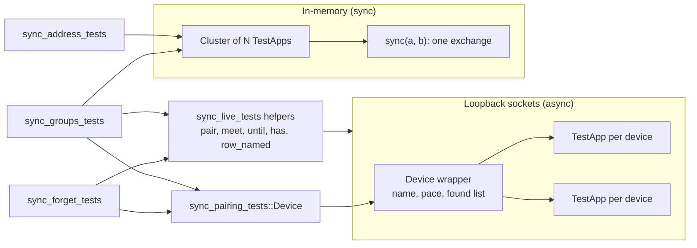
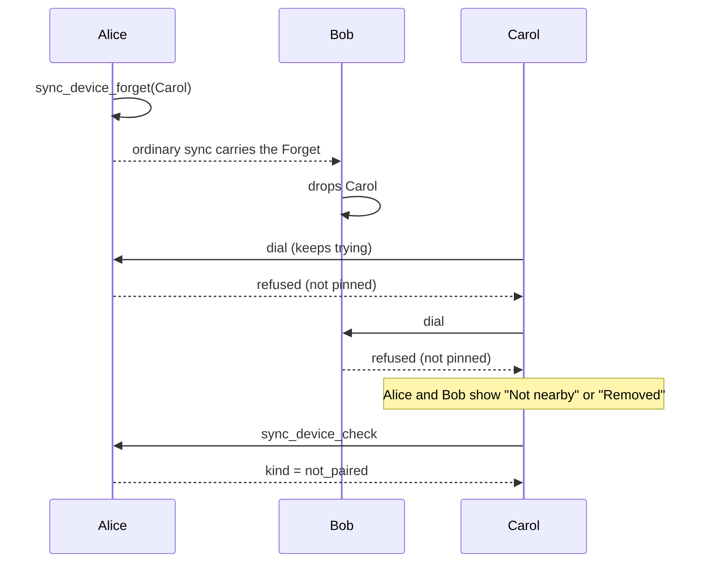
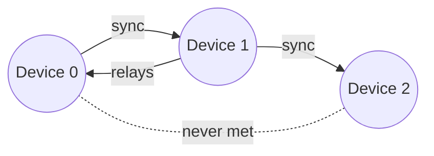

# sync_network_and_pairing_membership_tests

This module is a set of integration tests for **group membership** in the sync network: how a device is forgotten, how it leaves, how a forgotten device pairs back in, how introductions spread a group to devices that never met, and how the Address typed for a device is shared across the group. It contains no production code. Every scenario runs through the same commands the UI calls (see [sync_network_and_pairing_commands](sync_network_and_pairing_commands.md)) and reads results back through those commands.

The tests sit under the [sync_network_and_pairing](../sync_network_and_pairing.md) parent module and build on the harnesses of [sync_network_and_pairing_live_tests](sync_network_and_pairing_live_tests.md) and [sync_network_and_pairing_pairing_tests](sync_network_and_pairing_pairing_tests.md). The behaviour under test is implemented in [sync_devices](../sync_devices.md) and the wider [Sync_Connectivity_and_Pairing](../../Sync_Connectivity_and_Pairing.md) and [Sync_Replication_Engine](../../Sync_Replication_Engine.md) modules.

## Scope

| Test file | Covers |
|---|---|
| `src-tauri/src/sync_forget_tests.rs` | Forget, Leave, rename uniqueness, `sync_device_check`, typed Address reachability, the device sheet, re-pairing |
| `src-tauri/src/sync_groups_tests.rs` | Relay through intermediate devices, introductions, outsider-signed introductions, leave notices, groups of 3–4, backup before a first merge |
| `src-tauri/src/sync_address_tests.rs` | The typed Address as a group-wide shared value: propagation, editing, clearing, clashes, own-address filtering |

Test files are compiled into the `src-tauri` crate and run with the rest of the Rust suite (`make test`; see [Build_and_Packaging](../../Build_and_Packaging.md)).

## Test harness architecture

Two harnesses are used. Scenarios that need real sockets use `Device` (from `sync_pairing_tests`) over loopback TLS. Scenarios that only need data movement use `Cluster` (from `test_support`), which runs devices over an in-memory transport and lets the test call `sync(a, b)` explicitly.

Key helpers and what they do in these tests:

- `Device::with_pace(name, quick())` starts a device with a fast sync cadence. `found.announce(id, addr)` simulates discovery, and `found.set(...)` tells a device where to look when pairing.
- `pair(a, b)` / `pair_views(shower, enterer)` run the real pairing flow (show code, enter code, decide) and return both success screens, including `also_joined`.
- `meet(a, b)` makes two devices try a connection now; `meet_all` does this for every pair.
- `until(label, predicate)` polls until a condition holds, giving async assertions a deadline.
- `Cluster::sync(a, b)` performs one exchange between two in-memory devices; chains of calls model devices that meet only through others.
- `TestApp::call` and `TestApp::invoke` call the Tauri-style commands and return the JSON value or the error (`code`, `message`).

## Scenario groups

### 1. Trio fixture

`trio()` pairs Alice, Bob and Carol with each other. Carol learns Bob through Alice's introduction, so the three-way pairing is built from three pairing sessions. Most forget/leave tests start here, so a forgotten device always has more than one member to be refused by.

### 2. Forget and refusal

What the tests pin down:

- **`a_forgotten_device_is_refused_by_every_member`**: after Alice forgets Carol, Bob drops her by ordinary sync. Carol dials both and is refused. Her own new Tasks never reach Alice or Bob, and Alice's Tasks never reach Carol. Carol keeps her data. `sync_device_check` answers `not_paired` on both members, and Alice's Activity shows a `forgot` line.
- **`a_forgotten_device_can_show_a_code_again_and_again`**: a device that was forgotten can open the pairing code five times in a row (`sync_pair_show` → `sync_pair_state` → `sync_pair_cancel`) and each time gets the `showing` state. This guards against a regression where Pair did nothing after a forget.
- **`pairing_a_forgotten_device_again_takes_it_back_everywhere`**: pairing Carol again with Alice restores her on Alice and, through Alice's sync, on Bob, without Bob being paired with her directly.

Note that the refused device sees `not_nearby` or `removed`. Which one it sees depends on a race (whether a member had already dropped it), so `cut_off` accepts either.

### 3. Leave

`sync_leave` is the device-side counterpart of Forget.

- **`leaving_stops_syncing_for_good_and_keeps_the_data`**: after leaving, the device lists no peers, `sync_get` reports `paired_devices = 0`, the `sync_group` row is gone, and existing Tasks remain. Later writes on either side never cross over, even after manual `sync_now`.
- **`leaving_while_connected_tells_every_member_before_forgetting`**: Alice reaches only Bob, but Carol hears through Bob. Both drop Alice. Activity shows one `left` line each: `Left the group` on Alice, `Alice left the group` on Bob and Carol. Repeated sync rounds do not duplicate the line.
- **`leaving_with_nobody_reachable_is_local_only_and_quick`**: with no peer connected, Leave returns in under two seconds, writes no revocation, and Bob still lists Alice. Bob is never told, so this is a local-only leave.
- **`pairing_again_after_leaving_works`**: after Leave and a later pairing, the earlier revocation no longer applies on either side.

### 4. Identity: check, typed address and rename

- **`check_says_who_answered_in_words`**: `sync_device_check` returns one of: `reached` (message `Reached Bob in N ms`), `unreachable`, `wrong_device` (`That is Bob, not Carol.`), `invalid` (`That isn’t a host name or an IP address`), `not_found` for unknown hosts, and `not_found` error code for an unknown device id. A successful check also remembers the address in the sheet's list of working addresses.
- **`a_typed_address_is_a_way_to_reach_the_device`**: `sync_device_address` normalises input (trims, lowercases, `LOCALHOST:port` → `localhost:port`), rejects bad input without saving, and clearing the value returns `null`. Once saved, the peer is reached through the typed address even with no discovery and no remembered address.
- **`an_address_typed_on_one_device_is_dialled_by_another`**: Carol holds an Address typed on Alice for Bob, and reaches Bob through it. Bob ignores the value typed for himself. See [Section 6](#6-typed-address-as-a-shared-value) for the shared-value rules.
- **`renaming_this_device_is_unique_in_the_group_too`** and **`a_rename_is_unique_and_reaches_every_device`**: names clashing with another device's name, ignoring case and accents, fail with `validation` and the message `Another of your devices already has that name`. Names must be 1–40 characters. A rename reaches every device and appears once in Activity as `renamed`; repeating the same name is not logged.
- **`the_sheet_shows_what_is_known_and_syncs_only_that_device`**: `sync_device` returns name, `paired_by`, `app_version`, per-module `data_versions`, and `paired_at`. `sync_device_sync_now` syncs only the chosen device, so with automatic sync off, a Task reaches only the device asked.

### 5. Group relay and introductions

These tests use `Cluster` (in-memory) except where noted.

- **`a_change_from_a_reaches_c_when_a_meets_b_and_then_b_meets_c`**: a Task created on device 0 reaches device 2 through device 1, and a later priority change on device 2 reaches device 0 through the same path.
- **`four_devices_meeting_in_a_chain_converge_on_everything_each_made`**: four devices in a line, with a back-and-forth pass, end with every Task everywhere. Concurrent priority edits settle on the newest clock (device 3 wins in the test).
- **`an_introduction_signed_by_a_device_outside_the_group_changes_nothing`**: an introduction signed by a key that is not part of the group pairs nobody. It is still stored as a `sync_introduction` change so it can be passed on.
- **`a_leave_notice_reaches_a_member_that_never_met_the_leaver_through_another`**: a leave announced by device 0 reaches device 2 only via device 1. Both remove the leaver, each logs one `left` line, and the leaver's key goes into the revocation list.
- **`a_newcomer_paired_via_one_member_is_accepted_by_the_others_and_connects_directly`** (loopback): Carol joins through Bob; her success screen lists `also_joined: ["Alice"]`. Dana joins through Bob later and hears `["Alice", "Carol"]`. After Bob's introductions travel by ordinary sync, Dana connects directly to Alice and Carol, and a Task she makes reaches them.
- **`a_forgotten_device_paired_again_via_a_member_that_had_not_heard_comes_back_everywhere`** (loopback): Alice forgets Carol, Bob drops her, Carol pairs with Bob while Alice is away. Alice later accepts Carol back, whichever decision it receives first.
- **`four_devices_paired_in_pieces_while_apart_all_end_up_pinning_each_other`** (loopback): four devices pair in pieces (A–B, B–C, A–D), then through a chain of meetings everyone lists everyone, and Carol reaches Dana directly.

### 6. Typed address as a shared value

`sync_address_tests.rs` builds an `n`-device group with `group(n)`. Each device is named (`Mac`, `Pixel 8`, `Tablet`, `Watch`) and inserted into `sync_peers`. The Address is a field on the synced `sync_device` record, so it travels like any other value.

Rules the tests fix:

| Rule | Test |
|---|---|
| Typed on one device, it reaches the others directly and through a relay | `an_address_typed_on_one_device_reaches_the_others_directly_and_through_a_relay` |
| The device it is typed for keeps none for itself | same test, plus `an_address_typed_for_a_device_is_ignored_by_that_device` |
| Any member can edit it; clearing it is an edit that syncs | `any_member_can_edit_it_and_clearing_syncs` |
| Concurrent edits: newest wins and both devices log the same row (`Tablet · Address`, detail `… kept · … replaced`) | `concurrent_edits_converge_to_the_newest_and_are_logged_the_same_on_both` |
| Two first addresses typed at once are a clash like any other | `two_first_addresses_typed_at_once_are_a_clash_like_any_other` |
| A value written before sync existed joins the log once, and restarts record nothing more | `an_address_typed_before_it_synced_joins_the_group_once` |
| A rename and an Address made at once both stand | `a_rename_and_an_address_made_at_once_both_stand` |

Edits made without knowledge of each other produce a `value` row in `sync_conflicts`; a later edit by a device that has heard of the other is not a clash. The conflict rules are described in [sync_conflicts_and_activity](../../Sync_Client_Surface/sync_conflicts_and_activity.md) and the merge model in [Sync_Replication_Engine](../../Sync_Replication_Engine.md).

### 7. Backup before the first merge

`a_device_met_only_through_an_introduction_is_backed_up_for_once_before_its_first_records` checks that when Alice first receives records from Carol (a device she met only through Bob's introduction), she writes exactly one backup of her database before merging. The backup holds her pre-merge data (zero Tasks in the test), and further Tasks from the same device do not trigger another backup. The backup behaviour itself is part of the data layer; see [Data_Foundation](../../Data_Foundation.md).

## Running and maintaining the tests

- Run them with the Rust suite (`make test`, see [Build_and_Packaging](../../Build_and_Packaging.md)). Prefer `cargo check` for quick feedback; build with `CARGO_BUILD_JOBS=2` on the development machine.
- The loopback tests use real sockets on `127.0.0.1` and `::1`. They poll with `until`, so timing failures show as the labelled wait that timed out (for example `until("Bob to drop Carol", …)`).
- Assertions read through commands, not internal tables, except where the test intentionally checks storage: `sync_group`, `sync_peers`, `sync_peer_addresses`, `sync_revocations`, `change_log` and `sync_activity`.
- Some tests tolerate more than one outcome because it depends on a race (for example, `cut_off` accepts `not_nearby` or `removed`). Keep that tolerance when editing them.
- When adding a scenario, pick the lightest harness that proves it: `Cluster` for data movement, `Device` for anything that touches discovery, pairing or sockets.
