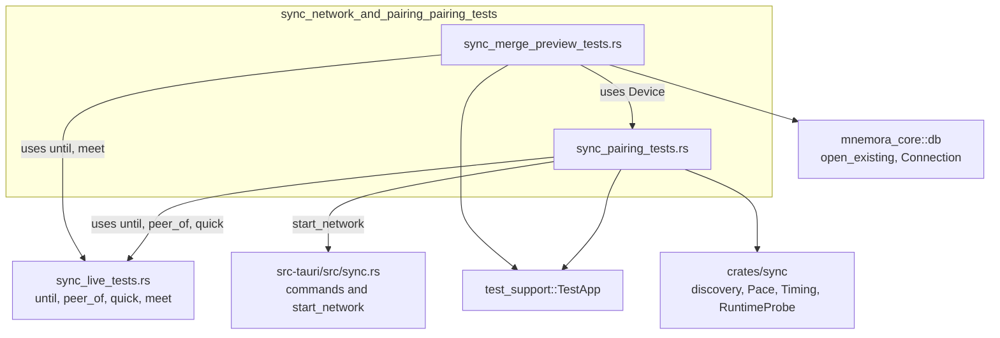
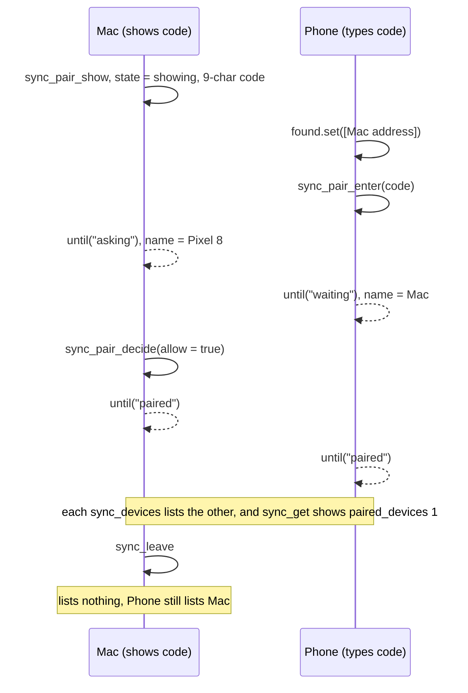
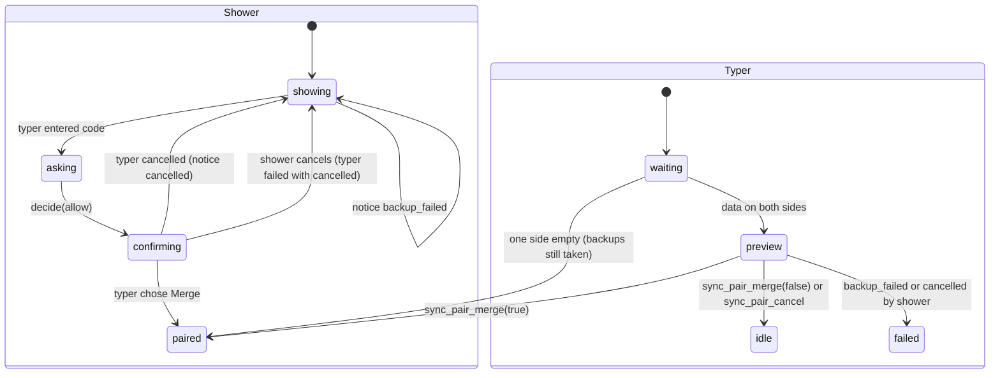

# sync_network_and_pairing_pairing_tests

This module holds the end-to-end pairing tests for Mnemora's Sync feature. Each test builds two `TestApp` devices (see [test_support](../../Tauri_Host_and_IPC_Bridge.md) for the app harness) on real loopback sockets and drives them only through the same Tauri commands the UI calls, in the same order. The tests check what each device lists afterwards, what is stored, and what is backed up.

It covers two areas:

1. **Pairing mechanics** (`src-tauri/src/sync_pairing_tests.rs`): showing and typing an 8-digit code, pairing by typed address (IPv4 and IPv6), wrong-code handling, and the rule that the network exists only while Sync is on.
2. **First-merge preview and backups** (`src-tauri/src/sync_merge_preview_tests.rs`, issue #73): what each device sees before two data sets are combined, the backups taken before the pairing is recorded, and the cancel and failure paths.

It is a test-only module. It owns no production code. The behaviour it verifies lives in the pairing and network layers described in [Sync_Connectivity_and_Pairing](../../Sync_Connectivity_and_Pairing.md), the live-connection layer in [sync_network_and_pairing_live_tests](sync_network_and_pairing_live_tests.md) (sibling page), and the Tauri command surface in [sync_network_and_pairing_commands](sync_network_and_pairing_commands.md) (sibling page).

## Where it sits

The module is a leaf of the Sync connectivity tree. Its helpers are reused by sibling test modules, and it depends on the production sync crate, the Tauri command layer and the test harness.

Related documentation:

- Parent area: [Sync_Connectivity_and_Pairing](../../Sync_Connectivity_and_Pairing.md) and the [sync_network_and_pairing](../sync_network_and_pairing.md) page.
- Pairing protocol and sync engine: [Sync_Replication_Engine](../../Sync_Replication_Engine.md).
- Client-side pairing UI that issues these commands: [Sync_Client_Surface](../../Sync_Client_Surface.md).
- Data and backup behaviour the merge-preview tests rely on: [Data_Foundation](../../Data_Foundation.md).

## Shared test helper: `Device`

`sync_pairing_tests.rs` defines a `pub(crate)` struct that the merge-preview tests reuse. A `Device` is a `TestApp` with Sync on, a device name, and its network already listening on a loopback port.

| Member | Purpose |
|---|---|
| `Device::new(name)` | Default pace, IPv4 only. |
| `Device::with_pace(name, pace)` | Same, with a custom `Pace` (the live tests pass `quick()`). |
| `Device::dual_stack(name)` | Also listens on `::1`, on the same port as IPv4. Private to the file. |
| `call::<T>(command, args)` | Invokes a Tauri command and unwraps the result. |
| `pairing()` | Calls `sync_pair_state`. |
| `until(state)` | Polls `sync_pair_state` every 10 ms until `state` matches, up to 20 s. Panics with the last view. The 20 s bound is deliberate: the whole suite runs in parallel on a small machine. |
| `devices()`, `listed()` | `sync_devices`; `listed()` returns the peer names. |
| `address()` | `127.0.0.1` plus the port from `this_device.port`. |
| `found: Arc<Fixed>` | Fixed discovery list. Tests set it with `found.set(vec![addr])` to make the other device discoverable. Leaving it empty simulates "nothing on the network". |

`build` starts the network through `start_network` with `NetworkOptions`:

- `port: 0` (ephemeral),
- `timing.search` of 800 ms,
- `local_network: LocalNetwork::off()`, so no OS multicast is involved.

## Area 1: pairing mechanics (`sync_pairing_tests.rs`)

### Test catalogue

| Test | What it proves |
|---|---|
| `after_pairing_both_devices_list_each_other` | The full happy path: show, enter, ask, allow, both paired, each lists the other, `sync_get` reports `paired_devices: 1`, and `sync_leave` forgets the peer on the leaver only. |
| `a_wrong_code_shows_tries_left_through_the_commands` | A wrong code fails with `wrong_code`, `tries_left: 2`, and the Mac's name. A malformed code (`"123"`) is a `validation` error. |
| `the_network_exists_only_while_sync_is_on` | A running device has one listener and two advertisements (the announcement and the paired-device browse). Turning Sync off zeroes the `RuntimeProbe`, closes the TCP port, and refuses `sync_pair_show`. |
| `pairing_commands_are_refused_before_the_network_is_up` | `sync_pair_show` on a `TestApp::syncing()` with no network returns `validation`. `sync_pair_state` returns `idle`. |
| `pairing_by_address_needs_no_discovery_and_remembers_the_address` | The phone finds nothing on the network. It types the Mac's address with `sync_pair_enter_at`, pairs, and the typed address is stored (`typed_address` in `sync_device`). The pair then reaches `up_to_date`. |
| `pairing_by_address_says_why_it_did_not_work` | Invalid host text (`"pixel 8"`, `"bad address!!"`) gives a `validation` error with the message "That isn’t a host name or an IP address", and the sheet stays `idle`. A closed port gives `address_unreachable`. A reachable device with a wrong code gives `wrong_code` and leaves no device listed. |
| `a_device_can_be_paired_over_its_ipv6_address` | Same pairing flow, typed as `[::1]:<port>` against a dual-stack Mac. |
| `sync_off_closes_the_ipv6_port_too` | Turning Sync off aborts the listener tasks (`tasks == 0`) and the IPv6 port stops accepting connections. |

### Pairing flow exercised by the happy path

The by-address variant replaces `found.set` and `sync_pair_enter` with `sync_pair_enter_at { address, code }`. The state names used in assertions (`showing`, `asking`, `waiting`, `paired`, `failed`, `idle`) are the values of `sync_pair_state`'s `state` field. Error objects carry a `kind` (`wrong_code`, `address_unreachable`, `validation`) and, for wrong codes, `tries_left`.

### Notes that matter for maintainers

- The code is shown as 9 characters, two groups of four, which the first test asserts.
- Each test uses the code in two forms: with a space in the displayed value and with spaces stripped (`replace(' ', "")`). Sub-tests that need a wrong code pick one that is guaranteed to differ.
- `pairing_by_address_needs_no_discovery_and_remembers_the_address` ends with a call to `sync_live_tests::until`, which takes a label and a closure. It is not the same helper as `Device::until`.
- The IPv6 test pairs a dual-stack Mac with an IPv4-only phone. It verifies the typed address, not discovery.

## Area 2: first-merge preview and backups (`sync_merge_preview_tests.rs`)

When two devices with existing data pair, the typing device shows a preview, and both devices take a backup before anything is recorded. Nothing is paired or stored until the typer chooses Merge. The module verifies that ordering.

### Fixture

`with_data(mac, phone)` builds the data both devices hold:

| Device | Entries | Tasks | Lists |
|---|---|---|---|
| Mac | 2 | 3 (Milk in Groceries, Report in Work, Inbox thing) | Groceries, Work |
| Phone | 1 | 1 (Eggs) | `groceries` (lower case), Café |

Helpers:

- `journal(app, text)` creates an entry through `journal_entry_create`.
- `task(app, title, list)` and `list(app, name)` use `todo_task_create` and `todo_list_create`.
- `type_code(shower, typer)` shows a code on the shower, types it on the typer, and waits until the shower is `asking`.
- `backups(app)` lists `*.db` files in `app.backup_dir()` (empty if the folder is absent).
- `count`, `open`, `list_names`, `tasks_on` read the databases directly through `mnemora_core::db`, or the `todo_lists` command for names. `list_names` lower-cases names and sorts them.

### Test catalogue

| Test | What it proves |
|---|---|
| `both_with_data_see_the_counts_and_the_lists_that_combine_before_anything_changes` | The typer sees `preview`. `there` is `{entries 2, tasks 3, lists 2}`, `here` is `{entries 1, tasks 1, lists 2}`, `combine` is `["groceries"]`. The shower reaches `confirming`. No pairing and no backup exists yet. After `sync_pair_merge { merge: true }` both are `paired`. |
| `both_databases_are_backed_up_before_the_pairing_is_recorded` | Each device has exactly one backup holding its pre-merge counts (Mac 3 tasks/2 entries, Phone 1/1). The backup has zero `sync_peers` rows, so it was taken before the pairing was recorded. After the merge, both hold 4 tasks, and the lists are `café`, `groceries`, `work`. |
| `cancel_leaves_both_databases_untouched_and_tells_the_other_device` | The typer cancels with `merge: false`. The typer returns to `idle`. The shower's state is `showing` with `notice: {kind: cancelled, name: "Pixel 8"}`, and it keeps its code. No peers, no backups, no changes to task counts, and `sync_probe().sessions == 0`. |
| `closing_the_preview_sheet_is_a_cancel_too` | Calling `sync_pair_cancel` from the preview has the same effect as the cancel above. |
| `the_showing_device_can_cancel_while_it_waits` | The shower cancels while `confirming`. The typer moves to `failed` with `error: {kind: cancelled, name: "Mac"}`. Nothing is paired or backed up. |
| `the_preview_is_skipped_when_one_side_is_empty_but_both_are_still_backed_up` | Loops with either side as the empty one. Pairing goes straight to `paired`, with no preview, but each device still gets exactly one backup. |
| `a_device_that_cannot_back_up_stops_the_pairing_with_nothing_changed` | Loops over which device is broken. A file is placed where the backup folder should be. See the failure table below. |

### Preview and confirmation states

The diagram follows the assertions. The shower returns to `showing` after a typer cancel, which keeps its code.

### Backup failure matrix

The test writes a file where the backup folder should be. `typer_fails` decides which device is broken.

| Broken device | Typer's state and error | Shower's notice |
|---|---|---|
| Phone (typer) | `failed`, `backup_failed`, name `null` | `showing`, `backup_failed`, name `"Pixel 8"` |
| Mac (shower) | `failed`, `backup_failed`, name `"Mac"` | `showing`, `backup_failed`, name `null` |

In both rows, `listed()` is empty on both devices. The `name` field appears to name the other device when that device is the one that failed, and is `null` when the failure is local. This is inferred from the assertions; the production code is not in this module.

## Design decisions the tests lock in

- **Backup before record.** The `sync_peers == 0` check in the backup is the proof that backups happen before pairing is stored.
- **Preview is informational.** Counts and combined list names are read from the live databases and show before any write.
- **Empty side still backs up.** The preview is skipped, but backups are not.
- **Cancel is symmetric.** Either device can cancel, and the other device is always told, with its code kept.
- **Sync off means no network.** Ports and tasks are zero after Sync is off; pairing commands are refused.

## Running and maintaining

- The module is part of the Rust test suite for `src-tauri` (see the `make test` target and `src-tauri/Cargo.toml` in [Build_and_Packaging](../../Build_and_Packaging.md)). Tests use real loopback sockets, so they need local port binding but no network access.
- The 20 s wait in `Device::until` and the 800 ms search timing are tuned for parallel runs on a small machine. Do not shorten them without checking flakiness.
- If you change a state name, error `kind`, or notice field in `sync_pair_state`, update the assertions here and the matching client handling in [Sync_Client_Surface](../../Sync_Client_Surface.md).
- Adding a new pairing path means adding a `Device`-based test here, so the same helper and the same command-level view stay in one place.
