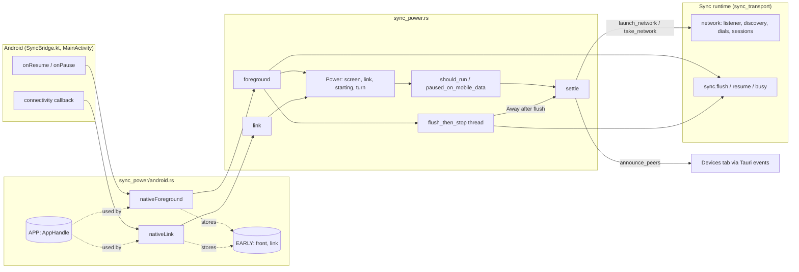
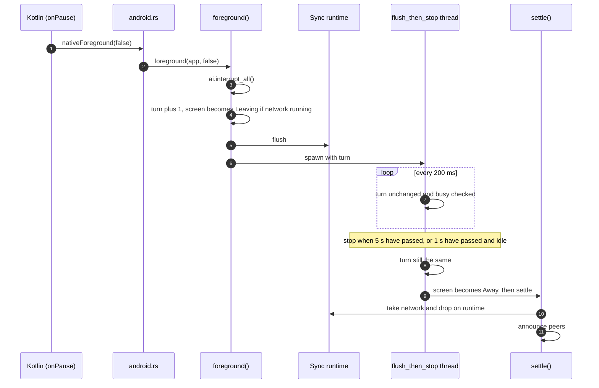
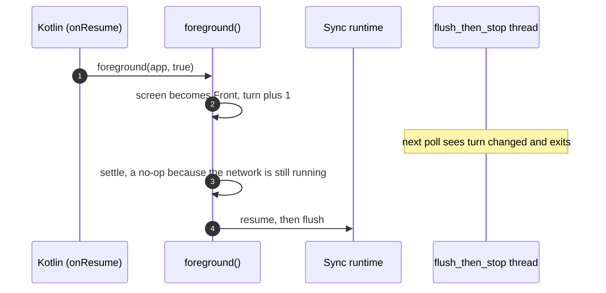
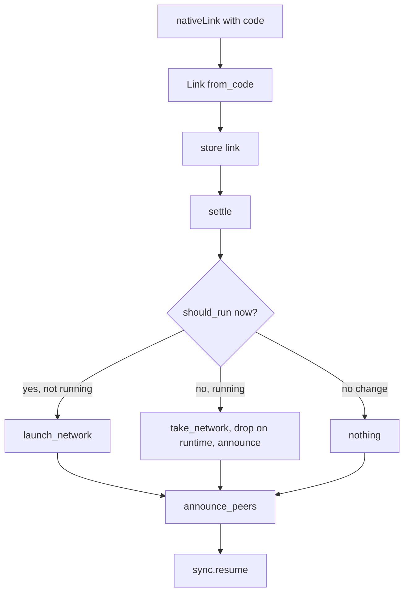
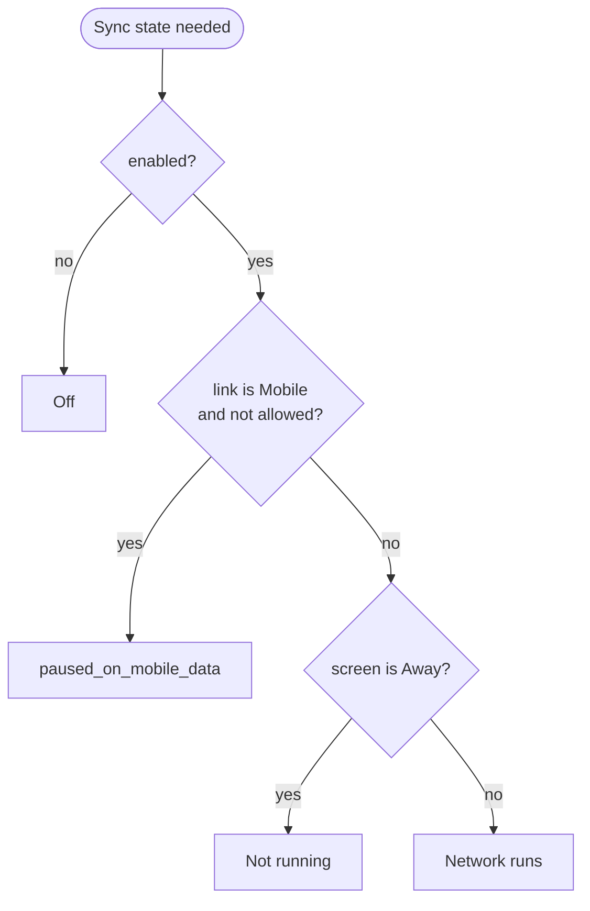

# sync_power_and_pause

## Introduction

`sync_power_and_pause` decides **when Sync's network is allowed to exist**. Turning Sync on in Settings is necessary but not sufficient. On Android the network also depends on whether the app is in front, what kind of connection the phone has, and whether the user allowed Sync over mobile data. This module owns those rules and the act of starting or stopping the network to match them.

The module also covers the **pauses** described in the tests (#72): a paired device whose data version or clock differs is not synced with until the cause is gone. Those pauses are a separate gate from the power rules, but they are documented here because they are tested in the same place and surface in the same Devices UI.

Related pages:

- Parent module: [Sync_Connectivity_and_Pairing](../Sync_Connectivity_and_Pairing.md)
- What the network is made of (listener, dials, TLS sessions): [sync_transport](sync_transport.md)
- Device rows, pairing and forgetting: [sync_devices](sync_devices.md)
- Replication, merge and the change log that the flush sends: [Sync_Replication_Engine](../Sync_Replication_Engine.md)
- Android lifecycle wiring and the Kotlin side: [Android_Integration](../Android_Integration.md)
- Tauri commands that expose sync state to the UI: [Tauri_Host_and_IPC_Bridge](../Tauri_Host_and_IPC_Bridge.md)
- Client UI that shows "paused" and "not nearby": [Sync_Client_Surface](../Sync_Client_Surface.md)

---

## Scope of this module

| Concern | Where it lives | Source |
|---|---|---|
| Decision: should the network run? | `sync_power.rs` | `should_run`, `paused_on_mobile_data` |
| Lifecycle state (screen, link) | `sync_power.rs` (`Power`) | `foreground`, `link`, `settle` |
| Flush-then-stop timer | `sync_power.rs` | `flush_then_stop`, `flush_over` |
| JNI entry points from Kotlin | `sync_power/android.rs` | `nativeForeground`, `nativeLink`, `register_app` |
| Lifecycle tests on real loopback sockets | `sync_power_tests.rs` | `TestApp` pairs |
| Data-version and clock pauses | `sync_pause_tests.rs` | tests only in this page's scope |

---

## Core concepts

### Four inputs to one decision

The decision reads four values, bundled as `Conditions`:

- `enabled`: the device's Sync switch (from `SyncDevice`).
- `screen`: `Front`, `Leaving` (inside the flush window), or `Away`.
- `link`: `Unknown`, `Offline`, `Wifi`, or `Mobile`. Tailscale counts as the network underneath it.
- `mobile_data`: the "Allow over mobile data" option.

`Unknown` (desktop, or Android has not reported yet) never blocks Sync.

### The rule

```rust
should_run(c) = c.enabled
             && c.screen != Screen::Away
             && (c.link != Link::Mobile || c.mobile_data)
```

Consequences, as covered by unit tests in `sync_power.rs`:

- Sync off: nothing runs in any screen or link state.
- In front on Wi-Fi, Offline, or Unknown: runs.
- In the flush window (`Leaving`): still runs, so pending changes can leave.
- `Away`: never runs, even on Wi-Fi with mobile data allowed.
- On mobile data: runs only with the option on, including during the flush window.

### Paused on mobile data

`paused_on_mobile_data(c)` is true when Sync is on, the link is `Mobile`, and mobile data is not allowed. This is not a separate state of the network. It is a *reason* the network is not running, so the UI can say "paused on mobile data" rather than "not nearby" (see [sync_devices](sync_devices.md) and [Sync_Client_Surface](../Sync_Client_Surface.md)).

### Desktop versus Android

- **Android**: the network runs only while the app is in front, plus a short flush after it leaves. Lifecycle callbacks arrive over JNI from `SyncBridge.kt`, not through the WebView, because the WebView may be suspended in the background and the flush timer must be Rust's own.
- **Desktop**: no lifecycle events arrive, so the screen stays `Front` and Sync runs as long as the process does, window or not.

---

## Architecture



`Power` lives in `AppState` (see [Tauri_Host_and_IPC_Bridge](../Tauri_Host_and_IPC_Bridge.md)). Its inner state is a single mutex holding:

- `screen`: current `Screen`.
- `link`: last reported `Link`.
- `starting`: a start is binding the port; a second start must not begin.
- `turn`: a counter bumped on every screen change, so a flush that was overtaken by a return knows to stand down.

---

## Components

### `Link` and `Screen`

- `Link::from_code(i32)` maps the Kotlin codes: `0` offline, `1` Wi-Fi or other, `2` mobile data; anything else is `Unknown`.
- `Screen::Front`, `Screen::Leaving`, `Screen::Away`.

### `Power`

- `Power::new()` uses the production `GRACE` (5 s). `Power::with_grace(d)` is used by tests to shorten it.
- On Android, `Power::with_grace` reads `android::early()` so that reports made before the app finished starting are not lost (link is copied, and `Away` is set if the activity had already left).
- `conditions(&SyncDevice)` builds the `Conditions` snapshot.
- `begin_start()` / `end_start()` guard against two concurrent network launches.

### `settle(app)`

The reconciler. It compares `should_run` with `network_running()`:

- Wanted and not running: `crate::sync::launch_network(app)`.
- Not wanted and running: takes the network out of state, drops it on the async runtime (where its tasks live), logs `network stopped`, and calls `announce_peers` so the Devices tab reads "not nearby" for everyone.

It is cheap when nothing needs to change, so every entry point calls it.

### `foreground(app, front)`

- **Leaving** (`front == false`):
  1. `state.ai.interrupt_all()`: an AI run cannot continue in the background on Android and ends as interrupted (see [AI_Assistant_Engine](../AI_Assistant_Engine.md)).
  2. If the screen is not `Front`, return (idempotent).
  3. Bump `turn`. If the network is running, the screen becomes `Leaving`; otherwise `Away`.
  4. If `Away`, return: nothing to flush.
  5. Call `sync.flush()` and spawn `flush_then_stop(app, turn)`.
- **Returning** (`front == true`):
  1. Set `Front` and bump `turn` (this cancels any pending stop).
  2. `settle(app)`.
  3. `sync.resume()` and `sync.flush()`: try every device again now.

### `flush_then_stop(app, turn)`

A plain thread that polls every `POLL` (200 ms):

- Stops early if `turn` changed (the app came back, or left again).
- Ends when `flush_over(elapsed, grace, busy)`:
  - `elapsed >= grace`, or
  - `elapsed >= MIN_FLUSH` (1 s) and no session is running (`!busy`).

The minimum exists so that the sessions the flush just asked for have started before "idle" is believed. When the flush is over, it re-checks `turn`, sets `Screen::Away`, and calls `settle`.

The sessions themselves run on Tauri's runtime; this thread only watches the clock.

### `link(app, now)`

Stores the new `Link`, then:

1. `settle(app)`: may start or stop the network (mobile data may have just become disallowed or allowed).
2. `announce_peers(app)`: the Devices tab updates its "paused on mobile data" reason.
3. `sync.resume()`: devices that could not be reached get another try on the new network.

It is called on every connectivity report, even when the kind did not change.

### `android.rs` (JNI)

- `Early { front, link }` is a process-wide static that remembers what Kotlin said before the Tauri app exists. Kotlin reports from `onCreate`, before Tauri setup.
- `register_app(app)` stores the `AppHandle` in a `OnceLock` and replays the early values (both operations are idempotent).
- `Java_com_hemang_mnemora_SyncBridge_nativeForeground(front)` and `Java_com_hemang_mnemora_SyncBridge_nativeLink(code)` update `EARLY` and, if the app is registered, call `foreground` or `link`.

Rules that the file states and the code follows:

- Nothing blocks: these run on the Android UI or a connectivity thread.
- Release builds abort on panic, so nothing unwraps or indexes. Poisoned locks are recovered with `PoisonError::into_inner`.

---

## Process flows

### Leaving the app



### Coming back inside the flush window



Because the network never stopped inside the window, return is cheap: the existing connections are asked to try again, and the pending stop is cancelled by the `turn` bump.

### Connectivity change



### Decision for one device (what the Devices tab reports)



---

## Pauses (data version and clock)

`sync_pause_tests.rs` (issue #72) pins down a second kind of pause. It is not caused by the phone's lifecycle or network type. It is caused by the devices' data or time:

- **Data version mismatch** (`different_data_versions_pause_both_sides_until_the_older_one_updates`): when the `_module_migrations` versions for a module differ, both sides show `paused` with `kind: "update"` and name the older side per module. Nothing crosses. Both keep working locally. When the older device updates, sync resumes and the pause is logged once, with a matching "resumed" line.
- **Pairing across versions** is refused before anything is stored (`pairing_across_data_versions_is_refused_with_the_fix_and_nothing_is_stored`), with `error.kind = "version_mismatch"`.
- **Clock ahead by more than five minutes**: the device with the wrong clock is paused with `kind: "clock"`. Within five minutes is tolerated (`a_clock_five_minutes_ahead_or_less_is_fine`, `a_record_a_few_minutes_ahead_is_taken`).
- **Records stamped far in the future**: a record more than five minutes ahead of the receiver's clock is refused and never stored, and never pulls the receiver's clock forward (`a_record_stamped_more_than_five_minutes_ahead_is_refused_and_never_seen_by_the_clock`). A stamped pause (`kind: "stamped"`) reports `resumes_in_ms` until real time is within five minutes of the records.
- **Clock fixed later**: edits made after the local clock is corrected are not stamped further ahead (`edits_after_the_clock_is_fixed_are_not_stamped_further_ahead`), but they still sort after earlier ones.

Shared behaviour across these pauses, as the tests assert:

- A pause is logged once per cause, not once per retry.
- A pause is not "resumed" until a sync really ran. A good handshake alone is not enough.
- Each device reports the pause in `peer_of(...)["pause"]`, and `sync_attention` counts it in `paused`.

Hash-level merging and the record format belong to [Sync_Replication_Engine](../Sync_Replication_Engine.md), and the sessions that carry records are in [sync_transport](sync_transport.md).

---

## Behaviour summary (from the tests)

| Situation | Expected result | Test |
|---|---|---|
| Leave app with a pending change | Change reaches the phone within 5 s, network then stops, phone reads Not nearby | `leaving_the_app_flushes_pending_changes_then_stops_everything` |
| App stays in front | Nothing stopped, Wi-Fi reports are harmless | `nothing_is_stopped_while_the_app_stays_in_front` |
| Return inside the 5 s window | Pending stop cancelled, network kept | `coming_back_inside_the_flush_window_keeps_the_network` |
| Mobile data, option off | Network stops; devices read paused with the reason | `mobile_data_stops_sync_unless_it_is_allowed`, `on_mobile_data_devices_read_paused_and_pairing_says_why` |
| Pairing on mobile data, option off | Refused with a message naming mobile data | `on_mobile_data_devices_read_paused_and_pairing_says_why` |
| Rapid leave/return loops | No duplicate listeners, tasks, or advertisements | `rapid_leaving_and_returning_never_duplicates_the_network` |
| Idle connection drops on leave | Not logged in Activity | `an_idle_connection_that_drops_is_not_logged` |
| Away, then Wi-Fi arrives | Stays stopped | `the_screen_and_link_are_remembered_for_the_next_decision` |

---

## How to test

- Pure rules (`should_run`, `paused_on_mobile_data`, `flush_over`, single start guard, link codes) are unit tests in `sync_power.rs`. They run without any app.
- Lifecycle tests in `sync_power_tests.rs` use `TestApp` pairs over real loopback sockets. They shorten the grace through the test app (about 600 ms in the comments) and drive the same entry points the JNI side calls: `sync_power::foreground`, `sync_power::link`.
- `sync_probe()` exposes `listeners`, `advertisements`, and `tasks`. Tests use these to assert the network is really gone, not just marked stopped.
- Pauses are tested in `sync_pause_tests.rs`. Clock skew is injected through `clock().skew(...)` and `clock().advance(...)`. Data version changes are injected by updating `_module_migrations` directly.

Tests do not restart the network when mobile data is allowed. Pairing in that case waits for the network instead of failing.

---

## Extending this module

- New lifecycle input (for example a different OS hook): call `foreground` or `link` with the new signal, and add the value to `Conditions` only if it changes the decision. Keep `settle` as the only place that starts or stops the network, so every path stays idempotent.
- Changing the grace or minimum flush: these are `GRACE` and `MIN_FLUSH` constants. The tests are written against the 5 s grace and use `Power::with_grace` for shorter windows, so update `sync_power_tests.rs` if the production value changes.
- Keep `Link` and `Screen` mappings in sync with `SyncBridge.kt`. `Link::from_code` documents the codes and has a unit test (`link_codes_match_the_android_side`).
- Do not put lifecycle logic in the WebView. The flush timer and the stop must run in Rust, because the WebView may be suspended.
