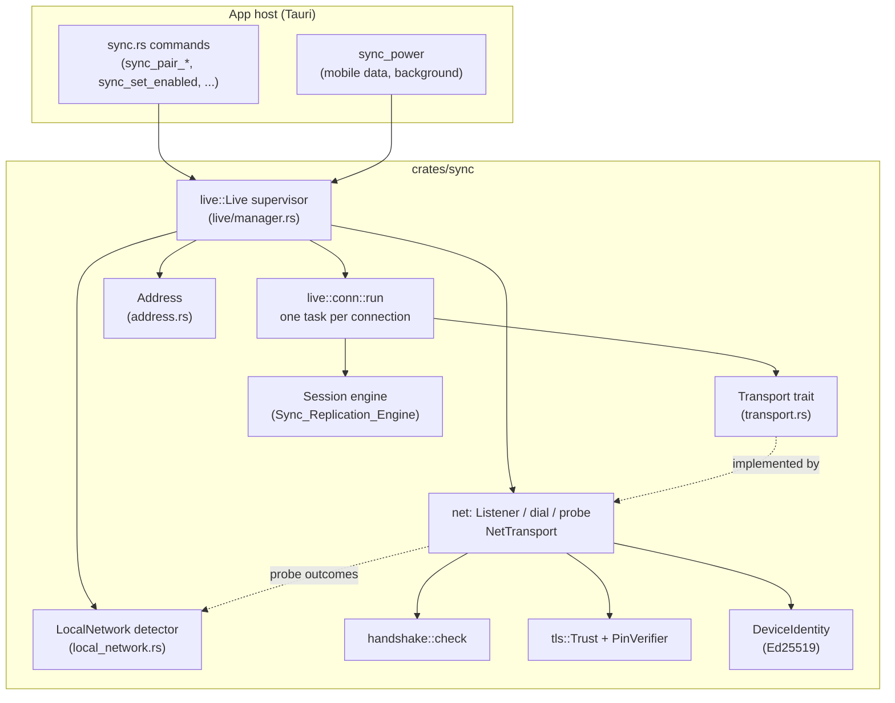
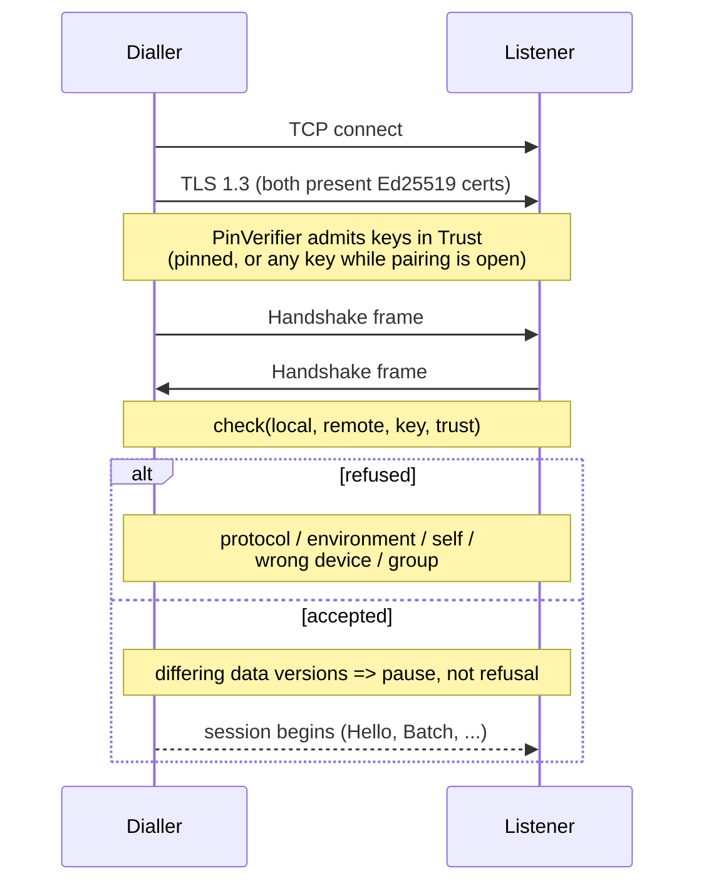
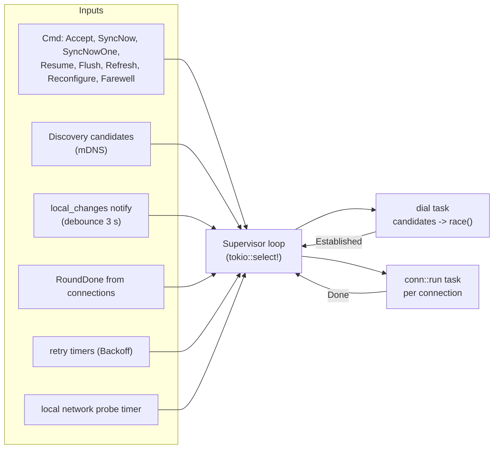
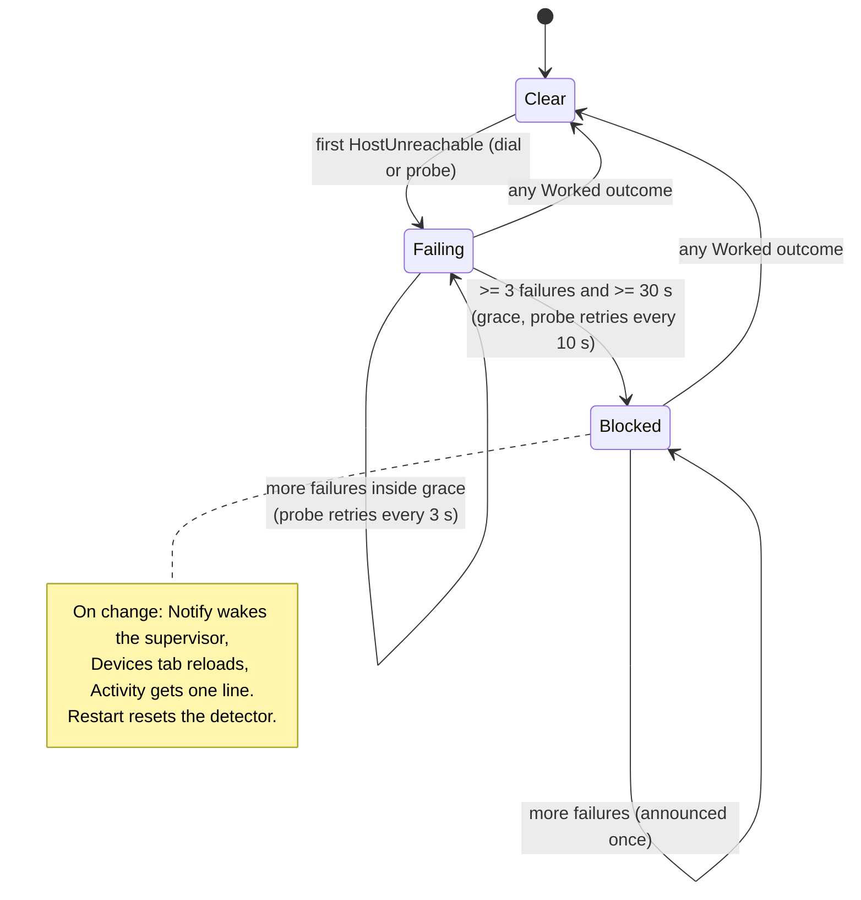

# sync_transport

`sync_transport` is the network layer under Mnemora's sync. It decides how two of a person's devices find each other, prove who they are, open a secure line, and keep that line alive so sessions can run over it. It owns no sync data and no merge rules: the sync engine ([Sync_Replication_Engine](../Sync_Replication_Engine/sync_engine.md)) is handed a `Transport` and speaks its messages over it.

The module lives in `crates/sync/src/` (`address.rs`, `local_network.rs`, `transport.rs`, `live/`, `net/`). Its sibling pages cover the surrounding pieces: pairing and device management in [sync_devices](sync_devices.md), the Tauri commands and pairing flow in [sync_network_and_pairing](sync_network_and_pairing.md), and pausing on mobile data or background in [sync_power_and_pause](sync_power_and_pause.md).

## Responsibilities

| Concern | Where it lives |
|---|---|
| Typed device addresses (`host`, `host:port`, IPv4, `[IPv6]:port`) | `address.rs` |
| Device identity: Ed25519 key, public key as a device's identity | `net/identity.rs` |
| Pinned-key TLS 1.3 on both sides, no certificate authority | `net/tls.rs` |
| Length-prefixed frames and the first (handshake) frame | `net/mod.rs`, `net/handshake.rs` |
| Listener, dialler, and the `NetTransport` adapter | `net/link.rs` (summarised here) |
| Detecting that macOS / Android keeps the app off the local network | `local_network.rs` |
| Supervisor: who to dial, when to retry, which duplicate connection survives | `live/manager.rs`, `live/mod.rs` |
| One connection's session loop | `live/conn.rs` |
| The `Transport` seam the sync engine talks through | `transport.rs` |

## Where it sits

The engine never sees a socket. `Transport` has two methods, `send` and a non-blocking `try_recv`, and returns `SyncError::Disconnected` once the line is gone. `NetTransport` is the TCP/TLS implementation; `transport::memory::pair()` is the in-process one the tests use, with a `Link` that can `cut()` the line or `cut_after(n)` messages for fault tests.

## Identity and trust

A device's identity is an Ed25519 key pair, not a name or an address.

- `DeviceIdentity::load_or_create` keeps the PKCS#8 private key in `sync-key.pk8` beside `device.toml` (0600). The file is per Environment, so Production and Sandbox never share a key. The key is made on first use and never leaves the device. A loosened file is tightened on load, and a corrupt file is an error rather than a silent new identity.
- The self-signed certificate is derived from the key at load time and carries nothing else.
- `PublicKey` is the 32 raw bytes, shown and stored as 64 hex characters. It is what a device pins.
- `DeviceIdentity::sign` signs messages that the whole group must be able to verify (revocations, renames).

`Trust` is the shared set of accepted keys. Cloning shares it. It holds:

- `pinned`: key → device id it was paired as. `pin` replaces the id; `unpin` and `unpin_all` forget.
- `pairing_open`: while on, TLS also admits unpinned keys so a device being paired can connect.

TLS is TLS 1.3 only. `PinVerifier` is used on both client and server (mutual TLS). It ignores chains, names and dates; it extracts the Ed25519 key from the certificate (`public_key_of`, a small DER walker) and asks `Trust::admits`. The handshake signature then proves the peer holds that key. Session resumption and TLS 1.3 tickets are disabled on both sides, so a forgotten key cannot come back on an old ticket.

## Connection establishment

### Listening and dialling

- `Listener::bind` listens on the preferred port (`DEFAULT_PORT`, 47311) and falls back to an ephemeral one if it is busy (`fell_back()` reports which). IPv4 and IPv6 listeners can share one port (`bind_exact`).
- At most `MAX_PENDING` (16) inbound handshakes are in flight; surplus TCP connections are dropped.
- Accepting yields `Incoming::Peer(Established)` for a pinned peer, or `Incoming::Unpinned` only while pairing is open. The pairing code consumes the latter.
- `dial`, `secure_dial` and `probe` are the outgoing calls. `probe` runs the handshake read without starting a session; it is answered even while pairing is open, which is what the "check" action relies on.
- Dropping the listener closes the port and its pending connections.

### The handshake frame

Both sides send their `Handshake` first, then read the other's and run `handshake::check`. Each refusal is reached on both ends.

`Handshake` carries: `protocol` (`PROTOCOL_VERSION` = 1, no negotiation), `app_version`, `environment` (Production and Sandbox refuse each other), `device`, `group` (`None` before the first pairing), `data_versions` (per Module migration count), `addresses` (gossiped `ip:port`), and `now_ms` (wall clock, for the five-minute clock rule).

`check` returns the Modules whose data versions differ. That is a pause condition, not a refusal, so both devices stay paired and resume once the older one updates.

| Refusal | Meaning |
|---|---|
| `Protocol { theirs }` | Different wire protocol number |
| `Environment` | Other Environment (Sandbox vs Production) |
| `SelfDial` | Same device id |
| `WrongDevice` | Key pinned as a different device id |
| `Unpinned` | Key not pinned |
| `Group` | Both have a group and they differ |

Frames are JSON with a 4-byte big-endian length prefix, capped at `MAX_FRAME` (8 MB). Before pairing or handshake a stranger may send only `HANDSHAKE_MAX_FRAME`, far less. `NetError` maps onto `SyncError`: socket, closed and timeout become `Disconnected`; everything else becomes `Protocol`.

## Addresses

A device can be reached by a typed address, a discovered address, or one remembered from an earlier connection. The typed form is `Address` in `address.rs`:

- Accepted: `host`, `host:port`, `100.88.12.4`, `100.88.12.4:port`, `[fd7a::1]`, `[fd7a::1]:port`. The port defaults to 47311 and must be 1–65535.
- Refused with a message the person can act on: empty, not a host name or IP, bad port, bare IPv6 without brackets (`Brackets`). Schemes such as `http://` and double colons are refused as `Host`.
- Names are lower-cased, a trailing dot is dropped, labels may hold letters, digits, `-` and `_`, the whole name is at most 253 characters, and all-numeric names are refused.
- `normalized()` is the stored text. `resolve(within)` returns the socket addresses: an IP is itself, a name is looked up under a timeout (`ResolveError::NotFound` / `TimedOut`).

The rules are shared with the browser mock. Both `address.rs` and `src/modules/sync/address.ts` read `src/lib/ipc/fixtures/sync-rules.json`, so the Rust and TypeScript sides cannot drift.

## The supervisor

`Live` (in `live/manager.rs`) is the one owner of every dial and connection. It runs as a single Tokio task; its `JoinSet` holds every dial and connection task, so dropping `Live` aborts all of them.

### Choosing addresses to dial

`dial` builds the candidate list from three sources, in this order:

1. Addresses discovery last reported (`found`).
2. Addresses remembered for the device (`peer_state::addresses_of`).
3. The address the person typed (`detail::typed_for_dial`), resolved under `dial_each`.

`candidates` merges them and `race` tries them, each given `dial_each` (default 3 s). The first address that passes the handshake becomes the connection. A typed or remembered address is therefore still tried when discovery finds nothing, which is what lets a Mac that macOS keeps off the LAN still sync through the other device's incoming connection.

### Retry and manual sync

- While Sync is automatic, a failed dial or a lost connection schedules a retry from a `Backoff` (default schedule in `Pace`). A new discovery report with different addresses cuts the backoff short. A device that keeps announcing the same addresses is left to the backoff.
- With Sync automatically off, nothing retries. "Sync now" (`SyncNow`, `SyncNowOne`) dials once and runs one round.
- `Reconfigure` closes every connection that is not a manual one when Sync automatically is switched off.

### Two connections to one device

Two devices can dial each other at the same moment. Each then holds two connections to the other. `tie::replaces` decides, and the rule is the same on both ends: the connection **dialled by the lower device id** is kept and the other is closed (`ConnCmd::Close`). A dial still racing when the other side's connection is adopted is not an error; a failed dial then says nothing against a device that is in fact connected.

### Pauses

If the handshake says the two devices' data versions differ, or a record was stamped more than five minutes ahead, the connection is not used for a session. `Pause` (see [sync_power_and_pause](sync_power_and_pause.md)) is stored on the peer, shown on the Devices tab and written to Activity once. A `ClockAhead` error from a connection becomes `Pause::Stamped`. A pause caused by stored records outlives a good handshake and ends only when a sync runs to the end.

### Farewell

`Leaver::farewell(limit)` is how a device that is leaving the group pushes what it has written. The supervisor asks every open connection to a device not yet told to run one more session, and waits for each to finish. If a connection is replaced before its farewell runs, the ask is repeated to whatever connection now stands, so a device is not skipped and is not asked twice.

## One connection

`live/conn.rs::run` is the loop for one open device. It is deliberately simple:

- It starts a session when it opens and then waits. A `Round` command, a farewell, or a received `Hello` starts another.
- A session is a fresh `Session` from the engine, created with the device's registry and event bus. Database work runs on blocking threads, one batch per transaction (`blocking`).
- Before the first non-empty batch from a device introduced by someone else, it takes a backup (`peer_state::needs_first_backup`). A failed backup ends the session before anything is applied.
- A session that hears nothing for 60 s (`SILENCE`) is given up and the connection closed.
- A message that arrives when the connection is idle and is not a `Hello` is a protocol error.
- When a session finishes, `peer_state::finished` records the counts and a `RoundDone` goes to the supervisor. The supervisor reloads the paired-device list if anything was received (a forgotten device must not keep its connection), and schedules a push to the other open connections. `news(stats)` counts stored records, the line written to Activity and Activity received, so one device's news can reach a member it cannot reach directly. A round with no news ends that chain.

## Local network detection (macOS and Android)

macOS 15+ (Local Network privacy) refuses LAN connections and mDNS sends until the person allows the app, and it offers no API that reports the state. The only sign is `EHOSTUNREACH` ("No route to host"). A switched-off neighbour produces the same error, so one failure proves nothing.

`local_network.rs` therefore declares "blocked" only after repeated failures over time:

- Two sources feed a `Detector`: **dials** to LAN addresses (`dial_failed`, `dial_worked`) and a **probe**, a UDP datagram with no questions sent to the mDNS group `224.0.0.251:5353`, which depends on no other device being present. The probe runs on macOS only (`LocalNetwork::system()`); elsewhere only dials count, and on non-macOS dials do not count at all (`dials_count` is false) because there the system's own report is the only refusal.
- A probe failure with `HostUnreachable` is a *Blocked* outcome. A probe that works is `Worked`.
- `Detector::observe` needs at least `MIN_FAILURES` (3) and at least `grace` (30 s) of consistent failures before it sets `blocked`. Any `Worked` clears the run.
- While a probe has worked, a dial's denial is about that device, not the permission, and is ignored.
- Outcomes for dials are classed by `outcome_of_failure`: only LAN addresses count (`is_lan` excludes Tailscale, loopback and public addresses); a link-local IPv6 dial without a scope says nothing; a connection refused is `Worked`; timeouts and TLS-level failures are `Unknown`.
- `probe_mdns_group` turns a denial into `NetworkUnreachable` when no LAN interface exists at all, so a VPN-only or offline machine is not reported as blocked.
- Android 17 reports the permission itself: `set_os_denied`.

`LocalNetwork::blocked()` is also true when the system reported a denial (`os_denied`). The supervisor's `local_network_changed` announces only real changes; `reset()` runs at each start so failures from before a start prove nothing.

## Configuration

Build and test behaviour depends on `crates/sync/Cargo.toml`, which pulls in `rustls`, `tokio-rustls`, `rcgen` (certificate creation), `ring` (Ed25519 signature checks), `if-addrs` (LAN interface detection), `mdns-sd` (discovery), `socket2` (listener sockets), and `spake2` (pairing, used by the pairing code). Tests use `tempfile` and a multi-thread Tokio runtime. Run the module's tests with the workspace test target (`make test`, see `Makefile` and [Build_and_Packaging](../Build_and_Packaging.md)).

Tunable timings are in code, not configuration: `Pace` (debounce 3 s, dial each 3 s, retry schedule), `Rhythm` (grace 30 s, probe fast 3 s / slow 10 s / steady 60 s), `SILENCE` (60 s) and `MAX_PENDING` (16). Tests replace them with short values (`Pace`, `Rhythm` via `with_rhythm`).

## Testing

| Test area | What it proves |
|---|---|
| `address.rs` | Shared `sync-rules.json` fixture; IPs resolve to themselves; `localhost` resolves |
| `net/tests.rs` | Real loopback TLS: pinned peers exchange a session; unpinned on either side is refused on both ends; forgotten peer refused, including on TLS resumption attempts; oversize frames close the line; IPv4/IPv6 and busy-port fallback; 16-handshake limit |
| `live/tests.rs` | Duplicate connections settle on the lower-id dial on both ends (either order); a panicking connection task does not leave a device "connected"; a dial that fails after adoption keeps the device reachable; a remembered address is dialled without discovery; probe-driven blocking is announced once and clears |
| `local_network.rs` (unit) | Denial code; LAN classification; grace and burst behaviour; probe rhythm |
| `net/handshake.rs`, `net/tls.rs`, `net/identity.rs` (unit) | Refusal order; differing data versions reported, not refused; key extraction; key file mode and corruption |
| `transport.rs` (unit) | In-order delivery to the other end only; cut and cut-after behaviour |

The app-level tests that exercise this module through the Tauri commands are listed in [Sync_Replication_Engine](../Sync_Replication_Engine/sync_engine.md) (the cluster tests) and [sync_network_and_pairing](sync_network_and_pairing.md) (`sync_live_tests.rs`, `sync_pairing_tests.rs`, `sync_forget_tests.rs`, `sync_groups_tests.rs`), with power and pause behaviour in [sync_power_and_pause](sync_power_and_pause.md).

## How other modules use it

- The **sync engine** consumes `Transport` and `Session`; it does not know about TLS or addresses. See [Sync_Replication_Engine](../Sync_Replication_Engine/sync_engine.md).
- The **app host** implements `Host` (database access on a separate connection, the registry of syncing Modules, the event bus, the "Sync automatically" flag, the local-changes notifier, and status callbacks) and calls `Live::start`, `Live::sync_now`, `Live::flush`, `Live::resume`, `Live::leaver().farewell` from [sync_network_and_pairing](sync_network_and_pairing.md).
- **Pairing** uses the same listener and dialler: a code-protected SPAKE2 exchange runs over the TLS channel that `Incoming::Unpinned` or `secure_dial` hands over. Pairing and device management are in [sync_devices](sync_devices.md).
- **Power and pause** reach the supervisor through `flush`, `resume` and the `Pause` values it stores. See [sync_power_and_pause](sync_power_and_pause.md).
- The **Devices and Activity views** read `Live::snapshot()` (per-device reachable, syncing, progress, paused) and the Activity lines the supervisor writes. The client side is in [Sync_Client_Surface](../Sync_Client_Surface.md).

## Maintenance notes

- Changing a field of `Handshake`, or any rule in `check`, is a protocol change: bump `PROTOCOL_VERSION`, because there is no negotiation and a different number is refused.
- Keep `address.rs` and `src/modules/sync/address.ts` on the same `sync-rules.json` fixture. Changing one without the other breaks the shared-fixture tests on purpose.
- Never log message content; this module logs peer ids, counts and outcomes only.
- The supervisor is the only place that changes a peer's connection state. Connection tasks report through `RoundDone` and the `Done` channel; do not write peer state from elsewhere.
- Tests that need a silent, refusing or cut network use `TcpListener` stand-ins, `Link::cut`, and `LocalNetwork::with_probe` rather than real LAN devices.
