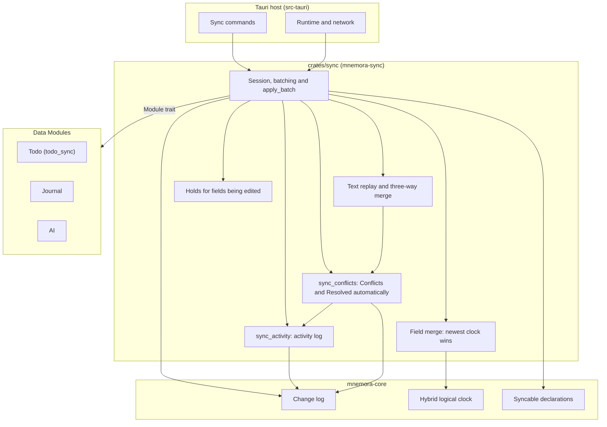
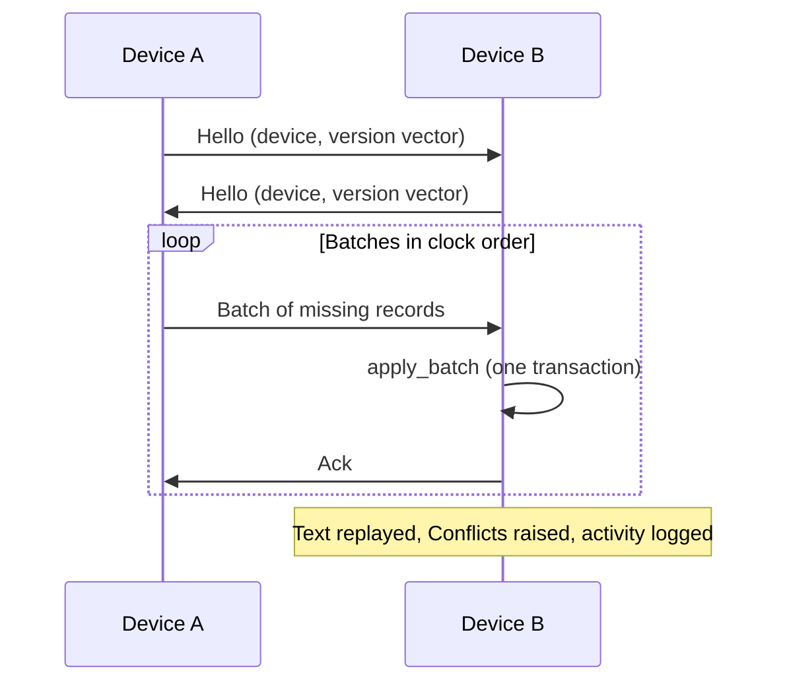

# Sync Replication Engine

## Purpose

The Sync Replication Engine keeps a person's own devices in step, directly between them, with no server in the middle (ADR 0017). It moves change-log records between paired devices, decides which value wins when two devices changed the same field, merges concurrent text edits without losing words, holds back remote changes while someone is typing, and records what happened in an activity log.

The module is off by default. Nothing listens, advertises or runs on a device until the person turns Sync on for that device in Device settings.

## Architecture

The engine (`crates/sync`, `mnemora-sync`) is generic. It never imports the data Modules (Todo, Journal, AI). It talks to them only through the `Module` trait (`apply_remote`, `settle_remote`, `sync_entities`). Modules own their tables and merge rules. The engine owns the version vector, field clocks, held values and text replay memos.

A synchronisation session runs as follows:

## Core components

| Component | Responsibility |
|---|---|
| [sync_engine](Sync_Replication_Engine/sync_engine.md) | The replication core: wire protocol, all-or-nothing batch apply, field merge rules, text replay and three-way merge, holds, field clocks, and device settings. |
| [sync_conflicts](Sync_Replication_Engine/sync_conflicts.md) | Turns text clashes into Conflicts a person must decide, and records automatic decisions (value clashes, delete versus edit, Inbox moves) as "Resolved automatically" rows. |
| [sync_activity](Sync_Replication_Engine/sync_activity.md) | Writes one immutable, synced row per meaningful event (sessions, pairings, pauses, failures, renames, Conflicts, List merges) and renders them as plain-language lines. |
| [todo_sync](Sync_Replication_Engine/todo_sync.md) | The Todo Module's side of the contract: field merge kinds for Tasks, Lists and Comments, how received records are written, and post-storage tidy-up such as List name clashes. |
| [sync_data_merge](Sync_Replication_Engine/sync_data_merge.md) | The end-to-end test suite. It runs multi-device clusters through the real commands and checks that every device converges. It contains no production code. |

## Key guarantees

- **Atomic batches.** A batch is applied in one transaction, or not at all. Version vector, change log, clocks and Module writes move together.
- **Order independence.** Final text, Conflicts and values depend only on the stored records, not on delivery order.
- **No silent text loss.** Every losing text stays in the change log and either appears in the replayed text or in an open Conflict.
- **Local state never syncs.** Version vectors, clocks, holds and per-device memory stay on the device.
- **Values are never logged.** Logs and activity rows carry counts, names and kinds only.

## Related documentation

- [Sync Connectivity and Pairing](Sync_Connectivity_and_Pairing.md): device discovery, pairing, live connections, TLS and power handling.
- [Sync Client Surface](Sync_Client_Surface.md): the UI for Sync, including the Conflicts, Compare and Activity screens.
- [Data Foundation](Data_Foundation.md): the change log, hybrid logical clock, syncable declarations and Device settings this engine builds on.
- [Task and Journal Domain Services](Task_and_Journal_Domain_Services.md): the domain Modules whose records are synced.