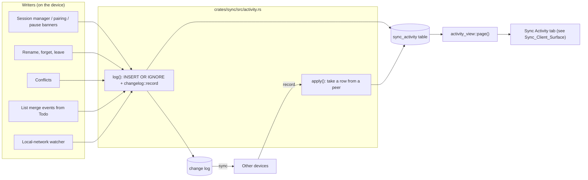
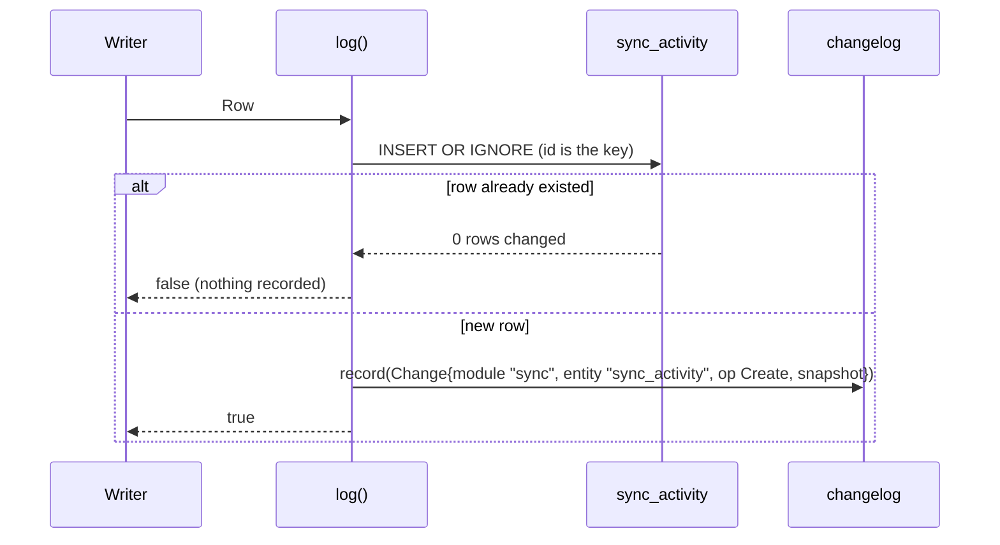
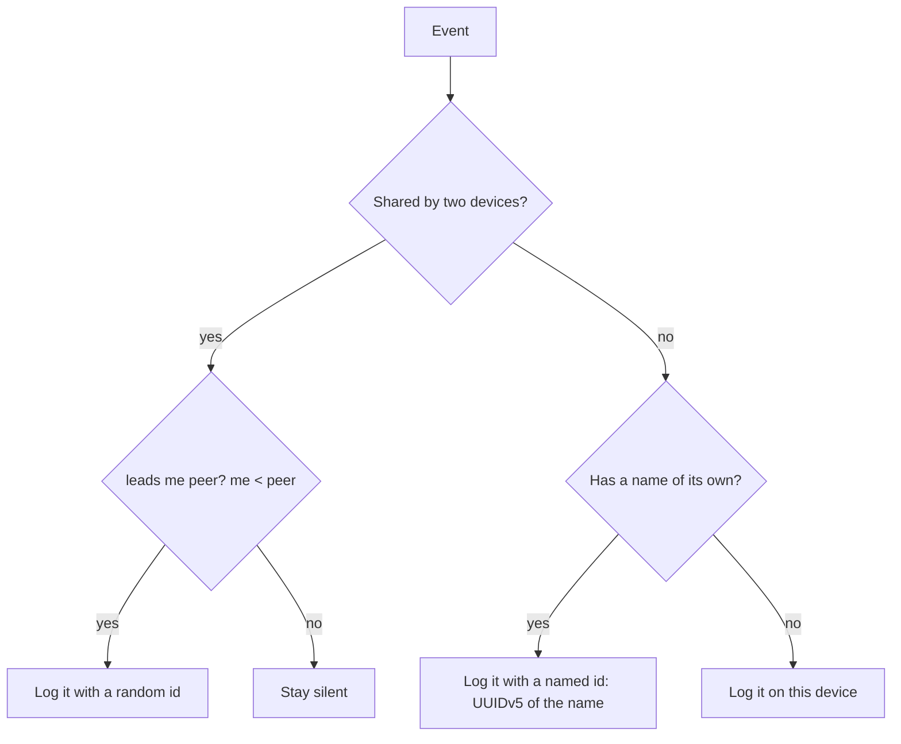
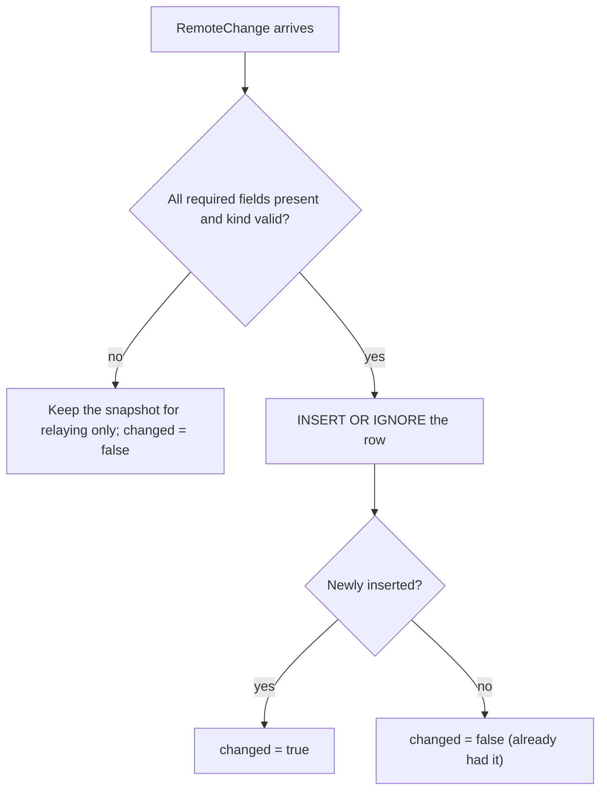
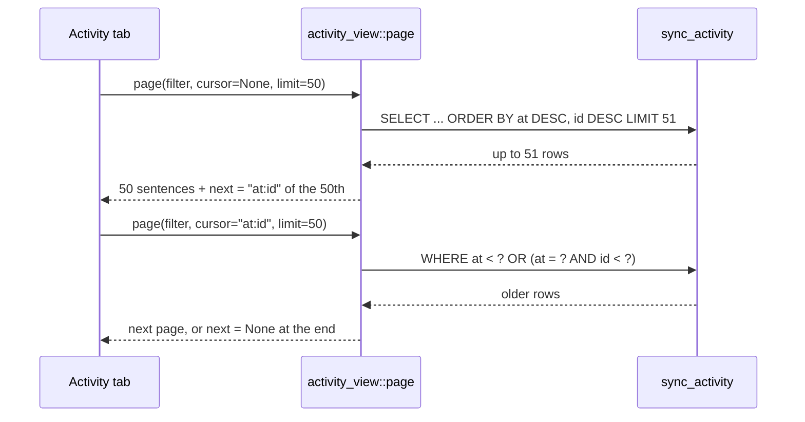
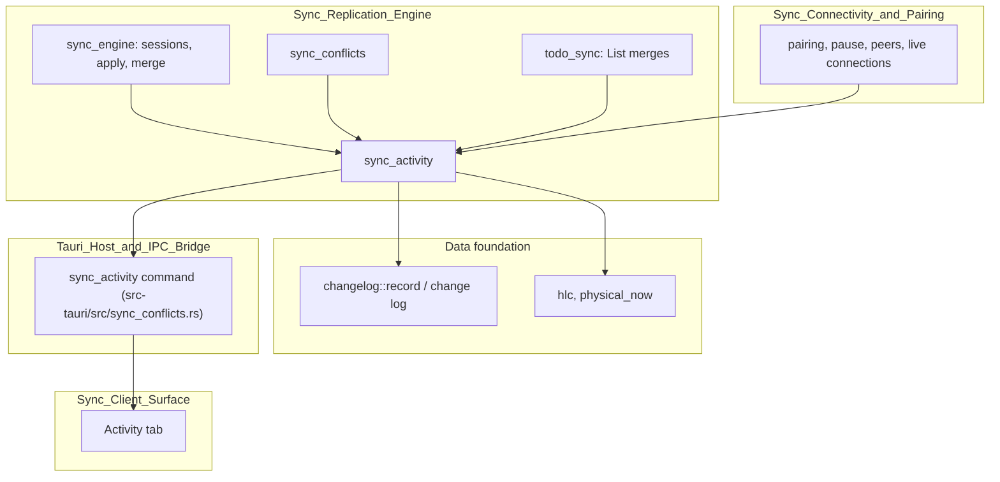

# sync_activity

The `sync_activity` module is Sync's activity log. Every meaningful thing Sync does (a session that moved records, a pairing, a pause, a failed connection, a rename, a Conflict being raised or resolved, two Lists merging) is written as one immutable row, and that row is synced to the other devices like any other record. The Activity tab then reads these rows and turns them into plain-language lines, newest first.

The module has three concerns, each in its own file:

| File | Role |
|---|---|
| `crates/sync/src/activity.rs` | Storage and writing: the `Kind` and `Why` vocabularies, the row shape, who logs what, de-duplication, and applying rows received from peers. |
| `crates/sync/src/activity_view.rs` | Presentation: keyset-paged reading of the log and the conversion of each row into a sentence, from the viewer's side. |
| `crates/sync/src/detail.rs` | The device sheet: the per-device data (state, addresses, data versions, typed Address) shown next to the activity of that device. |

For the overall sync design see [Sync_Replication_Engine.md](../Sync_Replication_Engine.md). The change-log and record contracts the module relies on are described in [Data_Foundation.md](../Data_Foundation.md). Conflict rows are produced by [sync_conflicts](sync_conflicts.md), and list merges by [todo_sync](todo_sync.md). The UI that renders the log is documented in [Sync_Client_Surface/sync-activity.md](../Sync_Client_Surface/sync-activity.md).

---

## 1. Design principles

The header of `activity.rs` states the rules that everything else follows:

1. **Each event is logged once, across all devices.** The log is synced, so if two devices both log the same event, the user sees two lines. The module avoids this in one of three ways:
   - **Shared events** (a session, pairing, a pause, a lost connection) are logged by the device with the lower device id. Exactly one of two devices leads (`leads(me, peer)` is `me < peer`).
   - **Own events** (renaming, forgetting, leaving, a local-network block) are logged by the device that did them.
   - **Named events** (a Conflict, a List merge, a member joining) get a deterministic id derived from the name of the thing (UUIDv5 in a fixed namespace). Devices that notice the same thing produce the same row id, so the row is stored once.
2. **Rows never change.** A row is written once and is never updated. Its `at` timestamp is fixed at creation.
3. **Never log content.** A row holds device names, counts, Module and entity kinds, and reasons. The only exception is List names in a merge line, which are shown in plain words.
4. **Quiet work is not logged.** A session that moved no records writes nothing. Records of this entity do not count as "moved" either, so a sync that only passes activity records along is silent. This also stops a feedback loop, because logging a session creates records that would otherwise trigger another session.

---

## 2. Architecture



The writers never build sentences. They record a `Kind` plus the facts (device, peer, counts, reason) and leave the wording to `activity_view`. Reading and writing are therefore independent: a row written by an older build still reads correctly, as long as its `kind` and `extra` keys are understood.

---

## 3. The stored row

The entity name is `sync_activity` (`ENTITY`). Its synced fields are declared in `ACTIVITY` (`SyncField::value` for each):

| Field | Meaning |
|---|---|
| `kind` | A `Kind` string, such as `session` or `conflict_raised`. |
| `at` | When it happened, in clock milliseconds. |
| `device`, `device_name` | The device that logged the row, and its name at the time. |
| `peer`, `peer_name` | The other device the event is about, if any, and its name at the time. Empty when there is none. |
| `n_in`, `n_out` | Records moved, counted from the logging device's side. |
| `detail` | JSON array of `Part` values (a session's per-Module breakdown). |
| `extra` | Kind-specific JSON, such as `{"why": "clock"}` or `{"entity": ..., "field": ...}`. |

The in-memory form is the `Row` struct, which mirrors these columns.

### Kind vocabulary

`Kind` has 13 variants. Its `as_str` and `parse` values are the strings stored in the database and sent to peers, so they must not be renamed.

| Kind | Meaning | Logged by |
|---|---|---|
| `Session` | A sync session that moved something | Leading device |
| `Paired` | Two devices paired | Leading device |
| `Joined` | A device joined the group, as learned here | Each device that learns of it (named id) |
| `Left` | This device left the group | This device |
| `Forgot` | A device was forgotten | This device |
| `Renamed` | A device was renamed (`extra` holds `old` and `new`) | This device |
| `Paused` / `Resumed` | Sync with a device paused or resumed | Leading device |
| `Failed` | A connection failed or was refused | Leading device |
| `ConflictRaised` | A Conflict was raised | Whichever device notices first (named id) |
| `ConflictResolved` | A Conflict was resolved by a person, or closed automatically | Resolving device or any device (named id) |
| `ListsMerged` | Two Lists with one name became one | Any device (named id) |
| `Blocked` | The system keeps this device off the local network | This device |

### Why vocabulary

`Why` explains a pause or a failure. It is stored in `extra.why`:

| Why | Meaning |
|---|---|
| `Update` | The data versions differ; one device needs an update |
| `Clock` | The clocks are too far apart |
| `Environment` | The devices run in different Environments |
| `Revoked` | The other device forgot this one |
| `Lost` | The line was lost mid-sync |

### Breakdown parts

`Part { m, e, n }` records how many records of one kind moved: `m` is the owning Module id (`todo`, `journal`, `core`, `sync`), `e` is the change-log entity (`todo_task`, `journal_entry`, ...), and `n` is the count. It never records which records moved.

---

## 4. Writing rows

### 4.1 Core write path

Every writer ends in `log(conn, row)`:



Because the insert is `OR IGNORE` on the row id, repeating a writer call with the same id is harmless. Only a genuinely new row is recorded as a change, so it reaches the other devices exactly once.

### 4.2 Who logs what



The writer functions map onto this:

- **Shared, random id, leader only:** `log_session` (only when `n_in + n_out > 0`), `log_paired`, `log_paused` (only if the newest pause/resume row this device logged for the peer is not already a pause), `log_resumed`, `log_failed`.
- **Named id, any device:** `log_joined` (keyed by the member id), `log_conflict_raised` (keyed by the Conflict id), `log_conflict_resolved` and `log_conflict_deleted` (both keyed by the Conflict's resolution id, so the person's resolution and an automatic closing collide on purpose), `log_lists_merged` (keyed by both List ids).
- **Own device:** `log_left`, `log_forgot`, `log_renamed`, `log_local_network_blocked`.

`note_events` is the bridge from the Todo side. When a batch is applied, a `SyncEvent::ListsMerged` coming from a Module is turned into a `log_lists_merged` call in the same transaction, so the merge line and the data change commit together.

### 4.3 Rate limiting

Some events are noisy, so two writers suppress repeats:

| Writer | Rule |
|---|---|
| `log_failed` | Not again for the same peer within 10 minutes of the last `failed` row logged by this device. |
| `log_local_network_blocked` | Not again within 10 minutes of the last `blocked` row on this device. |
| `log_paused` | Logged once per pause. The check reads the newest `paused`/`resumed` row from the table, not memory, so a restart does not log the same pause again. |

### 4.4 Conflicts and merges

- `log_conflict_raised` takes the Conflict id, the entity and field it concerns, and the time it was raised. The `at` of the row is that raise time, not the moment this device noticed it.
- `log_conflict_resolved` records who decided (`by`) and when.
- `log_conflict_deleted` is used when a Conflict is closed because its record was deleted. Nobody was asked, so the row carries `extra.auto = true`, which keeps the sentence from naming whichever device happened to log it. It uses the same id as a person's resolution, so the two cannot both appear.

Conflict behaviour, including how the resolution itself is applied, is in [sync_conflicts](sync_conflicts.md). List merge rules are in [todo_sync](todo_sync.md).

---

## 5. Receiving rows from peers

`apply(conn, change)` is Sync's side of the Module contract for the `sync_activity` entity. Rows never change, so the logic is simple:



Two consequences matter for other modules:

- A record missing a field (or with an unknown `kind`) is still passed on to other devices, but it is not shown. This keeps a newer build's rows flowing through an older device.
- Activity records are never counted as "moved" in a session, which is why a sync that only relays activity leaves no new line.

---

## 6. Reading the log

`activity_view::page` is the only reader. It returns an `ActivityPage` of up to 200 rows, newest first.

### 6.1 Filters

`ActivityFilter` has three forms:

| Filter | Shows |
|---|---|
| `All` | Every row |
| `ThisDevice` | Rows where this device is the logger or the peer |
| `Device { id }` | Rows where the given device is the logger or the peer |

The SQL matches `device = ? OR peer = ?` for the chosen device, so a pairing logged by a peer still appears on the other device's page.

### 6.2 Paging

Paging is keyset-based, not offset-based, so inserts from sync between two page loads do not cause gaps or repeats.

- The cursor is `"<at>:<id>"` of the last row returned.
- The query fetches `limit + 1` rows. If the extra row exists, `next` is set to the cursor of the last row returned; otherwise `next` is `None`.
- `limit` is clamped to `1..=200` (`MAX_PAGE`).
- Ordering is `ORDER BY at DESC, id DESC`, so rows with equal times are still in a stable order.



A malformed cursor is treated as no cursor: `parse_cursor` returns `None` and the page starts from the newest row.

### 6.3 Sentences, from the viewer's side

`describe` builds each `ActivityRow` for one `Viewer` (this device's id and name). Three rules make the wording correct for both devices:

1. **Counts flip for the other device.** A session is logged by the leader, so its `n_in` and `n_out` are from the leader's side. When the viewer is the peer (`row.peer == viewer.device`), the two counts are swapped, so "in" always means "into the person's device".
2. **The other device is named from the viewer's side.** If the viewer is the peer, the other device is the logger. Otherwise it is `row.peer`. Names are looked up live from the peer table (`peers::name_of`) and fall back to the name stored on the row, and then to "another device".
3. **"on …" is added only when needed.** A line gets an `on` suffix (for example, "· on Pixel 8") when another device logged it, the sentence does not already name that device, and the row is not an automatic closing. Renames never get the suffix.

Each `Kind` produces a sentence of `Piece` values. A `Piece` has `strong: true` for names, which the UI shows in bold:

| Kind | Example sentence |
|---|---|
| `Session` | "Synced with **Pixel 8** · 3 in, 1 out" plus a breakdown line |
| `Paired` | "Paired with **Pixel 8**" |
| `Joined` | "**Pixel 8** joined" |
| `Left` | "Left the group", or "**Name** left the group" |
| `Forgot` | "Forgot **Pixel 8**" |
| `Renamed` | "**Old** renamed to **New**" |
| `Paused` | "Paused with **Pixel 8**: one of you needs an update" |
| `Resumed` | "Resumed with **Pixel 8**" |
| `Failed` | "Connection to **Pixel 8** lost; retrying", or "**Pixel 8** refused: it no longer knows this device" |
| `ConflictRaised` | "Conflict in a Task’s notes needs you" (with a link to the Conflicts tab while it is still open) |
| `ConflictResolved` | "Conflict in a Task’s notes resolved" |
| `Blocked` | "Can’t reach devices on the network: blocked by the Local Network setting" |
| `ListsMerged` | "**Work** (**Pixel 8**) merged into **Work**" |

A `ConflictRaised` row links to the Conflicts tab (`ActivityLink::Conflicts`) only if the Conflict is still `open` in the `sync_conflicts` table. Once it is resolved, there is nothing to review and the link is dropped.

The subject of a Conflict sentence comes from `conflict_subject(entity, field)`. The entity is mapped to "a Task’s", "a Comment’s" or "an Entry’s", and the field to "notes", "title" or "text".

### 6.4 Session breakdowns

`breakdown_text` turns the `detail` parts of a session into a single line of counts:

```
Todo: 9 Tasks, 1 List · Journal: 2 Entries · Settings: 1
```

- Modules are ordered by a fixed rank: Todo, Journal, Settings (`core`), Sync, then any other Module alphabetically.
- Entities with a known noun are pluralised ("1 List", "9 Tasks"). Entities without one, such as settings, are added together as a bare number.
- Parts with `n = 0` are dropped, and an empty result produces no breakdown.

Counts only, never content. The noun table covers `todo_task`, `todo_list`, `todo_comment`, `journal_entry`, `sync_conflict` and `sync_resolution`.

---

## 7. Device sheet (`detail.rs`)

`detail.rs` is listed under this module in the module tree. It is not part of the activity log itself, but it supplies the device-level facts that the Activity lines refer to and that the device sheet shows.

`detail(conn, device, me, my_name, live)` returns a `DeviceDetail`, or `None` if the device is not paired:

| Field | Source |
|---|---|
| `name`, `platform`, `paired_at`, `paired_by` | `sync_peers`. `paired_by` is this device's own name when this device paired it. |
| `state` | `Removed` if this device has been removed from the group (`revoke::removed_here`), otherwise the live connection state. |
| `last_seen_at`, `last_synced_at`, `route`, `app_version`, `data_versions` | `sync_peer_status`, joined on the device id. |
| `addresses` | Addresses remembered for the device, most recently working first (`peer_state::known_addresses`). |
| `typed_address` | The Address a person typed for the device. |

Three helpers handle the typed Address:

- `set_typed_address` saves the text, or clears it when the text is blank. Non-blank text is parsed with `Address::parse` and normalised before being stored through `rename::set_address`. A text that breaks the rules returns a validation error and nothing is saved.
- `typed_address` reads the stored value.
- `typed_for_dial` returns the stored Address as a parsed value, for use as the third candidate when dialling a device.

The address rules and dialling order are described in [Sync_Connectivity_and_Pairing.md](../Sync_Connectivity_and_Pairing.md).

---

## 8. How the module fits into the system



- **Inbound:** `sync_engine` calls `activity::apply` for `sync_activity` records and `note_events` for Module events in the same transaction.
- **Outbound:** every new row goes through `changelog::record`, which is how it reaches other devices. See [Data_Foundation.md](../Data_Foundation.md).
- **Writers elsewhere:** pairing and pause handling in [Sync_Connectivity_and_Pairing.md](../Sync_Connectivity_and_Pairing.md) call `log_paired`, `log_paused`, `log_resumed` and `log_failed`; conflict handling in [sync_conflicts](sync_conflicts.md) calls the conflict writers; the Todo List merge in [todo_sync](todo_sync.md) produces `ListsMerged` events.
- **Reading:** the `sync_activity` Tauri command in `src-tauri/src/sync_conflicts.rs` builds a `Viewer` from the current device and calls `activity_view::page`. The screen is documented in [Sync_Client_Surface/sync-activity.md](../Sync_Client_Surface/sync-activity.md).

---

## 9. Tests

Behaviour is specified by two groups of tests:

- **Rust unit tests** in `activity.rs` cover the leader rule (`exactly_one_of_two_devices_leads`), named id stability (`named_ids_agree_and_differ_by_name`), and round-tripping of every `Kind` and `Why` string.
- **Rust unit tests** in `activity_view.rs` cover the breakdown order and empty breakdowns, and cursor parsing.
- **Integration tests** in `src-tauri/src/sync_activity_tests.rs` cover the observable behaviour. Examples: a session is logged once with counts that read the right way round; a long log pages newest first without gaps or repeats and filters by device; a pause and a resume are each logged once however often they are noticed; a sync that moved nothing is not logged; a conflict raised and resolved is one line each on every device; a list merge is one line on every device.

Run the suite with `make test` (see [Build_and_Packaging.md](../Build_and_Packaging.md)).

---

## 10. Extending the module

When adding a new kind of event:

1. Add a variant to `Kind` and its strings in `as_str` and `parse`. Add it to the round-trip test. Do not rename existing strings, because they are stored and synced.
2. Decide the owner. If two devices both live through it, use `leads` and a random id. If it is one device's own action, log it there. If the same thing can be noticed on several devices, derive a named id with `named_id` so the row is stored once.
3. Keep the content out. Put only names, counts and reasons in the row. Use `extra` for kind-specific keys, and document them.
4. Add a branch to `describe` in `activity_view.rs`. Decide the viewer perspective, whether the `on` suffix applies, and whether the row links anywhere.
5. Add a test in `sync_activity_tests.rs` that checks the line appears once on every device.

Any new `extra` key must be tolerated when missing, because older rows will not have it. The reader falls back to `Value::Null` and the default wording.
