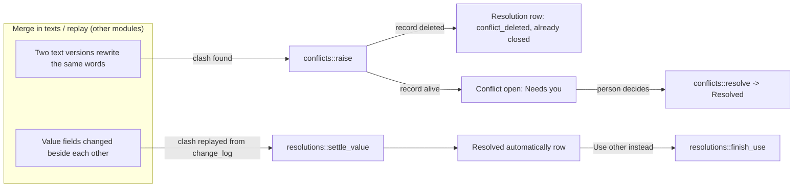
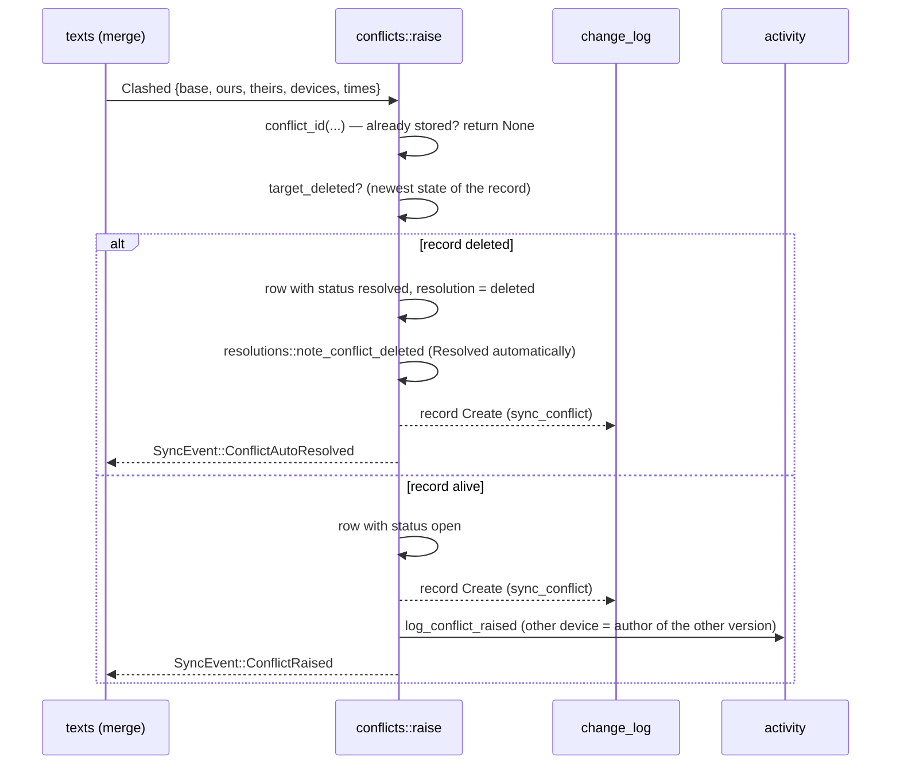
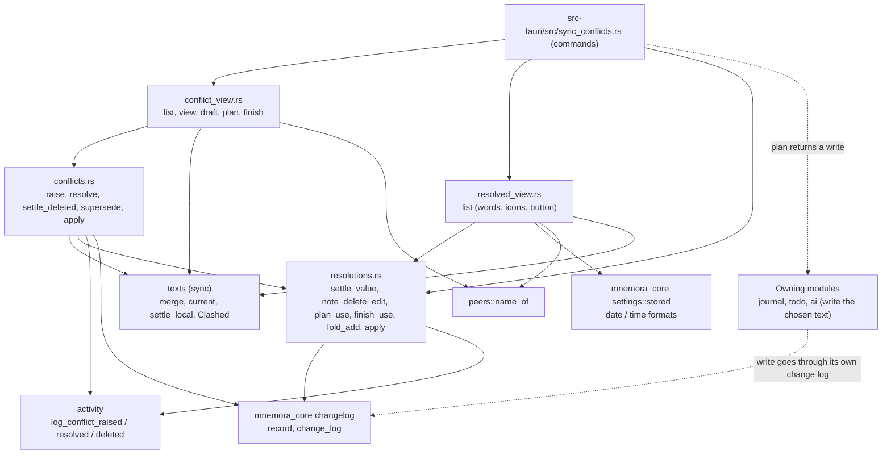
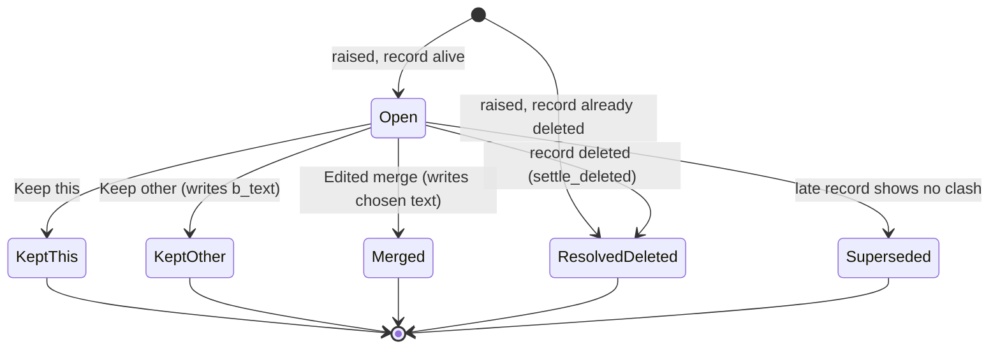

# sync_conflicts

The `sync_conflicts` module is the part of the sync engine that decides what a person must look at after two devices changed the same thing, and what the engine settles on its own. It owns three things: **Conflicts** (two devices rewrote the same words, and the older version waits to be compared), **Resolved automatically** (a log of decisions Sync made without asking), and the **view models** that the Conflicts tab and the Compare screen draw. It lives in `crates/sync/src/` and is exposed to the UI through the commands in `src-tauri/src/sync_conflicts.rs`.

Read [sync_engine.md](sync_engine.md) first for the merge model, the change log and the Module contract (`apply`, `settle`). The activity lines written here are rendered by [sync_activity.md](sync_activity.md). The surfaces that draw these rows live in [Sync_Client_Surface.md](../Sync_Client_Surface.md).

## Scope at a glance

| Concern | Source file | Storage / entity |
| --- | --- | --- |
| A text clash becomes a Conflict; Keep this / Keep other / Merged resolution | `crates/sync/src/conflicts.rs` | `sync_conflicts`, change-log entity `sync_conflict` |
| Compare view, Edit-merged draft, resolution planning | `crates/sync/src/conflict_view.rs` | read-only over the above |
| Automatic decisions (value clashes, delete-vs-edit, Inbox moves, deleted-record clashes, folded order/preference lines) | `crates/sync/src/resolutions.rs` | `sync_resolutions`, entity `sync_resolution` |
| "Resolved automatically" list with words, icons and the "Use ‹other› instead" button | `crates/sync/src/resolved_view.rs` | read-only over the above |
| Tauri commands | `src-tauri/src/sync_conflicts.rs` | — |
| Tests | `src-tauri/src/sync_conflicts_tests.rs`, `src-tauri/src/sync_resolutions_tests.rs` | — |

## The two kinds of "something to look at"

The distinction drives the whole module:

- **Conflict** — a *text* clash that a person must decide. Two devices rewrote overlapping words of the same field of the same record (a Journal entry text, a Task title or notes, a Comment body, a Conversation title, a Saved question). The merge in `texts` has already put the newest version in the record, so every device shows the same text. The other version waits here until the person chooses.
- **Resolution** (Resolved automatically) — a decision the engine made without asking, kept as a log so the person can read it and, for some kinds, change it back. Examples: a Priority set differently on two devices (newest took), a Task deleted on one device and edited on another, a Task moved to the Inbox because its List was deleted elsewhere, and a text clash on a record that is already deleted.

## Conflicts

### Data model

A Conflict is one row of `sync_conflicts` (`conflicts::Stored`):

- **What it is about**: `target` (change-log entity, such as `journal_entry`, `todo_task`, `todo_comment`, `ai_conversation`, `ai_saved_question`), `target_id`, `field`.
- **Three texts**: `base` (what both devices started from), `a_text` / `a_device` / `a_at` (the newest version, the one applied), `b_text` / `b_device` / `b_at` (the other version).
- **Outcome**: `status` (`open` or `resolved`), `resolution`, `resolved_at`, `resolved_by`.

The Conflict is synced as change-log entity `sync_conflict` using the `CONFLICT` schema. Everything except the outcome is fixed at creation. The four outcome fields form one atomic group (`OUTCOME`), so a resolution reads as a whole on every device. The outcome only ever moves from open to resolved; `apply` will never reopen a row.

### Identity

`conflicts::conflict_id` derives the id with UUIDv5 from the record, the field, the hash of `base` and the **sorted** hashes of the two versions. Every device that meets the same clash therefore makes the same row, whichever side it calls its own. A device that learns of a clash from another device finds the row already present (`INSERT OR IGNORE`). A unit test in `conflicts.rs` pins this property.

### Raising a Conflict

`conflicts::raise` is called by the merge when it finds a clash in a text field:

The "other device" in the activity line is the author of the version that did not win, computed as the side that is not this device.

### Settling without asking

Two helper paths keep the list correct even when no record arrives from another device:

- `settle_deleted` (for one record) and `settle_all_deleted` (run before listing or counting) resolve every waiting Conflict whose record has been deleted, with `Resolution::Deleted`, and log a conflict-deleted activity line. This covers deletes made on the *same* device, which never pass through the receiving side.
- `supersede` closes Conflicts about a field whose text, replayed from all of its records, no longer produces them. A late record can show that a clash was never one. Such rows get `Resolution::Superseded` on every device, because all devices replay the same records.

### Resolutions

`Resolution` (`conflicts.rs`) is the outcome stored on a Conflict:

| Variant | Stored as | Set by |
| --- | --- | --- |
| `KeptThis` | `keep_this` | the person, "Keep this" |
| `KeptOther` | `keep_other` | the person, "Keep other" |
| `Merged` | `merged` | the person, Edit merged |
| `Deleted` | `deleted` | automatic: the record was deleted |
| `Superseded` | `superseded` | automatic: replay shows no clash |

Only the first three are person decisions and are written to Activity (`log_conflict_resolved`). Automatic ones are not.

### Planning and finishing a decision

Resolving is two steps, so the app writes the text through the owning Module (which keeps its own validation and change logging):

1. `conflict_view::plan(conn, id, choice)` returns the optional `ConflictWrite` (entity, id, field, text) and the `Resolution` to record:
   - `KeepThis` → no write, `KeptThis`.
   - `KeepOther` → writes `b_text`, `KeptOther`.
   - `Merged { text }` → writes the given text, `Merged`.
   - Errors if the Conflict is gone or already resolved (for example, it was resolved on another device).
2. The app performs the write, then `conflict_view::finish` calls `conflicts::resolve`, which updates the row only while it is open and records an `Update` change so the decision reaches the other devices.

Because the decision itself is a change, resolving on one device clears the Conflict on all of them.

### Compare and Edit merged

`conflict_view::view` builds the Compare screen for one Conflict:

- `showing` and `other`: the two texts with differing words marked (`textmerge::diff`).
- `original`: the `base` text.
- `pieces`: the three-way merge of `base`, `b_text` and the **current** showing text, split into `Agreed` text and `Clash` entries (showing words, other words, original words).

The showing side is read from the record now (`showing_now`), not from `a_text`. That is why an edit the person makes after the Conflict was raised is kept in the merge.

`conflict_view::draft(conn, id, choices)` builds the Edit-merged starting text. Each clash takes a `ClashChoice`: `Showing`, `Other` or `Both` (newer words first, separated by a space or a newline). A clash without a choice takes `Showing`.

## Resolved automatically

`resolutions.rs` holds the automatic decisions. Each row (`resolutions::Row`) has a `kind`, the target record and field, the `kept` and `replaced` values with the devices that made them, an `extra` string for kind-specific data, the moment decided (`at`), the outcome (`used_at`, `used_by`), and `learned_at` (when this device first had it, used for "new" badges).

| Kind | Meaning | How it is produced |
| --- | --- | --- |
| `Value` | Two devices changed a value beside each other; the newest took | `settle_value` after each stored record, using `replay_clashes` |
| `DeleteEdit` | A record was deleted on one device and edited on another without seeing the delete | `note_delete_edit` |
| `TaskInbox` | A Task was moved into a List that is deleted here; it landed in the Inbox | `note_task_inbox` |
| `ConflictDeleted` | A text clash on a deleted record (also linked to the Conflict in `extra`) | `note_conflict_deleted` |
| `OrderPrefs` | Order keys and Preferences taken in one sync session, folded into one line | `fold_add` |

### Why clashes are replayed, not stored

A value clash is a property of the *records*, not of the order they arrived in. `replay_clashes` walks the change-log records of one unit (a field or a group of fields) in clock order (`hlc_ms`, `hlc_counter`, device). A record whose previous value differs from what the replay currently holds was written **beside** the one before it (its author had not seen it), so the two are a clash, unless both chose the same essential value. The essence rule ignores the exact moment a Task was completed and treats deletion as a boolean.

Because the decision is recomputed from the stored records, the log is the same on every device whatever order records arrive in. A late record can remove a row (`settle_value` deletes held rows that are no longer produced), and a row that the person has used (`used_at` set) is never removed.

`settle_local` covers the case where a device's *own* record was made from a value other than the one the replay holds. Its own changes do not pass through the receive path, so the scan runs over the change-log rows written since the last mark (`sync_local_settled`).

`apply` (Sync's side of the Module contract) takes remote Resolution records with a special rule: derived rows (`Value`, `DeleteEdit`) are **not** taken as they are. They are rebuilt from the creation record, because a copy made elsewhere may rest on records this device lacks. Only the outcome (`used_at`) is taken from the update.

### Delete versus edit

`note_delete_edit` finds the newest delete of a record and the first edit by another device that the delete's author had not seen. The author is known from the delete's `seen` map (which records what each device had held) or from a later clock. The row is keyed by the delete's stamp, so whichever clock is later, the line is the same. A restore after the delete clears the line, and `refresh_delete_edits` re-judges lines when a newer local delete appears.

### Use "‹other›" instead

Only `Value` rows can be used:

1. `resolutions::plan_use` returns a `UsePlan` (entity, id, unit, and the `replaced` values to write back). It refuses rows that are gone, already used, or not `Value`.
2. The app writes the values through the owning Module.
3. `resolutions::finish_use` sets `used_at` and `used_by` and records an `Update` change.

`can_write_back` in `resolved_view.rs` decides whether the button is offered at all: Task priority, when, list; List name, emoji, sort and grouping; Journal page date; a Task's status **unless the Task repeats** (closing a repeating Task has its own commands). Deletions are never offered.

### Words for the person

`resolved_view::list` converts rows into `ResolvedRow` values for the screen. Raw values are stored (they travel between devices); words are produced on read, so a change to the date or time format Preference (`core.date_format`, `core.time_format`) or to a device's name applies to the whole log at once. Dates and times are written by a small civil-calendar helper; names come from the current state of the record, and a device that is no longer paired reads as "Another device".

## Component interaction

Key direction rules:

- `conflict_view` and `resolved_view` only *read* and format; they never write text. The app performs the write through the owning Module.
- `conflicts` and `resolutions` write rows and record them as changes so the other devices see them.
- Activity lines are written only for person decisions and for raised or deleted clashes. Automatic outcomes stay out of Activity (see [sync_activity.md](sync_activity.md)).

## Lifecycle of a clash, end to end

Each transition to a resolved state is one `Update` change, so an open Conflict cleared on one device disappears from the others on the next sync. Resolving an already-resolved Conflict is refused with a plain message.

## Invariants

- **Deterministic ids.** Conflict and resolution ids come from content, never from a counter or a random value, so devices converge without coordination.
- **Forward-only outcomes.** A Conflict moves from open to resolved, once. A resolution's "used" moves from unused to used, once.
- **Derived rows are recomputed.** Value and delete-edit rows are a function of the stored records; they are never trusted from a remote copy.
- **Nothing logged as text or value.** Both modules state this in their headers; log lines carry only counts, kinds and booleans.
- **Activity matches decisions.** Only person choices and raised or deleted clashes produce Activity lines.

## Tests

The behaviour is pinned by `src-tauri/src/sync_conflicts_tests.rs` (for example, `overlapping_edits_raise_one_conflict_on_both_devices_and_the_newest_shows`, `edit_merged_keeps_an_edit_made_outside_the_clash_after_the_conflict_was_raised`, `three_devices_agree_on_the_text_and_the_conflict_whatever_order_they_sync_in`, `a_conflict_raised_before_the_entry_was_deleted_is_resolved_on_both_devices`) and `src-tauri/src/sync_resolutions_tests.rs` (for example, `a_delete_met_by_two_edits_is_one_row_the_same_on_three_devices_in_any_order`, `use_other_is_an_ordinary_new_change_that_syncs_and_reads_as_a_history_line`, `rows_are_new_until_the_log_is_visited_and_new_again_when_more_arrive`). The sync data and merge fixtures are covered in [sync_data_merge](sync_engine.md) and `src-tauri/src/sync_merge_fixture_tests.rs`.

## Dependencies and related modules

- **Sync engine core** — [sync_engine.md](sync_engine.md): `texts` (merge, `Clashed`, `current`, `settle_local`), `registry` (schema lookup), `wire` (records), `rename::ENTITY` (device Address exemption), and `settings::ENTITY` (preferences).
- **Sync activity** — [sync_activity.md](sync_activity.md): receives the `log_conflict_*`, `log_*` calls and renders them as lines.
- **Devices and names** — [Sync_Connectivity_and_Pairing.md](../Sync_Connectivity_and_Pairing.md): `peers::name_of` for the device names shown in rows.
- **Owning Modules** — [Task_and_Journal_Domain_Services.md](../Task_and_Journal_Domain_Services.md) and [Feature_Client_UI.md](../Feature_Client_UI.md) (journal, todo, AI): they hold the records and do the writes that resolutions ask for.
- **Data foundation** — [Data_Foundation.md](../Data_Foundation.md): the change log (`changelog::record`), settings lookup, and the physical clock (`physical_now`).
- **Front end** — [Sync_Client_Surface.md](../Sync_Client_Surface.md): the Conflicts tab, Compare flow and Activity views that consume the view models above.
- **Host** — [Tauri_Host_and_IPC_Bridge.md](../Tauri_Host_and_IPC_Bridge.md): command registration and events (`SyncConflictsEvent`).

## Maintenance notes

- Adding a new field that can clash: give it a `SyncField::value` in its Module's schema, and add its words to `unit_words` / `value_words` in `resolved_view.rs`, or the row will show a humanised key.
- Adding a new Use-other target: extend `can_write_back` and make sure the owning Module exposes a write that goes through its own validation.
- Never add text or values to a log line or to a `tracing` call in this module.
