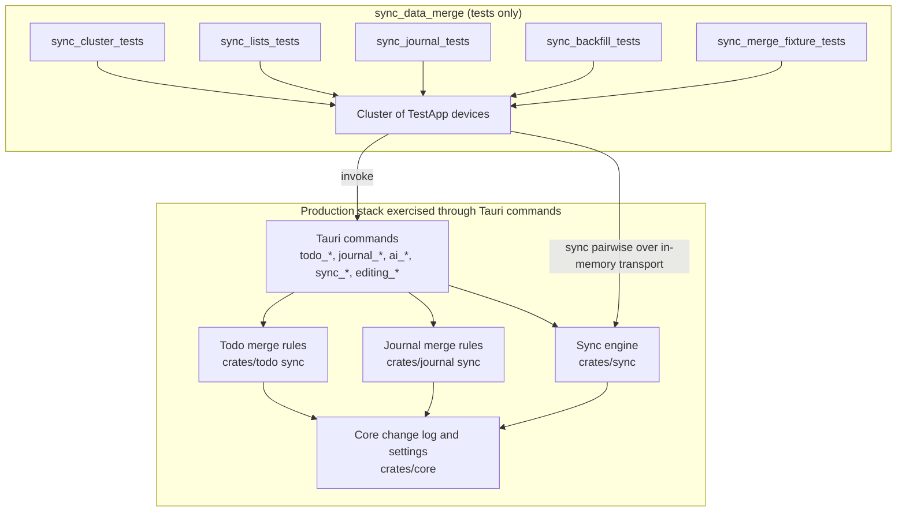
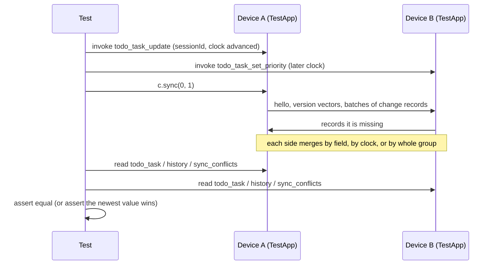

# sync_data_merge

## Introduction

`sync_data_merge` is the test suite that proves Mnemora's sync engine merges data correctly across devices. It contains no production code. Each test builds a `Cluster` of several devices (each a `TestApp` with its own SQLite database), drives every change through the same Tauri commands the app uses, synchronises the devices pairwise over the sync crate's in-memory transport, and then reads the result back through commands.

The suite covers five areas:

| Area | Source file | What it proves |
|---|---|---|
| Todo convergence scenarios | `src-tauri/src/sync_cluster_tests.rs` | Task fields, When groups, order keys, History, deletes, repeats, the sync engine's session and batch behaviour, and a seeded random convergence run over Tasks, Lists, Comments, Journal Entries, AI data and Conflicts |
| Lists, Comments and Preferences | `src-tauri/src/sync_lists_tests.rs` | List name clashes, Tasks moved into deleted Lists, Comments on deleted Tasks, per-key Preference merges, and look-and-feel staying per device |
| Journal Entries and held edits | `src-tauri/src/sync_journal_tests.rs` | Entry propagation, page-date and text merges, holding remote changes while an editor is open, lease expiry, and Undo after remote edits |
| First-merge backfill | `src-tauri/src/sync_backfill_tests.rs` | Rows that the change log never recorded (DV1, DV10) still reach the other device, and Preferences without history are ordered correctly |
| Shared merge fixture | `src-tauri/src/sync_merge_fixture_tests.rs` | Every case of `sync-merge-rules.json` runs on two real devices, so the Rust engine and the browser mock's TypeScript copy cannot drift |

## Architecture overview

The suite is a black-box harness on top of the production sync stack. The sync logic itself lives in the `Sync_Replication_Engine` module, and the Todo and Journal merge rules live in the domain crates.

## How a scenario runs

Every test follows the same shape: write on one device, sync, read back on all devices, and assert that the worlds match.

Key conventions used throughout the suite:

- **Clocks are explicit.** Tests call `clock().advance(ms)` or `clock().freeze(ms)` on each device so "later" is deterministic. Some tests sleep to make UUIDv7 list ids ordered.
- **Sessions identify editing sessions.** Repeated `sessionId` values model one open sheet saving several times, which the engine records as one rewritten row.
- **Cuts test resumption.** `c.try_sync(a, b, Some(n))` drops a sync after n messages, and the next sync must resume exactly with no duplicates or gaps.
- **Convergence is checked on the whole world.** `world()` in `sync_lists_tests` and `sync_merge_fixture_tests` dumps Lists, Tasks, Comments, Preferences, Entries, AI data and order keys so two devices can be compared in one assertion.

## Sub-modules

The suite is split by the area each file exercises. Each sub-module page describes its scenarios and the shared helpers it depends on.

- [sync_data_merge_todo_convergence](sync_data_merge/sync_data_merge_todo_convergence.md): Todo Task merging, History, repeats, the sync session engine, and the seeded random convergence run.
- [sync_data_merge_lists_and_preferences](sync_data_merge/sync_data_merge_lists_and_preferences.md): List name clashes, deleted Lists, Comments, Preferences and the three-device delivery-order matrix.
- [sync_data_merge_journal_holds](sync_data_merge/sync_data_merge_journal_holds.md): Journal Entry sync, held remote edits while an editor is open, lease expiry, and Undo.
- [sync_data_merge_backfill](sync_data_merge/sync_data_merge_backfill.md): First-merge backfill of rows that the change log does not record.
- [sync_data_merge_fixture_cases](sync_data_merge/sync_data_merge_fixture_cases.md): Runs the shared `sync-merge-rules.json` fixture on two real devices.

## Related modules

- [Sync_Replication_Engine](../Sync_Replication_Engine.md): the engine whose merge behaviour these tests verify.
- [Data_Foundation](../Data_Foundation.md): the change log, settings and syncable entities the merges rely on.
- [Task_and_Journal_Domain_Services](../Task_and_Journal_Domain_Services.md): the Todo commands and Task semantics the scenarios drive.
- [Sync_Connectivity_and_Pairing](../Sync_Connectivity_and_Pairing.md): pairing and transport used to set up clusters.
- [Sync_Client_Surface](../Sync_Client_Surface.md): the Conflicts and Activity screens that scenarios read through commands.
- [AI_Assistant_Engine](../AI_Assistant_Engine.md): the Conversations and Saved questions checked in the random convergence run.
