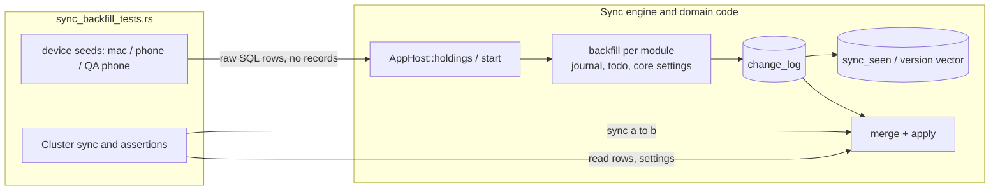
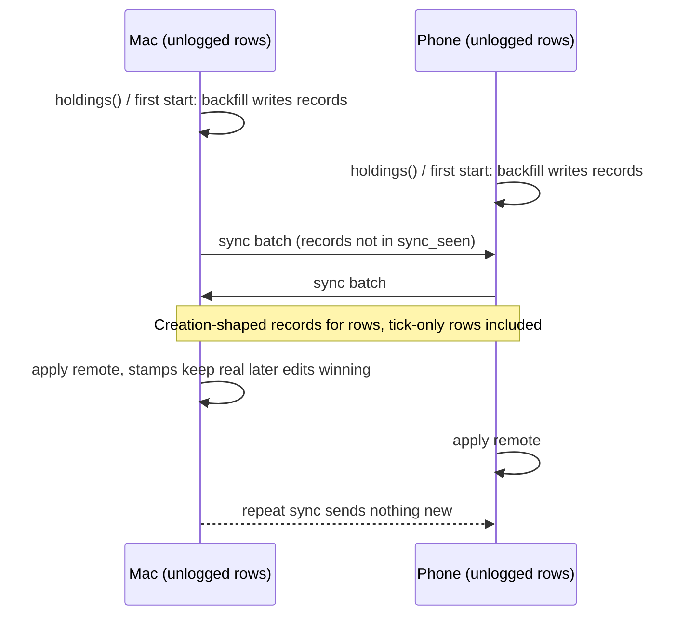

# sync_data_merge_backfill

This module holds the regression suite for the **first-merge backfill**: the step that makes rows written before a device's change log existed (or written around it with raw SQL) reach the other device on the first sync. It is a test-only module. The behaviour it pins down is implemented in the sync engine and in each domain crate's `backfill` code, which this page references but does not reproduce.

Parent: [sync_data_merge](../sync_data_merge.md) · Engine overview: [Sync_Replication_Engine](../../Sync_Replication_Engine.md)

## Purpose at a glance

| Question | Answer |
|---|---|
| What problem does it cover? | Data that exists in SQLite but has no (or only partial) records in `change_log` must still merge correctly and reach every paired device. |
| Where is the behaviour? | The backfill runs from `AppHost::holdings()` and sync start; domain pieces are in `crates/journal/src/sync.rs`, `crates/todo/src/backfill.rs`, `crates/core/src/changelog.rs` and `crates/core/src/settings/sync.rs` (see [Data_Foundation](../../Data_Foundation/core.md)). |
| What is tested here? | Ten scenarios in `src-tauri/src/sync_backfill_tests.rs`, run on a `Cluster` of `TestApp` devices. |
| What it does not cover | Ordinary edit-to-edit merge rules ([sync_data_merge_todo_convergence](sync_data_merge_todo_convergence.md), [sync_data_merge_lists_and_preferences](sync_data_merge_lists_and_preferences.md)), held editors ([sync_data_merge_journal_holds](sync_data_merge_journal_holds.md)), and the fixture cases ([sync_data_merge_fixture_cases](sync_data_merge_fixture_cases.md)). |

## Background: why a backfill exists

Sync replicates by reading `change_log` records, each carrying an origin device, a sequence number and a hybrid clock stamp. Rows created before the log existed, or inserted directly by SQL, have no record. A device that only sends its log therefore sends nothing for them, and the other device never learns they exist.

The backfill closes that gap once per database: it writes missing records for rows the log does not describe, stamped so that they never override a real later edit. The change log is the only way data travels, so the backfill's output is ordinary records that the normal merge handles.

## Component map

The helpers in the test file make the "no log history" state explicit:

- `device(seed)` builds a `TestApp` with Sync on, using `TestApp::upgrading`, so the seed is written to a freshly migrated database and **not** to the log.
- `list`, `task`, `comment`, `entry`, `pref` insert rows with raw SQL, including deleted rows, occurrences (`repeat_of` set, state `done`) and preferences in the `settings` table.
- `own_records(app)` counts `change_log` rows from this device that are not `sync` module rows. A value of `0` is the bug's setup.
- `holdings(app)` returns the preview counts (entries, tasks, lists) that the merge preview shows, so tests can check the preview matches what is sent.
- `ticked_task` and `qa_phone` reproduce rows whose only log entries are `tick` records (no `create`, no `fields`).

## Scenarios

### 1. Unlogged rows reach the other device at the first sync

`rows_without_any_log_history_reach_the_other_device_at_the_first_sync`

- Mac holds one List-free Inbox Task plus a Home List with a Task, a repeating occurrence and a deleted Task in an old List, two Comments (one deleted), two Entries (one deleted) and three Preferences. Phone holds a Groceries List, a Task, a deleted Task, a Comment and an Entry, plus a newer `week_start`.
- Before sync `own_records == 0`.
- The preview counts (`holdings`) match what the merge sends; after two syncs both devices hold identical rows.
- Deleted rows and their Comments stay deleted but present.
- Preferences: the newest per key wins (`week_start` = `"mon"` from the phone); `time_format` set only on the Mac survives.

### 2. Repeat starts and syncs add nothing

`a_second_start_or_sync_adds_nothing_and_logged_rows_get_no_synthetic_records`

- After the first sync both devices have logged rows (`> 0`). Further syncs in either direction leave the record counts unchanged.
- Rows created through the app (`todo_list_create`, `todo_task_create`, comments, priority) already have records; a sync adds no synthetic records for them.

### 3. Partially logged rows send what the log lacks

`a_row_whose_log_is_partial_sends_what_the_log_lacks`

- A Task and List are created through the app (logged), then changed by SQL (title, priority, list move, List rename) without logging.
- After one sync the receiving device has the new title, priority and list, and the rows match.

### 4. A synthetic record never beats a real later edit

`a_synthetic_record_does_not_beat_a_real_later_edit`

- Mac has an unlogged Task; after sync the phone makes a real priority edit later than the row's own time.
- The edit arrives on both devices; the title, which came from the synthetic record, is unchanged.

### 5–7. Unlogged Preferences against logged or unlogged rivals

- `an_older_unlogged_preference_loses_to_a_newer_logged_one`: an unlogged `time_format` on the Mac loses to a logged `24h` edit on the phone.
- `an_old_unlogged_preference_loses_to_a_newer_edit_on_another_device_whatever_this_one_logged_since`: the Mac logged other Preferences much later; the old unlogged value must **not** be stamped up to the Mac's newest record. The phone's edit wins.
- `of_two_unlogged_values_the_one_written_last_wins_whatever_else_each_device_logged`: both devices have unlogged values; the one written later (by its row time) wins regardless of how much each device has logged since.

These three pin the rule that a backfilled stamp reflects the row's own time, not the device's current clock or log head.

### 8. Rows with only tick records

`rows_with_only_tick_records_reach_the_other_device`

The QA phone's Tasks were written by SQL with only `tick` records (the change log stores a whole-row snapshot, no `fields`). One Task was ticked done and is still done; another was ticked done and then reopened around the log, so the row is `open` but the log says `done`. A third has no record.

Expected result on the Mac after sync: `q-plain:open`, `q01:open`, `t01:done`, and identical rows on both devices. A repeat sync writes nothing more.

The test comment explains why this matters: a receiver can only build a Task from a `create` record. `tick` records and `update`s of differing fields are not enough, so the backfill must emit a creation-shaped record for the full row.

### 9. A receiver that already holds the ticks still gets the row

`a_receiver_that_already_holds_the_tick_records_without_the_row_still_gets_it`

The Mac already has the phone's tick records in its change log, stored for relay but never applied, and its version vector (`sync_seen`) claims it has them. The row must still arrive. Without this, a version vector that covers the ticks would suppress the only record that could create the Task.

### 10. Large database backfills once and quickly

`a_large_database_joins_the_log_once_and_quickly_and_a_repeat_writes_nothing`

- 3,000 unlogged Tasks inserted in one transaction.
- The first `holdings()` call backfills them (`own_records == 3000`); a second call writes nothing more.
- Timing is logged with `eprintln!` and asserted loosely (first under 60 s, repeat under 30 s).

## Helper: `seed_unlogged`

`pub(crate) fn seed_unlogged(c: &Cluster, devices: usize)` gives each device a List, a Task, an occurrence, a deleted Task, a Comment, an Entry and a `week_start` Preference with device-specific timestamps. It is used by the convergence runs in sibling modules and must be called before devices first sync.

## Data flow of a first sync

Key invariants the tests enforce:

1. **Completeness:** after the first sync, the rows on both devices are equal, including deleted rows and their Comments.
2. **Idempotence:** backfill runs once per row; later starts and syncs add no records.
3. **No overreach:** synthetic records never override a real edit made later.
4. **Creation before change:** a row only becomes visible on a receiver through a creation-shaped record.
5. **Relay safety:** a version vector that claims records the receiver has not applied must not suppress the row.

## Relationship to other modules

- Sync transport, pairing and version vectors: [Sync_Replication_Engine](../../Sync_Replication_Engine.md), [sync_engine](../sync_engine.md).
- Rules for conflicting edits applied after backfill: [sync_conflicts](../sync_conflicts.md).
- Domain data shapes: [todo](../../Task_and_Journal_Domain_Services/todo.md), [journal](../../Feature_Client_UI/journal.md), and [core](../../Data_Foundation/core.md) / [core_settings](../../Data_Foundation/core_settings.md).
- Pre-upgrade databases that get this backfill on first launch: [legacy_data_migration](../../Data_Foundation/legacy_data_migration.md).
- Pairing and the merge preview that shows the `holdings` counts: [Sync_Connectivity_and_Pairing](../../Sync_Connectivity_and_Pairing.md).

## Running the tests

These are Rust tests in the Tauri crate. Use the project's test target (`make test`, see [Build_and_Packaging](../../Build_and_Packaging.md)); on the resource-constrained dev machine run `CARGO_BUILD_JOBS=2 cargo test` for the single module, not the whole workspace at once.

## Limits of this document

The page describes behaviour from the test names, comments and assertions in `sync_backfill_tests.rs`. The implementation of the backfill functions was not read here; check [sync_engine](../sync_engine.md) and the domain backfill modules before relying on internal details such as the exact stamp formula.
