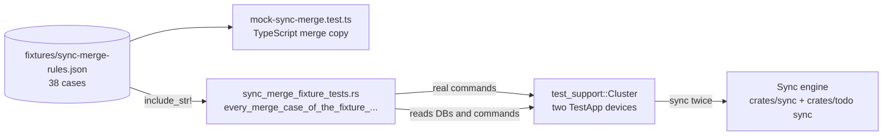
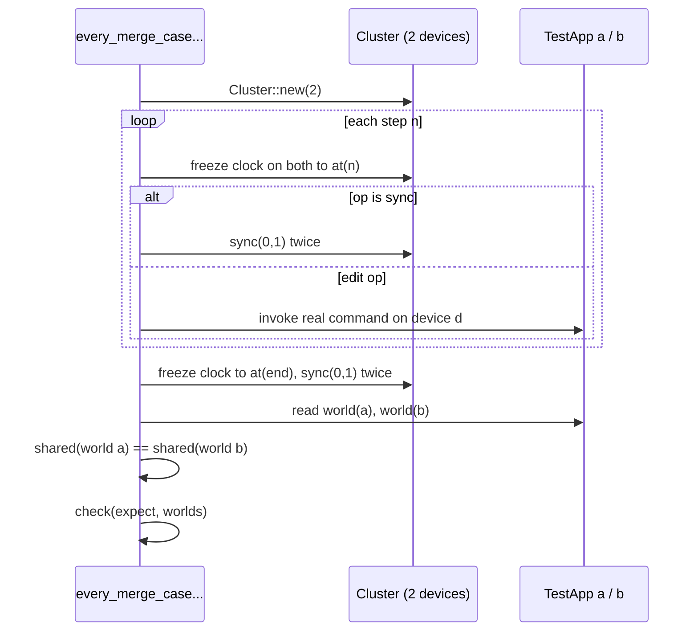
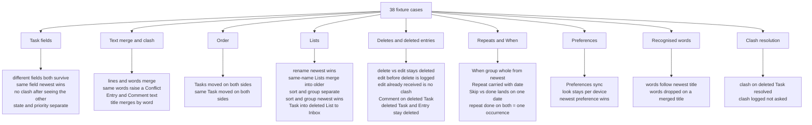

# sync_data_merge_fixture_cases

This module is the Rust side of the shared merge-case fixture. It loads `src/lib/ipc/fixtures/sync-merge-rules.json`, plays every case against two real devices (two app databases joined by the real sync engine), and checks the result against each case's `expect` block. The same JSON file is also run by the browser mock's TypeScript merge (`mock-sync-merge.test.ts`), so the Rust engine and the mock cannot drift apart (ADR 0009).

The module is a single test, `every_merge_case_of_the_fixture_holds_on_two_real_devices`, in `src-tauri/src/sync_merge_fixture_tests.rs`. It has no production code. For what the merge rules mean, see the parent [sync_data_merge](../sync_data_merge.md) page. For the engine that actually moves and merges records, see [Sync_Replication_Engine](../../Sync_Replication_Engine.md).

## Purpose

- Pin the merge behaviour of Sync as data, not as scattered per-feature tests. Each case is a short script of edits on device `a` or `b`, followed by a final sync.
- Prove that two devices end up identical after the merge (the "shared" world) and that the outcome matches the `expect` block.
- Keep Rust and the TypeScript mock on the same cases.

The sibling modules cover the same behaviour by theme: [todo convergence](sync_data_merge_todo_convergence.md), [lists and preferences](sync_data_merge_lists_and_preferences.md), [journal holds](sync_data_merge_journal_holds.md), and [backfill](sync_data_merge_backfill.md). The fixture cases are the cross-cutting, table-driven view of the same rules.

## Where it sits

Only the Rust path is covered here. The `include_str!` path is relative to the test file, so the fixture is compiled into the test binary; a change to the JSON reruns both suites.

## Fixture format

The JSON has an `about` string (the authoritative op list) and a `cases` array. Each case is:

| Key | Meaning |
|---|---|
| `name` | Human-readable case name, reported in assertion messages. |
| `steps` | Ordered list. Each step is `{ "d": "a" \| "b", "op": ... }` or `{ "op": "sync" }`. |
| `expect` | Only the facts this case is about (see below). |

Ops understood by the runner:

| Area | Ops |
|---|---|
| Lists | `list_create`, `list_rename`, `list_sort`, `list_group`, `list_delete` |
| Tasks | `task_create`, `task_edit`, `task_title`, `task_priority`, `task_when`, `task_skip`, `task_done`, `task_move`, `task_delete`, `task_place` |
| Comments | `comment_add`, `comment_edit` |
| Journal entries | `entry_create`, `entry_edit`, `entry_delete` |
| Preferences | `pref` |
| Sync | `sync` |

Labels such as `t1`, `l1`, `c1`, `e1` are test-side names. The runner maps each label to the real UUID the first time it is created, and the same label works on both devices because the ids travel with the records.

`expect` keys, checked by `check()`:

| Key | What is compared |
|---|---|
| `tasks` | Per task label: `title`, `notes`, `priority`, `due_date`, `due_time`, `state`, `list`, `deleted`, `understood`, and the `repeat_*` fields. |
| `comments` | Per comment label: `task`, `body`, `edited`. |
| `entries` | Live entries by label to body. |
| `lists` | Live lists by label to name. |
| `arrange` | Live lists by label to `{ sort, group }`. |
| `order` | `inbox` or a list label to the open tasks in display order. |
| `occurrences` | Count of live done copies of repeating tasks. |
| `settings` | Shared preferences (look-and-feel keys removed). |
| `device` | Per-device settings, by device `a`/`b`. |
| `conflicts` | Count of open Conflicts (`needs_you`). |
| `resolved` | Sorted list of automatic Resolved kinds, excluding `order_prefs`. |

Any other key is compared directly on both devices.

## How a case runs

Key details of the runner:

- **Shared clock.** Step `n` runs at `Cluster::START + (n+1) * 1000` ms, and both devices are frozen to that instant, so "later" always means a later step. The `at()` helper is the single place this is defined.
- **Two syncs per sync point.** `sync(0, 1)` is called twice each time, so changes that need a second pass (for example, a relayed record) settle inside the step.
- **Real UUIDv7 ordering.** `list_create` and `task_create` sleep 3 ms before creating, so their UUIDv7 ids sort in creation order. This is what makes "the older List" unambiguous in the merge case.
- **Commands, not direct writes.** Each op goes through the same Tauri command the UI uses (`todo_task_create`, `todo_task_quick_edit`, `todo_task_reorder`, `journal_entry_update`, `settings`-style `set_pref`, and so on), so the merge is exercised through production paths.
- **Worlds read back.** `world()` reads the lists, tasks, comments, entries and repeat counts straight from SQLite, reads the order of each list, reads `settings_get_all`, and reads `sync_conflicts` for the open and resolved lists. It turns them into plain JSON keyed by label.
- **Two-level assertion.** First, the shared part of each device's world must be identical (`"the devices differ"`). Then every `expect` entry must hold on both devices. Look-and-feel keys (`core.theme`, `core.density`, `core.text_size`, `core.reduce_motion`, `core.phone_tabs`, `core.phone_tabs_edited`) are removed from the equality check and only checked by `device` expectations.

A deleted task reports `list: null` in the world, because which list a deleted task was in depends on which side's delete arrived first; the case does not assert it.

## Case inventory

The file holds 38 cases. They group by the rule they prove:

Representative cases, with the rule each one pins:

| Case (abridged) | What it proves |
|---|---|
| different fields of one task both survive | Field-level merge: priority on `a` and notes on `b` both stick. No Conflict. |
| the same field changed on both sides: the newest wins and is logged | A same-field clash is resolved by the newer write and recorded as a `value` Resolved entry. |
| a change made after seeing the other is not a clash | Causal ordering: an edit made after a sync is not a conflict. |
| the When group is taken whole from the newest side | Date and time move as one group; no mixing of `a`'s date with `b`'s time. |
| order: the same Task moved on both sides goes where the newest put it | Manual order is last-write-wins per Task. |
| text: edits in different lines / to different words of one line merge | Text is merged by line, then by word, before a Conflict is considered. |
| text: the same words changed on both sides ... raise a Conflict | Overlapping word edits produce `conflicts: 1`, and the newest text shows meanwhile. |
| a List renamed on both sides: the newest name stays | List name is last-write-wins. |
| two Lists with one name merge into the older, Tasks after its own | Same-name Lists (case-insensitive) collapse into the older id; the newer List's Tasks join the end of its order. |
| a Task moved into a List deleted elsewhere lands in the Inbox | A move into a deleted List resolves to the Inbox and logs `task_inbox`. |
| an edit made before a delete ... is logged too | Delete vs edit is a logged Resolved (`delete_edit`), whichever order the devices saw them. |
| an edit the deleting device had already received is no clash | If the deleter already had the edit, nothing is logged. |
| a Comment added to a Task deleted elsewhere stays attached | Comments survive the parent task's delete. |
| a Preference changed on both sides: the newest wins | Shared preferences are per-key last-write-wins. |
| the When group carries its Repeat ... | Repeat is part of the When group and is taken whole. |
| a Skip on one side and a completion on the other land on one next date | Skip and done on the same occurrence produce one next occurrence. |
| a repeating Task completed on both sides is one occurrence | `occurrences` stays at 1; the second completion reuses the same occurrence id. |
| a List sorted / grouped on both sides | Sort and grouping are separate values with separate newest-wins rules. |
| a text clash on a Task deleted by one of the editors ... not asked | A clash on a deleted entry is resolved automatically and logged as `conflict_deleted` (plus `delete_edit`). |
| a deleted Task / Entry stays deleted through later syncs | Tombstones do not resurrect when later records arrive. |

## Interpreting a failure

Messages are built from the case name, so a failure names the case, the key, and the device:

- `"<case>: the devices differ"`: the shared worlds disagree after the final sync. This is a convergence bug.
- `"<case>: <key> on <a|b>"`: a whole-world key (for example `conflicts` or `resolved`) disagrees with `expect`.
- `"<case>: tasks <label>.<field> on <a|b>"`, and similar for `comments`, `order of <list>`, `<setting>`: a specific field is wrong.

Because every step is a real command, a failure can come from a command's own precondition (for example, `task_place` panics if the target task is not in the list, and `ids.get` panics on an unknown label). Those are runner bugs in the JSON, not merge bugs.

## Adding a case

1. Add an object to `cases` in `src/lib/ipc/fixtures/sync-merge-rules.json` with a unique `name`.
2. Use only the ops in the table above; use fresh labels for new records.
3. Put only the facts the case is about in `expect`. Missing keys are not checked.
4. Run the Rust test (`every_merge_case_of_the_fixture_holds_on_two_real_devices`) and the mock test `mock-sync-merge.test.ts`. The case must pass in both, which is the point of sharing the file.

If the case needs an op that does not exist, add the arm to `step()` in the test file and to the mock's runner, and document it in the fixture's `about` string.

## Constraints and notes

- The runner uses `Cluster` from `src-tauri/src/test_support.rs` and `TestApp` helpers (`invoke`, `with_db`, `set_pref`, `clock().freeze`). These are not documented here; they live with the test harness.
- The runner has two `#[allow(clippy::too_many_lines)]` attributes, one on `step()` and one on `world()`, because each is one match arm per fixture op or per `expect` section.
- `sync(0, 1)` is hard-wired to two devices; `Cluster::new(2)` is the only size used.
- `world()` removes `resolved` entries of kind `order_prefs` before comparing, so order-preference bookkeeping does not affect the expectations.
