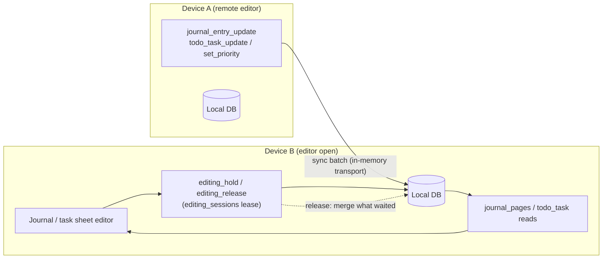
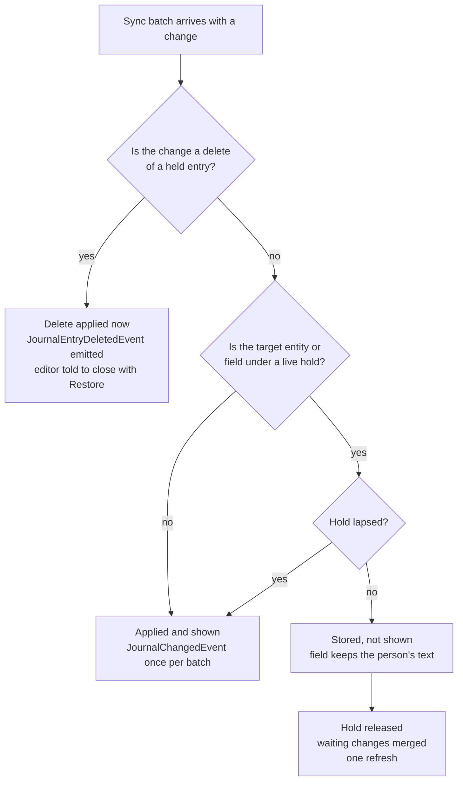

# sync_data_merge_journal_holds

This module documents the sync scenarios that cover Journal entries and Task-sheet fields **while a person is typing in them**. When a remote device changes an entry or a task field that is open in an editor, the local device *holds* that field: it keeps the person's text on screen, does not overwrite it, and applies the remote change once the editor lets go. The module is covered entirely by Rust integration scenarios in `src-tauri/src/sync_journal_tests.rs`. It is a test-only module; the production code it exercises lives in the editing-hold command surface and the sync engine (see [Sync_Replication_Engine](../sync_engine.md) and [Tauri_Host_and_IPC_Bridge](../../Tauri_Host_and_IPC_Bridge.md)).

It sits under [sync_data_merge](../sync_data_merge.md), alongside [sync_data_merge_todo_convergence](sync_data_merge_todo_convergence.md), [sync_data_merge_lists_and_preferences](sync_data_merge_lists_and_preferences.md), [sync_data_merge_backfill](sync_data_merge_backfill.md) and [sync_data_merge_fixture_cases](sync_data_merge_fixture_cases.md). It has no child pages.

---

## 1. Purpose at a glance

| Question | Answer in this module |
|---|---|
| What is held? | An Entry (`journal_entry`) as a whole, or one field of a task (`todo_task` with scope `title` or `notes`). |
| Who holds it? | The editor on the device where the person is typing, via `editing_hold`. |
| What is not held? | Deletes. A remote delete closes the open editor at once. |
| What happens to a remote change to a held field? | It is stored, but not shown until the hold is released (or lapses). |
| What happens to other fields? | They refresh normally (e.g. a task's priority while its title is held). |
| What survives a restart? | Nothing held survives; what waited is merged at start. |
| What if sync is off? | `editing_hold` returns `false`; the editor is told there is nothing to keep renewing. |

---

## 2. Architecture and component relationships

The module has no production code of its own. Each scenario drives real Tauri commands on a `Cluster` of `TestApp` devices (see [Data_Foundation](../../Data_Foundation.md) for the shared core, and [Feature_Client_UI/journal](../../Feature_Client_UI/journal.md) for the screens that call these commands).

Key pieces, as used by the tests:

| Piece | Role |
|---|---|
| `editing_hold(entity, entityId, scope)` | Takes a hold. Returns `bool`: `true` when a hold was taken (sync on), `false` when sync is off. Refuses unknown entities and unknown fields with a `validation` error. |
| `editing_release(entity, entityId, scope)` | Ends the hold and merges whatever waited. |
| `editing_sessions` table | Holds the lease rows. Each has `touched_at`; a hold whose `touched_at` is older than about two minutes is treated as lapsed. |
| `sync_resume` | Foreground return; merges waiting changes when a hold has lapsed. |
| `journal_pages` | The read used to show Journal entries. Used to assert what a person sees. |
| `todo_task` | The read used to assert task fields. |
| `JournalChangedEvent` | Emitted once per applied batch so open Journal views refresh. |
| `JournalEntryDeletedEvent` | Emitted when a remote delete removes an entry that an editor holds, so the window can close the editor and show a toast with Restore. |
| `Cluster` / `TestApp` | Test harness: devices with their own databases, synced pairwise through the sync crate's in-memory transport ([Sync_Connectivity_and_Pairing/sync_transport](../../Sync_Connectivity_and_Pairing.md)). |

Scope strings select what is held:

- `"*"` holds the whole entity (used for Journal entries).
- `"title"` or `"notes"` holds one task field.
- Any other value is a `validation` error for `todo_task`.

Entity constants used: `journal_entry` and `todo_task`.

---

## 3. Hold lifecycle

```mermaid
stateDiagram-v2
    [*] --> Free
    Free --> Held: editing_hold (sync on)
    Free --> Free: editing_hold (sync off, returns false)
    Held --> Held: editing_hold renews lease\n/ local edits saved under own session
    Held --> Free: editing_release\n(merge what waited, refresh once)
    Held --> Lapsed: no renewal for ~2 minutes
    Lapsed --> Free: next sync batch arrives\nor sync_resume merges waiting changes
    Held --> Free: app restart\n(holds never survive; waiting changes merged at start)
```

Rules shown by the scenarios:

1. A hold is per entity, or per field for task sheets. A remote change to a held thing is stored, not shown.
2. Releasing a hold applies the waiting changes in one step and emits one refresh.
3. A lapsed hold ends in one of two ways: a later sync batch arrives, or the app comes back to the foreground (`sync_resume`).
4. A restart drops every hold. Anything that waited is merged at start.
5. The local person's own saves are never blocked by the hold; they are stored under their own editing session.

---

## 4. Decision flow for an incoming change

Notes on the flow:

- Only **held fields** wait. In an open task sheet, the priority refreshes while the title waits (scenario `in_an_open_task_sheet_other_fields_refresh_while_the_field_being_typed_in_waits`).
- A remote **delete** is not held. The person's typed text is kept, and a Restore brings it back on both devices (scenario `an_entry_deleted_elsewhere_while_its_editor_is_open_is_deleted_at_once_and_announced`).

---

## 5. Behaviour by scenario group

### 5.1 Entries travel between devices

- `an_entry_created_moved_edited_and_deleted_on_one_device_does_the_same_on_the_other`: create, move, edit, delete and restore all reach the other device. The moved page date survives a later edit. `word_count` is recomputed on the receiving device.
- `the_page_date_and_the_text_changed_on_two_devices_both_survive`: a move on one device and an edit on the other both stand.
- `a_delete_and_an_edit_on_two_devices_leave_it_deleted_with_the_new_text`: the entry stays deleted; restoring it brings back the edited text.
- `remote_entry_changes_refresh_open_journal_views_through_one_event_per_batch`: one `JournalChangedEvent` per batch; a sync with nothing new sends nothing.

### 5.2 Edited time

- `the_edited_time_is_derived_from_when_the_text_was_changed`: a typo fix within a minute of writing is not an edit (`edited_at` stays null). A later text change sets `edited_at` to the moment it was made, the same on both devices. Ticking a checklist item (`journal_entry_toggle_task`) is never an edit.

### 5.3 Remote edits to held content

- `a_remote_edit_to_an_entry_being_edited_is_applied_only_after_the_session_ends`: the editor does not jump; no event while held; on release, one silent refresh. Nothing is sent back, and the devices end identical.
- `text_saved_during_the_session_after_the_remote_edit_arrived_stands_on_both_devices`: the person's later save wins over the held remote text and is what both devices end on.
- `what_was_held_converges_with_other_changes_that_came_in_meanwhile`: a held entry keeps both its old date and old text; after release both the move and the edit appear, matching the other device.
- `a_device_holding_an_entry_relays_what_it_holds_and_never_claims_it_as_its_own`: a holding device relays the remote text it has *stored* (not the stale text it shows) to a third device, and does not present it as its own change.
- `what_was_held_gives_the_same_edited_time_as_when_it_was_not_held`: the `edited_at` for a held and an unheld receiver match.

### 5.4 Lease and restart

- `a_hold_whose_editor_vanished_ends_when_the_lease_lapses`: after about two minutes without renewal, `sync_resume` merges the waiting text.
- `a_lapsed_hold_also_ends_when_the_next_sync_batch_arrives`: a lapsed hold ends when the next batch arrives.
- `holds_never_survive_a_restart_and_what_waited_is_merged_at_start`: after restart `editing_sessions` is empty and the waiting text is visible.
- `with_sync_off_the_editor_is_told_there_is_nothing_to_keep_renewing`: `editing_hold` returns `false` with sync off and `true` with sync on.
- `an_editor_can_only_hold_something_that_exists_to_be_edited`: unknown entity or field returns `validation`.

### 5.5 Remote delete while an editor is open

- `an_entry_deleted_elsewhere_while_its_editor_is_open_is_deleted_at_once_and_announced`: the entry disappears at once, one `JournalEntryDeletedEvent` carries the entry id and page date, and a Restore keeps the typed text on both devices.

### 5.6 Task sheet fields

- `a_task_field_held_and_then_saved_locally_keeps_the_local_text_everywhere`: the notes held on B are saved locally after A's change; B's text is the one both devices end on.
- `the_dv3_sequence_ends_identical_whatever_order_the_records_arrive_in`: a three-device sequence where a line added elsewhere meets an editing session. The test only pins that the devices converge to the same text, whatever the delivery order.

> **Known open issue (#77).** A line added on another device while notes are held can be lost when the holder keeps typing in the same editing session. The reason is that a record built on a session version that has since been rewritten has a base no record holds. Deciding this from the local change log made devices end in different texts, so the team chose not to work around it in this module. The DV3 test only guarantees convergence, not that the added line survives. Track #77 before relying on this path.

### 5.7 Undo after remote changes

Undo restores only what the undo itself changed:

- `undoing_a_delete_after_a_remote_edit_keeps_the_remote_edit`: restoring an entry keeps the text edited on the other device.
- `undoing_a_move_after_a_remote_edit_puts_back_the_date_and_keeps_the_remote_text`: the date returns; the remote text stays.
- `undoing_a_task_change_after_a_remote_change_to_the_same_task_keeps_the_remote_change`: resetting a priority does not undo a remote title change.

---

## 6. Common pitfalls for maintainers

- **Do not clear holds on the screen only.** The hold lives in `editing_sessions` and must be released through `editing_release`, otherwise remote changes wait until the lease lapses.
- **Keep renewal going.** An editor that stops calling `editing_hold` lapses after about two minutes; the scenarios treat that as the editor having vanished.
- **Edited time comes from the text change, not the sync time.** Do not stamp `edited_at` when a held change is merged; the scenarios check that held and unheld receivers agree.
- **Checklist ticks are not edits.** Toggling a task line must not set `edited_at`.
- **Hold scope must match a known field.** New task fields need to be added to the allowed scope list or `editing_hold` refuses them.

## 7. Related documentation

- [sync_data_merge](../sync_data_merge.md): parent module and the shared merge rules.
- [sync_data_merge_todo_convergence](sync_data_merge_todo_convergence.md): task convergence across devices.
- [sync_data_merge_lists_and_preferences](sync_data_merge_lists_and_preferences.md): list and preference merges.
- [sync_data_merge_backfill](sync_data_merge_backfill.md): change-log backfill for rows that predate logging.
- [sync_data_merge_fixture_cases](sync_data_merge_fixture_cases.md): shared merge fixtures on two real devices.
- [Sync_Replication_Engine/sync_conflicts](../sync_conflicts.md): clashes that are raised when a held edit and a local edit touch the same words.
- [Sync_Replication_Engine/sync_activity](../sync_activity.md): how holds, releases and remote deletes appear in the activity log.
- [Feature_Client_UI/journal](../../Feature_Client_UI/journal.md) and [Task_and_Journal_Domain_Services/todo](../../Task_and_Journal_Domain_Services/todo.md): the screens and domain services that call these commands.
- [Data_Foundation/core](../../Data_Foundation/core.md): the change log and the shared sync record shapes.
