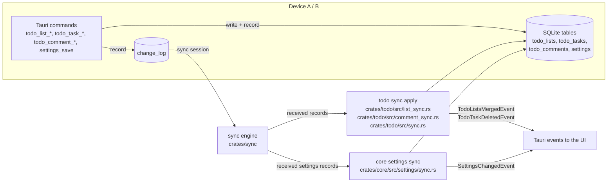
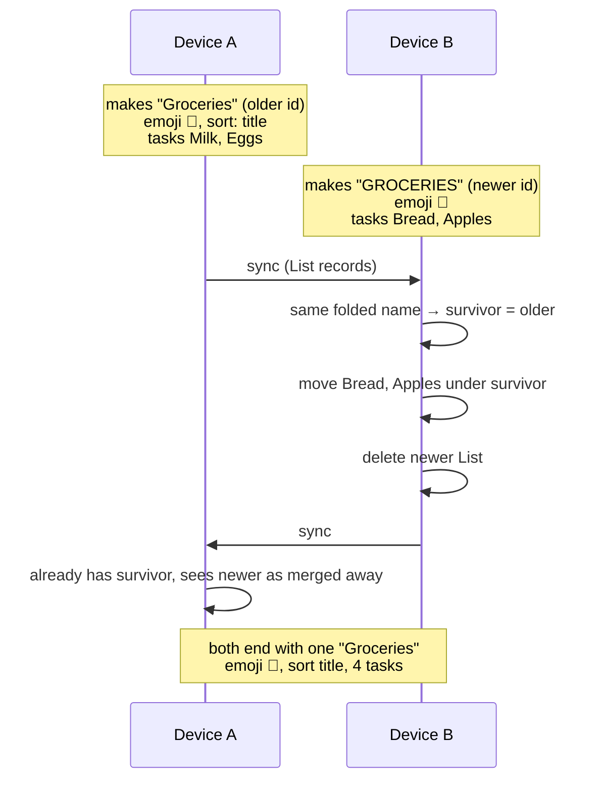
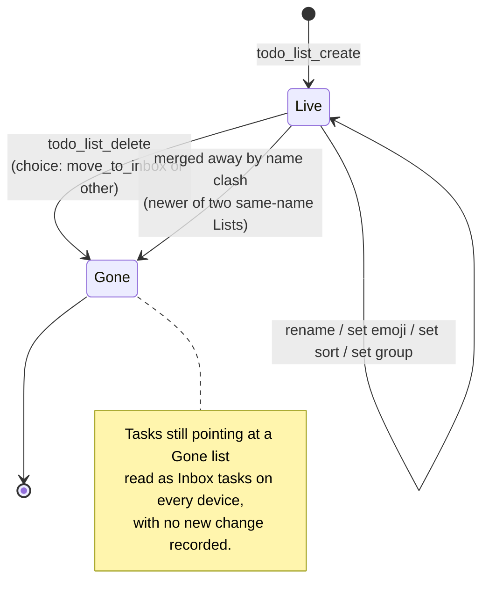
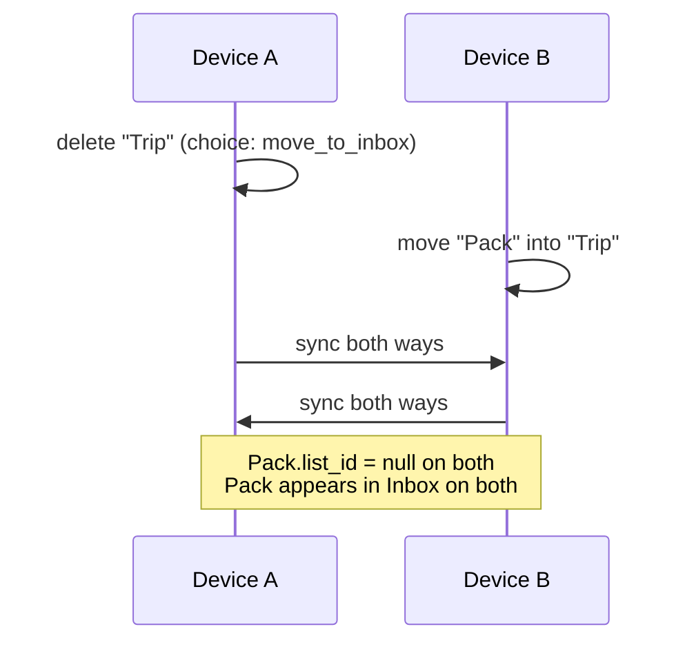
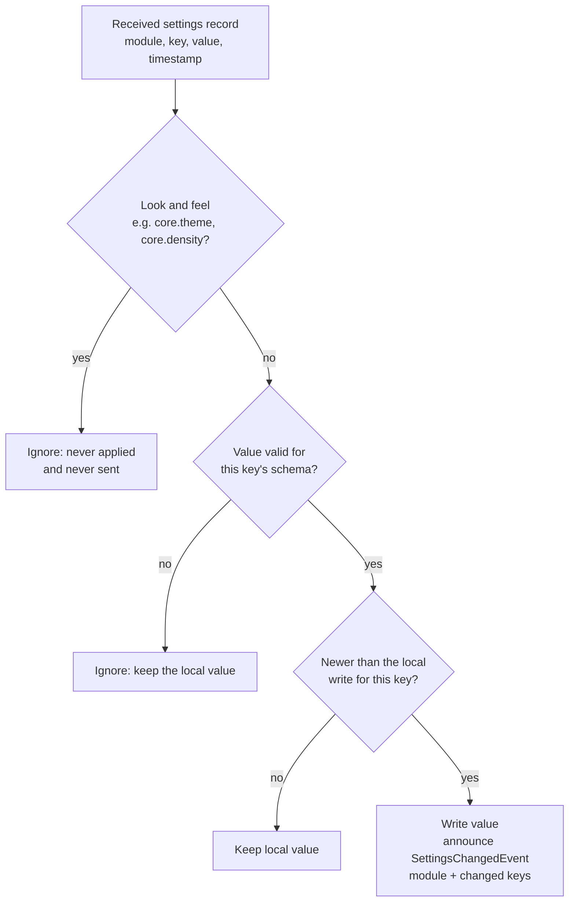
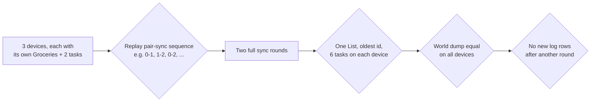

# sync_data_merge_lists_and_preferences

This page documents how **Lists, Tasks' List membership, Comments and synced Preferences** converge across devices. It is one of four leaf scenarios under [sync_data_merge](../sync_data_merge.md), which itself sits inside the [Sync Replication Engine](../../Sync_Replication_Engine.md). The behaviour is pinned by the Rust scenario tests in `src-tauri/src/sync_lists_tests.rs`, all of which run on a simulated multi-device `Cluster` of real app instances.

Read this page for the *merge rules* for Lists and Preferences. For the record format, change log, and transport, see [sync_engine](../sync_engine.md). For the Todo data model that these rules act on, see [todo](../../Task_and_Journal_Domain_Services/todo.md). For how the settings keys themselves are defined, see [core_settings](../../Data_Foundation/core_settings.md).

---

## 1. Purpose and scope

Two devices can create, rename, delete, and edit the same things while apart. When they later sync, every device must end with the same visible state. This module covers five groups of data:

| Group | What converges | Key rule |
|---|---|---|
| **Lists** | Existence, name, emoji, sort, group-by | Same-name Lists collapse into the **older** one |
| **Task ↔ List membership** | Which List a Task belongs to | A Task whose List is gone falls back to the Inbox |
| **Manual order** | `sort_key` of Lists and Tasks | Equal keys break ties by `id` |
| **Comments** | Body, edited flag, deletion, count | Attached to the Task; survive the Task's deletion |
| **Preferences** | Synced `settings` keys | Newest write wins per key; look-and-feel never syncs |

The scope deliberately excludes the Task field merge rules (see [sync_data_merge_todo_convergence](sync_data_merge_todo_convergence.md)), the in-progress edit "holds" (see [sync_data_merge_journal_holds](sync_data_merge_journal_holds.md)), the backfill of pre-log rows (see [sync_data_merge_backfill](sync_data_merge_backfill.md)), and the randomized fixture cases (see [sync_data_merge_fixture_cases](sync_data_merge_fixture_cases.md)).

---

## 2. Architecture and where the code sits

The merge logic is split between the sync engine (which moves records and decides arrival order) and the Todo and settings modules (which decide what a received record *means*).

Responsibilities:

- **Todo sync apply** (`crates/todo/src/list_sync.rs`, `sync.rs`, `comment_sync.rs`): applies a received List, Task, or Comment record to local tables and performs the List merge.
- **Core settings sync** (`crates/core/src/settings/sync.rs`, `schema.rs`, `mod.rs`): applies a received preference record, validates it against the key's schema, and drops it if invalid or look-and-feel.
- **Tauri host** (`src-tauri/src/todo.rs`, `sync.rs`): exposes the commands used by the tests and by the UI; emits the announcement events.
- **Tests** (`src-tauri/src/sync_lists_tests.rs`): exercise every rule below through real commands and read results back through commands, plus a whole-device `world()` dump used to prove devices are identical.

---

## 3. Lists

### 3.1 Identity and ordering

List ids are UUIDv7 generated from the real clock. Because of this, **the older List is always the one with the smaller id**. Every "which one is older" decision in this module uses that comparison, not the wall-clock timestamp, so it is stable even when a device's clock is skewed (the tests advance device clocks with `clock().advance(...)` to prove this).

### 3.2 The name clash merge

Two Lists with the same name, made on different devices, become one. Names are compared after folding accents and case (`Groceries` and `GROCERIES` match; `Café` and `cafe` match). The fold uses the shared text rules described in [core](../../Data_Foundation/core.md).

Rule: **the older List survives; the newer is merged into it and deleted.**

What the tests establish:

- **Survivor keeps its own properties.** Emoji and task sort of the older List stay; the newer's emoji (🥕) is discarded.
- **Newer's tasks join the end.** Under manual order, the survivor's tasks come first, then the newer's tasks in their own order (`Milk, Eggs, Bread, Apples`).
- **Three-way merges converge.** If a third device hears about the two Lists in either order, it still ends with the same survivor and the same tasks.
- **Chained merges work.** A third device that only knows the newer List and adds a Task to it before the merge arrives has that Task end up in the survivor.
- **Accent and case folding works.** `Café` + `cafe` merge into `Café`.

#### Rename into a taken name

Renames can produce the same clash after the fact:

- Alpha and Beta exist. Offline, A renames Alpha to `Gamma`, B renames Beta to `gamma`. After sync, Alpha (older) survives, Beta's tasks move into it, and both devices agree.
- If the *older* List is the one renamed **later** into a name the newer List already holds (`Beta → Home` first, `Alpha → HOME` later), the older still survives and keeps its **own latest name** (`HOME`). Arrival order does not matter.

### 3.3 Merge notification

When a device receives a merge, it reports it once to the user through `TodoListsMergedEvent`:

| Field | Value in the test |
|---|---|
| `from_id` | id of the merged-away List |
| `into_id` | id of the survivor |
| `from_name` / `into_name` | names at the time of the merge (`GROCERIES`, `Groceries`) |
| `device` | the sync peer's name for the device the merged List came from (`Pixel 8`) |

The device name is looked up from the local peer table. The event fires exactly once per merge, even when both sync directions are run.

### 3.4 Same-name merge is one-shot

After the merge, the newer List id is gone on every device. Repeating syncs record nothing new; the `three_devices...` test checks that log row counts stop growing once the devices have converged.

### 3.5 List properties

Edits to different properties of one List made on two devices merge **per field**, not per record:

| Property | Set by | Result |
|---|---|---|
| `emoji` | device A | kept |
| `group_by` | device B | kept |
| `name` | device B (later) | kept |

Within one field, the newest write wins (the same last-writer rule used for the title fields elsewhere in the sync engine).

### 3.6 List lifecycle

---

## 4. Task membership in Lists

### 4.1 Moving into a List deleted elsewhere

If device A deletes a List while device B, not yet knowing, moves a Task into it, both devices end with that Task in the **Inbox**:

### 4.2 Tasks left behind in a deleted List

If B adds a Task to a List that A has deleted (and that A had moved its own tasks out of), the new Task shows up in the Inbox on both devices. **No new change is recorded**: the sync that carries the Task sends zero records in both directions afterwards. Membership is resolved at read time, not written back.

### 4.3 Restoring a Task whose List was deleted

Deleting a Task keeps its List reference in the database, but the comparison that matters hides it: the `world()` dump records `CASE WHEN deleted_at IS NULL THEN list_id END`. The two devices can disagree on a deleted Task's hidden List column for a while. This is intentional.

When the Task is restored, **Restore settles it the same way everywhere**. The scenario test covers:

- Three delete/merge variants (plain delete of the List; merge then delete; delete then merge).
- Restore on device 0, on device 1, or on both.

In every combination the restored Task ends in the same List on all three devices, and the full `world()` matches.

### 4.4 Moving into a List whose name is reused

The test `a_task_moved_into_a_deleted_list_lands_the_same_whether_a_rename_into_its_name_came_first` checks a subtler case. A Task is moved into List `Bar`, and `Bar` is deleted on another device. Then a List `Food` is renamed to `Bar`. The Task ends up in `Food` on all three devices, and it does so regardless of whether the rename or the move reaches a device first. In other words, a Task that was moved into a deleted List follows the List that now holds that name through the same name-clash merge.

---

## 5. Manual order keys

Lists and Tasks each carry a `sort_key`. Two devices can produce the same key from the same starting state while apart.

- **Equal keys are broken by `id`.** The test `lists_and_tasks_with_equal_order_keys_are_ordered_by_id_on_every_device` creates equal keys on both devices and checks that every device shows `First, Second` and `T1, T2` in the same order.
- **Newest key wins for a moved item.** The `manual_order_takes_the_newest_key` case in [sync_data_merge_todo_convergence](sync_data_merge_todo_convergence.md) is the single-task version of this rule.
- **Merged Tasks are appended.** When a List merges, its Tasks take order keys after the survivor's, preserving their own relative order.

---

## 6. Comments

Comments belong to a Task (`todo_comments.task_id`). They follow these rules:

| Situation | Result on every device |
|---|---|
| A Comment is added to a Task deleted elsewhere | Comment stays attached; it returns when the Task is restored (`comment_count` is 1 after restore) |
| Comments are edited on one device and one is deleted on another | Edits merge into the body with `edited = true`; deletions remove the row from view |
| The count | Recomputed from live comments, never trusted from the record |

The count is derived, so a device that receives a Comment record updates `comment_count` on the Task rather than receiving it as a field.

---

## 7. Preferences

Preferences live in the `settings` table as `(module, key, value)` rows. The synced subset is applied from received settings records through `crates/core/src/settings/sync.rs`.

### 7.1 Rules

Details confirmed by the tests:

- **Per-key, newest write wins.** When device A writes `core.week_start = sun` and device B later writes `core.week_start = mon`, both end with `mon`. Keys that were written on only one device carry over unchanged.
- **Look and feel never comes in.** `core.theme` set to `oled` on device A stays `system` on device B. `core.density` set to `compact` on A also stays `comfortable` on B. Forged records for `core.theme` from a peer are ignored on receipt, and the sending device does not transmit them (only the `week_start` record was counted as sent).
- **Old look-and-feel change-log rows are inert.** Installs that already have change-log rows for the theme do not leak them to the other device.
- **An invalid value is ignored.** A record with `core.time_format = "37h"` is discarded; the receiving device keeps its own `24h`.
- **A valid change announces itself.** `SettingsChangedEvent` is emitted once per sync with `module: "core"` and `keys: ["week_start"]`.

The schema that decides "valid" is defined in `crates/core/src/settings/schema.rs`; see [core_settings](../../Data_Foundation/core_settings.md).

---

## 8. Convergence proof: the `world()` dump

Most tests end with `same_world(&cluster, n)`. This takes a `world()` snapshot of each device and asserts equality. It covers:

| Table | Columns compared |
|---|---|
| `todo_lists` | id, name, emoji, sort_key, task_sort, group_by, deleted |
| `todo_tasks` | id, effective list (hidden for deleted tasks), sort_key, title, deleted |
| `todo_comments` | id, task, body, edited, deleted |
| `settings` | module, key, value |
| `journal_entries` | id, page date, body, written/edited times, word count, deleted |
| `ai_conversations`, `ai_entries`, `ai_saved_questions` | ids, titles, provider names and models as text, payloads, deleted |

Two points matter for maintainers:

- The AI Module's Provider **id** is deliberately *not* compared, because it names a device's own Provider. Provider name and model travel as text.
- The `world()` function is `pub(crate)` and reused by other sync test files, so changing its column list changes the convergence contract for the whole suite.

---

## 9. Three devices, every delivery order

The most important test is `three_devices_making_the_same_list_converge_in_every_delivery_order`:

1. Three devices each create a List named `Groceries` with two Tasks, while apart.
2. Every ordered sequence of pair-syncs up to four steps is replayed (three pairs, each pair can appear in any position).
3. After the sequence, two extra full rounds of sync run.
4. Assertions:
   - All devices show **one** List, with the oldest id.
   - Each device has **six** Tasks in it.
   - `world()` is identical on all three devices.
   - Log row counts stop growing: the second pair of rounds records nothing new.

---

## 10. Tests in this module

| Test | Rule it checks |
|---|---|
| `same_name_lists_made_on_two_devices_merge_into_the_older_which_keeps_everything` | Basic clash merge; survivor keeps emoji and sort |
| `lists_differing_only_by_accents_and_case_merge_into_the_older` | Folded name comparison |
| `the_newer_lists_tasks_join_the_end_of_the_older_ones_manual_order_in_their_own_order` | Task append order |
| `the_merge_is_the_same_whichever_list_a_third_device_hears_of_first` | Order independence with three devices |
| `a_rename_into_another_lists_name_merges_the_same_way` | Clash created by a rename |
| `a_rename_that_loses_the_race_still_leaves_one_list_when_the_older_is_the_one_renamed_later` | Older survives with its own name |
| `a_task_made_in_the_merged_away_list_by_a_device_that_had_not_heard_ends_in_the_survivor` | Late tasks follow the merge |
| `a_merged_away_list_is_reported_with_the_name_of_the_device_it_came_from` | `TodoListsMergedEvent` contents, emitted once |
| `a_task_deleted_on_another_device_is_reported_with_that_devices_name` | `TodoTaskDeletedEvent`, not repeated for an already deleted task |
| `lists_and_tasks_with_equal_order_keys_are_ordered_by_id_on_every_device` | Tie-break by id |
| `list_properties_edited_on_two_devices_merge_per_field` | Per-field merge of List properties |
| `a_task_moved_into_a_list_deleted_elsewhere_lands_in_the_inbox_on_both` | Membership falls back to Inbox |
| `tasks_still_in_a_list_deleted_elsewhere_move_to_the_inbox_without_a_new_change` | Read-time fallback, no records |
| `a_comment_added_to_a_task_deleted_elsewhere_stays_attached_and_returns_with_it` | Comments survive task deletion |
| `comments_sync_edits_deletes_and_the_count_is_recomputed` | Comment edit/delete merge and count |
| `a_preference_changed_on_one_device_appears_on_the_other_and_the_theme_does_not` | Synced vs local preferences |
| `look_and_feel_never_comes_in_either_even_when_a_peer_sends_it` | Forged look-and-feel records are dropped |
| `the_newest_write_of_each_preference_wins_per_key` | Per-key last writer |
| `a_synced_preference_announces_settings_changed_and_an_invalid_value_is_ignored` | Event and validation |
| `three_devices_making_the_same_list_converge_in_every_delivery_order` | Full convergence across delivery orders |
| `restoring_a_task_deleted_with_its_list_gives_the_same_list_on_every_device` | Hidden list column settles on restore |
| `a_task_moved_into_a_deleted_list_lands_the_same_whether_a_rename_into_its_name_came_first` | Name reuse and arrival order |

---

## 11. Maintaining this module

- **Do not compare clocks to decide "older" for Lists.** Use the id. Clock comparison breaks under skew and the tests exist to prevent that.
- **Look-and-feel keys belong in one list.** If a new display-only preference is added, it must be excluded from the sync send path and the receive path together, or the forged-record test will catch it on the receive side only.
- **Membership fallbacks are read-time.** Do not add a write that rewrites a Task's `list_id` when its List disappears; the "no new change" tests will fail, and devices that have not yet heard would see a spurious change.
- **Changing `world()` changes the contract.** Add a column there only when the new state must converge on every device, and expect the convergence tests to exercise it.

## Related pages

- [sync_data_merge](../sync_data_merge.md): parent scenario group
- [sync_engine](../sync_engine.md): record format, vector clocks, and the apply pipeline
- [sync_conflicts](../sync_conflicts.md): clashes that need a human choice (not used for the rules above)
- [sync_activity](../sync_activity.md): how merges and conflicts appear in the activity log
- [todo](../../Task_and_Journal_Domain_Services/todo.md) and [todo_sync](../todo_sync.md): the Todo model and its sync apply code
- [core](../../Data_Foundation/core.md) and [core_settings](../../Data_Foundation/core_settings.md): text folding and settings schema
- [Sync_Connectivity_and_Pairing](../../Sync_Connectivity_and_Pairing.md): how the devices reach each other before any of this runs
