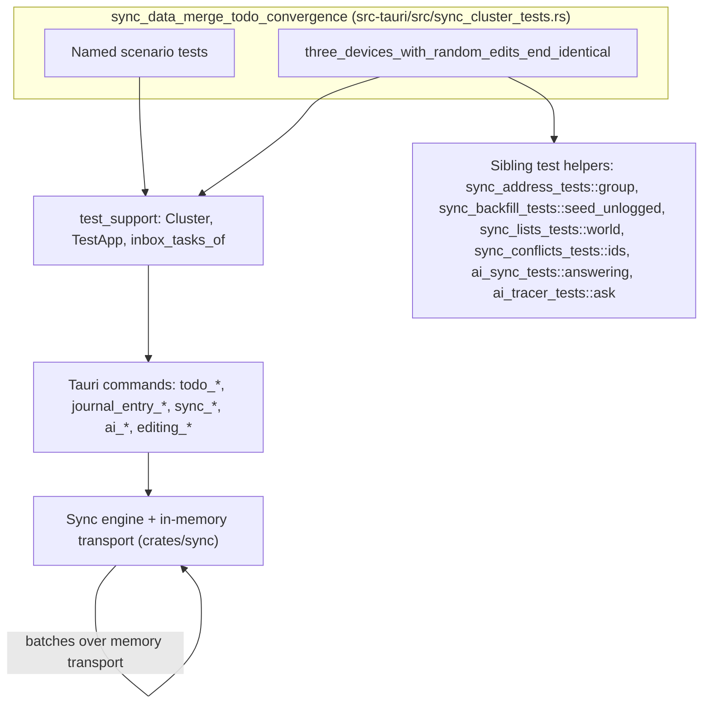
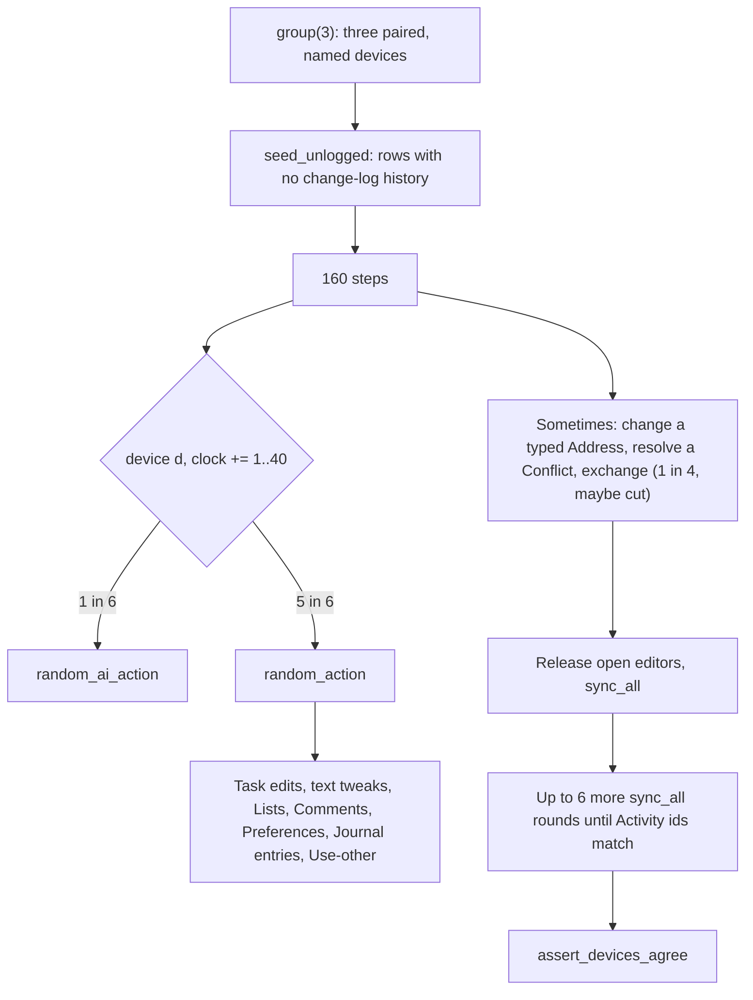

# sync_data_merge_todo_convergence

This module is the Todo convergence test suite for the sync data-merge layer. It runs several simulated devices, each with its own database, and checks that Todo Tasks end up identical everywhere after they sync, whatever order the changes travel in. It has two parts: a set of named scenario tests for specific merge rules, and a seeded random-edit test (`three_devices_with_random_edits_end_identical`) that checks the whole system converges across Todo, Lists, Comments, Preferences, Journal, AI, Conflicts and Activity.

The module contains tests only. It ships no production code. Its behaviour is defined by the merge rules implemented in the sync crate and the Todo sync adapters (see [Sync_Replication_Engine](../../Sync_Replication_Engine.md), [sync_engine](../sync_engine.md), and [todo_sync](../todo_sync.md)).

Every step and assertion goes through Tauri commands on a device, not through internal functions. This follows ADR 0009, which the file header cites.

## Where it sits

Sibling pages cover the code under test: [sync_data_merge_lists_and_preferences](sync_data_merge_lists_and_preferences.md), [sync_data_merge_journal_holds](sync_data_merge_journal_holds.md), [sync_data_merge_backfill](sync_data_merge_backfill.md), [sync_data_merge_fixture_cases](sync_data_merge_fixture_cases.md). The Todo domain itself is described in [Task_and_Journal_Domain_Services/todo](../../Task_and_Journal_Domain_Services/todo.md). Conflicts and Activity are in [sync_conflicts](../sync_conflicts.md) and [sync_activity](../sync_activity.md).

## Test harness

The tests use two types from `test_support`:

- `Cluster`: a group of `TestApp` devices indexed `c[0]`, `c[1]`, ... It exposes `sync(a, b)` for one exchange in one direction, `try_sync(a, b, cut)` which can drop the line after a number of batches, and `sync_all()`.
- `TestApp`: one device. It has `invoke(command, args)` to call a Tauri command, `with_db` for read-only database checks, `clock()` to advance or freeze the device clock, `widget_signals()`, `sync_probe()`, `set_pref`, `ai_events()`, and `device_id()`.

`sync` returns counts `(sent, received)`. The tests use these to check that only missing records move.

Local time is fixed at `TODAY = 2026-10-22`, 14:05, UTC offset 0 (`local()`).

Read-only helpers in this file:

| Helper | Purpose |
|---|---|
| `task`, `seen` | Read a Task; `seen` drops per-device `updated_at` so devices can be compared |
| `history`, `history_seen` | Task History lines as `"<kind> <text>"` |
| `done_titles`, `inbox_titles`, `inbox_in_order` | Views used as observable state |
| `resolved_rows`, `activity_ids` | Read Conflicts (Resolved automatically) and Activity pages |
| `address_lines` | Reads `sync_resolutions` rows about typed Addresses |

Two helpers build the starting state: `create`/`create_repeating` make Tasks, and `pair_with_task` makes two devices that have synced one Task and then diverge.

## Scenario tests

The named scenarios each pin one merge rule. They are grouped below.

**Field merging** (per-field last-writer-wins, using each device's own clock):

- `a_new_task_reaches_the_other_device_as_it_was_made`: a created Task arrives with title, due date, time, notes.
- `priority_changed_on_one_device_and_due_date_on_the_other_both_survive_on_both`: different fields edited on each side both survive.
- `the_same_field_changed_on_both_takes_the_newest_everywhere`: the same field takes the newer write.
- `the_when_group_is_taken_whole_from_the_newest_never_mixed`: date, time and Repeat are one group. The newer side's group wins whole, so no time or Repeat leaks from the older side.
- `the_state_and_its_closed_time_are_taken_together`: state and `closed_at` come from the same write.
- `recognised_words_follow_the_newest_title`: the recognised-words field follows whichever title is newer.
- `manual_order_takes_the_newest_key`: the manual sort key from the newer reorder wins.
- `a_local_edit_made_between_two_exchanges_is_judged_by_its_own_clock`: an edit is compared by its own timestamp, not by when it arrives.

**Deletes, repeats and occurrences**:

- `delete_on_one_device_and_notes_on_the_other_leaves_it_deleted_with_the_new_notes`: a delete wins, but a later note edit is kept and visible on restore.
- `a_deleted_task_stays_deleted_when_an_old_device_syncs_later`.
- `completing_the_same_repeating_task_offline_on_two_devices_gives_one_occurrence`: two completions of one occurrence produce one Done record and advance the due date once.
- `the_same_occurrence_has_the_same_id_on_devices_that_never_exchanged_it`: occurrence ids are derived from the Task and its due date, so they match without any exchange.
- `a_skip_reads_as_skipped_in_history_on_the_other_device_too`.

**History and sessions**:

- `history_of_concurrent_edits_reads_the_same_on_two_devices` and `..._on_three_devices`: History lines are identical and in the same order everywhere.
- `a_session_rewritten_after_a_sync_is_sent_again_and_not_duplicated`: an editing session that saves again is one record, rewritten in place and re-sent.
- `a_session_does_not_claim_a_value_another_device_changed_since`: a device that only changes notes does not overwrite a newer title it has not seen.

**Transport and engine**:

- `an_exchange_cut_mid_way_resumes_exactly_without_duplicates_or_gaps`: 1,200 Tasks; the line is cut after the 4th message. Exactly 500 Tasks are applied (the acknowledged batches). The next exchange sends exactly 700.
- `a_change_travels_through_a_middle_device`: relay A → B → C, and back.
- `a_record_that_arrives_by_two_paths_is_stored_once`.
- `received_changes_are_remote_not_new_local_ones`: received records are not sent back as new local changes.
- `remote_changes_tell_todo_to_refresh_and_the_widget_to_redraw`: one widget signal per received batch, none for an empty exchange.
- `with_sync_off_no_engine_work_runs_and_changes_wait_for_it_to_be_switched_on`: with sync off, the sync tables stay empty and changes wait until it is enabled.

## Random convergence test

`three_devices_with_random_edits_end_identical` runs `converge(seed)` for each seed and reports every failing seed, not just the first.

### What a step does

`random_action` picks from a roll of 40:

- 0 to 11 and 12 to 19 are split between Task commands (create, priority, update, when, delete, restore, complete, reopen, won't do, skip, repeating create) and List/Comment/Preference commands (`random_list_action`).
- 20 to 27: Journal entry actions (`random_entry_action`), including editor holds that keep remote changes waiting.
- 28 to 31: `random_task_text_action`, which changes a few words of notes or a title.
- 32 to 35: `random_reorder`.
- 36 to 39: `random_use_other`, which picks a Resolved-automatically line and chooses "use other".

`random_ai_action` covers Conversations (ask, rename, delete, restore) and Saved questions (create, update, delete, restore, reorder). A refused action changes nothing, and the devices must still agree.

Text edits use `tweak`, which replaces one word from a fixed list of seven, or appends a line. Two devices editing the same text therefore clash often, and sometimes do not.

### Oracle

After everything has synced, `assert_devices_agree` requires:

1. `sync_lists_tests::world` is equal on all devices. It covers `lists`, `tasks`, `comments`, `settings`, `entries`, `conversations`, `ai_entries` and `saved`. Differing rows are printed as `DIFF` lines to help diagnosis.
2. The same Conflicts are waiting on every device.
3. For every Task id used, `seen` and `history_seen` match. History is compared even when the Task is missing, so a `not_found` answer must also match.
4. `assert_addresses_agree`: the Address typed for each device is equal on the two devices that keep it, and the device itself keeps no Address lines.
5. Resolved automatically lines (excluding the folded order/preferences line and Address lines) and every Activity id are equal.

Failing seeds are printed with the command to run only that seed.

### Running and seeds

| Variable | Effect |
|---|---|
| `MNEMORA_CONVERGE_SEED=n` | Run only seed n |
| `MNEMORA_CONVERGE_SEEDS=n` | Run seeds `first..first+n` |
| `MNEMORA_CONVERGE_FIRST=n` | First seed for the range (default 1) |

With no variables set, the test runs the 22 `FIXED_SEEDS`. The doc comment says each one found a divergence that is now fixed. They cover Resolved automatically lines, History of a Task whose author sent a whole When, a clash visible only to its author, text replays from rewritten records, a used line taken back, a Conversation not moving to the top on the other device, and overlapping word diffs. The suite runs under `make test` (see [Build_and_Packaging](../../Build_and_Packaging.md)). A range hunt takes about 0.5 s per seed.

## Invariants the suite protects

- **Same state everywhere.** Once syncing settles, every device shows the same data, including Conflicts, Activity and History.
- **Newest write wins per field group.** The When group, the state with its closed time, and each text field each take one writer's values.
- **Idempotent, resumable exchange.** Re-sending moves nothing; a cut exchange resumes without duplicates or gaps.
- **Refused actions are neutral.** A refused command records nothing, so devices still agree.
- **Look and feel stays local.** Theme is excluded from `world` comparisons; each device keeps its own value (see `sync_lists_tests`).

## Maintenance notes

- A new Todo field should be added to `seen` (if it is shared) and to `random_action` so the random run covers it.
- A new synced section should be added to the `sections` list in `assert_devices_agree`, or it will not be compared.
- When a seed fails, add it to `FIXED_SEEDS` with a short note of the bug it found.
- The random test is sensitive to the clock and to the order of `rng` calls. Changing the number of random draws in a step changes which scenario every seed produces.
