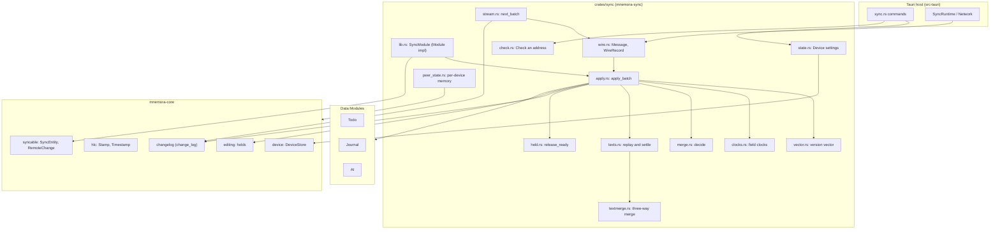
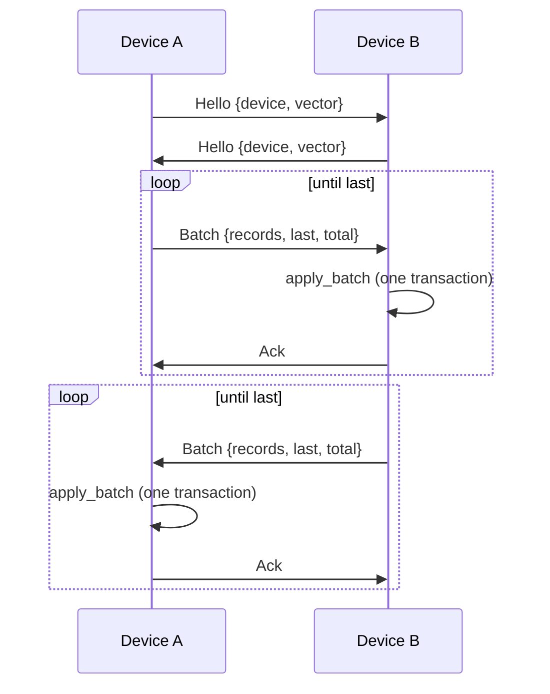
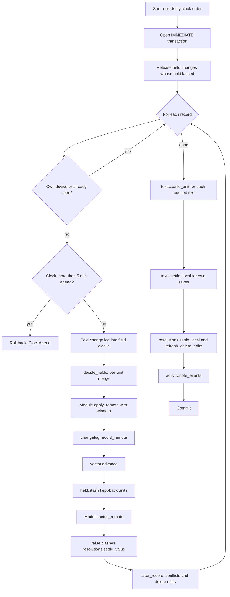
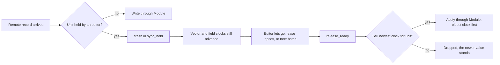
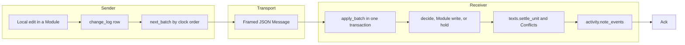

# Sync Engine (`crates/sync`, `mnemora-sync`)

## Introduction

The Sync Engine keeps a person's own devices in step, directly between them (ADR 0017). It is a Rust module, `mnemora-sync`, that sits beside the data Modules (Journal, Todo, AI) and never imports them. It moves **change-log records** between paired devices, decides which values win when two devices changed the same thing, merges concurrent text edits, holds back remote changes while someone is typing, and keeps the engine's own bookkeeping (version vectors, field clocks, held values) in local tables that are never synced.

The module is **off by default and inert while off**: its startup returns at once, and nothing listens, advertises or runs until the person turns Sync on for that device (`SyncModule::default_enabled`, `crates/sync/src/lib.rs`).

This page covers the replication core: the wire protocol, the apply pipeline, the merge rules, text replay and holds. Other parts of Sync are documented separately:

- Pairing, addresses, live connections, TLS and power handling: [Sync Connectivity and Pairing](../Sync_Connectivity_and_Pairing.md).
- Conflicts and "Resolved automatically" rows: [sync_conflicts](sync_conflicts.md).
- Activity log: [sync_activity](sync_activity.md).
- Todo-specific sync `apply`/`settle` hooks: [todo_sync](todo_sync.md).
- The UI that shows all of this: [Sync Client Surface](../Sync_Client_Surface.md).
- The change log, HLC, syncable declarations and Device settings that the engine builds on: [Data Foundation](../Data_Foundation.md) (see [core](../Data_Foundation/core.md) and [core_settings](../Data_Foundation/core_settings.md)).

---

## Architecture

The module boundary is deliberate: the engine talks to Modules only through the `Module` trait (`apply_remote`, `settle_remote`, `sync_entities`). Modules own their tables and their repositories; the engine owns the vector, clocks, holds and replay state.

### Module registration

`SyncModule` implements `mnemora_core::module::Module`:

| Hook | What it does here |
|---|---|
| `id()` | `"sync"`. Also the migration namespace and the change-log module name. |
| `default_enabled()` | `false`. Sync is on per device, in Device settings. |
| `migrations()` | `migrations::all()`: append-only schema, run on every install whether Sync is on or not. |
| `sync_entities()` | The engine's own synced kinds: `sync_conflict`, `sync_resolution`, `sync_activity`, `sync_revocation`, `sync_device`, `sync_introduction`. |
| `apply_remote()` | Dispatches a received record of one of those kinds to its `apply` function. Any other kind is refused. |
| `register_settings()` | Empty. Sync has no Preferences; its choices are Device settings. |
| `on_startup()` | Adopts addresses typed before they synced into the log (`rename::adopt_local_addresses`). |

Synced entities of **other** Modules are declared by those Modules through `SyncEntity` and `SyncField` (fields carry a `FieldClass`: `Text`, `Value`, `Order` or `Derived`, plus an optional `group`). The engine reads those declarations through the `Registry` (`crates/sync/src/registry.rs`, not included in this page's sources).

---

## Core components

| Component | File | Responsibility |
|---|---|---|
| `SyncModule` | `lib.rs` | Module registration; entity dispatch; startup adoption. |
| `migrations::all` | `migrations.rs` | Local and synced tables (see [Data model](#data-model)). |
| `vector::{of_entity, all, seen, advance}` | `vector.rs` | Version vector: highest sequence held per entity and origin device. |
| `stream::next_batch` | `stream.rs` | Builds the records a peer lacks, in clock order, in size-bounded batches. |
| `stream::pending` | `stream.rs` | Counts records a peer lacks, for progress. |
| `wire::{Message, WireRecord, Vector}` | `wire.rs` | The whole session protocol (Hello, Batch, Ack) and the record shape. |
| `apply::apply_batch` | `apply.rs` | Applies a received batch in one transaction, with the vector advancing with it. |
| `apply::{Applied, Decided}` | `apply.rs` | What a batch did; per-record decision output. |
| `clocks::{fold, load, raise}` | `clocks.rs` | Per-field clocks, read from the change log and compared with received values. |
| `merge::{decide, Verdict}` | `merge.rs` | The merge rule for one unit: take or keep. |
| `texts::{fold, settle_unit, settle_local, current, already}` | `texts.rs` | Text replay in clock order, three-way merge where edits were made from different texts, and Conflict raising. |
| `textmerge::{merge, diff, Merge, Piece, Clash}` | `textmerge.rs` | Pure three-way merge of two edits of a base text, line first then word. |
| `held::{stash, release_ready, Released}` | `held.rs` | Keeps values of held units apart and applies them when the hold ends. |
| `peer_state::*` | `peer_state.rs` | Per-device memory: last seen, last synced, last session counts, route, remembered addresses. |
| `state::{SyncState, SyncOption, current, set_enabled, rename, set_option}` | `state.rs` | Device-level Sync settings and their changes. |
| `check::{check, Expect, Limits, CheckKind, CheckResult}` | `check.rs` | "Check" an address typed in the device sheet; reports in words what answered. |

---

## Data model

The engine adds two groups of tables, both created by `migrations::all()`.

**Local bookkeeping (never synced):**

| Table | Holds |
|---|---|
| `sync_seen` | Version vector: `(entity, device) -> seq` of records held from other devices. |
| `sync_field_clocks` | `(entity, entity_id, field) -> (ms, counter, device)`: when each field last changed. |
| `sync_clock_marks` | How far into the change log the field clocks have been read, per entity. |
| `sync_held` | Values of received units held back while an editor has them. |
| `sync_text_replay` | Memo of the text replay per `(entity, entity_id, unit)`, so long-edited records are not replayed from the start. |
| `sync_local_settled` | How far this device's own records have been checked for clashes (`seq`) and replayed (`texts`). |
| `sync_peers`, `sync_group` | Paired devices (public key, platform, `paired_by`, `typed_address`, `wanted_name`) and the single group id. |
| `sync_peer_status`, `sync_peer_addresses` | Per-device memory from `peer_state`. |
| `sync_resolution_visit` | "Since your last visit" marker. |

**Synced kinds (the change log carries them as entities of module `sync`):**

| Entity | Table | Purpose |
|---|---|---|
| `sync_conflict` | `sync_conflicts` | Two devices rewrote the same words. See [sync_conflicts](sync_conflicts.md). |
| `sync_resolution` | `sync_resolutions` | Values settled automatically, and the "Use other instead" outcome. |
| `sync_activity` | `sync_activity` | One line per session or event, kept forever. See [sync_activity](sync_activity.md). |
| `sync_revocation` | `sync_revocations` | Signed decision that a device is out of the group, or back in. |
| `sync_device` | (rename) | Device rename. |
| `sync_introduction` | `sync_introductions` | A member signs the key of a device it paired, for the members that were not there. |

Every record in the change log has: module, entity, entity id, op (`create`, `update`, ...), optional session id, wall-clock `at`, origin device, origin sequence, hybrid logical clock `(hlc_ms, hlc_counter)`, `fields`, `snapshot`, `prev` and `seen`. The engine reads these; the `change_log` table itself belongs to [core](../Data_Foundation/core.md).

Synced kinds are never themselves sent through the text or value merges (`decide_fields` and `texts::current` skip `sync_*` entities for clash purposes).

---

## Wire protocol

A session between two paired devices exchanges three message types (`wire.rs`), JSON-encoded, framed by the transport:

- **Hello** is the first message each way. It carries the sender's device id and its full version vector (`{entity: {device: highest seq}}`). The vector tells the other side what to skip.
- **Batch** carries records the receiver lacks, oldest clock first. `last` marks the final batch; `total` on the first batch is the stream size, for progress only.
- **Ack** says the previous batch was applied and stored, so an interrupted exchange resumes exactly where it stopped (see [Invariants](#invariants)).

The records within a batch are `WireRecord`s: changed fields only (whole groups), plus `prev` (what each changed field replaced on the origin device) and, for deletes, `seen` (what the origin had of the other devices' records, so an edit made without knowing of the delete can be recognised).

### Building a batch (`stream.rs`)

`next_batch(conn, registry, me, peer_vector, cursor)`:

1. For every entity the peer declares in its Hello, and every origin device this device holds for it, takes the records after `max(peer's seq, cursor)` (up to `BATCH_RECORDS`).
2. Keeps one queue per `(entity, origin)`, each in sequence order.
3. Repeatedly pops the queue whose next record has the **oldest clock** (`order_key`: `(hlc_ms, hlc_counter, origin_device, origin_seq)`), until `BATCH_RECORDS` (500) or `BATCH_BYTES` (2 MB) is reached.
4. Advances an in-memory `Cursor` so the next batch continues where this one stopped.

Clock order means a record is sent after the records its author had seen, even when those came from other devices, so the receiver mostly applies things in dependency order. Records of entities whose ids are local-only are excluded (`registry.local_only`).

`pending` counts the records a peer lacks, for the progress indicator.

---

## Applying a batch

`apply_batch(conn, registry, me, records)` is the heart of the engine. It is **all or nothing**: one `IMMEDIATE` transaction covers every record, the Module writes, the change-log rows, the field clocks, the held values, the version vector and the replay memos. If any record fails (a refused write, a clock too far ahead), the whole batch rolls back and the vector does not move.

Key points of the per-record step:

- **Duplicates and own records are skipped.** A record whose origin sequence is at or below the vector entry, or whose origin is this device, is not stored twice. Seen-before is read once per origin before the batch, so a record is not skipped because a later one of its origin was applied first.
- **Future clocks are refused.** `physical_now + MAX_AHEAD_MS` (five minutes) is the ceiling. A record beyond it stops the exchange (`SyncError::ClockAhead`) and is never shown to the clock; sync resumes once real time catches up.
- **Field clocks are folded** from the change log before each entity's first comparison, so the table reflects the newest clock any record has put on a field.
- **Module writes are the Module's.** The engine passes only the winning `fields` in a `RemoteChange`; the Module writes them through its own repository and returns a snapshot, events and a `changed` flag.
- **The record is stored** in the change log as sent (origin device, origin sequence, clock) with a fresh local sequence, so this device can relay it onward unchanged.
- **Events** from the Module are attributed to the origin device (for example a task deleted elsewhere is reported with that device's name).
- **Field values are never logged.**

### Deciding unit by unit (`decide_fields`)

Fields are grouped into **units**: each ungrouped field alone, each `group` as one. A group moves together or not at all (for example a Todo task's `when` group).

| Field class | Rule |
|---|---|
| `Value`, `Order` | Newest clock wins (`merge::decide`). Ties go by device id, so every device chooses the same. A value that replaces a different value written beside it is reported as a Resolved-automatically clash (see [sync_conflicts](sync_conflicts.md)). |
| `Derived` | Never taken; recomputed locally. |
| `Text` | Not decided by the clock here. The text of a record is the **replay** of every record that touched it, settled after the batch is stored (see [Text replay](#text-replay-and-three-way-merge)). A Create brings its own text, since nothing can exist without it. |

The `deleted_at` mark is never held back: a delete takes effect at once, and Restore is the way back.

---

## Text replay and three-way merge

Free text (a journal entry body, a task's notes, a comment) cannot be decided by "newest wins" without losing one person's words. The engine therefore makes the text a **pure function of the records that touched it**.

### Replay (`texts::fold`)

1. Load every stored record for `(entity, entity_id)` whose text unit is present, sorted by `(clock, origin sequence)`. Each record carries `text` and `prev` (the text it replaced on its origin device).
2. Start from the memo in `sync_text_replay` if it still matches the change log (`count_upto` compares the row count and the sum of local sequences up to the memo point); otherwise replay from the start.
3. For each record, in order:
   - If its `prev` is absent, or equals what the replay holds, or its text equals what the replay holds: the record **takes over**.
   - Otherwise the replay merges `prev` (base), the held text (`ours`) and the record's text (`theirs`) with `textmerge::merge`. Any clash is recorded as a `Clashed` value with both sides' devices and times. The newer side's text shows.
4. Save the memo.

Because the result depends only on the records in clock order, **delivery order cannot change it**: a late record is simply replayed in its place.

### Three-way merge (`textmerge`)

`merge(base, ours, theirs)` works in two passes:

1. **By line.** Hunks are computed with a Myers diff against the base, for each side. Hunks that overlap (or are both insertions at one spot) form a region. A region only one side changed takes that side. Edits to neighbouring lines do not overlap.
2. **By word** for a region both sides changed differently. A word is whatever sits between spaces, so punctuation and Markdown marks stay with their word. Only words both sides changed form a **clash**; shared leading and trailing words are agreed text. If one side's change sits wholly inside the other's, the longer change wins without a clash.

The output is a list of `Piece`s: `Agreed(text)` or `Clash { base, ours, theirs }`. `Merge::text()` settles every clash in favour of `theirs` (the newer side). Accents, emoji and other scripts stay whole. CRLF line endings merge like LF.

### Settling a unit (`texts::settle_unit`)

Called after each batch, and when a hold ends:

1. Replay the unit (`fold`).
2. If the stored snapshot does not already show the replay's values (`already`), write them through the Module's `apply_remote` and refresh the newest change-log snapshot. Then call `Module.settle_remote`.
3. For each clash met on the way, **raise a Conflict** through `conflicts::raise`, unless `is_phantom` says the clash is an artifact (see below). Conflicts the replay no longer produces are superseded (`conflicts::supersede`).

**Phantom clashes.** A session record that was saved again in place gets a new clock and drops the text other records were built from. The replay can then appear to clash with a deletion that never really happened. `is_phantom` drops a clash only when the clash's older side was never held by any replay state **and** the text it replaced is the base of some later stored record (so the text went on). A clash whose older side nobody built on is still raised, because dropping it would drop someone's text.

### Own saves (`texts::settle_local`)

A device's own save is a record too, but nothing "receives" it. `settle_local` looks at this device's own text records since the mark in `sync_local_settled.texts` and settles their units, so the stored text is the replay here as well. A unit an open editor holds is left for later; the mark stays before it.

---

## Holds (`held.rs`)

While a person is typing in a field, a remote change to that field must not overwrite their text under them. `core::editing` provides the holds; the engine enforces them:

- The record is **stored and counted as seen** like any other, so it is never asked for again. Only its unit's values wait in `sync_held`.
- `release_ready` runs at the start of every batch and at local settle time. It releases holds whose lease has lapsed, applies held values that are still the newest clock for their unit (in clock order, each with its own operation and moment, so derived times match a device that held nothing), and calls `texts::settle_unit` for held text units (text is always replayed, never simply dropped).
- Holds never survive a restart: what waited is merged on start.
- After a release, `after_release` re-judges edits made beside a delete and settles Conflicts on a deleted record.

---

## Field clocks (`clocks.rs`)

Field clocks answer "when did this field last change, and on which device?". They are local and rebuilt from the change log:

- `fold` reads log rows of an entity since `sync_clock_marks.seq` and raises each field the row changed to the row's clock (whole groups at once). It uses the row's `fields` for rows this device made or received and falls back to `snapshot` for older rows.
- `raise` sets a field clock only if the new `(ms, counter, device)` is greater than the one held.
- `load` returns one record's clocks for the comparison in `decide_fields`.

---

## Merge rule (`merge.rs`)

`decide(class, stored, incoming)`:

- `Text`, `Value`, `Order`: `Take` if the stored clock is absent or the incoming clock is strictly newer; `Keep` otherwise (including the same record twice).
- `Derived`: always `Keep`.

Only `Value` and `Order` use this directly in `apply_batch`. Text uses the replay instead, so `merge.rs` keeps "newest wins" as a placeholder for text only where it is never consulted for text units.

---

## Device settings and state (`state.rs`)

Sync's choices are **Device settings** (`DeviceSettings::sync`), not Preferences, so they never sync:

| Setting | Meaning |
|---|---|
| `enabled` | Sync is on for this device. Turning it on for the first time fixes the device name (`default_device_name`). |
| `name` | The name other devices see, validated to 1 to 40 characters (`validate_name`). |
| `automatic` | Sync on discovery and after changes. |
| `mobile_data` | Phone only: allow reaching devices away from Wi-Fi. |
| `visible` | Advertise on the local network. |
| `toast_conflicts` | Toast on a new conflict (off means quietly). |

`set_enabled` writes the setting and then calls `runtime.reconcile`, so the network services follow the setting even if the file write failed. `SyncState` is the read model for the screens; it adds `paired_devices` from `peers::paired_count`.

---

## Per-device memory (`peer_state.rs`)

Local-only memory about each paired device, updated by the connectivity layer and the session code:

- `saw` / `met`: last seen, route (`wifi` or `tailscale`, from `Route::of`), and what the device said about itself (app version, per-Module data versions).
- `finished`: last synced time and the counts of the last session that moved anything. An empty session keeps the previous counts.
- `learn` / `worked` / `addresses_of`: remembered addresses with when each last worked. At most 8 are kept per device, best first.
- `needs_first_backup`: true for a device that was **introduced** by another member and has never finished a session. Its records are the first to reach this database, so a backup is taken first.

---

## Checking an address (`check.rs`)

The device sheet lets a person type an address for a paired device. `check` dials it and reports in words:

| `CheckKind` | Meaning |
|---|---|
| `Reached` | The expected device answered (with milliseconds). |
| `Invalid` | Not an address. |
| `NotFound` | The name does not resolve. |
| `Unreachable` | Nothing answered. |
| `TimedOut` | Nothing answered in time. |
| `WrongDevice` | A different device answered; named if known. |
| `NotPaired` | Answered, but not a device paired with this one (or one that forgot it). |
| `Other` | Answered, but not Mnemora. |

Limits are 3 s for lookup, 4 s per address and 10 s in total, so a Check never hangs. The answering address is returned for the caller to remember. The probe itself uses the network layer documented in [Sync Connectivity and Pairing](../Sync_Connectivity_and_Pairing.md).

---

## Invariants

These are the properties the module's tests check (see [Tests](#tests)).

1. **Atomic batches.** A batch is applied whole or not at all. The vector, change log, clocks and Module writes move together.
2. **Idempotence.** Delivering a batch twice stores nothing the second time.
3. **Resumability.** An exchange cut mid-way resumes from the vector without duplicates or gaps.
4. **Order independence.** The final text, Conflicts and values are a function of the stored records, whatever order or batches they arrive in.
5. **Relay without claim.** A record received is stored as received (origin device and sequence preserved), so it can be passed on unchanged and is never reported as the relayer's own.
6. **Clock safety.** Nothing more than five minutes ahead of real time is stored or shown to the clock.
7. **No silent loss of text.** Every record stays in the change log. A losing text is either in the replayed text or in an open Conflict.
8. **Local state never syncs.** Vector, clocks, holds, replay memos and per-device memory are local tables.
9. **Values are never logged.** Activity and logs carry counts and names, never field values.

---

## Process: one exchange, end to end

The Tauri host decides when this runs (on change, on discovery, or by "Sync now"); the transport and session loop live in the connectivity layer. Remote changes are reported to the UI through events described in [Tauri Host and IPC Bridge](../Tauri_Host_and_IPC_Bridge.md) and [Sync Client Surface](../Sync_Client_Surface.md).

---

## Build, configuration and tests

- **Manifest.** `crates/sync/Cargo.toml` (package `mnemora-sync`) depends on `mnemora-core` and the networking, TLS and pairing crates (`rustls`, `tokio-rustls`, `rcgen`, `spake2`, `mdns-sd`, `socket2`, `if-addrs`, `similar`, `ring`). Its lints come from the workspace (`[lints] workspace = true`). Dependency versions are pinned at the workspace root (`Cargo.toml`).
- **Migrations** are append-only and run on every install. Tables stay empty until the first pairing.
- **Build targets.** The repo's `Makefile` provides `make test` and `make lint`. Per the project's resource rules, run `cargo check` with `CARGO_BUILD_JOBS=2`. See [Build and Packaging](../Build_and_Packaging.md) for the build pipeline.
- **Unit tests** live beside the code: `apply.rs` (atomicity, idempotence, out-of-order delivery, a 2,000-revision history staying under 50 ms, text convergence across batch orders, value clashes), `held.rs`, `texts.rs`, `textmerge.rs` (merge cases, CRLF, Unicode, swap symmetry), `merge.rs`, `peer_state.rs` (address pruning, first-backup rule), `vector.rs`, `check.rs` (timeouts, failure wording), `wire.rs` (JSON shape).
- **End-to-end tests** in `src-tauri/src/` exercise the engine on real databases and sockets: `sync_cluster_tests.rs` (three-device random edits converge, change through a middle device, resume after a cut), `sync_merge_fixture_tests.rs` (every merge fixture case on two real devices), `sync_backfill_tests.rs` (rows that predate the change log), `sync_journal_tests.rs` (holds on journal entries), `sync_lists_tests.rs` (list merges and preferences), `sync_groups_tests.rs` (introductions across a group). See [Tauri Host and IPC Bridge](../Tauri_Host_and_IPC_Bridge.md) for the host side.

---

## Related pages

| Topic | Page |
|---|---|
| Pairing, addresses, live sessions, TLS, power | [Sync Connectivity and Pairing](../Sync_Connectivity_and_Pairing.md) |
| Conflicts and Resolved automatically | [sync_conflicts](sync_conflicts.md) |
| Activity log | [sync_activity](sync_activity.md) |
| Todo sync hooks | [todo_sync](todo_sync.md) |
| Change log, HLC, syncable declarations, editing holds, Device settings | [Data Foundation](../Data_Foundation.md), [core](../Data_Foundation/core.md), [core_settings](../Data_Foundation/core_settings.md) |
| Client UI for Sync | [Sync Client Surface](../Sync_Client_Surface.md) |
| Host commands and events | [Tauri Host and IPC Bridge](../Tauri_Host_and_IPC_Bridge.md) |
