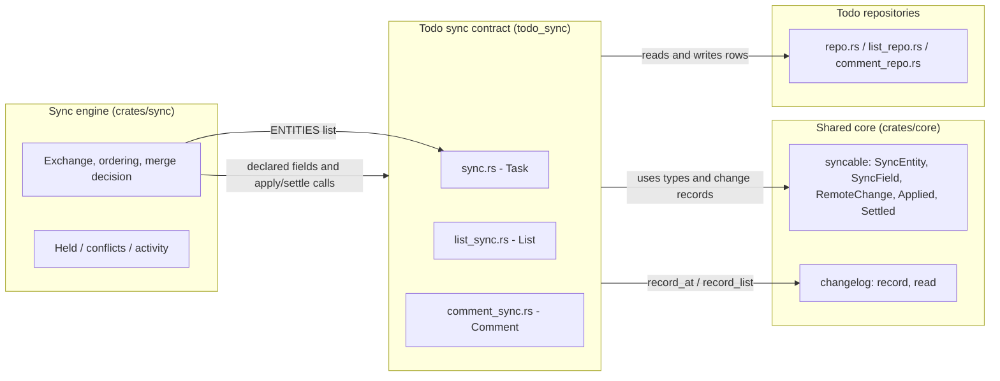
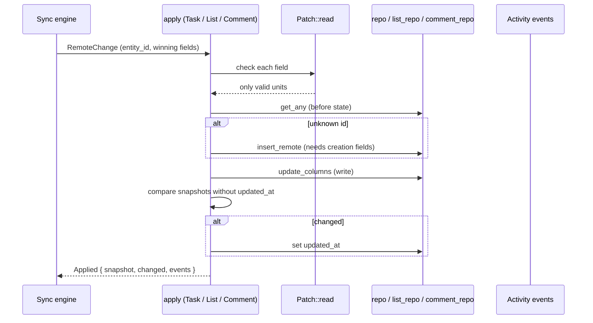
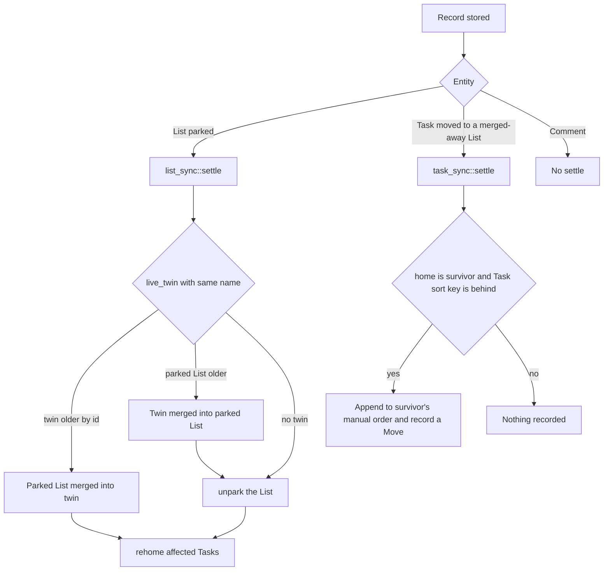

# todo_sync

## Introduction

`todo_sync` is the Todo module's side of the sync contract. The generic sync engine ([Sync_Replication_Engine](../Sync_Replication_Engine.md), see [sync_engine](sync_engine.md)) knows how to exchange, order and store change records between devices, but it knows nothing about Tasks, Lists or Comments. This module tells the engine:

1. Which fields of each Todo entity exist and how each one merges when two devices changed it (`SyncField` declarations).
2. How a received record is written into the Todo tables (`apply`).
3. What must be tidied up after a record is stored, such as parking a List whose name clashes or moving Tasks out of a deleted List (`settle`).

The three files are `crates/todo/src/sync.rs` (Tasks), `crates/todo/src/list_sync.rs` (Lists) and `crates/todo/src/comment_sync.rs` (Comments). The module's own data layer is described in [Task_and_Journal_Domain_Services/todo](../Task_and_Journal_Domain_Services/todo.md), and the change log and entity contract it plugs into are in [Data_Foundation/core](../Data_Foundation/core.md).

Privacy rule for every file here: Task, List and Comment text must never reach a log line. Logs use only ids and the `sync` target.

---

## Where it sits

`ENTITIES` in `sync.rs` is the list the engine is given: `[TASK, list_sync::LIST, comment_sync::COMMENT]`. Each entity is a `SyncEntity { name, fields }` constant, and the engine asks it for the merge rule of every field it receives.

---

## Entities and merge rules

Every field has one of these merge kinds (declared with `SyncField::text`, `value`, `order`, `derived`, and grouped with `.in_group`):

| Kind | Meaning | Used for |
|---|---|---|
| `text` | Newest wins for now; three-way merge planned | Task `title` and `notes`, Comment `body` |
| `value` | Newest write wins, whole value | most columns, `deleted_at`, `state`, `priority` |
| `order` | Manual order key | Task and List `sort_key` |
| `derived` | Recomputed locally, never trusted from a peer | `updated_at` (all entities) |
| group | Fields that must move together | `title`+`understood`, `when`, `state`, Comment `body`+`edited` |

### Task (`sync.rs`)

| Field | Kind / group | Notes |
|---|---|---|
| `list_id` | value | Placed through `list_repo::home` (see below) |
| `title`, `understood` | text, group `title` | Recognised words always come from the same device as the newest title |
| `notes` | text | |
| `due_date`, `due_time`, `repeat_freq`, `repeat_every`, `repeat_days`, `repeat_mode` | value, group `when` | The whole When group is taken from one device |
| `priority` | value | |
| `state`, `closed_at` | value, group `state` | Open Tasks have no close time; closed ones always do |
| `repeat_of`, `created_at` | value | |
| `sort_key` | order | Manual order |
| `deleted_at` | value | A delete on one device and an edit on another both stand |
| `skipped` | value | Not a column. Marks a Skip so History reads "Skipped" everywhere |
| `updated_at` | derived | Set to now when the row actually changed |

### List (`list_sync.rs`)

`name`, `emoji`, `task_sort`, `group_by`, `created_at`, `deleted_at` are values; `sort_key` is an order field; `updated_at` is derived. The folded name key (`name_key`) is derived from `name`.

### Comment (`comment_sync.rs`)

`body` (text) and `edited` (value) form the group `body`, so the "edited" flag always comes from the device that wrote the text. `task_id`, `created_at` and `deleted_at` are values. `updated_at` is derived and always moves forward. The Comment count on a Task is never stored, it is recomputed.

A Comment stays attached to its Task whatever state the Task is in; when the Task returns, so do its Comments.

---

## How a received record is applied

`apply(conn, &RemoteChange)` is the write path. Each entity follows the same shape:

1. **Read the patch.** `Patch::read` checks every received field (length, range, shape, group completeness). A unit that fails its checks is left out whole. A hostile or buggy peer can therefore only skip a field, never write an invalid value.
2. **Create if new.** A row can be created only from its first record, which must carry the creation fields (`title`/`name`/`body`, `sort_key`, `created_at`, plus `task_id` for Comments). Otherwise the record is kept for relay only and `changed` is false.
3. **Write.** `write` builds the column list and calls the repository `update_columns`.
4. **Compare snapshots.** The before and after snapshots are compared with `updated_at` stripped (`strip_updated`). If anything else changed, `updated_at` is set to now (Comments use `MAX(now, updated_at + 1)`).
5. **Return `Applied`** with the new snapshot, the `changed` flag and any user-facing `SyncEvent`s.

### Task-specific behaviour in `apply`

- **Visibility decides list placement.** In `write`, a Task is moved out of a List only if it is visible after the write. A deleted Task keeps its `list_id`, so every device holds the same place and Restore finds it where it was.
- **Missing Lists.** `home_or_inbox` resolves a `list_id` through `list_repo::home`: the List itself while live, the survivor it was merged into, or the Inbox (`None`). Moving to the Inbox emits `SyncEvent::TaskToInbox`.
- **Unknown repeat parent.** A `repeat_of` pointing to a Task this device does not have is cleared to `NULL`.
- **Deletion event.** When a live Task becomes deleted, `SyncEvent::TaskDeleted` is emitted with the title so the activity log can say what was deleted (title only goes to the event, never to logs).
- **Skipped marker.** `skipped` is read from the record's own fields and only appears in the snapshot of that record, so History reads "Skipped" on other devices.
- **`keep_out_of_missing_lists`.** After writing, a live Task still pointing at a missing List is moved to its home or the Inbox, as Undo of a delete does.

### List-specific behaviour in `apply`

- **Parked marker.** `list_repo::PARKED` is a sentinel stored in `deleted_at`. A List whose name would clash with another live List is stored parked; `Patch::read` rejects a received `deleted_at` equal to the marker, because it is not a real deletion time.
- **Clash check.** `live_twin` looks for another live List with the same `name_key`. If one exists, the incoming List is parked instead of going live, so the unique name index holds during the write.
- **Deleted here.** When a previously live List arrives deleted, `send_tasks_home` moves its Tasks to `home` (survivor or Inbox) and emits a `ListsMerged` event when there is a survivor.
- **Re-homing.** When a List changes (name, deletion, revival), `rehome` re-places every live Task whose change-log list choice names an affected List. Only the column is written, so nothing is recorded and every device ends with the same placement whatever order records arrived in.

### Comment-specific behaviour in `apply`

- If the Task named by `task_id` is unknown here, `task_id` is dropped; a new Comment without a Task is then kept for relay only.
- A new Comment is inserted with its `deleted_at` hidden until that field is applied, so it never appears half-created.

---

## Settling after storage

`settle(conn, &RemoteChange)` runs after the engine has stored the record. It returns `Settled { recorded, events }`. When `recorded` is true the engine knows that this device has written new change records of its own, which will then travel to the other devices.

### List name clash

Two devices can each create a List with the same name (ignoring case and accents), or one device can rename a List into another's name. The rule is deterministic and depends only on the two ids, so every device makes the same choice:

- The **older** List by id survives with all its own properties.
- The **newer** List is soft-deleted.
- Its Tasks join the **end** of the survivor's manual order, keeping their own relative order.
- The merge is recorded as ordinary changes (a `Move` per Task, a `Delete` for the List) made after the received record is stored, so they are stamped later and win on every device.

`merge` performs this and emits `SyncEvent::ListsMerged` (names and the devices that created each List, so the Activity log can say "merged from device X"). Keys only grow: a Task whose key is already past the end keeps it.

### Task that names a merged-away List

A Task made on a device that had not yet heard of the merge may name the merged-away List. `task_sync::settle` moves it to the survivor and, if its key falls behind the survivor's end, gives it a new key after the end and records a `Move`. Every device therefore ends with the newest such key.

---

## Public surface used by other modules

| Symbol | File | Role |
|---|---|---|
| `ENTITIES` | `sync.rs` | The entity list handed to the engine |
| `TASK`, `LIST`, `COMMENT` | `sync.rs`, `list_sync.rs`, `comment_sync.rs` | Field declarations and merge kinds |
| `apply` | all three | Write one received record |
| `settle` | `sync.rs`, `list_sync.rs` | Post-storage decisions (Comments have none) |
| `is_live` | `sync.rs` | Whether a snapshot is of a Task that is not deleted |
| `strip_updated` | `sync.rs` | Snapshot without the derived `updated_at`, used for change detection |

The shared helpers `Set<T>` (a value that may be NULL, distinct from "not sent"), `text`, `number` live in `sync.rs` and are reused by the other two files. The engine-side types (`SyncField`, `RemoteChange`, `Applied`, `Settled`, `SyncEvent`) are defined in `mnemora_core::syncable` and are documented in [Data_Foundation/core](../Data_Foundation/core.md) and [sync_engine](sync_engine.md).

---

## Related documentation

- [Sync_Replication_Engine](../Sync_Replication_Engine.md) - the parent module: the engine that calls into this contract.
- [sync_engine](sync_engine.md) - exchange, ordering and merge decision.
- [sync_conflicts](sync_conflicts.md) - clashes that cannot be settled by "newest wins" (text clashes, delete vs. edit, priority or status clashes).
- [sync_activity](sync_activity.md) - how `SyncEvent`s become one-line Activity entries.
- [sync_data_merge](sync_data_merge.md) - the end-to-end cluster behaviour these rules are tested with.
- [Task_and_Journal_Domain_Services/todo](../Task_and_Journal_Domain_Services/todo.md) - the Todo repositories, services and change recording this code writes through.
- [Data_Foundation/core](../Data_Foundation/core.md) - the change log, `syncable` types and `order` keys.
- [Sync_Connectivity_and_Pairing](../Sync_Connectivity_and_Pairing.md) - how devices find and pair with each other before any records move.

## Maintenance notes

- Adding a Todo field to sync means adding a `SyncField` entry in the matching `SyncEntity`, reading and validating it in `Patch::read`, and writing it in `write`. A field that is declared but not validated is silently ignored on receipt.
- Keep validation in `Patch::read` aligned with the rules in the Todo service, so a value a local write would refuse is also refused when received.
- Any new state that a record can imply must be decided in `apply` or `settle` on every device, not in the UI, so every device converges.
