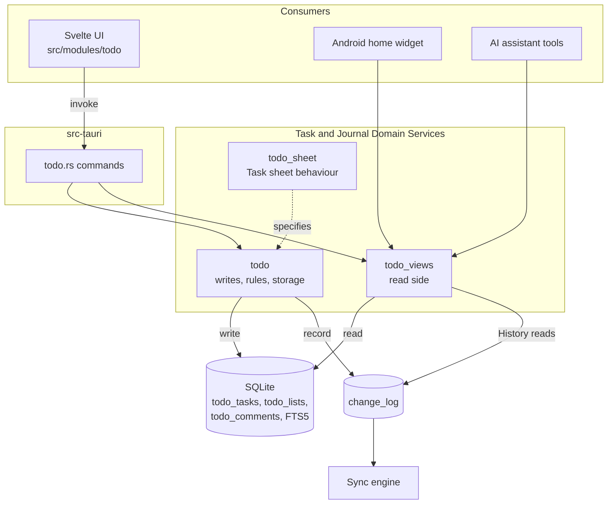

# Task and Journal Domain Services

## Purpose

`Task_and_Journal_Domain_Services` holds the domain rules for Tasks, Lists, Comments and the Task sheet in the Mnemora app. The Journal sits beside it in the same domain group. Most of the logic lives in the `mnemora-todo` crate (`crates/todo`). The Tauri host (`src-tauri/src/todo.rs`) exposes it as commands, and the Svelte UI calls those commands.

The module splits into three areas:

- **Write and core rules (`todo`)**: Task and List types, validation, recurrence, ordering, capture parsing, storage in SQLite and change-log records for Sync.
- **Read views (`todo_views`)**: Today, Upcoming and day counts, Task History lines, search, Android widget snapshots, and the read-only AI tools.
- **Task sheet rules (`todo_sheet`)**: the behaviour of the editor for a single Task (Priority, Won't do, Comments, editing sessions, delete and restore, repeats), verified end to end by command-level tests.

Every rule is defined once in the Rust crate. The UI, the widget and the AI assistant all read those same rules. Deletion is always soft, and every write is recorded in the change log, which gives Undo, History and Sync one shared source.

## Architecture

Reads in `todo_views` never change Tasks. "Today" is always passed in as `LocalNow`, so the views never read the clock for dates. The one exception is History, which takes its timestamps from the change log.

## Core components

- [todo](Task_and_Journal_Domain_Services/todo.md): the write side and core Todo domain. It covers the data model, capture parsing, recurrence, ordering, search rules, sync application and the shared test fixtures.
- [todo_views](Task_and_Journal_Domain_Services/todo_views.md): the read side. It covers date views and counts, Task History lines, search, widget snapshots and wording, and the three AI read tools.
- [todo_sheet](Task_and_Journal_Domain_Services/todo_sheet.md): the rules behind the Task sheet, including Priority, Won't do, editing sessions, Comments, repeats and History. It is specified by `src-tauri/src/todo_sheet_tests.rs`.