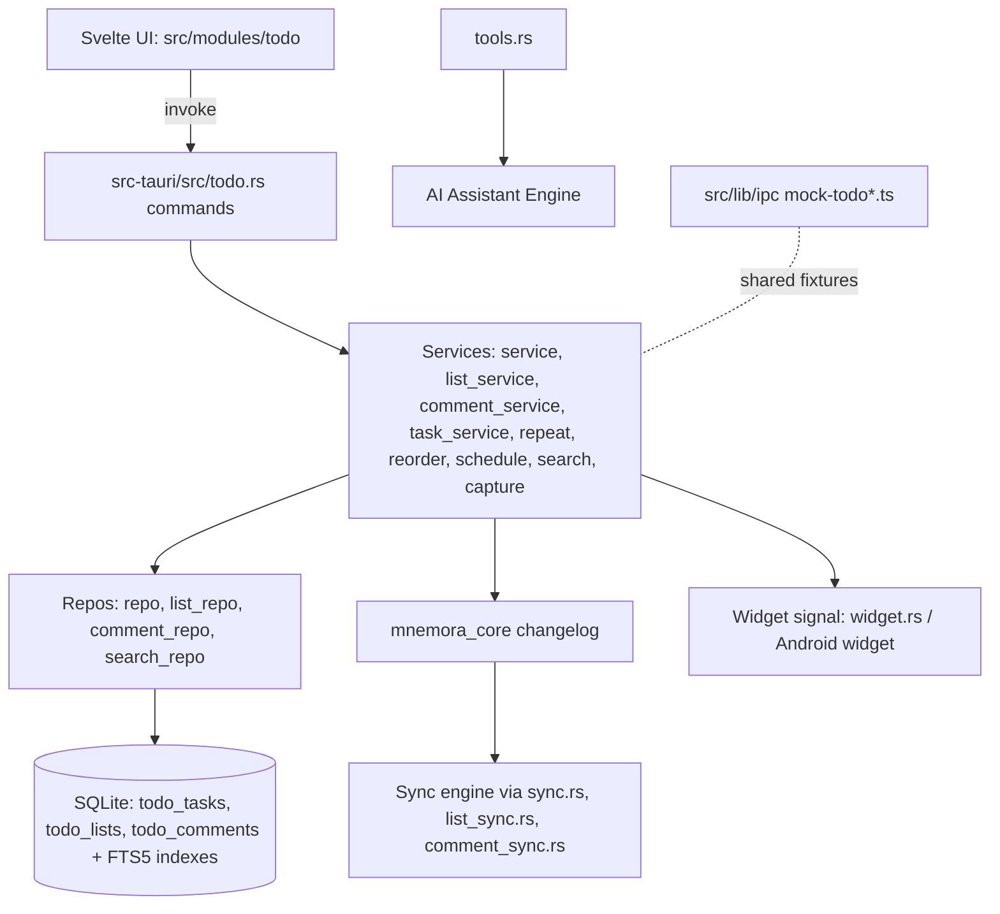

# Todo Module

## Introduction

The Todo Module (`mnemora-todo`, `crates/todo`) owns Tasks, Lists and Comments: their rules, their storage in SQLite, their change-log records for Sync, and the Tauri commands that expose them (`src-tauri/src/todo.rs`). It sits beside the Journal in the Task and Journal Domain Services. The Journal is covered in [Feature_Client_UI](../Feature_Client_UI.md); the sync engine that carries Todo changes between devices is in [Sync_Replication_Engine](../Sync_Replication_Engine.md); shared infrastructure (migrations, change log, settings registry, text folding) is in [Data_Foundation](../Data_Foundation.md).

The crate is deliberately thin at the boundary: the app crate only exposes commands, and every rule (validation, recurrence, ordering, search, parsing) lives in `crates/todo`.

## Architecture Overview

The `write` helper in `src-tauri/src/todo.rs` runs every Task and List write and signals the Todo widget on success, so no command can forget it.

## Core Data Model

| Table | Purpose |
|-------|---------|
| `todo_lists` | Flat groups. `name_key` (case and accent folded) is unique among live Lists. `task_sort` and `group_by` hold the List's page arrangement. |
| `todo_tasks` | One thing to do. `list_id` NULL means the Inbox. Holds the When (`due_date`, `due_time`), the Repeat fields, `priority` (1 to 4), `state` (open, done, wont), `closed_at`, `repeat_of` for occurrence copies, and `understood` (JSON of what capture read). |
| `todo_comments` | Notes on a Task, with an `edited` flag independent of `updated_at`. |
| `todo_tasks_fts`, `todo_comments_fts` | External-content FTS5 indexes kept in step by triggers. Soft-deleted rows stay indexed so Undo works; queries filter on `deleted_at`. |

Dates are `YYYY-MM-DD` and times `HH:MM`, both floating local. Ordering uses fractional-index keys (`sort_key`, ADR 0012). Migrations are append-only; the schema is built in `crates/todo/src/migrations.rs`.

Deletion is always soft (`deleted_at`). Nothing is erased, which is what makes Undo and Sync deletes possible.

## Key Behaviours

- **Capture**: `parse.rs` reads dates, times, Repeats, `#List` and `p1` to `p4` from typed text. It is pure, with the clock passed in. The browser mock runs the same cases from a shared JSON fixture.
- **Recurrence**: `recurrence.rs` and `repeat.rs` implement fixed and after-done Repeats. Completing a repeating Task writes a done occurrence copy (`repeat_of` points at the series) and moves the Task on. Reopening the latest occurrence rewinds the Task.
- **Ordering**: `reorder.rs` and `arrange.rs` place Tasks between neighbours. Dropping onto a day, priority or List group adopts that value as part of the same change.
- **Search**: `search.rs` and `search_repo.rs` match every word by prefix, quoted text as a phrase, typo-tolerant "similar" results via the FTS vocabulary tables.
- **History**: `history.rs` turns change-log records into readable lines, never including the Task's own text.
- **Sync**: `sync.rs`, `list_sync.rs` and `comment_sync.rs` apply received records. Incoming Lists are parked (hidden) until name clashes are settled; duplicate names merge into the older List.

## Sub-modules

The Todo Module is documented in two sub-module pages:

- **todo_views** ([todo/todo_todo_views.md](todo/todo_todo_views.md)): read-side views and their helpers: Today and Upcoming scheduling, day counts, History lines, the widget's view model and text, and the Tasks and Lists search queries (`schedule.rs`, `history.rs`, `search.rs`, `search_repo.rs`, `tools.rs`, `widget.rs`, `widget_text.rs`).
- **todo_sheet** ([todo/todo_todo_sheet.md](todo/todo_todo_sheet.md)): the Task sheet's behaviour as exercised end to end: editing titles and notes, Comments, Priority, Done, Won't do, Skip, delete and restore, and the sync and history rules that govern them (covered by `src-tauri/src/todo_sheet_tests.rs`).

The remaining core lives in this page's scope: the Task and List types and rules (`task.rs`, `list.rs`), the services and repositories, Quick edit and capture (`capture.rs`, `parse.rs`), reordering, recurrence, and the migrations, backfill and module registration in `lib.rs`.

## Tests and Shared Fixtures

Command-level tests are in `src-tauri/src/todo_*_tests.rs` and drive the real commands through a mock Tauri runtime (`test_support.rs`). Shared JSON fixtures under `src/lib/ipc/fixtures/` (`todo-rules.json`, `todo-order-rules.json`, `todo-search-rules.json`, `parse-cases.json`) run both in Rust and against the TypeScript browser mock, so the two implementations cannot drift (ADR 0009).

## Build and Configuration

- The crate is declared in `crates/todo/Cargo.toml` (`mnemora-todo`) with the workspace-pinned dependencies `rusqlite`, `rusqlite_migration`, `specta` and `uuid`.
- Build and test commands are in `Makefile` (`make test`, `make bindings`) and `package.json`; see [Build_and_Packaging](../Build_and_Packaging.md).
