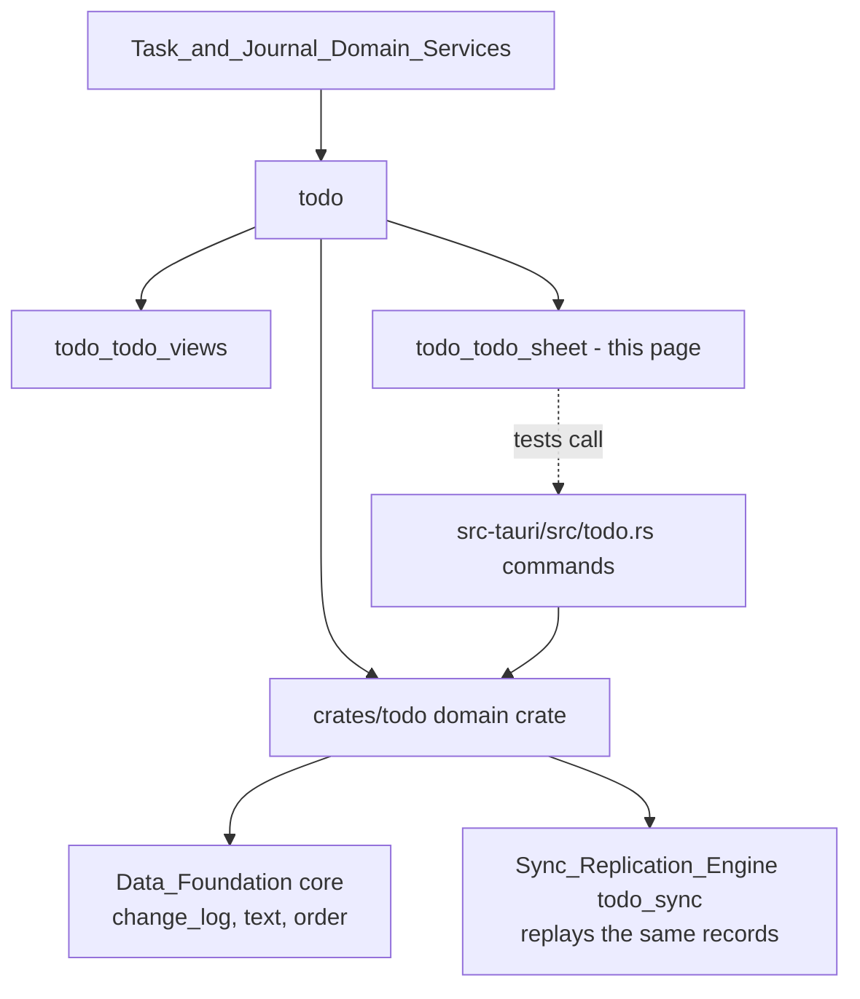
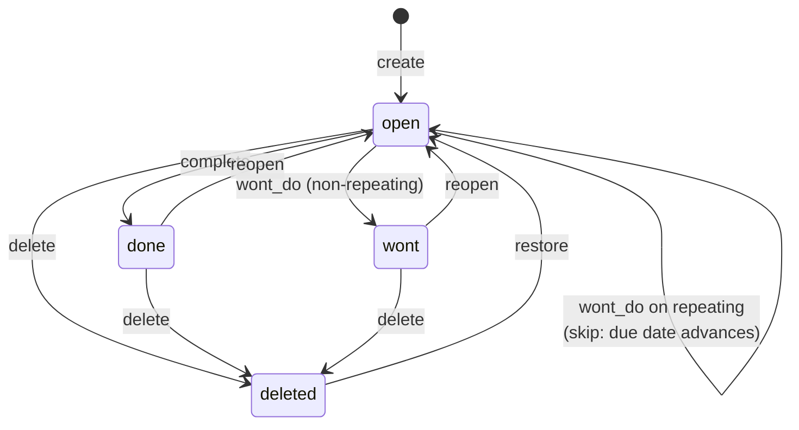
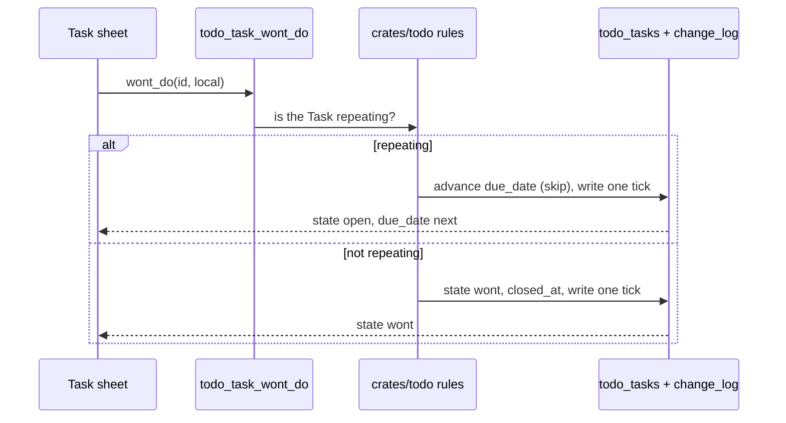
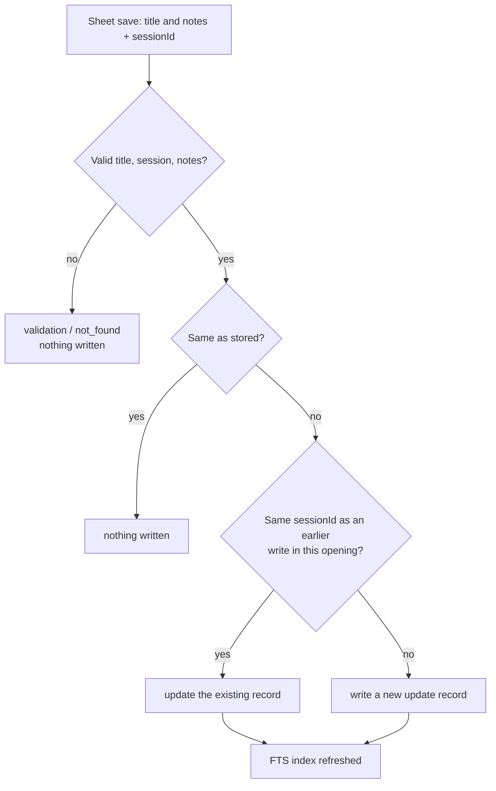
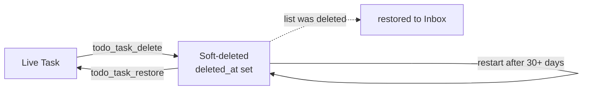
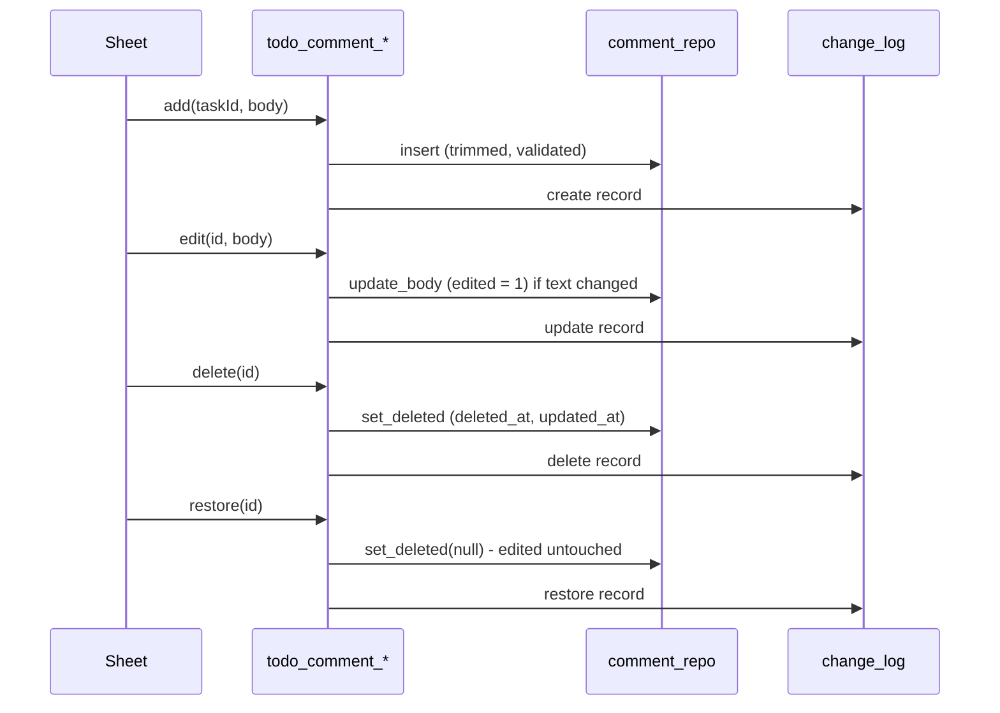

# todo_todo_sheet

The `todo_todo_sheet` module is the command-level contract for the **Task sheet**, the detail view where a person edits one Task. It defines and tests the rules behind five areas of that sheet: **Priority**, **Won't do**, **open steps** (checklist items in the notes), **editing sessions** with **History**, and **delete / restore**, plus the **Comments** attached to a Task.

The module contains no production code of its own. Its only source is `src-tauri/src/todo_sheet_tests.rs`, a command-layer test suite that drives the real Tauri commands through the mock runtime (ADR 0009) and checks the results in the database and the `change_log`. The rules it protects live in the `mnemora_todo` crate (see [todo](../todo.md)).

## Where it sits

| Relationship | Page |
|---|---|
| Parent module and its full command set | [todo](../todo.md) |
| Sibling: list, Today, Upcoming, search views | [todo_todo_views](todo_todo_views.md) |
| Overlapping sheet-level description used by the UI | [todo_sheet](../todo_sheet.md) |
| Change log, text and ordering primitives | [Data_Foundation core](../../Data_Foundation/core.md) |
| How these records reach other devices | [todo_sync](../../Sync_Replication_Engine/todo_sync.md) |
| Client-side editing of the sheet | [todo-task-editing](../../Feature_Client_UI/todo-task-editing.md) |

## What the module guarantees

The suite is organised around six behaviour groups. Each group is a set of rules the sheet relies on.

| Group | Guarantee (from the tests) |
|---|---|
| Priority | Every new Task starts at priority 4; values 1–4 are accepted, anything else is a `validation` error. Changing it is one `update` record; setting the same value writes nothing. Only an open, existing Task can change priority. |
| Won't do | Closes a Task into the done set with state `wont`, but it is **not counted as done** in progress totals. Reopening undoes it. On a repeating Task it skips the occurrence in Rust instead of closing it. |
| Open steps | Completing a Task with unchecked steps is still allowed. "Tick all and complete" is a notes update followed by completion. |
| Editing sessions | Saves that share a `sessionId` make one change record; a new session makes another. Saving unchanged content writes nothing. |
| History | Lines are derived from the `change_log`, newest first, and never contain the Task's own text. |
| Delete / restore | Delete is soft; every view drops the Task at once; restore returns it to its place. Deletion records survive a restart. |

Comments are covered in their own section below.

## Core components

### Test helpers

| Helper | Role |
|---|---|
| `bodies(app, task)` | Returns the bodies of a Task's live Comments, oldest first, by calling `todo_comments`. |
| `inbox(app)` | Returns the titles in the Inbox view (`todo_inbox`), flattened from its groups. |

Other helpers in the same file (`create`, `dated`, `priority`, `complete`, `update`, `history`, `log`, `age`, `repeating`) wrap one command each and are the fastest way to read a test's intent.

### Comment storage (`crates/todo/src/comment_repo.rs`)

The sheet's Comment operations ultimately write to `todo_comments`. Two of its functions carry the sheet's rules at the SQL level.

**`update_body`** rewrites a Comment's body, sets `edited = 1`, and stamps `updated_at`. It is the only path that marks a Comment as edited.

**`set_deleted`** sets or clears `deleted_at` and always stamps `updated_at`, so that a synced peer sees the newer state. It deliberately does **not** touch `edited`: deleting and restoring a Comment never makes it look edited.

Supporting functions: `insert`, `get` (live rows only), `get_any` (with `deleted_at`), `every`, `for_task` (live Comments ordered by `created_at, id`), and `update_columns`, which applies column values received from another device. Column names passed to `update_columns` are the caller's constants, never user input.

### Deletion choices for Lists (`crates/todo/src/list.rs`)

The sheet's Task-deletion rules sit beside the List deletion rules that the History test relies on. `DeleteChoice` is the tagged enum sent to `todo_list_delete`:

| Variant (`kind`) | Effect on the List's Tasks |
|---|---|
| `delete_tasks` (default) | Deleted with the List. |
| `move_to_inbox` | Moved to the Inbox. |
| `move_to_list` (with `list_id`) | Moved to another List. |

A Task whose List is later deleted and that is then restored returns to the Inbox (see Delete and restore).

## Rules in detail

### Priority

- Range 1–4 (1 is highest); a new Task is 4.
- A value outside the range returns `validation`; an unknown Task returns `not_found`.
- A Task that is done or Won't do cannot be re-prioritised (`validation`).
- Ordering effect: inside a time block on Today, Tasks sort by priority, then manual order. A timed Task still sits before untimed ones; priority only orders within a block. Upcoming days order by priority inside each block too.

### Won't do

Won't do is a **tick** (`op = tick`) that moves the Task to state `wont` and stamps `closed_at`.

Rules confirmed by tests:

- Won't do is refused for a Task that is already closed (`validation`) and for an unknown one (`not_found`).
- Won't do is listed with state `wont` in the done set of Today and `todo_done`, but is excluded from progress counts and from the sidebar's Today and Inbox counts.
- Reopening restores the Task to open with `closed_at` cleared. Won't do plus reopen gives two `tick` records.

#### Won't do on a repeating Task

Instead of closing, the command skips the current occurrence in Rust. The next due date is advanced, and the Task stays open. The change is the same single `tick` record a skip writes, and the history line reads `Skipped (Wed → Sat)`.

### Open steps and completion

Steps are Markdown checklist lines inside `notes`.

- Completing a Task with unchecked steps is allowed. The sheet's plain **Complete** action changes only the state; the notes stay as they are.
- **Tick all and complete** first updates the notes (every step ticked), then completes the Task. These are two separate writes; the notes update appears in history as a notes edit.

### Editing sessions and saves

The sheet sends a `sessionId` with every save of title and notes. The rules are:

- Several saves in one session produce **one** `update` record, which carries the latest values.
- A save with a different `sessionId` produces a new record.
- Saving the stored values again writes nothing.
- Titles: non-empty, one line, at most 500 characters (501 is refused). A blank `sessionId` is `validation`.
- Notes: up to 100 000 characters; 100 001 is refused and nothing is written.
- Refused updates (bad title, missing session, unknown Task) write no record and leave the stored title untouched.
- Title and notes are indexed for search (the FTS index follows edits).

### History

History is `todo_task_history`: a list of text lines, newest first, read from the `change_log` snapshots for that Task.

Line rules, as shown by the tests:

| Change | Line example |
|---|---|
| Creation | `Created` |
| Title or notes saved (one line per field per sheet opening) | `Title edited`, `Notes edited` |
| Priority | `Priority P4 → P1` |
| Due date | `Due date Thu 22 Oct → Fri 23 Oct`, `Due date no date → Thu 22 Oct` |
| Time | `Time set to 09:30`, `Time 08:00 → 09:00`, `Time removed` |
| Repeat | `Repeat set: Every 2 weeks on Mon, Sat`, `Repeat removed` |
| List | `Moved 📥 Inbox → 💼 Work` |
| Won't do / reopen | `Won’t do`, `Reopened` |
| Repeating occurrence | `Done (occurrence of 21 Oct)`, `Reopened (occurrence of 21 Oct)` |
| Skip | `Skipped (Thu → Sat)` |
| Delete / restore | `Deleted`, `Restored` |

Rules confirmed by tests:

- **Lines never contain the Task's own text.** Titles and notes appear only as "edited"; a test asserts that a secret word never appears in any line.
- **One line per field per opening.** Many saves in one opening produce one `Title edited` and one `Notes edited`, even when other changes happen in between. A new opening of the sheet adds a new line.
- **Order follows what happened, not the wall clock.** Lines are ordered by the log's sequence, so history stays correct when the clock freezes or goes backwards.
- A skip is not reported as an occurrence or as a date edit. Undoing a skip with a plain date write shows an ordinary `Due date` line.
- Completing a repeating Task does not report the next date as a separate edit; the copy created for the occurrence reads the same way.
- Deleted and restored Tasks keep their history. A Task moved into a list that was later deleted names the deleted list (`≡ Home`).
- An unknown Task returns `not_found`.

### Delete, restore and retention

- Delete sets `deleted_at` and writes a `delete` record whose snapshot carries the time. Every view drops the Task at once.
- Deleting an already-deleted Task, or restoring a live one, is refused (`not_found` and `validation` respectively).
- Restore clears `deleted_at`, writes a `restore` record, and returns the Task to its place. If its List was deleted in the meantime, the Task returns to the Inbox.
- Records are never erased on startup. A Task deleted more than 30 days earlier still counts in the table and can still be restored; the change log keeps every row.
- Deleting a Task with comments leaves its Comments in place, soft-deleted with it.

### Comments

Comments are short notes attached to a Task, shown in order on the sheet.

| Rule | Behaviour |
|---|---|
| Body | Trimmed; not blank; up to 5 000 characters; line breaks allowed. Otherwise `validation`, nothing written. |
| Owner | An unknown Task returns `not_found`. |
| Order | Oldest first. |
| Count | `comment_count` on the Task is recomputed from live Comments only. |
| Edit | Changing the text sets `edited`; saving the same text is not an edit. |
| Delete | Soft delete with a `delete` record. Restore brings it back with `edited` unchanged, and restoring a live Comment is refused (`validation`). |
| Done Task | A done Task can still be commented. |
| Repeating Task | Comments move with the occurrence: completing copies the Comments to the new occurrence record, the Task keeps none, and reopening the occurrence brings them back. |

Each Comment operation writes exactly one change record, which is why the Comment history in the log reads `create`, `delete`, `restore` in order. Completing a repeating Task also writes one `move` record per Comment, including soft-deleted ones, so that Undo can bring deleted Comments back.

### Repeating occurrences

Completing a repeating Task creates an occurrence row (`repeat_of` set) and advances the original. Completing the same occurrence again after a reopen **reuses its row** and its id: there is never a second occurrence for the same date, and the deletion flag is cleared.

## Change records

Every rule above writes to `change_log` with `module = 'todo'`. The suite reads these records to assert exact sequences. Records used here:

| Operation | Entity | Written when |
|---|---|---|
| `create` | `todo_task`, `todo_comment` | A Task or Comment is made |
| `update` | `todo_task` | Priority, date, title and notes changes; list moves |
| `tick` | `todo_task` | Complete, Won't do, reopen, skip |
| `delete` / `restore` | `todo_task`, `todo_comment`, `todo_list` | Soft delete and undo |
| `move` | `todo_comment` | Comment follows a completed repeating occurrence |

Plain reorders and no-op saves write nothing. A Task's history is a view over these records, which is why History is reliable across devices once the records are synced (see [todo_sync](../../Sync_Replication_Engine/todo_sync.md)).

## Testing

The file `src-tauri/src/todo_sheet_tests.rs` has these groups, each a set of `#[test]` functions:

| Group | Focus |
|---|---|
| Priority | Range, change records, open-task requirement, time-block ordering |
| Won't do | Done set vs progress, reopen, repeating skip, refusals |
| Open steps | Complete with steps open, tick-all-and-complete |
| Editing sessions | Session grouping, limits, FTS after edits, refusals |
| Delete / restore / retention | Views, restore place, list-deleted fallback, 30-day survival |
| Comments | Add, edit, delete/restore, repeating-occurrence moves, length limits |
| History | Line wording, order, privacy, one line per field, wall-clock independence |

The suite uses the shared fixtures from `src-tauri/src/test_support.rs` (`TestApp`, `inbox_tasks_of`, `tasks_of`, `close_all_on`) and a fixed date (`2026-10-21`) for all Today-relative behaviour. Helpers that age rows (`age`) back-date `deleted_at` to test retention.

Run the suite through the project's test target (`make test`, see [Build and Packaging](../../Build_and_Packaging.md)).

## Limits and notes

- The module has no runtime code. Changing a rule means changing the `mnemora_todo` crate and then the tests here.
- Sheet-level behaviour is also described from the UI side in [todo_sheet](../todo_sheet.md); this page documents the command contract the sheet depends on.
- The limits (500-character titles, 100 000-character notes, 5 000-character Comments) are enforced in Rust; the client should not be the only check.
