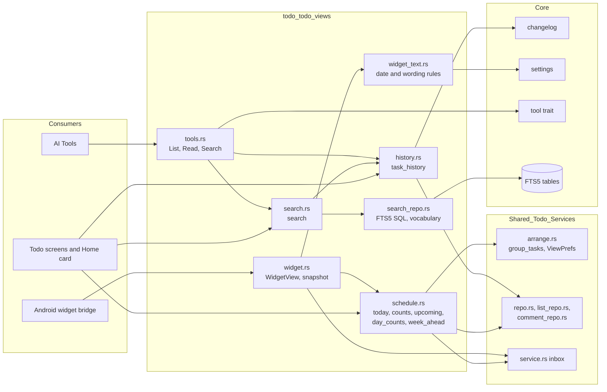
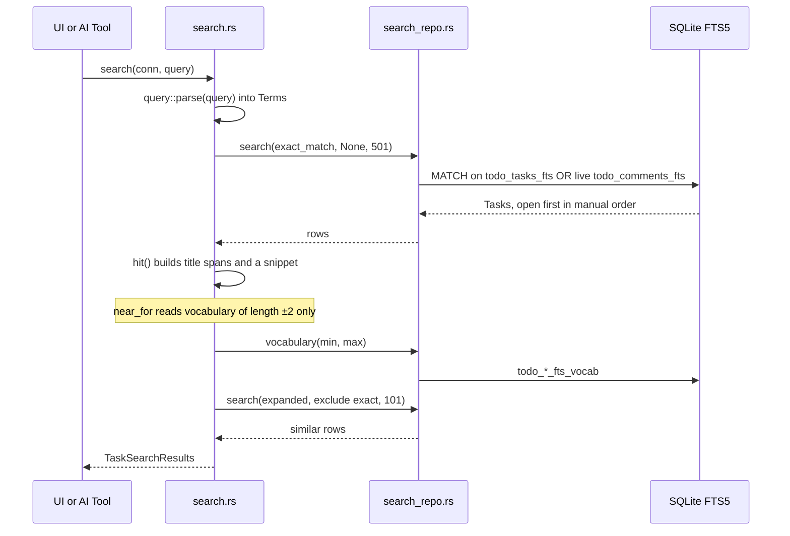
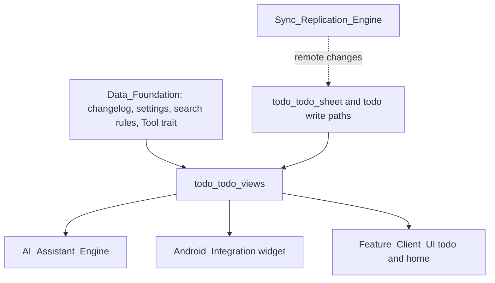
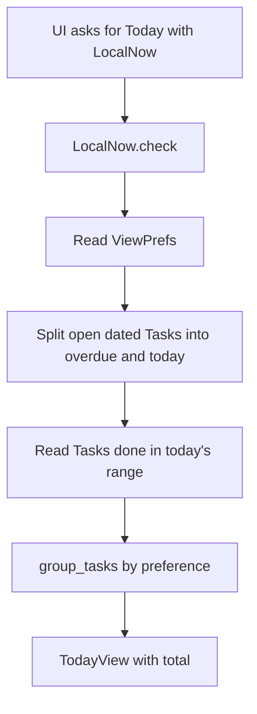
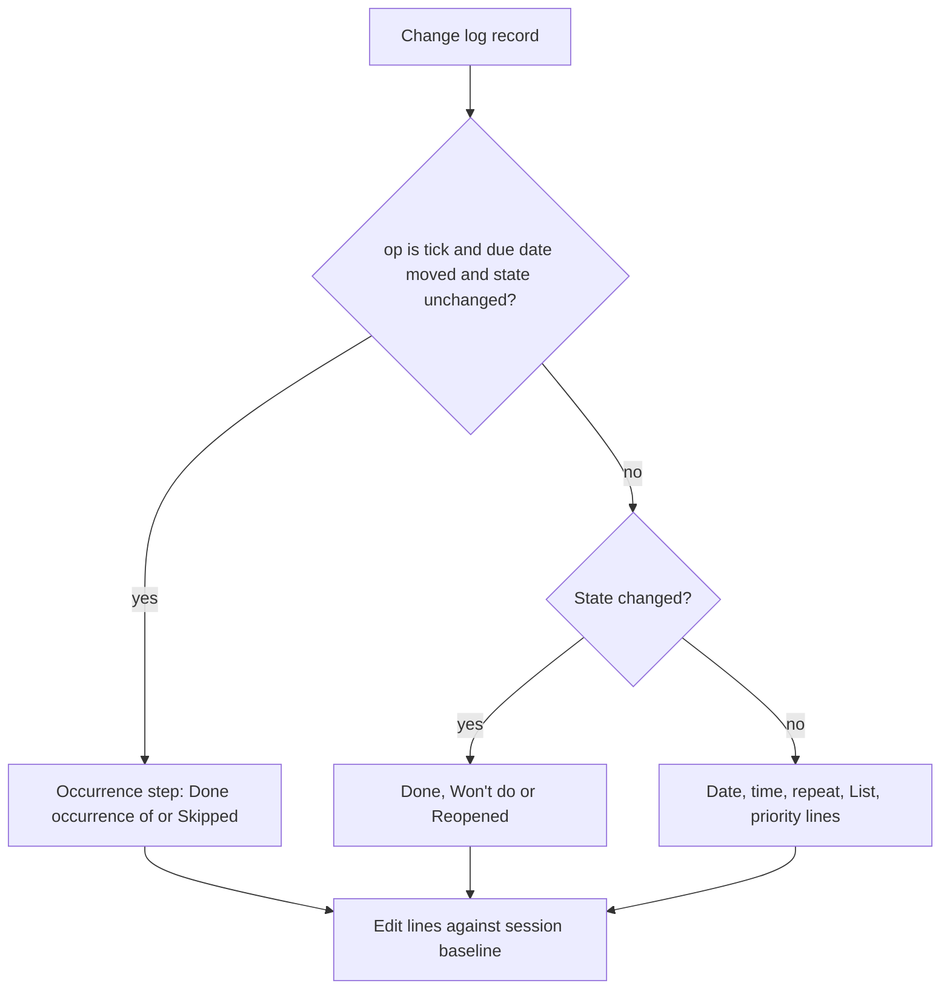

# todo_todo_views

The read side of the Todo domain service. This module answers questions about Tasks without changing them: what is due today, what is coming up, how many open Tasks are left for the badge, what a Task's History says, how a search runs, what the AI may read, and what the Android home widget draws. It sits in the [Todo domain service](../todo.md) next to the write paths described in [todo_todo_sheet](todo_todo_sheet.md).

The module's Rust code lives in `crates/todo/src/` (`schedule.rs`, `history.rs`, `search.rs`, `search_repo.rs`, `tools.rs`, `widget.rs`, `widget_text.rs`). Its sibling page [todo_views](../todo_views.md) covers the same files from the view-model angle; this page focuses on how the read paths are wired to the app, the AI, and the widget.

## Purpose at a glance

| Read path | Entry points | Consumer |
|---|---|---|
| Today / Upcoming / counts | `schedule::today`, `upcoming`, `counts`, `day_counts`, `week_ahead` | Todo screens, Home card, badge |
| Task History | `history::task_history`, `record_lines`, `first_line` | Task sheet, AI `todo_read` |
| Search | `search::search`, `search_repo::search`, `vocabulary` | Todo search, AI `todo_search` |
| AI Tools | `tools::List`, `Read`, `Search` | [AI_Assistant_Engine](../../AI_Assistant_Engine/ai_assistant.md) |
| Widget snapshots | `widget::snapshot`, `lists`, `settings_affect_widget` | [Android home widget](../../Android_Integration/widget.md) |
| Widget wording | `widget_text::*` | Widget rows, Quick add toast |

Every read takes a `LocalNow` (the device's notion of today, passed in by the UI or the bridge) and never reads the clock itself for dates. Text of Tasks, notes and queries is never written to log lines.

## Architecture

The views never write. Writes (create, tick, move, reorder) live in the write-side modules, which record each change in the change log. History is then rebuilt by reading that log, so it is the same on every device (see [Data_Foundation](../../Data_Foundation.md) for the log itself).

## Components

### Schedule: Today, Upcoming and counts (`schedule.rs`)

- **`today(conn, local)`** returns a `TodayView`: overdue Tasks first (oldest date first), then today's Tasks grouped by `ViewPrefs.group_today`, the Tasks done today, and a `total` for "N of M done". Timed Tasks sort by time; within one time block a more urgent Priority goes first. Priority grouping is dropped when no Task due today has a Priority.
- **`counts(conn, local)`** returns `TodoCounts`, the single read behind the badge and the Home card: `due_today`, `overdue` (the badge turns red above zero), up to `CARD_TASKS` (5) Tasks, the soonest later Task as `next`, and `any_tasks` (false only on a first run).
- **`upcoming(conn, local)`** returns `UpcomingView` with overdue first, then future Tasks grouped by `ViewPrefs.group_upcoming`.
- **`week_ahead(conn, local, days)`** is the widget's fixed Upcoming: overdue plus one group per day for the next seven days, always by day, regardless of the preference.
- **`day_counts(conn, from, to, exclude)`** returns open Task counts per date for the When picker's dots, optionally leaving out the Task being dated.

Write-side helpers (`set_when`, `restore_when`, `move_overdue`) share `assign_when` and `settle_when`; they are documented in [todo_todo_sheet](todo_todo_sheet.md) and [todo](../todo.md).

### History (`history.rs`)

History is a readable projection of a Task's change log records (ADR 0008). `task_history` walks the records for one Task in order and turns each change into `HistoryLine { at, kind, text }`, newest first. Kinds include `create`, `done`, `skip`, `reopen`, `wont`, `delete`, `restore`, `list`, `date`, `time`, `repeat`, `priority`, `title` and `notes`.

Key rules:

- Each record's own `fields` are applied to a running state (`advance`). The record's snapshot is not trusted for history, because a received record holds the receiver's merged state and would differ between devices after concurrent edits. Records without `fields` (from before Sync) fall back to their snapshot.
- A repeating Task ticked without closing is an **occurrence step**, not a completion. The due date moves forward and the line reads `Done (occurrence of 18 Oct)`; a `skipped` marker reads `Skipped (Thu → Sat)`.
- Title and Notes edits are compared with a **baseline** taken before each editing session, so one opening of the sheet yields one "Title edited" and one "Notes edited" line, however many saves happened in between.
- Lines hold dates, List names and Priorities, never the Task's own text.

`first_line`, `list_label`, `short_day`, `day_text`, `skip_days` and `repeat_label` are the wording helpers. `repeat_label` is shared with `widget_text::repeat_text` so the History and the UI say a Repeat the same way.

### Search (`search.rs`, `search_repo.rs`)

`search::search(conn, query)` returns `TaskSearchResults` with two groups:

- `exact`: Tasks matching every word (prefix match) or quoted phrase, capped at 500 (`truncated` is set when cut).
- `similar`: Tasks that match only when a word is allowed a typo, capped at 100, never repeating an `exact` hit.

Flow:

- `search_repo::search` excludes deleted Tasks and deleted Comments. Results list open Tasks first in manual order, then closed ones, latest closed first.
- A snippet comes from the first matching note line, else the first matching Comment, windowed around the match.
- Known limit (documented in code): words must all match in the Task's title and notes together, or all in one Comment. Words split between a Task and its Comments find nothing.
- `search` never logs or records; hostile input is not an error, it simply matches nothing.

The search rules themselves (parsing, prefix, accents, typo tolerance) come from `mnemora_core::search` and are shared with the Journal; see [Data_Foundation](../../Data_Foundation.md).

### AI Tools (`tools.rs`)

Three read-only Tools implement the `mnemora_core::tool::Tool` trait so the AI can use them (ADR 0002 amendment, ADR 0018):

| Tool | Name | Purpose | Limits |
|---|---|---|---|
| `List` | `todo_list` | Tasks by state, List, due range, Priority, closing day | default 30 rows, max 100; `next_offset` pages |
| `Read` | `todo_read` | One Task in full, with optional steps, Comments, History | notes in 8 KB pages via `next_offset` |
| `Search` | `todo_search` | Search results, open ones first | default 10, max 25; filters by state and List after search |

Behaviour shared by the three:

- Deleted rows are never returned; unknown Lists are refused as data (`Output::error`), not as failures.
- Dates use the device's zone, so closing days are compared in SQLite's local time.
- Large result sets are trimmed with `fit_rows`, which sets a truncated flag instead of failing.
- The `Search` Tool calls the same `crate::search` as the app, then filters in Rust, so its results can be capped by the 500/100 search limits before paging.

The AI never writes through these Tools; the AI-side registration and permission rules are in [AI_Assistant_Engine](../../AI_Assistant_Engine/ai_assistant.md).

### Widget snapshots (`widget.rs`)

`WidgetView` names what the widget shows: `today`, `upcoming`, `inbox`, `all`, or `list:<id>`. `WidgetView::parse` reads that name and rejects anything else.

`snapshot(conn, view, local)` builds a `WidgetSnapshot` with a title, an optional header count (red `N overdue`, or grey `N left`), groups with headings and tones, and an `EmptyState` when there is nothing to list. Every word is final here so the Android side does no date or wording logic.

- **Today** reuses `schedule::today` and splits its output into an Overdue run and a Today run.
- **Upcoming** uses `week_ahead` (seven days, always by day).
- **Inbox** uses `Inbox` from `service.rs` and marks rows with their List only in the "No date, in a List" group.
- **All** and **List** group open Tasks through `arrange::group_tasks`; a single List uses its own grouping and sort.

`counted()` drops empty groups and derives the header count from the rows actually shown. `lists(conn)` gives the setup screen the Lists in sidebar order. `settings_affect_widget(module, keys)` decides whether a settings save must redraw the widget: the `core` theme, time format and week start, and the Todo grouping and sort preferences.

`app_theme` is a Device setting, so the bridge fills it in; the Rust side leaves it empty.

### Widget wording (`widget_text.rs`)

Rust ports of the app's TypeScript text rules, so Kotlin needs no date logic:

- `TimeFormat` and `WeekStart` read `core.time_format` and `core.week_start` through `mnemora_core::settings`.
- Dates: `row_date_label` (Today, Tomorrow, Yesterday, a weekday within the week, then `28 Oct`), `row_day_label` for future rows, `overdue_day_label` for late rows, `day_heading` for Upcoming headings.
- Times: `format_hm` gives `21:30` or `9:30 PM`.
- Titles: `plain_title` strips Markdown marks; `quoted_title` cuts to 34 characters for toasts.
- Messages: `completed_message`, `completed_repeat_message`, `landed_in`, `quick_added_message`, `meaning_text`, `when_chip_label`.

The same cases run in Rust and in Vitest from `src/lib/ipc/fixtures/widget-text.json`, so the two sides cannot drift. The Vitest side is in [Feature_Client_UI](../../Feature_Client_UI.md).

## How the module fits in

- Writes come from the write-side Todo modules and are logged; this module only reads the resulting rows and log.
- Remote changes arriving through Sync are reflected because the views read the merged database; History stays identical across devices because it is built from record `fields`.
- The widget and the app use the same `schedule` functions, so the Today list on the home screen matches the app.

## Key flows

### Showing Today

### Ticking a repeating Task in History

## Testing

Behaviour is tested from the Tauri side rather than in this crate alone:

- `src-tauri/src/todo_search_tests.rs` covers exact and similar search, snippets, ordering and that search never logs or records.
- `src-tauri/src/todo_sheet_tests.rs` covers History lines (`history_reads_the_change_log_as_lines_newest_first`, `history_lines_never_hold_the_tasks_own_text`, and related cases) and the views a delete or restore affects.
- `src-tauri/src/widget_tests.rs` covers every snapshot shape, empty states, the day rules and that widget writes signal the widget once.
- `crates/todo/src/history.rs` and `widget_text.rs` carry unit tests for wording; `widget_text.rs` also runs the shared JSON fixture.

Run the suite with `make test` (see [Build_and_Packaging](../../Build_and_Packaging.md)).

## Related pages

- [Todo domain service](../todo.md): parent module and the write side.
- [todo_todo_sheet](todo_todo_sheet.md): Task sheet, edits and History display.
- [todo_views](../todo_views.md): view-model overlap with this page.
- [Data_Foundation](../../Data_Foundation.md): change log, settings, search and Tool contracts.
- [AI_Assistant_Engine](../../AI_Assistant_Engine/ai_assistant.md): how the Tools are offered to the model.
- [Android_Integration](../../Android_Integration.md): the widget that renders the snapshots.
- [Sync_Replication_Engine](../../Sync_Replication_Engine.md): how remote changes reach these views.
