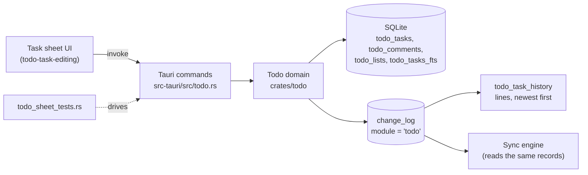
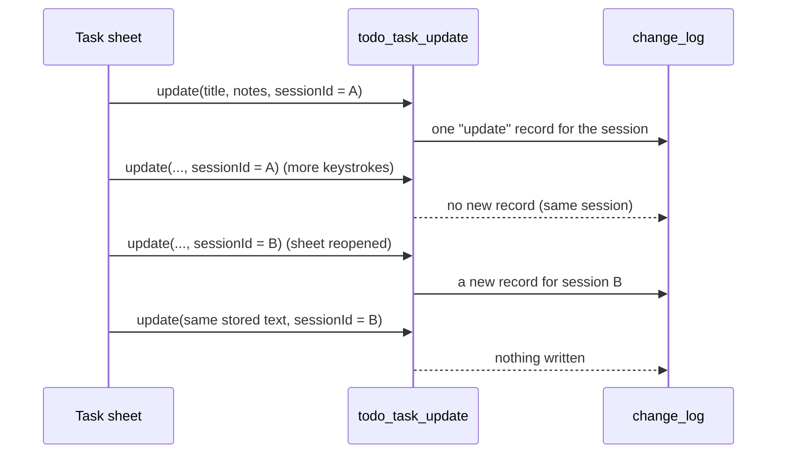
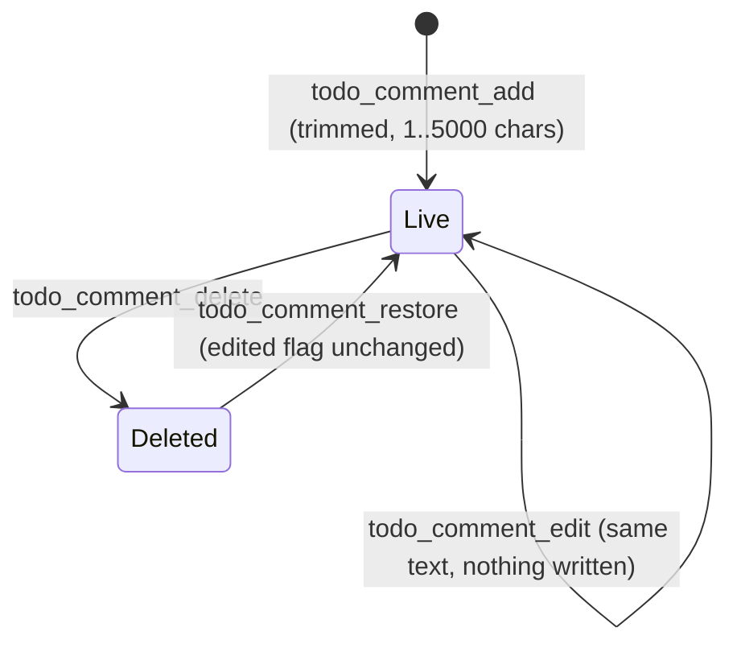
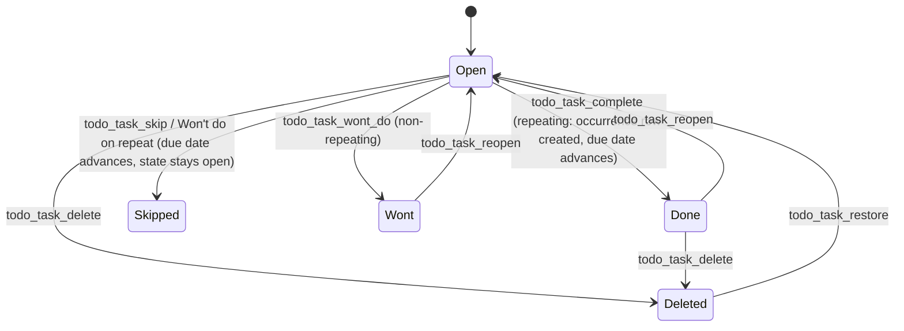
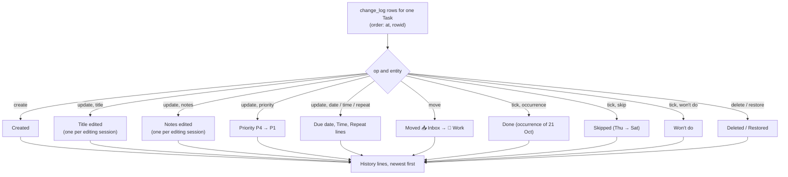

# Todo Sheet (Task sheet rules)

## Introduction

The **todo_sheet** module defines the rules behind the Task sheet: the editor a person opens on a single Task. It covers Priority, Won't do, open steps (checklist items inside the notes), editing sessions for Title and Notes, Delete / Restore, Comments, and History (the per-Task change log shown as readable lines).

The module has no production code of its own in the provided components. Its only core component file is `src-tauri/src/todo_sheet_tests.rs`, a set of command-layer tests that drive the real Tauri commands through the mock runtime (ADR 0009). The behaviour described below is therefore taken from those tests and from the command names they call. The implementation in `crates/todo` and `src-tauri/src/todo.rs` was not read for this page, so details of storage layout are inferred from the test queries.

Related pages:

- Parent: [Task_and_Journal_Domain_Services](../Task_and_Journal_Domain_Services.md)
- Sibling domain pages: [todo_views](todo_views.md) (Today, Upcoming, Inbox, Search views), [todo](todo.md) (core Todo domain)
- Shared Todo sheet page under the todo tree: [todo_todo_sheet](todo/todo_todo_sheet.md)
- Change log and settings: [Data_Foundation](../Data_Foundation.md)
- Sync of the same records: [Sync_Replication_Engine](../Sync_Replication_Engine.md)
- Client editor for the sheet: [todo-task-editing](../Feature_Client_UI/todo-task-editing.md)
- IPC layer: [Tauri_Host_and_IPC_Bridge](../Tauri_Host_and_IPC_Bridge.md)

## Where the module sits



The sheet reads and writes through the same commands used by Today, Upcoming and the widget. Every write that matters for History or Sync is a row in `change_log`.

## Core concepts

| Concept | Meaning in the sheet |
| --- | --- |
| Priority | An integer 1 to 4 on an open Task. New Tasks start at 4. 1 is most urgent. |
| Won't do | A closing action that moves an open Task to state `wont`. It is a tick, not a completion. |
| Skip | Advances a repeating Task to its next date without completing it. |
| Occurrence | One completed instance of a repeating Task. Completing a repeating Task creates a copy that holds the finished occurrence; the original keeps running. |
| Editing session | An opening of the sheet, identified by `sessionId`. All saves in one opening share one change record per field. |
| Open steps | Markdown checklist items (`- [ ]` / `- [x]`) inside Notes. They do not block completion. |
| Comment | A short note attached to a Task, up to 5000 characters. |
| History line | A human-readable line built from one change-log record. It never includes the Task's own title or notes text. |

## Commands used by the sheet

These are the commands the tests call. Each returns the updated record or a structured error with a `code` of `validation`, `not_found`, or similar.

| Area | Commands |
| --- | --- |
| Create and read | `todo_task_create`, `todo_task`, `todo_inbox`, `todo_today`, `todo_upcoming`, `todo_done`, `todo_lists` |
| Dates and repeats | `todo_task_set_when` (date, time, optional repeat rule), `todo_task_skip` |
| Priority | `todo_task_set_priority` |
| Closing | `todo_task_complete`, `todo_task_wont_do`, `todo_task_reopen` |
| Editing | `todo_task_update` (title, notes, `sessionId`), `todo_task_move` |
| Delete | `todo_task_delete`, `todo_task_restore`, `todo_list_delete` (with `choice`) |
| Comments | `todo_comment_add`, `todo_comment_edit`, `todo_comment_delete`, `todo_comment_restore`, `todo_comments` |
| History | `todo_task_history` |

Local clock context is passed on every date-sensitive call as `local: { today, now, offset_min }`.

## Rules

### Priority

- Valid values are 1 to 4. Values 0, 5 and 99 return `validation`.
- Setting a Priority needs an open Task. On a completed Task it returns `validation`. An unknown id returns `not_found`.
- Setting the same Priority again writes nothing. A change writes one `update` record.
- Inside a Today block, timed Tasks come first by time, then priority decides the order inside each block. Upcoming days also order by priority inside each day.

### Won't do

- Won't do closes the Task into `state = "wont"` with a `closed_at` time. It is counted as closed, not as done.
- Today's `done` list shows it with `state: "wont"`. It is excluded from Today's progress total, and the sidebar counts drop it.
- It writes a `tick` record. Reopen restores `open` and clears `closed_at`, also as a `tick`.
- Won't do on a closed or unknown Task returns `validation` or `not_found`.
- On a repeating Task, Won't do is implemented in Rust as a skip: the due date advances (for example from Wed 21 Oct to Sat 24 Oct for an every-3-days rule), the state stays `open`, and the record is the same `tick` a skip writes. History reads `Skipped (Wed → Sat)`.

### Completing and open steps

- Completing with unticked open steps is allowed. The state changes to `done` and the notes are kept as they are.
- "Tick all and complete" is two steps in order: a Notes update (one edit session) and then completion.
- Completing a repeating Task creates an occurrence and advances the original. See [Repeating Tasks and occurrences](#repeating-tasks-and-occurrences).

### Editing sessions (Title and Notes)



- Saves that share a `sessionId` make one change record. A new session makes another.
- Saving text identical to what is stored writes nothing.
- Validation: title must be non-empty, single-line, and at most 500 characters; `sessionId` must be non-blank; Notes at most 100,000 characters (exactly 100,000 is accepted, 100,001 is refused). Refused saves record nothing.
- An unknown Task returns `not_found`.
- Title and Notes are kept in the full-text index (`todo_tasks_fts`), so a word in new Notes is found by search right after the save.

### Delete, restore and purge

- Deleting sets `deleted_at` and removes the Task from every view at once (Inbox, Today, Upcoming, Done, search, sidebar counts).
- Deleting a deleted Task returns `not_found`. Restoring a live Task returns `validation`. Restoring an unknown id returns `not_found`.
- Restore puts the Task back in place. If its list was deleted in the meantime, it returns to the Inbox (`list_id` is null).
- The delete record stores `deleted_at` in its snapshot, so History can say when it happened.
- Nothing is purged. A deletion older than 30 days still survives a restart with its change log, and can still be restored.

### Comments



- Comments are listed oldest first. Each Task carries `comment_count`, which follows adds and deletes.
- Input is trimmed. Empty or whitespace-only text, and text over 5000 characters, return `validation`. Line breaks are allowed.
- An unknown Task returns `not_found` for add. An unknown Comment returns `not_found` for edit.
- An edited Comment shows `edited: true`. Saving the same text is not an edit.
- Restoring a deleted Comment does not mark it edited.
- Comments can be added to a done Task.
- Completing a repeating Task moves its Comments to the new occurrence, so the occurrence shows the count and the original starts clean. Reopening the occurrence moves them back. Those moves are recorded with the full Comment state in the snapshot.

### Repeating tasks and occurrences

- A repeat rule is set with `todo_task_set_when`: `freq` (`day` or `week`), `every`, an optional `days` bit mask for weeks, and `mode` (`fixed` or `after`, meaning the next date counts from completion). In the week mask, bit 0 is Sunday and bit 1 is Monday.
- Completing an occurrence writes an occurrence row. Completing the same occurrence again after a reopen reuses the same row and clears its deletion, so there is one occurrence and one id.
- Completing or skipping is always recorded with the occurrence date in History, so the next date is not shown as a separate date edit.



## History

History reads the Task's `change_log` rows and turns each into one line, newest first. Ordering comes from the stored sequence (time, then row id), so it stays correct when the wall clock stands still or goes backwards.



Rules for lines:

- A line never contains the Task's own title or notes text. A test checks that a secret word in the title and notes never appears.
- Title and Notes produce at most one line each per editing session, even if other changes happen in between. Saving again in a new session adds one more line.
- Deleting a list that held the Task names the list in the move line (`Moved ≡ Home → 📥 Inbox`).
- Time changes read as `Time set to 09:30`, `Time removed`, or `Time 08:00 → 09:00`. Date changes read as `Due date Thu 22 Oct → Fri 23 Oct`, or `no date → …` when there was none.
- Repeat lines read as `Repeat set: Every 2 weeks on Mon, Sat`, `Repeat removed`, or a change between two rules.
- An unknown Task returns `not_found`.

Example of a history for one Task, oldest at the bottom:

```text
Reopened
Won’t do
Title edited
Notes edited
Moved 📥 Inbox → 💼 Work
Priority P4 → P1
Due date Thu 22 Oct → Fri 23 Oct
Time set to 09:30
Due date no date → Thu 22 Oct
Created
```

## Interaction with other modules

- **Views** ([todo_views](todo_views.md)): Today, Upcoming, Inbox, Done and sidebar counts read the same Task rows, so every rule above (Won't do not being done, delete leaving every view) applies there too.
- **Core Todo** ([todo](todo.md) and [todo_todo_sheet](todo/todo_todo_sheet.md)): owns the storage and validation the sheet calls.
- **Data Foundation** ([Data_Foundation](../Data_Foundation.md)): supplies the `change_log` that History reads and that Sync consumes.
- **Sync** ([Sync_Replication_Engine](../Sync_Replication_Engine.md)): receives the same change records. A History line on one device matches the line on the other device for the same change.
- **Client sheet** ([todo-task-editing](../Feature_Client_UI/todo-task-editing.md)): sends the `sessionId`, decides when to save, and renders History and Comments.

## Testing

All behaviour above is covered by `src-tauri/src/todo_sheet_tests.rs`. Helpers used by the tests:

- `TestApp` with `invoke`, `with_db` and `clock().freeze(...)` for deterministic time.
- `run_startup(&TodoModule)` to check that a restart keeps old deletions.
- `age(...)` to pretend rows were deleted 31 days ago.
- Shared helpers from `src-tauri/src/test_support.rs` (`tasks_of`, `inbox_tasks_of`, `close_all_on`).

When changing a rule, update the matching test name in this file and the History wording in the same change, because the tests assert the exact text.
