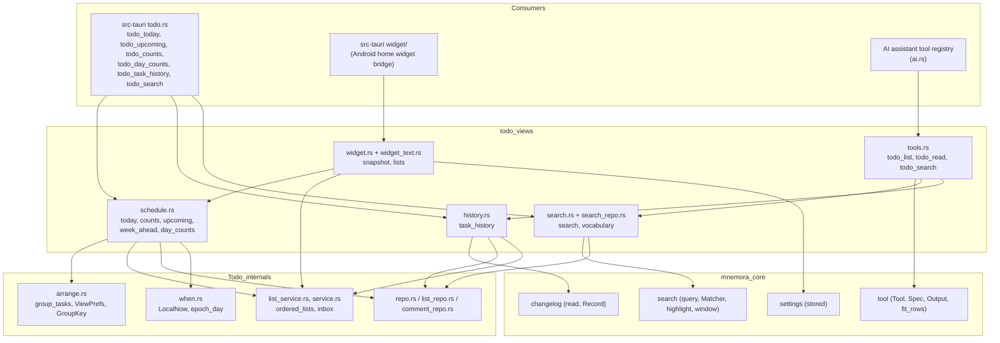
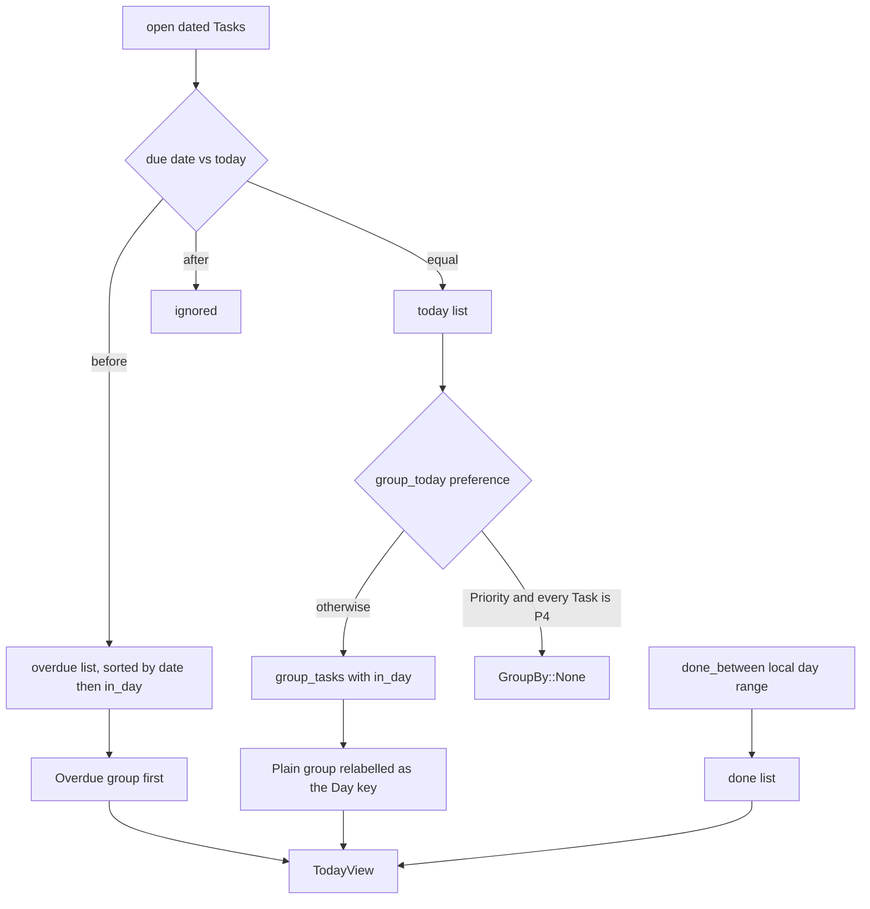
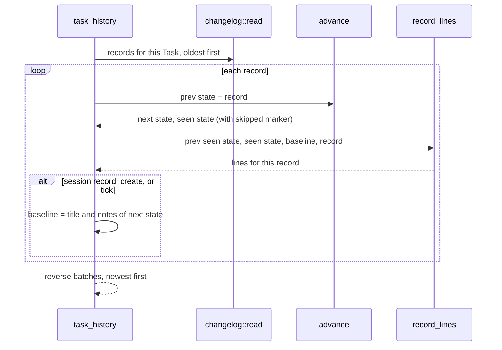
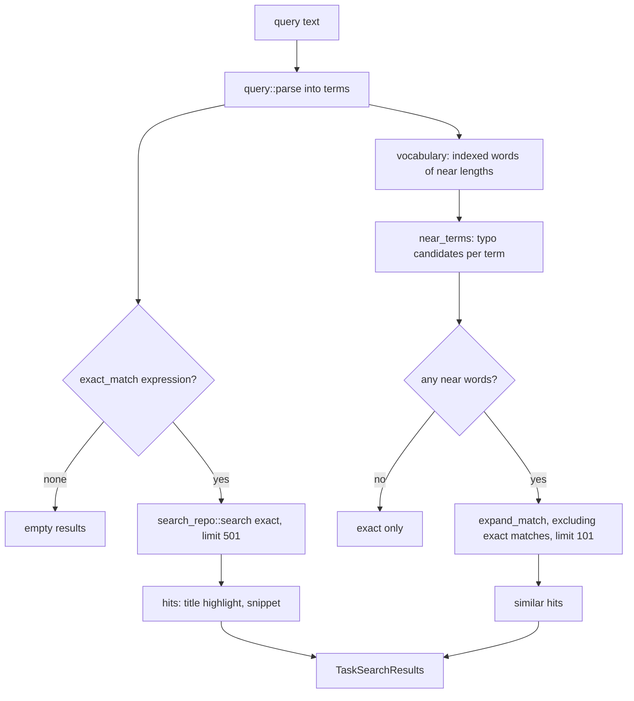
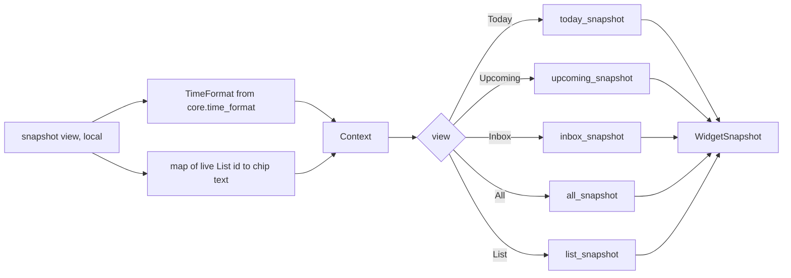

# todo_views

## Introduction

`todo_views` is the read side of the Todo domain in `crates/todo`. It turns stored Tasks, Lists, Comments and the change log into the shapes the rest of the system displays:

- **Date views** (`schedule.rs`): Today, Upcoming, the badge and Home-card counts, and the per-day dots of the When picker.
- **Task History** (`history.rs`): readable lines such as "Due date Thu 22 Oct → Fri 23 Oct", built from the change log.
- **Search** (`search.rs`, `search_repo.rs`): word-prefix, typo-tolerant search over titles, notes and Comments.
- **Widget snapshots** (`widget.rs`, `widget_text.rs`): display-ready rows and wording for the Android home widget.
- **AI read tools** (`tools.rs`): four read-only tools the AI assistant can call to list, read and search Tasks.

Nothing in this module writes Tasks. The write paths that live in the same files (`set_when`, `restore_when`, `move_overdue` in `schedule.rs`) are covered by the Todo write side, see [todo](todo.md). The module depends on shared rules from the core crate ([Data Foundation › core](../Data_Foundation/core.md)) and the Todo storage layer, and it is consumed by the Tauri command layer, the Android widget and the AI assistant.

---

## Where it sits

Related pages: [Todo module](todo.md) (the parent Todo domain), [Todo sheet](todo_sheet.md) (the Task sheet that edits what these views show), [Data Foundation](../Data_Foundation.md), [Android home widget](../Android_Integration/widget.md), [AI assistant](../AI_Assistant_Engine/ai_assistant.md), [Feature client UI › Todo tasks](../Feature_Client_UI/todo-tasks.md) and [Todo search UI](../Feature_Client_UI/todo-search.md).

---

## Shared conventions

- **Dates are `YYYY-MM-DD` strings.** Lexical comparison works because the format is fixed, so the code compares dates with `<`, `>` and `cmp` directly.
- **Today is passed in, never read.** Every view takes a `LocalNow` from `when.rs`, which the UI supplies. `local.check()` is called first. Nothing here reads the clock for dates. The one exception is `history.rs`, which takes timestamps from the change log.
- **Time is `HH:MM`.** Ordering by time is a plain string comparison.
- **Task text never reaches a log line.** This applies to search queries and to Task titles alike.
- **Deleted rows are invisible.** Every read filters `deleted_at IS NULL`, including the Comments that feed search.

---

## 1. Date views (`schedule.rs`)

### Ordering inside a day

`in_day` sorts Tasks inside one day or one group:

1. Timed Tasks before untimed ones, earlier times first.
2. More urgent Priority first (1 is most urgent, 4 is none).
3. Manual `sort_key`.
4. `id`, as the final tie-break.

`by_date_then_day` sorts by due date first and then applies `in_day`. Upcoming and the widget's week-ahead use it.

### The views

| Function | Returns | Used by |
|---|---|---|
| `today(conn, local)` | `TodayView`: overdue group, today's groups, Tasks done today, `total` | `todo_today` command, Todo Today page |
| `counts(conn, local)` | `TodoCounts`: `due_today`, `overdue`, up to 5 `card` Tasks, `next`, `any_tasks` | Todo badge, Home card |
| `upcoming(conn, local)` | `UpcomingView`: overdue group, then future groups | `todo_upcoming` command |
| `week_ahead(conn, local, days)` | overdue list plus one group per day | Android widget Upcoming |
| `day_counts(conn, from, to, exclude)` | `DayCount` per date with open Tasks | When picker dots |

### How Today is built

Key points:

- Overdue Tasks are only ever grouped by date. A Task due today stays in Today even after its time has passed.
- Priority grouping is switched off when every Task due today is Priority 4. Otherwise it would show a single "No priority" heading.
- Done Tasks come from `repo::done_between`, which uses the device's day range. Won't do is not counted as done, and it is not in `total` either.
- `total` is overdue + due today + done today. The UI shows it as "N of M done".

### The badge and Home card (`counts`)

`counts` reads the overdue and due-today numbers from `repo::due_counts`. The badge is `due_today + overdue`, and turns red while overdue is above zero. The card holds at most `CARD_TASKS` (5) of today's Tasks in `in_day` order. `next` is the earliest open Task after today, used for "Nothing due today · next: …". `any_tasks` is false only on a first run, which lets the UI show onboarding.

### Upcoming

`upcoming` puts the overdue group first. The rest are grouped with the user's `group_upcoming` preference, which defaults to by-day. Inside each group they sort by `by_date_then_day`.

`week_ahead` is the fixed version the widget uses. It always groups by day, covers the next `days` days (7 for the widget), and ignores the Upcoming preference.

### Day dots (`day_counts`)

`day_counts` validates both dates, refuses a range that ends before it starts, and returns only dates that have open Tasks. The `exclude` argument leaves out one Task, so the When picker does not count the Task it is dating.

---

## 2. Task History (`history.rs`)

History is a function of the change log alone. Every device holds the same records, so every device reads the same lines.

### Output

`task_history(conn, id)` returns `HistoryLine { at, kind, text }`, newest first. `kind` is one of `create`, `done`, `skip`, `reopen`, `wont`, `delete`, `restore`, `list`, `date`, `time`, `repeat`, `priority`, `title` or `notes`. The UI uses `kind` to choose an icon. The text is never the Task's own title or notes.

A missing Task returns `TaskNotFound`.

### How the lines are built

Three ideas make this work:

1. **Running state, not snapshots.** `advance` applies each record's own `fields` (the author's values) onto a running state. A record without `fields` (from before Sync) falls back to its snapshot. A received record's snapshot is this device's merged state, which can differ between devices after concurrent edits, so it is not used when `fields` exist.
2. **Local records are completed the way they were sent.** For a record this device wrote, `wire_fields` from `syncable.rs` fills the whole When, because a change to the Due date carries the full When. The author then reads the same History as the devices that received it.
3. **Text edits are compared with a baseline.** One opening of the Task sheet is one editing session and one record. Its title and notes are compared with the baseline from before the session, not with the neighbouring record. So one opening gives one "Title edited" and one "Notes edited" line, however much happened in between. The baseline is reset by a session record, by `create`, and by `tick` (a checklist reset).

### What each record can say

- **First record**: `create` gives "Created". An occurrence copy (it has `repeat_of`) gives "Done (occurrence of 18 Oct)".
- **Deleted or restored**: from `deleted_at` going null or not.
- **Repeating Task ticked** (`step`: the state did not change and the due date moved): a later date is "Done (occurrence of …)". An earlier date is "Reopened (occurrence of …)". When the record is marked `skipped`, it is "Skipped (Thu → Sat)". Within a week only weekdays are used. Beyond a week, the full day is used.
- **Plain state change**: "Done", "Won’t do" or "Reopened".
- **Schedule**: "Moved <list> → <list>", "Due date … → …" (not on a step, since the step explains the new date itself), "Time set to", "Time removed", "Time … → …", and Repeat lines through `repeat_label`.
- **Priority**: "Priority P2 → P1".
- **Text**: "Title edited", "Notes edited", only for session records.

Lists are named as "📥 Inbox" when there is no List, as the List's emoji (or `≡`) plus its name, or as "a deleted List" when the List is gone.

Dates are rendered by `day_text` as `Thu 22 Oct`. The weekday comes from `epoch_day`. Malformed dates are returned as given.

---

## 3. Search (`search.rs`, `search_repo.rs`)

### Rules

Search follows the Journal's matching in `mnemora_core::search`:

- Every word is required, and matches by **prefix**.
- Case and accents are ignored.
- Quoted text is an **exact phrase**.
- A **"similar" fallback** allows typos. The allowed distance depends on word length (`tolerance`).
- Searched text: title, notes and live Comments.
- Deleted Tasks and Comments are never found. Search never logs or records anything.

Known v1 limit (stated in the source): all words must match in the Task's title and notes together, or all in one Comment. Words split between the Task and its Comments find nothing.

### Flow

- **Exact** hits are capped at `MAX_EXACT` (500). Going over sets `truncated`.
- **Similar** hits are capped at `MAX_SIMILAR` (100). Going over sets `similar_truncated`. A similar hit is never also in `exact`.
- **Vocabulary** is read only for words within `MAX_TOLERANCE` (2) letters of a query word, so far-off lengths are never fetched.
- **Ordering** comes from SQL: open Tasks first in manual `sort_key` order, then closed Tasks, latest closed first.

### Snippets

`hit()` builds the display for each result:

- The title is split into plain and matched runs (`highlight`).
- The snippet is the first note line that matches, found with `plain_text`. If no note line matches, the first matching live Comment is used.
- `window` cuts the snippet around the match, so long notes give a short window.
- `snippet_source` says where the snippet came from (`notes` or `comment`). A title-only match has no snippet and no source.

### The SQL (`search_repo.rs`)

`search` matches a Task when the FTS5 expression hits its title or notes table, or when one of its live Comments hits the Comments table. An optional `excluding` expression removes the exact set from the similar set. The order is `(state <> 'open')`, then `sort_key` for open Tasks, then `closed_at DESC`, then `id`.

`vocabulary` reads the two FTS5 vocabulary tables (Tasks and Comments), filters by term length, and sums the document counts of words that appear in both.

---

## 4. Widget snapshots (`widget.rs`, `widget_text.rs`)

The Android widget does no date or wording logic. This module produces a finished snapshot, and the Kotlin side only draws it. The grouping, order and hiding of done Tasks come from the app's own `today`, `inbox` and group functions. This module only picks them and words them.

### Views

`WidgetView` has five cases. Each is parsed from a stored name:

| Name | View | Notes |
|---|---|---|
| `today` | Overdue, then today | Flattens app groups into one "Today" run |
| `upcoming` | Overdue, then each of the next 7 days | Always by day |
| `inbox` | Inbox groups | "No date, in a List" group shows its List chip |
| `all` | Every open Task by List, Inbox first | |
| `list:<id>` | One List | Uses that List's own group and sort settings. Missing List is `ListNotFound` |

### Building a snapshot

Each snapshot has:

- a **title** and an optional **count** (`N overdue` in red, `N left`, or the row total for other views),
- **groups** of `WidgetRow`s, each with a heading and a tone (Overdue is red),
- an **empty state** (for example "Nothing due today" with a "Next: …" line, "Inbox zero", or "No open Tasks").

A `WidgetRow` carries the ring (`p1` to `p3` or `none`), an `overdue` flag, the grey time on the right, a red `day` for overdue rows (such as `Yesterday` or `Mon`), and a List chip where the view needs one.

The right-hand text follows these rules. An overdue row shows only its red day, never a time. Otherwise a row shows the day in front of the time (`Tomorrow 11:00`) when the Task is not due today and the heading does not already say so.

`counted` drops groups with no rows, sets the header count to the number of rows shown, and only sets the empty state when no groups remain.

### Settings that redraw the widget

`settings_affect_widget(module, keys)` decides whether saving a Setting should trigger a widget redraw:

- Core: `theme`, `time_format`, `week_start`.
- Todo: the keys in `arrange::PREF_KEYS` (how views group and sort).

Anything else does not redraw. The `app_theme` field is left empty here, because the theme is a device setting that the app bridge fills in.

### Wording (`widget_text.rs`)

`widget_text.rs` ports the app's TypeScript wording rules to Rust. The fixture `src/lib/ipc/fixtures/widget-text.json` is shared by the Rust tests and the Vitest tests, so both sides agree. It covers:

- **Titles**: `plain_title` strips Markdown marks (bold, italic, code, links). `quoted_title` wraps the title in curly quotes and cuts it at 34 characters.
- **Toasts**: `completed_message`, `completed_repeat_message` (`… · next Wed 28 Oct`), `landed_in` (`Today`, `Upcoming · Thu 22 Oct`, or the List), `quick_added_message`.
- **Chips and labels**: `meaning_text`, `when_chip_label` (`Tomorrow · 09:00 · Every month`), `repeat_text`.
- **Dates**: `row_date_label` (Today, Tomorrow, Yesterday, a weekday within the week, then `28 Oct`, with the year only when it is not this year), `row_day_label`, `overdue_day_label`, `day_heading` (`Tomorrow · Thu 22`, `Mon 2 Nov`).
- **Times**: `format_hm` gives `21:30` or `9:30 PM`. Malformed input is returned unchanged.
- **Setting readers**: `TimeFormat` (`12h` or `24h`) and `WeekStart` (`mon` or `sun`). Anything unexpected falls back to the default.

`month_short` returns an empty string for an out-of-range month rather than panicking.

---

## 5. AI read tools (`tools.rs`)

The Todo module offers three tools to the AI assistant through `all()`. They follow the core `Tool` contract: each has a `Spec` with typed parameters and runs against a connection. They never write. Refusals come back as data (`Output::error`), not as failures. Closing days are compared in SQLite's local time, so they match the device's day.

| Tool | Name | Purpose | Key parameters |
|---|---|---|---|
| `List` | `todo_list` | List Tasks by state, List, due date, priority and closing day | `state` (open by default, `done`, `wont`, `any`), `list` (a name or `inbox`), `due_from`/`due_to`, `priority` (1 to 4), `closed_from`/`closed_to`, `offset`, `limit` (30 by default, max 100) |
| `Read` | `todo_read` | Read one Task in full | `id` (required), `steps`, `comments`, `history` flags, `offset` (bytes of notes) |
| `Search` | `todo_search` | Find Tasks with the app's Search | `query` (required, max 200 characters), `state` (`any` by default), `list`, `offset`, `limit` (10 by default, max 25) |

Details:

- **`todo_list` order** is open Tasks first, then undated last, then by due date, then latest closed, then manual order. It fetches `limit + 1` rows to know whether more exist. `next_offset` is set when there are more rows or when `fit_rows` cut rows to fit the size budget.
- **`todo_read` pages notes** in 8 KB chunks (`READ_PAGE_BYTES`), moving to the next character boundary. It can add `steps` (from `checklist_items`), `comments` (with `comments_truncated`), and `history` from `history::task_history` (with `history_truncated`).
- **`todo_search` filters after searching.** It calls the search in `search.rs`, then applies `state` and `list`, then pages. See the known limit below.
- **`list` names** are resolved with `name_key` against live Lists. An unknown name is refused with "No List has that name.".
- Every result carries an `Item` (module `todo`, title cut to 120 characters, due date), which the assistant uses for citations.

---

## Known behaviour and limits

These are observations from the code, worth knowing before changing it:

1. **`todo_search` filters after the caps.** `search` stops at 500 exact and 100 similar hits. The `state` and `list` filters then apply to that capped set, so a matching Task beyond the cap can never be returned, and `total` can undercount. A fix would push the filters into the SQL.
2. **Search reads Comments per hit.** When no note line matches, `hit` runs one `comment_repo::for_task` query for each result. With up to 600 results this is many small queries. Batching the Comment reads would be the fix.
3. **Two fallbacks for a missing List differ.** History names a List that no longer exists as "a deleted List". The AI `list_label` falls back to "Inbox". Widget chips show no List at all. Pick one wording if these need to agree.
4. **History follows the records, not the database.** A Task's History can differ from its current state after a sync conflict, because the lines are built from authored fields in the log. This is intended, and it is what keeps lines identical on every device.

---

## Testing

Tests sit next to the code and in the Tauri test files named in the module tree:

- Unit tests in `history.rs` (day and skip wording, repeat labels), `widget_text.rs` (every fixture case shared with the TypeScript tests, plus malformed input).
- Tauri integration tests: `todo_search_tests.rs` (exact matches, snippets, deleted rows, index updates), `widget_tests.rs` (every widget view, empty states, the day rollover, settings that redraw), and `todo_sheet_tests.rs` (History lines for edits, occurrences, skips and deletes, across the change log).
- Sync tests (`sync_cluster_tests.rs`, `sync_merge_fixture_tests.rs`) confirm that History and views read the same on every device.

See [Android home widget tests](../Android_Integration/widget_tests.md) for the widget cases and [Todo sheet](todo_sheet.md) for the History cases.
